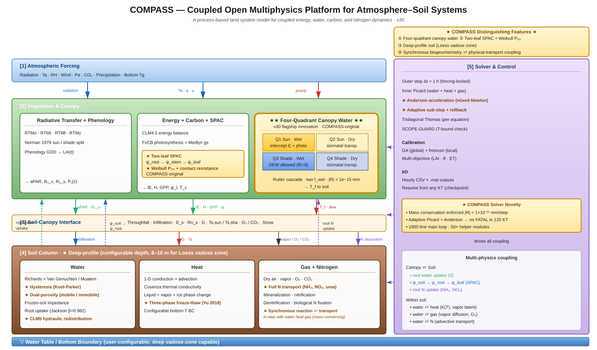

<p align="center">
  
</p>

<h1 align="center">COMPASS</h1>

<p align="center">
  <b>Coupled Open Multiphysics Platform for Atmosphere–Soil Systems</b><br/>
  <i>The COMPASS Land System Model</i><br/>
  MATLAB Final Branch · MATLAB 最终版
</p>

<p align="center">
  
  
  
  
</p>

---

## About / 项目简介

**COMPASS** (Coupled Open Multiphysics Platform for Atmosphere–Soil Systems) is a process-based land system model for coupled energy, water, carbon, and nitrogen dynamics. This repository contains the final MATLAB implementation of the COMPASS Land System Model.

**COMPASS**（大气–土壤系统开放式多物理过程耦合平台）是一个模拟能量、水分、碳和氮循环耦合过程的过程型陆地系统模型。本仓库是 COMPASS Land System Model 的最终 MATLAB 实现。

Here, **Open** describes an open, modular, and extensible scientific architecture. It does not by itself declare an open-source software license.

这里的 **Open** 表示开放式、模块化和可扩展的科学架构，本身不代表软件已经采用开源许可证。

The current release targets the Changwu apple orchard site on the Loess Plateau. `COMPASS_MATLAB` is the final MATLAB branch; future latest development will continue in Julia.

当前版本面向黄土高原长武苹果园站点。`COMPASS_MATLAB` 是 MATLAB 最终分支；后续最新开发版本将转向 Julia。

## Architecture / 模型结构

<p align="center">
  
</p>

The production pathway couples atmosphere, vegetation, surface fluxes, snow, and a one-dimensional soil column through accepted-state transactions and adaptive numerical stepping.

生产路径通过接受态事务和自适应数值时间步，将大气、植被、地表通量、积雪和一维土柱统一耦合。

## Repository layout / 目录结构

```text
COMPASSV2.0/
├── src/                         MATLAB production source / 生产源代码
│   ├── runCOMPASS.m             canonical run function / 主运行函数
│   ├── runOneStep.m             one accepted-step transaction / 单步推进
│   ├── beginRun.m, finalizeRun.m
│   ├── +init/, +io/              initialization and input loading / 初始化和输入读取
│   ├── +atmosphere/, +vegetation/
│   ├── +surface/, +soil/         surface and soil processes / 地表与土壤过程
│   ├── +coupling/, +interfaces/
│   └── +step/, +solver/          stepping and numerical solvers / 时间步与求解器
├── data/                        input data and site packages / 输入数据和站点包
├── tests/                       tests and validation / 测试与验证
├── tools/                       diagnostics and analysis / 诊断与分析工具
├── docs/                        physics and interface documents / 物理与接口文档
├── run.sh                       Linux launcher / Linux 启动器
└── scripts/                     launch and monitoring scripts / 启动与监视脚本
```

## Inputs / 输入数据

Each site is configured under `data/sites/<site>/`:

每个站点配置位于 `data/sites/<site>/`：

```text
data/sites/<site>/
├── site.toml                    site, time, boundary, and output settings
├── forcing.csv                  atmospheric forcing / 大气强迫
├── soil.csv                     soil parameters / 土壤参数
├── soil_initial_profile.csv     initial soil profile / 土壤初始剖面
├── plant_initial_pools.csv      initial plant C/N pools / 植物初始碳氮库
├── water_boundary.csv            water or groundwater boundary / 水边界
└── ...                          site observations and parameters
```

The default site is `changwu`, with configuration at `data/sites/changwu/site.toml`. Shared model libraries and observations are under `data/input/`, `data/atmosphere/`, `data/model_library_nc/`, `data/forcing/`, and `data/observations/`.

默认站点为 `changwu`，配置文件为 `data/sites/changwu/site.toml`。通用模型库和观测数据位于 `data/input/`、`data/atmosphere/`、`data/model_library_nc/`、`data/forcing/` 和 `data/observations/`。

Generated runtime outputs are local products and are not included in this branch. All VOD-related files and figures are also intentionally excluded.

运行生成的输出属于本地结果，不纳入本分支；所有 VOD 相关文件和图件也明确排除。

## Running COMPASS / 运行 COMPASS

### Launchers / 启动器

**Linux** — from the project root / 在项目根目录：

```bash
./run.sh                 # default Changwu site / 默认长武站点
./run.sh <site-name>     # another configured site / 其他站点
```

**Windows** — double-click `run.bat` in Explorer, or from `cmd` / PowerShell:

```bat
run.bat
run.bat changwu
```

Both launchers read `[output].output_dir` from `data/sites/<site>/site.toml` (directory must already exist), write logs under that directory’s `logs/` as `compass_<site>_<timestamp>.log`, and open the **progress GUI** (`scripts/compass_monitor_gui.py`) when Python+Tk is available. Set `COMPASS_LOG_WINDOW=0` to disable. Set `MATLAB_BIN` if MATLAB is not on `PATH` / default install paths.

两端启动器均读取 `site.toml` 的 `[output].output_dir`（目录须事先存在），日志写在 `logs/compass_<站点>_<时间戳>.log`；默认弹出进度 GUI。`COMPASS_LOG_WINDOW=0` 关闭；找不到 MATLAB 时设置 `MATLAB_BIN`。

**Progress GUI only / 只开进度窗（不启动模型）：**

```bat
monitor.bat
monitor.bat changwu
```

```bash
./monitor.sh
./monitor.sh changwu
```

Requires Python 3 with `tkinter` (Windows installer: enable Tcl/Tk). Optional: `pip install pillow` for the logo. GUI auto-picks the newest `compass_<site>_*.log` under the site’s `output_dir/logs/` if no log path is given.

### Canonical MATLAB function / 主 MATLAB 函数

The canonical production entry point is `src/runCOMPASS.m` / 生产主入口是 `src/runCOMPASS.m`：

```matlab
addpath('src');
model = runCOMPASS('data/sites/changwu');
```

With no site argument, `runCOMPASS()` uses `data/sites/changwu` by default.

省略站点参数时，`runCOMPASS()` 默认使用 `data/sites/changwu`：

```matlab
addpath('src');
model = runCOMPASS();
```

To initialize without advancing the full time series / 只初始化、不推进完整时间序列：

```matlab
addpath('src');
model = runCOMPASS('data/sites/changwu', ...
    struct('stop_after_initialization', true));
```

The internal sequence is `initialize → prepareRuntime → beginRun → runOneStep loop → finalizeRun`.

内部流程为：初始化 → 运行时准备 → `beginRun` → 循环调用 `runOneStep` → `finalizeRun`。

### MATLAB batch mode / MATLAB 批处理

```bash
matlab -batch "addpath('src'); runCOMPASS('data/sites/changwu');"
```

## Results and validation / 结果与验证

The result directory is controlled by `[output].output_dir`. Only accepted time steps are written as physical results; rejected trials are rolled back.

结果目录由 `[output].output_dir` 控制。只有接受的时间步才会写入有效物理结果；被拒绝的试算会回滚。

Tests and validation scripts are in `tests/`. The soil water–heat–gas–freeze physics contract is documented in `docs/soil/compass_soil_water_heat_physics.md`.

测试和验证脚本位于 `tests/`；土壤水–热–气–冻融物理合同见 `docs/soil/compass_soil_water_heat_physics.md`。

## Version / 版本

| Branch or tag / 分支或 Tag | Meaning / 定位 |
|---|---|
| `COMPASS_MATLAB` | MATLAB final branch and current default / MATLAB 最终分支与当前默认分支 |
| `v2.0-matlab-final` | MATLAB final release tag / MATLAB 最终版发布 tag |
| Future Julia versions / 后续 Julia 版本 | Latest development direction / 最新开发方向 |

## Citation / 引用

```bibtex
@misc{Zhu2026COMPASS,
  author = {Jizixing Zhu},
  title  = {COMPASS: Coupled Open Multiphysics Platform for Atmosphere-Soil Systems},
  year   = {2026},
  note   = {The COMPASS Land System Model, MATLAB final release, v2.0-matlab-final},
  url    = {https://github.com/3100362274/COMPASS}
}
```

## Copyright / 版权声明

Copyright © 2026 Jizixing Zhu, Northwest A&F University. All rights reserved.

本仓库中的 COMPASS 自有代码、文档和配置资料归 Jizixing Zhu 所有。第三方代码、数据、模型和文献材料仍受其各自版权、许可证或使用条款约束。This repository does not currently declare a single OSI-approved open-source license; unless separately authorized in writing, it should not be treated as freely redistributable software.

## Contact / 联系方式

Jizixing Zhu · zjzx3100362274@gmail.com · Northwest A&F University
