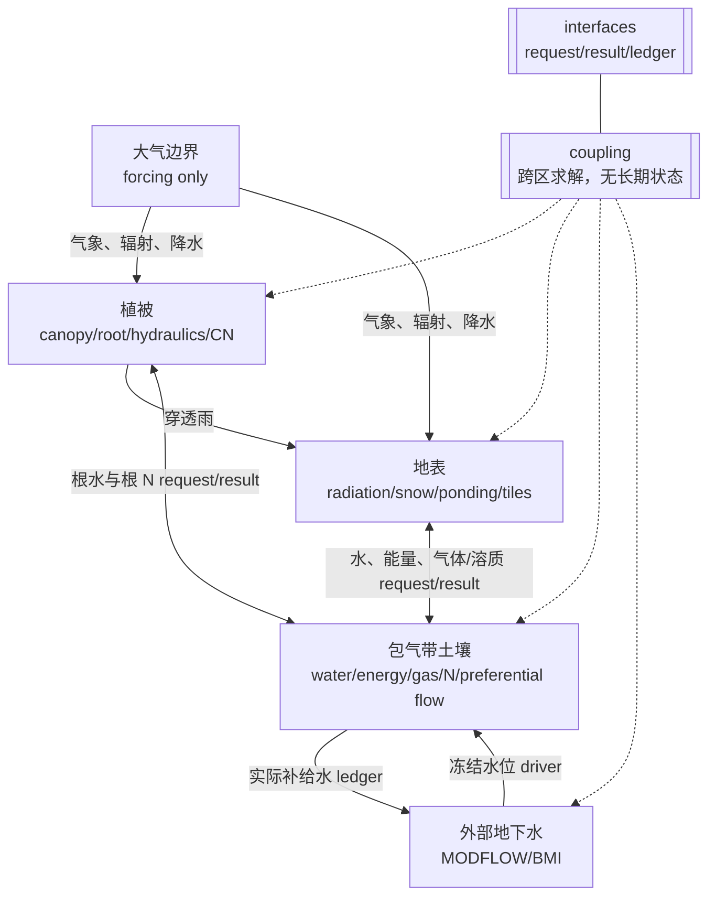

# COMPASS 完整架构、迁移台账与扩展路线

**正式命名：** COMPASS — Coupled Open Multiphysics Platform for Atmosphere–Soil Systems
**模型类别：** The COMPASS Land System Model

**首次定稿：** 2026-07-20  
**合并修订：** 2026-07-21  
**适用代码：** `COMPASSV2.0` 新主链 `runCOMPASS -> runOneStep`  
**状态：** MATLAB 五区目录与主链迁移已实现并通过短窗验收；全年验收与 Julia 物理迁移尚未完成  
**文档地位：** 本文件是 COMPASS MATLAB V2 架构、迁移状态、MATLAB→Julia 参考窗口及区域/全球扩展的唯一权威总纲。

本文件合并并取代了原五区设计、五区决策、架构学习笔记、深层迁移报告、主循环迁移台账、MATLAB 参考窗口和全球化路线图。历史草案中与当前生产代码冲突的 `+core/+plant/+Radiation/+snow` 顶层结构不再有效；本文件正文中的五区所有权和生产源码边界优先。

## 目录

1. 结论与边界
2. 五区及唯一状态所有权
3. 目标值语义与兼容适配
4. 跨区接口 schema
5. 外层步原子事务
6. 核心物理时间层和控制体
7. 分包迁移清单
8. 验收矩阵
9. 本轮实施基线
10. 当前实施与验证状态
11. 当前生产执行链与数据分类
12. 主循环迁移详细台账
13. MATLAB→Julia 数值参考窗口与迁移门
14. 区域/全球扩展路线
15. 参考模型经验与历史说明

## 1. 结论与边界

COMPASS 的迁移单位不是目录，而是可验证的物理所有权和时间步事务。只有同时满足下列条件，才可称为“五大物理区迁移完成”：

1. 每个预报状态只有一个物理区所有者；参数、强迫、辅助量和诊断不得成为第二套可写状态。
2. 每个过程从接受态 `n` 构造私有 trial/candidate；拒绝 trial 后接受态逐字段不变。
3. 跨区量通过固定 request/result/ledger 传递，单位、正方向、时间积分范围和实际施加量明确。
4. 水、能量、干空气和氮的状态更新与账本在相同控制体、相同时间层闭合。
5. checkpoint 只保存接受态；恢复后重建 auxiliary，连续运行和断点恢复在规定容差内等价。
6. 新主链完成短窗、事件、拒绝回滚、恢复和全年验收；仅有门面函数或测试文件存在不算完成。

本次迁移保留现有数值核和已经验证的雪—土、Richards、热、气、氮方程，不以重构名义改变方程。`model.built` 在本阶段仍可作为旧核适配容器，但只能由适配层装配；新的物理过程、事务和账本不得把它当成无边界的共享可写工作区。

### 1.1 当前明确支持的物理范围

- 默认无 MODFLOW：土壤水—热—干空气—氮耦合按现有开关运行。
- MODFLOW：当前只定义外部水位驱动的 **water-only external boundary**。地下水位以下不属于 Richards 活跃控制体。
- MODFLOW 与土壤热、气或氮同时开启：在物理边界条件、外部温度/浓度和守恒账本没有定义前必须 fail-fast；不得用零通量、底温或静水延拓冒充耦合。
- Changwu 默认土顶热边界为 `atmospheric`：冻结地表仿射热响应，与上部 20 cm 土壤热导纳匹配得到固定 Neumann `G*`。SCOPE skin temperature `Tss` 不是土顶 Dirichlet。

## 2. 五区及唯一状态所有权

| 物理区 | 权威预报状态 | 非状态输入 | 对外结果 |
|---|---|---|---|
| 大气 `atmosphere` | 当前无 | 气象、辐射、降水及化学组成 forcing | 对植被/地表的只读 forcing slice |
| 植被 `vegetation` | 冠层水、植物水力贮量、物候、生物量、植被 C/N、必要的叶温记忆 | 大气 forcing、土壤快照、参数 | 穿透雨、蒸腾/根水需求、根 N 需求、光合/呼吸结果 |
| 地表 `surface` | 雪质量和焓、覆盖度、积水/地表冰、force-restore 历史 | 大气 forcing、植被结果、土壤界面响应 | 对土壤的水、能量、气体/溶质边界 request |
| 包气带土壤 `soil` | `h/U/P_g`、液/冰水、土壤气、NH4/NO3/urea、有机 N、优先流/双孔隙状态 | 地表边界、根系 request、土壤参数 | 实际入渗、根吸收、排水、热/气/N 通量 result 与闭合账本 |
| 外部地下水 `groundwater` | 由 MODFLOW/BMI 外部拥有；COMPASS 不保存其储量为预报状态 | 每 outer step 冻结的水位 driver | 实际土壤到地下水水量 ledger；未来接口另行定义 |



箭头表示数据契约，不表示一个域可以直接改写另一个域的接受态。只有接口两侧必须同时闭合时，才由 coupling 求解并返回双方 result/candidate。

下列分类不可混用：

- `parameters`：初始化后不可变，如 `theta_s`、`theta_r`、双孔隙 `OmegaExch`。
- `forcing`：按接受时间索引的外部驱动，不随 trial 写回。
- `state`：下一步方程会读取、不能从当步接受态无损重建的量。
- `auxiliary`：可由接受态、参数和 forcing 重建，如导度、冻结点、线性化系数。
- `diagnostics`：只读接受态和已接受 ledger；不得参与下一步方程。

## 3. 目标值语义与兼容适配

新域入口遵循同一函数形状：

```matlab
[candidate, result, aux, diagnostics] = domain.stageOrAdvance( ...
    accepted_state, parameters, forcing, requests, dt_s);
```

约束如下：

1. `accepted_state` 只读；函数不得接收整个可变 `model` 作为最终接口。
2. `candidate` 只包含该域拥有的 `n+1` 预报量。
3. `result` 是实际施加量，不等同于 request；发生供给限制或 active-set 切换时必须记录差异。
4. `aux` 可丢弃和重算，不能提交为物理状态。
5. 旧 MATLAB 核若仍要求 `built/Y/workspace`，由包内 adapter 创建局部值副本，核返回后只提取 owner candidate。适配副本不得在 commit 前安装进接受态。

本阶段不做一次性的大对象改名。`model.built.Y` 可暂时承载已接受状态的物理存储，但其字段所有权由本文件和 transaction schema 唯一规定；所有新增逻辑必须从域门面进入。最终 Julia 迁移直接映射为 `VegetationState`、`SurfaceState`、`SoilState` 和 `StepTransaction`，不翻译 MATLAB 共享工作区习惯。

## 4. 跨区接口 schema

所有水/能/N 量采用“进入接收域为正”。每个记录至少含：

```text
producer, receiver, quantity, unit, sign_convention,
rate_or_amount, interval_s, requested, applied, active_set
```

### 4.1 必需接口

| ledger | request | result/验收量 |
|---|---|---|
| `atmosphere_to_vegetation` | 辐射、温湿风、降水 | 冠层截留、交换通量 |
| `atmosphere_to_surface` | 到达地面的降水/辐射/湍流条件 | 雪/裸地实际水能通量 |
| `vegetation_to_surface` | 穿透雨、冠层滴落 | 地表实际接收水量 |
| `vegetation_to_soil` | 根水和 NH4/NO3 需求 | 土壤实际移除量及供给限制 |
| `surface_to_soil` | 入渗供给、蒸发、土顶热/气/N 边界 | active-set 后实际边界通量 |
| `soil_to_groundwater` | 无内部状态 request；读取冻结水位 | 活跃 Richards 控制体底部实际水交换 |

`workspace_flux`、`scope_flux` 等通用桶不得作为长期 schema。输出需要的量必须来自上述 typed ledger 或显式 diagnostics。兼容输出可以在 commit 后由 typed ledger 投影到旧 workspace，但旧 workspace 不是所有者。

## 5. 外层步原子事务

一个 outer step 固定经历：

```text
accepted state n
  -> freeze forcing / management / groundwater driver
  -> stage vegetation and surface candidates + requests
  -> adaptive soil trials from the same accepted snapshot
  -> accepted soil h/U/Pg endpoint
  -> soil N and preferential-flow candidates at the accepted endpoint
  -> validate candidates + ledgers + closures
  -> one atomic commit
  -> accepted diagnostics / checkpoint / output
```

事务固定结构：

```text
transaction.candidate.vegetation
transaction.candidate.surface
transaction.candidate.soil
transaction.candidate.groundwater   # 当前声明无 COMPASS 预报状态
transaction.ledger.<producer>_to_<receiver>
transaction.diagnostics
transaction.management
```

禁止：

- trial 中直接写 `Y` 的任意域状态；
- 用 diagnostics 或 workspace 将 candidate 带入下一步；
- 某一域先提交、另一域随后失败；
- rejected trial 累加施肥、径流、根吸收或累计守恒账本；
- resume 保存未接受的 trial 或 derived cache。

## 6. 核心物理时间层和控制体

### 6.1 水—热—气耦合土壤

- `h_n/U_n/Pg_n` 是离散式旧时间层；Picard/Newton trial 只能写 trial 数组。
- 液水/冰相、热性质、气体孔隙度必须对应同一 trial endpoint。
- 接受后一次性 carry；拒绝时恢复 outer-step snapshot。
- MODFLOW 启用时，贮量、根 sink、边界通量和残差统一只积分 Richards 活跃节点；静水延拓段只用于构造完整输出，不进入同一控制体的守恒左端。

### 6.2 土壤氮

- `NH4_n/NO3_n/urea_n/granule_n` 来自接受态，不得把 candidate 当旧时间层。
- 施肥是本步外部输入：旧贮量测量后加入 trial，再进入反应/输运；事件量与残差在同一步 ledger 体现。
- 土壤 N 只在水热气 endpoint 接受后推进，并与 soil candidate 原子提交。
- `NH4_total/NO3_total` 是物理状态/派生驱动时必须在求解前具有正确单位和节点映射；输出 ug/g 只是 diagnostics 投影。

### 6.3 双孔隙/优先流

- `Theta_im` 是 soil-owned prognostic state。
- `Theta_im_old`、`Theta_m_old` 若仅用于离散审计，可作为 candidate 内显式时间层；不得由 trial 先写接受态。
- `SinkIm_current` 是该 substep 的冻结内部交换 rate，属于 trial aux/result，不是跨步权威状态。
- `theta_s_im`、`theta_r_im`、`OmegaExch` 是参数，不能藏在预报状态或硬编码。
- 每个 trial 从相同接受态或已接受 substep state 生成双孔隙 candidate；Richards 只读取冻结 sink。substep 接受时两域同时 carry，拒绝时两域都不变。

### 6.4 地表—雪—土热接口

- 雪质量/焓只推进一次；重算从同一接受态 replay。
- `G_total = G_bare + G_snow`，tile 面积权重只能出现一次。
- `atmospheric` 土顶使用匹配得到的固定 `G*`；不得重新将 `Tss` 写成 Dirichlet。
- 融尽、相变、雪盖切换是 bounded restage 事件；第二次仍不一致则拒绝 outer step。

## 7. 分包迁移清单

### 7.1 大气

- forcing slicing 集中在 `+atmosphere` 门面并返回只读值。
- 删除过程核对全局 KT/文件句柄的隐式读取。
- 当前无 `candidate.atmosphere`；不得创建空壳预报状态伪装完成。

### 7.2 植被

- 冠层水、植物水力、物候和 Plant C/N 全部进入 `candidate.vegetation`。
- 根吸收只生成需求；土壤实际扣除量由 soil result 决定。
- 生产代码统一位于 `+vegetation`；原 `+plant` 已合并，植物水力、能量、C/N、物候和 LUNA 不再存在第二套顶层命名空间。
- 辐射位于 `+surface/+radiation`；植被通过显式调用消费辐射结果，辐射核不能直接提交植被或地表状态。

### 7.3 地表

- 雪、积水、force-restore 历史进入 `candidate.surface`。
- SCOPE/ebal 输出按 state、request、aux、diagnostics 分类；地表不得直接改土壤状态。
- 雪—土对账和事件 restage 在 commit 前完成。

### 7.4 土壤

- `candidate.soil` 同时包含耦合 endpoint、相态、soil N 和 enabled soil-mode candidates。
- 双孔隙写接受态路径必须删除；preferential-flow 内交换进入 soil transaction。
- 所有顶部/底部边界在 trial 开始时 materialize，方程核不得自行更换边界类型。

### 7.5 地下水

- 每 outer step 冻结一次外部 driver，adaptive retry 读取同一快照。
- 活跃 Richards 控制体及水账本一致。
- 当前 `candidate.groundwater.has_prognostic_state=false`。
- 热、气、氮接口未定义时显式拒绝组合开关；未来扩展必须另写守恒方程、外部状态来源和双向 ledger。

### 7.6 生产源码边界

- 生产 `src` 不设置 `+core` 包，也不允许新入口或域函数调用 `core.*`。
- 配置、状态、常数和时间信息分别由 `+init` 构造普通结构、由五域 accepted state 持有、由 `+equations` 提供不可变值、由 `+step` 管理时间推进；不再由通用 handle 类集中持有和跨域修改。
- 原 `+core` 类和 V1 入口只保存在 `legacy/src` 供来源追溯和数值 oracle 使用；`legacy` 不得加入生产 MATLAB path，`runCOMPASS` 的静态依赖闭包不得包含其中任何文件。
- 原 `+plant` 已并入 `+vegetation`，原 `+Radiation` 和 `+snow` 已并入 `+surface`；这些旧顶层包不得以转发门面形式残留在生产 `src`。

## 8. 验收矩阵

### 8.1 结构与所有权

- 静态搜索：域过程不调用 `step.commitTransaction`，不在 trial 路径赋值其他域 state。
- transaction schema 测试：vegetation/surface/soil 三个预报 candidate，加一个显式的外部 groundwater boundary record，并保证所有启用接口完整；disabled request 必须为物理零。
- rejected outer step：vegetation/surface/soil/management/cumulative ledgers 与开始快照 `isequaln`。
- enabled/disabled 双孔隙分别验证 no-op、单列 oracle、多列独立和回滚。

### 8.2 物理闭合

- 水：每 accepted substep 与 outer step 使用同一控制体，残差 `<= 1e-6 mm`（聚焦边界测试）；全年阈值另按累计量比例报告。
- 氮：单次和同刻多肥事件的 NH4/NO3 输入精确记账，事件步与下一步残差接近机器精度；根吸收开关独立。
- 能量：雪—裸地 tile 汇总、雪焓、土顶 `G*` 和底部能量输出符号一致；冻融/融尽窗口无重复积分。
- MODFLOW water-only：固定水位节点、静水延拓、active-domain storage 和实际补给 ledger 一致。
- MODFLOW heat/gas/N：当前必须以规定 error identifier fail-fast，不进入求解器。

### 8.3 数值与运行链

- `test_runOneStep`、`test_runCOMPASS`、checkpoint、resume、root ownership、五区契约全部通过。
- 晴天、强降雨、冻融/积雪、施肥、双孔隙、浅水位 water-only 各至少一个确定短窗。
- 连续运行与中断恢复逐步接受决定一致，状态和 ledger 在规定容差内等价。
- 最终执行全年 Changwu；报告 accepted steps、NaN/Inf、最小/最大物理状态、水/能/N 累积残差和 checkpoint 完成标记。
- 监测内存随步数的增长；固定长度状态/aux 不得线性增长，只有明确的逐时 diagnostics/history 可按配置增长。

### 8.4 完成声明格式

最终报告必须分开写：

1. 已确认通过的代码与测试；
2. 与旧结果的数值差异及物理原因；
3. 尚未定义而被 fail-fast 的外部物理接口；
4. 未运行或未完成的长窗验证。

只要全年验收未完成，或任一 enabled 过程仍直接修改接受态，就不得写“完全迁移完成”。外部 MODFLOW 热/气/N 被明确限制并不等于内部迁移未完成；但必须准确称为“不支持的耦合模式”，不能称为已迁移物理。

## 9. 本轮实施基线

本轮已修复并通过聚焦回归确认：`test_accepted_nitrogen_transaction` 3/3、`test_modflow_boundary_transaction` 2/2。

- 施肥 N 从正确旧时间层进入同一步外部输入 ledger；事件步和后继步闭合。
- MODFLOW water-only 的接受判据、贮量、根 sink 和账本使用同一 active Richards 控制体。
- MODFLOW 与热/气/N 的未定义混合模式在 materialize 阶段 fail-fast。
- soil-N 接受态 diagnostics 已 materialize，内容级测试确认主要字段有限且与接受态一致。
- `lNtotal` 启用时，求解前以明确节点映射更新 `NH4_total/NO3_total` 物理工作量供 pH 路径使用；接受后再按 bulk-density 单位转换写入输出，二者不混作同一语义。

后续代码改动必须以本文件为验收依据，并同步更新原深层审查报告中的过期结论。

## 10. 截至 2026-07-20 的实施与验证状态

已完成并执行：

- N 时间层/施肥 ledger、MODFLOW active Richards 控制体、未定义混合物理 fail-fast 和 soil-N diagnostics 已完成；N 3/3、MODFLOW 2/2。
- 双孔隙 exchange 只写 soil candidate/trial aux，拒绝不改接受态，参数归位；oracle、逐元素交换闭合、回滚与接线测试通过。迟滞与完整优先流物理按范围暂缓。
- pending transaction 已移除 `workspace_flux/scope_flux`，旧输出只由 typed request/ledger 投影。
- 真实物理成功报告为 `physics_status="completed"`、`status="accepted"`。
- 地表积水已从 soil scheduler 的直接 `Y.surface_water` 写入迁到 `candidate.surface.surface_water`；soil candidate 使用白名单，不能携带 surface/vegetation state。
- 五区结构 5/5、`test_runOneStep` 109/109、`test_runCOMPASS` 29/29、resume 19/19、checkpoint compatibility 17/17、雪—地表—土壤事务 3/3、地表 active-set、回滚和水诊断均通过。

clean V2 全功能短窗：Changwu 连续 48 个真实小时全部接受，循环耗时 40.550 s，速度 1.1837 step/s（约 177.557 个模拟日/墙钟小时）。累计水残差 `-4.06151148e-06 mm`（0.000406151148%），最大地表能量残差 17298 J/m²，最大土壤能量残差 5.09232 J/m²；NH4、NO3、植被 C、植被 N 末值残差分别为 `-1.00364e-13`、`-1.15406e-10`、`3.786970737e-13`、`3.08195309551e-15`。LUNA Vcmax 和 Cab 均有 25 个有限输出时刻，plant-N 文件已物化 82 个变量。

静态依赖闭包：从 `src/runCOMPASS.m` 解析出 478 个依赖文件，生产树外依赖 0，`legacy` 依赖 0；结构测试同时确认生产 `src` 不含 `+core`、`+plant`、`+Radiation`、`+snow` 顶层包。

仍不得发布“最终完成声明”：

- 若干包内 adapter 仍接收完整 legacy `model/built`；虽然静态审计确认 trial 路径不再跨域写接受态，但显式最小输入的 Julia-ready 接口还可继续收窄。
- 全年 Changwu 运行、全年水/能/N 累积闭合和最终差异归因尚未执行。
- `test_buildState` 的新结构检查已通过到遗留 oracle；该测试随后因仓库缺少 `data/sites/changwu/soilproperty.xlsx` 中止，属于失效外部夹具，不能记为代码通过。

## 11. 当前生产执行链与数据分类

### 11.1 生产入口

旧 `COMPASS.m` 已迁到 `legacy/src/COMPASS.m`，只作为行为与数值来源追溯，不进入生产 MATLAB path。当前生产链是：

```text
runCOMPASS
  → init.initialize
  → init.prepareRuntime
  → beginRun
  → runOneStep
      → 冻结 forcing / management / groundwater driver
      → canopy / SCOPE / snow / vegetation candidates
      → interfaces.createTransaction
      → soil h/U/Pg adaptive trials
      → accepted endpoint 后推进 soil N candidate
      → validate state + ledgers + conservation
      → step.commitTransaction
      → diagnostics.writeStep
  → finalizeRun
```

`runOneStep` 是单个 outer step 的唯一事务入口；`finalizeRun` 负责最终 flush、汇总和只读后处理。脚本层只负责选择站点、输出目录和启动运行，不承载科学公式。

### 11.2 五类数据

| 类别 | 定义 | 当前 MATLAB 位置 | Julia 映射 |
|---|---|---|---|
| `parameters` | 初始化后只读的物理、数值和结构参数 | `built.parameters`、`built.p` 中不可变部分 | 具体不可变 parameter structs |
| `state` | 下一步会读取且不能由当前接受态无损重建 | `built.Y.<domain>` | `SoilState`、`SurfaceState`、`VegetationState` 等 |
| `forcing` | 外部时间序列在当前步的冻结切片 | `forcing.hourly/derived` 的当步 view | immutable `ForcingAtTime` |
| `auxiliary/cache` | 可由 state + parameters + forcing 重建 | `workspace.derived`、预分配系数、`built.p.scope_static` | typed cache/workspace |
| `diagnostics` | 只读 accepted state/result/ledger 的输出 | registry、`built.diagnostics` | diagnostics registry/history |

跨步物理记忆必须在 `Y.<domain>`；静态派生缓存放 `built.p.*`；只写量放 diagnostics；`runtime.*` 只保留运行服务，以及 management/groundwater 必需的可恢复外部状态。不得建立第二套权威状态。

### 11.3 当前状态所有权收口结果

在进入真实 soil substep 迁移前，以下跨步量已完成归属收口：

| 原位置/问题 | 当前权威位置 | 语义 |
|---|---|---|
| `runtime.snow.SWE` | `Y.snow.SWE` | 雪预报状态，随 checkpoint/rollback |
| `runtime.thermal.Tss` | `Y.surface.Tss` | 地表历史状态；不等于土顶 Dirichlet |
| canopy-water 混合容器 | state → `Y.canopy_water`; config → parameters; history → diagnostics | 状态/参数/诊断三分离 |
| `runtime.scope_static` | `built.p.scope_static` | 可重建静态 SCOPE cache |
| `runtime.phenology/lai_state` | `Y.vegetation` | accept-only 物候与 LAI 记忆 |
| LUNA/leaf respiration 记忆 | `Y.plant_acclimation` | acclimation state 与序列化 climate buffer |

兼容旧 checkpoint 的字段补齐集中在 `beginRun.materializeCheckpointStateDefaults`；新代码不得在其他位置散落同类恢复逻辑。

### 11.4 初始化、恢复和失败语义

- 初始化顺序是 read → validate → build parameters/domain/forcing/sources → build accepted state → allocate workspace → refresh auxiliary。
- checkpoint 保存 accepted `Y`、运行时间、management once-only 状态及不能重建的运行记忆；不保存 trial 和可重建 cache。
- resume 使用 `init.rebuildSoilAuxiliaryFromAccepted` 从 accepted state 重建辅助量。
- 旧 checkpoint 缺 PlantCN 完整库时只能以当前配置初始库补种，并标为不具备严格连续 parity。
- outer step 失败后停止运行，写出上一 accepted state 的故障 checkpoint，并保持 `next_kt` 指向同一失败步；禁止携带旧状态却推进时钟或跳过 forcing/事件。

### 11.5 旧主循环职责映射

| 旧 `COMPASS.m` 职责 | 新位置 | 状态 |
|---|---|---|
| 网格、时间、状态初始化 | `init.initialize` / `init.prepareRuntime` | 已迁移 |
| 最大 KT 环境覆盖 | `io.getEnv` | 已迁移 |
| 最后一步时间裁剪 | `step.computeOuterDt` | 已迁移 |
| 时钟、NoTime、KT 提交 | `step.computeClock` / `step.commitRuntime` | 已迁移，accept-only |
| forcing、施肥等事件 | `runOneStep` 开始阶段 | 已迁移 |
| 冠层—地表—雪—植物—土壤顺序 | `runOneStep` + transaction | 已迁移 |
| 周期 checkpoint / partial output | `io.writePeriodicStepArtifacts` | 已迁移 |
| 最终 NetCDF / CSV | `finalizeRun` | 已迁移 |
| 年度水量总结 | `diagnostics.summarizeAcceptedRun` | 已迁移 |
| 三方案对照 | `finalizeRun` 可选只读 hook | 已迁移 |
| 失败后跳过小时继续 | 不迁移 | 有意改为停机 + accepted checkpoint |

## 12. 主循环迁移详细台账

本节保留旧 `while TIME < TEND` 向 `runOneStep`/`finalizeRun` 迁移的有效工程决策。历史中间实现仅在有助于解释当前契约时保留。

### 12.1 总表

| 块 | 旧主循环范围 | 内容 | 最终状态 |
|---|---|---|---|
| B1 | 约 351–388 | outer-step 开场、末步裁剪、snapshot、clock | 完成并测试 |
| B2 | 约 390–406 | checkpoint、partial output、calendar | 完成并测试 |
| B3a-1 | 408–431、2023–2042 | latent heat、surface BC、carry/commit split | 完成并测试 |
| B3a-2 | 437–453 | 管理事件、施肥池和 N 注入 | 完成并测试 |
| B3b/c | 456 起 | forcing、LAI、LUNA、SCOPE 输入与过程 staging | 完成主要迁移 |
| ③.6 | 954–966 | ebal driver 与 golden | 完成 |
| ③.4+/6b/6c | 969–1149 | LUNA→Cab、SIF、SCOPE guard | 完成 |
| ③.7 | 1054 | RWU→土壤根 sink | 完成 |
| ③.8 | 1195–1421 | Plant C/N、根吸氮、NEE | 完成并 golden |
| ③.9 | 1425–1550 | 冠层水、雪、土壤蒸发 | 完成 |
| ③.10 | 1152–1193 | 滞回反向点、积水历史 | 容器完成；随冻融/土壤真解验收 |

### 12.2 B1：outer-step 时钟与回滚

- 外层时间只在 step 接受后推进；inner substep `dt` 不得冒充 outer-step 时间。
- `computeStepClock` 是纯计算，`commitRuntimeStep` 只在 accept 分支执行。
- 时间标签保持 legacy 的步末语义；forcing index 与步末标签分开，防止物候、施肥和 SCOPE 日变化错一拍。
- `snapshotState`/`restoreState` 覆盖 accepted `Y`、step workspace 和 surface trial scratch；真实 solver 写入的附加 trial 容器必须随实现纳入。
- 测试求解器通过函数注入，不在生产热路径保留测试分支。
- step report 由单一模板构造，固定字段集在初始化时声明，避免动态字段漂移。

### 12.3 B2：step-end side effects

- checkpoint 与 partial output 只在 accepted step 结束后触发。
- 输出目录由运行初始化确认，不由深层 writer 静默创建。
- `COMPASS_OUTPUT` 优先、`STEMMUS_OUTPUT` 仅作兼容兜底，checkpoint 和 partial output 必须落在同一运行目录。
- step-end 调用 partial writer 时窗口使用已接受的当前 KT，避免比旧循环顶部调用少一拍。
- calendar view 保存在 runtime 当前值，不为每个 KT 重建重复时间数组。

### 12.4 B3a：状态 carry、施肥和失败语义

接受顺序固定为：

```text
previous ← old accepted Y
Y        ← validated trial/candidate
carry accepted derived time layers
commit management applied flags
commit runtime clock
write accepted diagnostics / artifacts
```

拒绝时只恢复 snapshot，不修改 previous、management、clock、history 或 cumulative ledgers。

施肥已从 PDE boundary 中移出，当前数据契约是：

```text
built.sources.fertilization_schedule   不可变事件计划
runtime.management.fertilizer.applied  可恢复、accept-only once flags
trial fertilizer pools                 当前步 candidate
soil-N ledger                          接受后唯一外部 N 输入记录
```

`pool_entry` 明确路由：

| `pool_entry` | 接收池 |
|---|---|
| `nh4_granule` | 固态铵颗粒池，后续溶解释放 |
| `nh4_liquid` | 已溶 NH4 |
| `no3_liquid` | 已溶 NO3 |
| `urea` | 尿素池，后续水解 |

同一时间命中的多个事件按 per-pool 独立累计；mixed/custom 事件若无法从配置唯一判断必须 fail-fast。事件命中只产生 candidate，失败步不得报告已施肥，也不得消费 applied flag。

### 12.5 SCOPE、植被与地表过程迁移

- 每步先构造 SCOPE 输入 view，再按配置应用 LAI、物候和冠层高度。
- 物候推进产生 candidate；冠层/Plant C/N 可读取明确规定的一步 lag accepted state。
- LUNA 和叶呼吸 acclimation 的跨步记忆属于 `Y.plant_acclimation`；固定参数和 SCOPE 静态光学缓存不进入 `Y`。
- ebal、SIF、动态木质部水力、root uptake 和 Plant C/N 均通过 staging 返回 candidate/result/diagnostics，不直接提交。
- 冠层水、SWE、地表温度历史和 soil evaporation 全部 accept-only；失败步不扣冠层水、不推进雪、不写 history。
- `Y.surface_water.{DSTOR,DSTOR0,RS}` 是地表预报状态；`hcrit/h_target/hN` 是边界 trial scratch。
- `Theta_II_prev` 代表上一 accepted 冰时间层，不应新增为不透明 runtime memory；随冻融解的 accepted carry 一起维护。

### 12.6 Julia-port 遗留清单

- `assembleNitrogenVariables`、`scatterNitrogenVariables`、`assembleSoilStateN`、`buildDemandMeteoView` 是 MATLAB legacy adapters；Julia 物理核直接使用 typed state/parameters 后应删除，不得在这些桥上叠新物理。
- 当前边界 glue 中的 `×1e-2`、`×0.1`、`×12/1e9` 等单位转换，Julia 迁移时集中到 units/boundary adapter，禁止散在 RHS。
- 地表逐步水通量要进入统一 accepted ledger 和累计诊断；只有下一步物理确实读取的积分量才提升为 prognostic state。
- 仍接收完整 `model/built` 的包内 adapter 需继续收窄，但不能以收窄接口为由改变数值语义。

## 13. MATLAB→Julia 数值参考窗口与迁移门

Julia 逐核比较 MATLAB 的逐步状态、接口通量、接受/拒绝轨迹和守恒账本，而不是只比较全年末值。参考窗口使用 `tools/architecture/capture_reference_window.m` 从 accepted checkpoint 冻结。

| 窗口 | Changwu forcing 依据 | checkpoint / 结束 KT | 目的 |
|---|---|---|---|
| 冻融/融雪 | 2021-03-23 日最低 −1.5 °C、最高 21 °C；KT1951 为已知融尽回放点 | `KT01848 → KT01960` | 雪—土热、相变、bounded restage |
| 暴雨 | 2021-07-15 日雨量 91.52 mm | `KT04536 → KT04728` | 顶部供水、入渗/积水、深层响应 |
| 干旱/植物水力 | 2021-07-17 至 08-15 共 7.54 mm、均温约 23.25 °C | `KT05208 → KT05328` | 根—土水和水力滞后 |
| 晴天辐射 | 2021-07-30 日照 12 h、无雨 | `KT05040 → KT05064` | RTMo、ebal 与日周期 |

默认全物理窗口保持 soil N 和 Plant C/N 开启。若单核调试临时关闭，artifact 必须记录覆盖，不能冒充全物理基准。

旧 checkpoint 缺少 `Y.plant_cn.C/N` 时，恢复器只能以当前初始池补齐，并记录：

```text
plant_cn_resume_compatibility = seeded_from_current_initial_pools_not_continuous_parity
```

这种 artifact 只用于结构/接口回归；连续 PlantCN 数值真值必须从含完整 PlantCN state 的新 checkpoint 生成。

### 13.1 Julia 迁移门

1. **Gate A：冻结 MATLAB 基准。** 导出四窗口的 state、flux、ledger、iteration、accept/reject 和 event 轨迹。
2. **Gate B：基础类型与纯函数。** 建立 config、domain、component API、state/aux、forcing 和 boundary schema；逐函数 parity。
3. **Gate C：单域过程。** 依次迁移 soil water、thermal/freezing、gas/O₂、nitrogen、vegetation hydraulics/CN、surface radiation/energy/snow、groundwater water-only。
4. **Gate D：耦合与事务。** 恢复 Modified Picard、Anderson、adaptive substep、typed coupling、conservation gate、atomic commit 和 checkpoint/resume。
5. **Gate E：扩展执行规模。** 只有单站点全年通过后，才做多站点、threads/processes、tile/patch、MPI/GPU。

Julia 第一期采用普通 `Vector{FT}` 单柱实现，不引入 ClimaCore，不把定制 water→dry-air→heat split 强行改成普通 ODE/IMEX。

## 14. 区域/全球扩展路线

### 14.1 当前边界

COMPASS 当前是单点单柱模型：只有时间循环，没有空间格点循环或横向路由。区域/全球模式首先应理解为大量独立列的 ensemble；地表/地下水横向流是后续独立组件，不能偷偷混进单柱核心。

### 14.2 执行规模路线

| 阶段 | 执行方式 | 约束 |
|---|---|---|
| 单点 | MATLAB/Julia serial | 完成全年 parity 与守恒 |
| 多站点 | 独立进程或 Julia threads/processes | 每个站点保持独立 transaction；一个失败不污染其他站点 |
| tile/patch | 显式面积权重、active sets、aggregation | extensive/intensive 量分别测试，权重守恒 |
| 区域/全球 | 根据 profile 选择 MPI/GPU | physics 与 decomposition/IO 解耦；并行结果对齐 serial |

MATLAB 单机阶段可采用外部任务并行；不在物理内核嵌入并行逻辑。Julia 迁移后由 execution backend 选择 serial/threaded/distributed/GPU。

### 14.3 全球输入数据类别

| 输入 | 候选数据 | 主要处理 |
|---|---|---|
| 气象 | GSWP3、CRU-JRA、ERA5 | 变量、时间和单位适配 |
| PFT | CLM surfdata、MODIS MCD12 | 主导 PFT 或显式 PFT fractions |
| 浅层土壤 | SoilGrids 2.0 | 砂粉黏、容重、SOC、pH → 参数 |
| 深层土壤 | 缺少全球实测 | 分层外推并记录不确定性 |
| 水初值 | ERA5/GLDAS + spin-up | 与模型土层映射 |
| N 沉降 | CESM/ACCMIP 等重建 | 按年/情景输入，不称为直接观测 |
| CO₂ | 冰芯 + 现代观测 | 全球年序列 |
| 施肥 | LUH2/区域统计 | 只作用于管理格点，保留事件语义 |
| C/N/SOM 初值 | SoilGrids SOC、实测或 spin-up | 当前最大科学缺口之一 |

土壤质地是水力、热力和 N 参数的共同母数据。参数生成必须保存源数据、pedotransfer 版本、单位和不确定性，不能只留下派生数组。

### 14.4 底部边界

| 环境 | 水边界 | 当前支持 |
|---|---|---|
| 深地下水 | free drainage | 支持 |
| 浅地下水 | 外部水位固定头 / water-only coupling | 支持已定义接口；需区域 driver |
| 浅基岩 | no-flow | 需按配置验证 |

基岩深度决定物理土柱底，地下水位决定水文边界，两者不能混用。MODFLOW 热、气、N 未定义时继续 fail-fast。

### 14.5 Spin-up 和人类活动阶段

spin-up 必须是 water–energy–temperature–C–N 全耦合平衡，不是单独调 C/N。典型时间尺度从能量的小时到 SOM 的百年至千年不等；PFT 默认固定，不做动态植被演替。

全球历史模拟可分为：

1. 工业前平衡：固定约 1850 CO₂/N deposition，化肥为零，循环去趋势气象；
2. 历史过渡：逐年 CO₂、N deposition、土地利用和施肥；
3. 研究期：使用目标时期的真实/重分析 forcing。

具体年限、数据集和 spin-up 加速方案必须在实验 protocol 中注册，不能把蓝图中的示例年份写死为模型内核。

### 14.6 当前全球化硬缺口

1. SOM 慢库尚未形成经验证的完整闭环，全球 N 长期平衡缺少锚点；
2. 千年级全耦合 spin-up 计算成本高；
3. 区域 decomposition、批量 forcing/parameter ingestion 和并行 IO 尚未实现；
4. 横向地表水/地下水路由不属于当前独立列核心。

推荐路线：单点全年 → 接通并验证 SOM → 单点 50–100 年 spin-up → 小区域 ensemble → 区域/全球集群运行。

人工果园不应机械采用千年自然植被 spin-up。长武可用实测土壤 C/N 初始化慢库，循环近期气象平衡快库，从真实建园年份和管理历史开始正式积分。

## 15. 参考模型经验与历史说明

### 15.1 已吸收的架构经验

| 模型/材料 | 有效经验 | COMPASS 采用方式 |
|---|---|---|
| CLM5/CTSM | gridcell→landunit→column→patch、active filters、weighted aggregation、balance checks | 当前保留单柱；未来空间层显式权重/active sets；守恒是 commit 门禁 |
| ClimaLand.jl | standalone/integrated 模型、prognostic/aux 分离、domain/driver 一致性检查、Simulation 生命周期 | Julia 采用具体类型组件和 integrated model；不强制替换 COMPASS stepper |
| CoLM202X | invariant/state/forcing/flux/accumulated-flux 分账，worker/IO 分工 | Julia IO 和 execution 分层；不采用全局数组和超长参数表 |
| DAISY | column 组合 water/heat/vegetation/boundary，每步时间限制和质量检查 | 明确上下边界、过程时间步和质量门禁 |
| Noah-MP | 顶层严格过程顺序与多列计算 | 保留明确 driver 顺序；并行只包裹独立列 |
| LAST/DIPMI | matrix/event/macropore 是同一土柱内运输路径 | preferential flow 属于 soil 内部机制 |
| DSSAT/CSM | RUNINIT/RATE/INTEGR/OUTPUT 生命周期 | 运行生命周期与科学过程分离 |
| SWAT/SurfMOD | HRU/流域路由和管理是空间问题 | 不把流域路由塞进单柱物理 |
| HYDRUS 材料 | 显式上下边界、Richards 与 root sink | 用作物理/验证参考，不作为软件模板 |

### 15.2 历史架构草案为何失效

早期学习笔记曾建议 Julia 顶层 `core/soil/canopy/plant/radiation`，并把 `run_compass_window.m → src/COMPASS.m → run_stemmus_initialize.m → StartInit.m` 描述为当前入口。这些内容只反映迁移前代码：

- 生产入口现为 `runCOMPASS → init.initialize/prepareRuntime → beginRun → runOneStep → finalizeRun`；
- 生产 `src` 已不含 `+core`、`+plant`、`+Radiation`、`+snow`；
- 植物统一归 `+vegetation`，雪和辐射统一归 `+surface`；
- Julia 不建立通用 `Core` 状态仓库，而以 component API、physical domains、integrated model、coupling、step transaction、conservation、simulation 和 execution 分层。

历史笔记中仍有效的是：先分类 parameter/state/forcing/auxiliary/diagnostic；先迁纯函数和单过程；最后迁 driver；不逐行翻译 MATLAB 工作区形态。

### 15.3 不可违背的总规则

- 数学与物理先于软件结构；重构不能偷换方程、边界、单位或接受规则。
- 每个预报状态只有一个物理所有者。
- trial/candidate 不得污染 accepted state；只有 `Step` 可以原子 commit。
- request 是需求，result 是实际施加量，ledger 只记唯一权威交换。
- diagnostics 只读 accepted state/result/ledger。
- 雪属于 surface，优先流属于 soil，深包气带仍属于 soil。
- 当前 groundwater 只支持外部 water-only 边界。
- 长武 production heat top 是 matched fixed `G*` Neumann，不是 skin-temperature Dirichlet。
- checkpoint 只保存 accepted state 和不可重建记忆；resume 必须重建 auxiliary。
- 未完成全年验收或存在 enabled 过程绕过事务时，不得宣称“完全迁移完成”。
