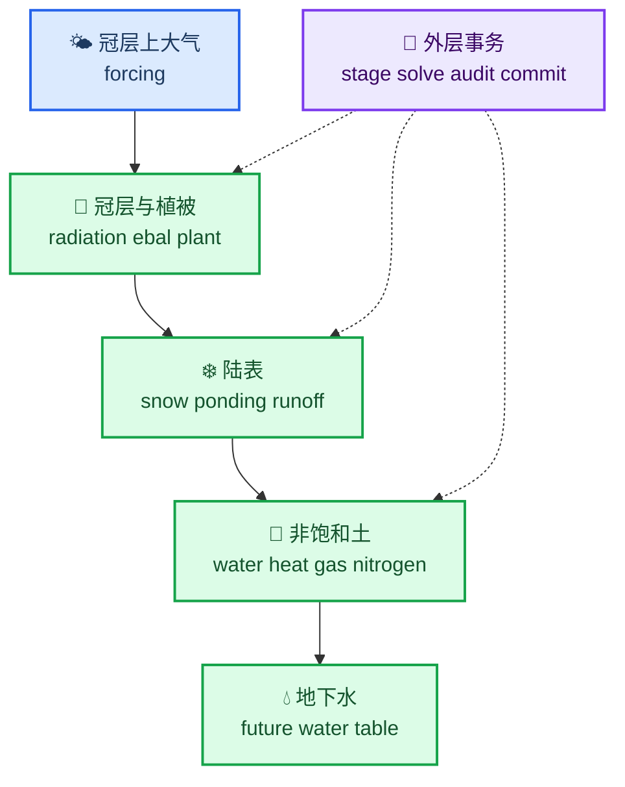
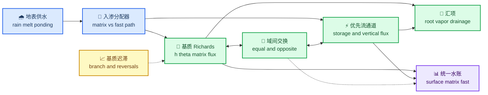
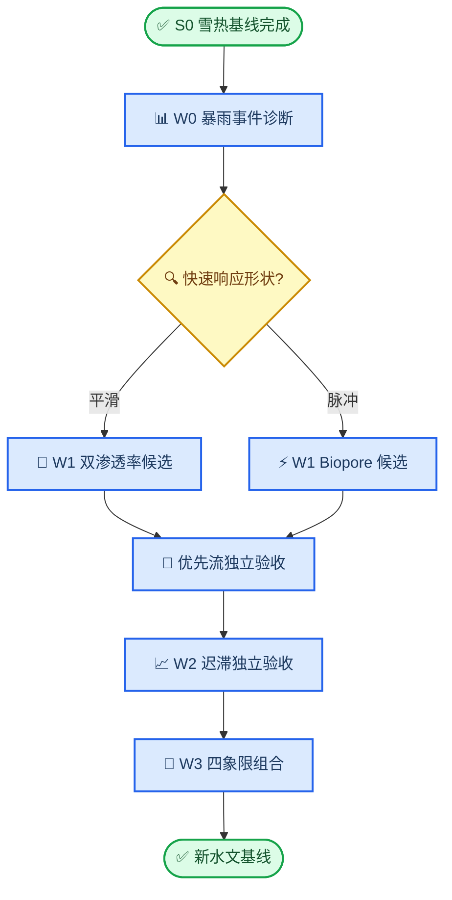

# COMPASS 近期物理扩展架构：雪收尾、优先流、迟滞

_更新于 2026-07-20；本文件是近期水热物理扩展的权威顺序与模块边界。_

---

## 📋 当前判决

| 阶段 | 主题 | 状态 | 判决 |
| --- | --- | --- | --- |
| S0 | 雪与地表--土壤热接口 | **完成** | 冻结为回归基线，不继续夹带改动 |
| W0 | 水文事件证据与单域基线 | 待执行 | 先确定快速深层响应的时间形状和水量 |
| W1 | 显式优先流 | 下一主线 | **先于迟滞**，但须先选定通道模型 |
| W2 | 基质水力迟滞 | 后续独立主线 | 在优先流单独验收后接入 |
| W3 | 优先流 × 迟滞组合 | 最后集成 | 两个单独开关均通过后才做交叉组合 |

优先流先于迟滞的依据不是“代码更多”或“模型更高级”，而是当前长武证据的可辨识性：100--200 cm 在暴雨期几乎不响应，属于缺少快速下传路径；基质滞回会改变同一 Richards 域内的持水与导水历史，但不能单独产生绕过上层基质的快速深层到达。

> ⚠️ **术语边界：** 当前 `dual_porosity` 是 mobile--immobile 一阶交换骨架，不是带独立纵向导水能力的 macropore/preferential-flow 通道，不能把“打开 dual_porosity”写成“完成优先流”。

## 🏠 总架构中的位置



所有新增水文过程仍服从总架构已有契约：

- `surface` 只交付地表可用水、积水、径流和能量状态
- `soil` 拥有基质、优先流通道及其交换状态
- 跨块只传 typed request/result 和一份权威通量账本
- trial 失败时，基质、通道、迟滞历史和地表水必须回到同一接受时刻
- 诊断不得反向成为状态所有者

## ✅ S0：雪模块收尾

生产配置使用：

```toml
heat_top_kind = "atmospheric"
heat_bottom_kind = "free_drainage_internal_energy"
checkpoint_interval = 168
```

验收结果：

| 指标 | 全年结果 |
| --- | ---: |
| 外层小时 | 8760/8760 |
| 最终失败 | 0 |
| 预期顶热边界 | 8760 h |
| 土温范围 | -14.1498--42.7411 degC |
| 界面闭合最大残差 | 4.99976 W m-2 |
| 闭合最大/平均评估数 | 5 / 1.47 |
| 最大 SWE | 0.719407 cm |
| 雪相态异常 | 0 |

“完成”表示按当前 `5 W m-2` 界面容差通过，不表示机器精度严格守恒。最大雪+土壤总能量残差 `18003.2 J m-2` 中，`17999.1 J m-2` 来自该小时界面容差。

收尾规则：

- 保留全年输出、KT8064 checkpoint、KT8065--8120 真状态重放和专项测试
- 后续水文开发不得顺带修改雪状态机、融尽单次积分或热边界契约
- 每个 W1/W2 回归都必须包含雪关闭、零雪和有雪窗口，证明新水文状态不污染 S0
- 详细实现以 [`../surface/2026-07-20_atmospheric_matched_flux_guide.md`](../surface/2026-07-20_atmospheric_matched_flux_guide.md) 和 [`../surface/surface_soil_thermal_coupling_progress.md`](../surface/surface_soil_thermal_coupling_progress.md) 为准

## 🎯 水文子系统重新分块



### 模块职责

| 块 | 权威状态 | 只读输入 | 输出 |
| --- | --- | --- | --- |
| Surface supply | `DSTOR`、地表活动集 | throughfall、融雪水、蒸发需求 | 可入渗水、径流 |
| Infiltration partition | 无跨步状态或显式参数态 | 雨强、积水、土表状态、通道容量 | 基质入渗、快速通道入流 |
| Matrix Richards | `h`、液水/冰状态 | 基质入渗、根汇、交换通量 | 基质纵向通量、底排水 |
| Preferential domain | 通道储水/压力或运动波状态 | 快速通道入流、交换参数 | 快速纵向通量、深层释放 |
| Domain exchange | 不单独拥有重复水量 | 两域状态 | 等值反号交换通量 |
| Matrix hysteresis | 分支、反转点和扫描曲线记忆 | 接受态与 trial 基质状态 | 基质 `theta(h)`、`K(h)` 参数化 |
| Unified ledger | 诊断，无预报状态 | 所有边界、交换、储量变化 | 守恒残差与分量闭合 |

关键约束：优先流和迟滞是两个正交开关。优先流控制“水走哪条路径”，迟滞控制“基质同一水头在不同历史下如何持水/导水”。二者不能共享一个含糊的 `soil_modes` 布尔量。

## 📍 W0：先做事件证据，不先写方程

W0 的目标是用现有观测决定 W1 应采用哪类快速通道，而不是预设 dual-permeability 或 biopore。

### 必须提取的事件特征

| 特征 | 判别用途 |
| --- | --- |
| 10、30、50、70、100、200 cm 湿度首次响应时刻 | 判断是否绕过上层基质 |
| 各深度峰值滞后与上升斜率 | 区分连续双介质与脉冲通道 |
| 雨强、历时、前期含水量 | 决定通道激活阈值 |
| 事件总入渗、径流和深层排水 | 约束水量，防止只拟合波形 |
| 冻土/无冻土事件标签 | 避免把冻融阻滞误认成迟滞或优先流 |

判别规则：

- 深层随暴雨平滑爬升、存在连续压力响应：优先试双渗透率顺序耦合
- 深层近脉冲到达且明显早于中层湿润锋：优先试 biopore/运动波通道
- 只有干湿循环回线而没有快速深层到达：才把迟滞提升为第一解释

W0 交付物应是事件表、时滞图和水量账，不改生产配置。

## ✍️ W1：显式优先流主线

### W1.1 接口骨架

先建立不依赖具体通道方程的 typed contract：

```text
PreferentialFlowRequest
  surface_available_water
  rainfall_intensity
  ponded_depth
  matrix_state
  accepted_fast_state
  dt

PreferentialFlowResult
  surface_to_matrix_flux
  surface_to_fast_flux
  fast_vertical_flux
  matrix_fast_exchange
  fast_bottom_flux
  candidate_fast_state
  water_ledger
```

入渗分配必须满足：

\[
I_{available}=I_{matrix}+I_{fast}+R_{surface},
\]

域间交换必须在两域账本中等值反号，组合账本中严格抵消。

### W1.2 模型选择顺序

| 候选 | 适用证据 | 当前角色 |
| --- | --- | --- |
| 现有 dual-porosity | 基质与不动域质量交换 | 兼容/溶质骨架，不作为优先流终态 |
| 顺序 dual-permeability | 平滑快速深层响应 | 首个连续双域候选 |
| Biopore/运动波 | 脉冲式绕流 | 根孔/裂缝候选 |

不要同时实现两个候选。W0 选一个后，先做最小垂直水量闭合，再接热、溶质和氮。

### W1.3 验收门槛

- 开关关闭时与当前全年水热雪基线一致
- 单通道解析/制造解水量闭合
- 基质--通道交换两侧等值反号
- 暴雨事件同时改善 50--200 cm 到达时刻与幅度，不只改善一个深度
- 年尺度不制造额外水，径流、ET、底排水变化可解释
- 冻融窗口、resume 和 trial rollback 保持一致

## 📚 W2：基质水力迟滞

当前仓库已有 `src/+soil/+water/+hysteresis/` 的 Lenhard/HYDRUS 风格旧核和 `Y.soil_modes.hysteresis` 初始化字段，但新主链缺少完整的“trial 更新--接受后提交--失败回滚”接线。`lHystrs=1` 的旧默认不能当作当前生产迟滞已经生效的证据。

### W2.1 物理范围

- 只作用于基质域，不直接修改优先流通道本构
- 明确主干燥、主湿润与扫描曲线
- `theta(h)`、容量导数和 `K(h)` 必须来自同一分支状态
- 反转点只在接受 substep 后提交，Picard trial 不得污染跨步历史
- 冻结特征曲线与水力迟滞的组合必须单独定义，不能默认交换调用顺序等价

### W2.2 状态所有权

| 状态 | trial 可写 | 接受后提交 | rollback |
| --- | --- | --- | --- |
| 当前干湿方向 | 是 | 是 | 回到步初 |
| 反转点栈 `RHSW/RASW` | 候选副本 | 是 | 整体恢复 |
| 扫描路径索引 | 候选副本 | 是 | 整体恢复 |
| `theta/K/C` 派生量 | 每次重算 | 否 | 丢弃 |

### W2.3 验收门槛

- 开关关闭严格 no-op
- 单节点干燥--湿润--再干燥闭环连续，无反转跳变
- 扫描曲线位于主干湿曲线之间，容量导数有限且符号正确
- water-only 柱状循环与参考算例对齐
- 冻融开/关分别验证后，再做与 W1 的四象限组合

## 🔗 W3：组合顺序与禁止项

组合验收矩阵：

| Preferential flow | Hysteresis | 用途 |
| --- | --- | --- |
| Off | Off | 当前权威基线 |
| On | Off | W1 独立验收 |
| Off | On | W2 独立验收 |
| On | On | W3 最终组合 |

禁止项：

- 不把现有 `dual_porosity=true` 直接宣传为优先流
- 不在一个 patch 中同时接入优先流和迟滞状态机
- 不用深层含水量拟合掩盖总水量不闭合
- 不让反转点历史在 rejected trial 后残留
- 不因水文扩展改回土顶 Dirichlet 或重开雪状态机
- 不先做深度学习 closure 替代缺失的物理通道

## 🎯 执行顺序



下一项具体工作是 W0：按 [`../soil/water/w0_storm_multidepth_lag_handoff_for_grok.md`](../soil/water/w0_storm_multidepth_lag_handoff_for_grok.md) 整理长武暴雨事件的多深度响应时滞与水量，不直接改 `src/`。W0 给出“平滑还是脉冲”的证据后，才为 W1 写实现规格。

## 🔗 关联文档

| 内容 | 路径 |
| --- | --- |
| 五域架构、迁移与扩展总纲 | [`compass_complete_architecture.md`](compass_complete_architecture.md) |
| 雪热实现说明 | [`../surface/2026-07-20_atmospheric_matched_flux_guide.md`](../surface/2026-07-20_atmospheric_matched_flux_guide.md) |
| 雪热验收进度 | [`../surface/surface_soil_thermal_coupling_progress.md`](../surface/surface_soil_thermal_coupling_progress.md) |
| 旧模型差异与深层响应证据 | [`compass_vs_stemmus_scope_diff.md`](compass_vs_stemmus_scope_diff.md) |
| 水分能力路线 | [`../soil/water/wateronly_hydrus_capability_roadmap.md`](../soil/water/wateronly_hydrus_capability_roadmap.md) |
| W0 暴雨时滞任务书 | [`../soil/water/w0_storm_multidepth_lag_handoff_for_grok.md`](../soil/water/w0_storm_multidepth_lag_handoff_for_grok.md) |
| MATLAB→Julia 学习与迁移地图 | [`compass_complete_architecture.md`](compass_complete_architecture.md) |
