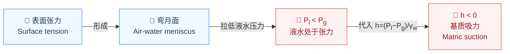
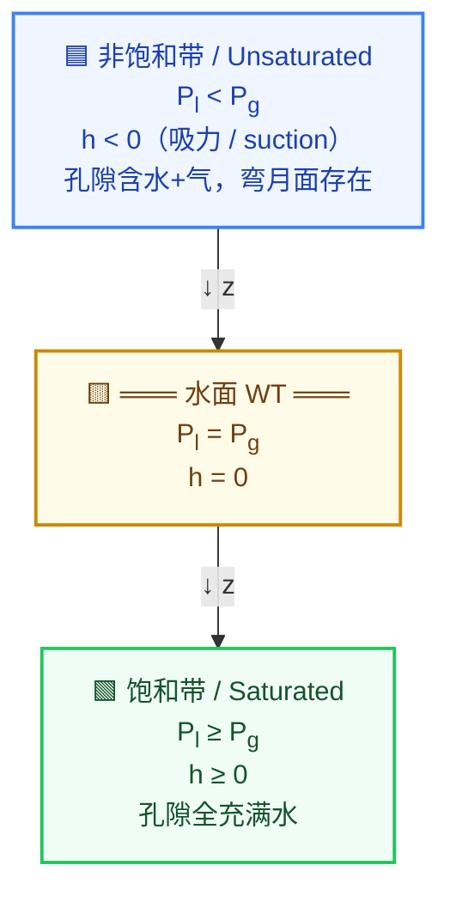
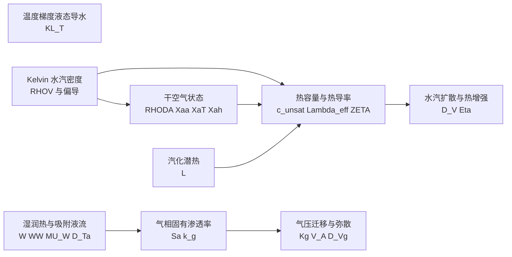

# COMPASS 土壤水–气–热–冻融物理原理

_本文是 COMPASS 自身的土壤水–气–热–冻融物理指导书。正文从模型实际守恒的液水、冰、水汽、干空气和总体积内能出发，依次给出守恒方程、本构闭合以及预报变量 \(h,U,P_g\) 的偏微分方程。生产求解器在 \((h,U,P_g)\) 坐标下以分布式标量 Picard–Thomas 为普通快路径；普通映射停滞时，对同一批冻结 Picard 系数执行块三对角求解和共同阻尼。两者都不是 Newton。温度由唯一内能状态函数局部反演；\(T\) 仍是用户初值和定温边界变量，但不再是独立预报变量。章节组织仿照成熟土壤多相传输理论的推导笔法，但所有主方程从一开始就是 COMPASS 方程；参考模型和论文只作为具体公式的出处。Editor: Jizixing Zhu; Date: 2026-07-12. Change: 2026-07-15 Jizixing Zhu — synchronize the guide with the validated U-primary production solver. Change: 2026-07-19 Jizixing Zhu — add the unified water, energy, dry-air and snow boundary derivation used by the production solver. Change: 2026-08-12 Jizixing Zhu — keep pressure-driven water-vapor transport conservative in the physical residual and use its state derivatives only in correction Jacobians. Change: 2026-08-15 Jizixing Zhu — document the shared-flux, exact-ledger, dry-air coordinate, and stalled block Modified-Picard production path._

## 📖 1. 物理域、主变量与符号

COMPASS 将土壤视为一维、刚性、多孔连续介质。垂向坐标 \(z\) 向上为正。固体骨架不移动；孔隙内可以存在液态水、冰和由水汽与干空气构成的气相。

\[
\theta_m+\varepsilon=1,
\qquad
\varepsilon=\theta_l+\theta_i+\theta_g .
\tag{1.1}
\]

来源：刚性多孔介质体积闭合；含冰控制体见 Yu et al. [11, §2]。

式中各项均为体积分数（m\(^3\) m\(^{-3}\)），数值上无量纲：

| 符号 | 名称 | 含义 |
| --- | --- | --- |
| \(\theta_m\) | 固体基质体积分数 | 单位土体体积中固体矿物–有机骨架所占比例。刚性介质假设下 \(\theta_m\) 不随时间变化 |
| \(\varepsilon\) | 孔隙度 | 固体之外的全部孔隙空间占比；等于三相体积分数之和 |
| \(\theta_l\) | 液态水含量 | 液态水占据的体积分数 |
| \(\theta_i\) | 冰含量 | 冰相占据的体积分数；关闭冻融时 \(\theta_i=0\) |
| \(\theta_g\) | 气相含量 | 水汽与干空气混合气体占据的体积分数 |

> **符号说明**：本文中 \(\theta_m\) 表示固体基质体积分数，而 \(\theta_s\) 保留为 van Genuchten 保水曲线中的**饱和体积含水量**参数（见 §3.1）。两者物理含义完全不同——前者是刚性骨架占比（\(\approx 1-\varepsilon\)），后者是孔隙被水完全填满时的液水含量上限（\(\le\varepsilon\)），因此必须使用不同符号。

关闭冻融时 \(\theta_i=0\)，式 (1.1) 自动退化为 \(\theta_g=\varepsilon-\theta_l\)。开启冻融时仍使用同一体积闭合，不另换一套方程。

目标求解状态与局部诊断状态必须分开：

| 符号 | 定义 | 在目标求解器中的角色 | SI 单位 |
| --- | --- | --- | --- |
| \(h\) | 液水相对于孔隙气压的压力水头 | 预报变量；决定保水、液水势和水汽相对湿度 | m |
| \(U\) | 单位土体体积的总内能 | 预报变量；直接跨时间层守恒推进 | J m\(^{-3}\) |
| \(P_g\) | 孔隙混合气体总压力 | 预报变量；驱动气相运动并改变干空气密度 | Pa |
| \(T\) | 绝对温度；\(\Delta T=T-T_r\) | 诊断变量；由 \(U=\mathcal U(h,T,P_g)\) 局部反演 | K |

压力水头定义为

\[
h=\frac{P_l-P_g}{\gamma_w},
\qquad
\gamma_w=\rho_l g .
\tag{1.2}
\]

来源：Coupled Dynamics in Soil [1, Eq. 4.4]。

单位：\(P_l,P_g\) 为 Pa，\(\gamma_w\) 为 Pa m\(^{-1}\)，因此 \(h\) 为 m。





_图 1.1 压力水头 \(h\) 的符号来源与物理意义。上链：表面张力→弯月面→液水张力（P_l < P_g）→ h < 0（基质吸力），h 的负号来自弯月面拉低液水压力的物理机制。下柱：沿土柱垂向（z 向上），水面以上非饱和带因弯月面张力使 h < 0，水面处 h = 0，饱和/承压带 h ≥ 0。h 的负号不是数值错误，绝不能用绝对值消除——否则吸力变推力，保水曲线和 Darcy 流方向全部翻转。_

在非饱和土中，气–水界面弯月面的表面张力使孔隙液水处于张力状态（\(P_l<P_g\)），分子 \(P_l-P_g<0\)，因此 \(h<0\)，即基质吸力（matric suction）。在饱和区或承压区 \(P_l\ge P_g\)，\(h\ge 0\)。负值来自非饱和张力物理，不是数值符号错误，绝不能用绝对值消除——否则吸力变推力，保水曲线和 Darcy 流方向全部翻转。

主要物理量如下。

| 符号 | 定义 | SI 单位 |
| --- | --- | --- |
| \(\rho_l,\rho_i,\rho_v,\rho_a,\rho_s\) | 液水、冰、水汽、干空气、固体密度 | kg m\(^{-3}\) |
| \(\rho_{sv}\) | 当前温度下的饱和水汽密度 | kg m\(^{-3}\) |
| \(H_r\) | 孔隙相对湿度，\(\rho_v/\rho_{sv}\) | 无量纲 |
| \(R_v\) | 水汽比气体常数 | J kg\(^{-1}\) K\(^{-1}\) |
| \(q_l,q_v,q_a\) | 向上为正的液水、水汽、干空气质量通量 | kg m\(^{-2}\) s\(^{-1}\) |
| \(V_A=q_{aa}/\rho_a\) | 气压梯度产生的孔隙气体 Darcy 速度 | m s\(^{-1}\) |
| \(K\) | 非饱和液态导水率 | m s\(^{-1}\) |
| \(K_g\) | 直接乘气压梯度的气体压力迁移率 | m\(^2\) Pa\(^{-1}\) s\(^{-1}\) |
| \(\frac{\partial K_g}{\partial h}\) | 以气压水头为势变量的气体导率 | m s\(^{-1}\) |
| \(D_e,D_{Vg}\) | 有效分子扩散率、气相纵向弥散率 | m\(^2\) s\(^{-1}\) |
| \(D_{TD}\) | 温度梯度诱导的吸附液流系数 | m\(^2\) s\(^{-1}\) K\(^{-1}\) |
| \(H_c\) | 干空气在水中的 Henry 分配系数 | 无量纲 |
| \(c_s,c_l,c_i,c_v,c_a\) | 各相质量比热 | J kg\(^{-1}\) K\(^{-1}\) |
| \(L_0,L_v,L_f\) | 参考汽化潜热、温变汽化潜热、熔化潜热 | J kg\(^{-1}\) |
| \(\lambda_{\mathrm{eff}}\) | 多相土壤有效热导率 | W m\(^{-1}\) K\(^{-1}\) |
| \(W\) | 微量自由水润湿土壤时释放的差分湿润热 | J kg\(^{-1}\) |

本文不再使用下标代替偏导。空间偏导和时间偏导始终写成完整形式，例如

\[
\boxed{
\begin{aligned}
&\frac{\partial h}{\partial z},\quad
\frac{\partial T}{\partial z},\quad
\frac{\partial P_g}{\partial z},\quad
\frac{\partial U}{\partial z},\\
&\frac{\partial h}{\partial t},\quad
\frac{\partial T}{\partial t},\quad
\frac{\partial P_g}{\partial t},\quad
\frac{\partial U}{\partial t}.
\end{aligned}
}
\tag{1.2a}
\]

来源：偏导数记号定义。

单位：\(\frac{\partial h}{\partial z}\) 为 m m\(^{-1}\)，\(\frac{\partial T}{\partial z}\) 为 K m\(^{-1}\)，\(\frac{\partial P_g}{\partial z}\) 为 Pa m\(^{-1}\)，\(\frac{\partial U}{\partial z}\) 为 J m\(^{-4}\)；\(\frac{\partial h}{\partial t},\frac{\partial T}{\partial t},\frac{\partial P_g}{\partial t},\frac{\partial U}{\partial t}\) 分别为 m s\(^{-1}\)、K s\(^{-1}\)、Pa s\(^{-1}\) 和 W m\(^{-3}\)。其中 \(\frac{\partial P_g}{\partial z}\) 明确表示孔隙总气压沿向上坐标 \(z\) 的空间偏导，不是 \(P_g\) 与 \(z\) 的乘积。COMPASS 当前代码中的 `DPgDZ` 是相邻节点 \(P_g\) 之差除以层厚后的内部单位版本。

对任意局部热力学状态函数 \(f=f(h,T,P_g)\)，状态偏导必须写明保持不变的热力学坐标。其全微分统一写成：

\[
\boxed{
df=
\left.\frac{\partial f}{\partial h}\right|_{T,P_g}dh
+\left.\frac{\partial f}{\partial T}\right|_{h,P_g}dT
+\left.\frac{\partial f}{\partial P_g}\right|_{h,T}dP_g .
}
\tag{1.2b}
\]

来源：多变量偏导数的标准定义。

单位：三个偏导的单位分别由 \(f\) 的单位除以 m、K 和 Pa 得到。物理推导、最终 PDE 和解释文字中的偏导一律保留完整形式，不再恢复成下标简写；程序字段名除外，因为它们是既有接口。

当前代码字段与标准数学定义的对应关系如下。字段名是程序接口，不是新的物理量：

| 当前代码字段 | 标准数学定义 | SI 单位 |
| --- | --- | --- |
| `DPgDZ` | \(\dfrac{\partial P_g}{\partial z}\) | Pa m\(^{-1}\) |
| `DRHOVh` | \(\left.\dfrac{\partial\rho_v}{\partial h}\right\rvert_{T,P_g}\) | kg m\(^{-4}\) |
| `DRHOVT` | \(\left.\dfrac{\partial\rho_v}{\partial T}\right\rvert_{h,P_g}\) | kg m\(^{-3}\) K\(^{-1}\) |
| `Xah` | \(\left.\dfrac{\partial\rho_a}{\partial h}\right\rvert_{T,P_g}\) | kg m\(^{-4}\) |
| `XaT` | \(\left.\dfrac{\partial\rho_a}{\partial T}\right\rvert_{h,P_g}\) | kg m\(^{-3}\) K\(^{-1}\) |
| `Xaa` | \(\left.\dfrac{\partial\rho_a}{\partial P_g}\right\rvert_{h,T}\) | kg m\(^{-3}\) Pa\(^{-1}\) |
| `DThetaWaterEquivDh` | \(\left.\dfrac{\partial\theta_u}{\partial h}\right\rvert_{T,P_g}\) | m\(^{-1}\) |
| `DThetaWaterEquivDT` | \(\left.\dfrac{\partial\theta_u}{\partial T}\right\rvert_{h,P_g}\) | K\(^{-1}\) |
| `DThetaLiquidDh` | \(\left.\dfrac{\partial\theta_l}{\partial h}\right\rvert_{T,P_g}\) | m\(^{-1}\) |
| `DThetaLiquidDT` | \(\left.\dfrac{\partial\theta_l}{\partial T}\right\rvert_{h,P_g}\) | K\(^{-1}\) |
| `DThetaIceDh` | \(\left.\dfrac{\partial\theta_i}{\partial h}\right\rvert_{T,P_g}\) | m\(^{-1}\) |
| `DThetaIceDT` | \(\left.\dfrac{\partial\theta_i}{\partial T}\right\rvert_{h,P_g}\) | K\(^{-1}\) |
| `DThetaGasDh` | \(\left.\dfrac{\partial\theta_g}{\partial h}\right\rvert_{T,P_g}\) | m\(^{-1}\) |
| `DThetaGasDT` | \(\left.\dfrac{\partial\theta_g}{\partial T}\right\rvert_{h,P_g}\) | K\(^{-1}\) |

来源：式 (1.2a)–(1.2b) 的数学定义，以及当前 COMPASS 状态与 `workspace.derived` 字段合同。

表中第三列是本指导书的 SI 物理合同。当前 MATLAB 网格和水头仍以 cm 保存，所以原始 `DPgDZ` 是“当前内部压力单位每 cm”，而 `DRHOVh`、`Xah` 及所有 `DTheta*Dh` 字段都是“每 cm”的偏导。进入 SI 方程或跨语言接口时必须同时确认压力标度并显式换算为空间每 m，不能只改字段注释。

以下每一条守恒式都遵守同一符号约定：

\[
\frac{\partial b}{\partial t}
+\frac{\partial J_b}{\partial z}
=s_b ,
\tag{1.3}
\]

其中 \(b\) 是单位土体体积储量，\(J_b\) 是向上为正的通量，\(s_b\) 是体积源项。

来源：固定控制体的质量或能量守恒；水、干空气和能量的具体形式分别见 [1, Eqs. 4.1, 4.11 and 4.15]。

单位：若 \(b\) 的单位为 \(B\) m\(^{-3}\)，则两项导数和 \(s_b\) 均为 \(B\) m\(^{-3}\) s\(^{-1}\)。

### 1.1 控制域边界、公开通量方向与边界状态

式 (1.3) 使用土柱内部坐标：\(z\) 向上为正，\(J_b\) 也以向上为正。边界输入输出若继续沿用该符号，在顶部和底部会得到相反的“正输入”含义。为避免水、能量和干空气账本分别猜符号，COMPASS 的公开边界合同统一规定：**从边界进入土柱为正**。若土柱顶部和底部分别为 \(z_t\) 与 \(z_b\)，则

\[
\boxed{
q_{b,t}^{\mathrm{in}}=-J_b(z_t),
\qquad
q_{b,b}^{\mathrm{in}}=+J_b(z_b).
}
\tag{1.B.1}
\]

把式 (1.3) 在整根土柱上积分，得到所有三条方程共同使用的柱尺度边界账本

\[
\boxed{
\frac{\mathrm d}{\mathrm dt}
\int_{z_b}^{z_t}b\,\mathrm dz
=q_{b,t}^{\mathrm{in}}+q_{b,b}^{\mathrm{in}}
+\int_{z_b}^{z_t}s_b\,\mathrm dz .
}
\tag{1.B.2}
\]

因此，“给定边界值”和“实际边界通量”是两个不同物理量。Dirichlet 条件给定 \(h\)、\(T\) 或 \(P_g\)，实际水、能量或干空气通量必须由收敛后的完整耦合边界行反算；Neumann 条件才直接给定进入土柱的通量。一次试算中，水、热和干空气边界请求必须冻结在同一个时间区间 \([t^n,t^{n+1}]\)。被拒绝的试算不改变地表积水、雪、土柱状态或累计边界账本。

三类边界的物理量和单位为：

| 守恒量 | 顶部公开输入 | 底部公开输入 | 公开通量单位 |
| --- | --- | --- | --- |
| 总水 | 降雨/融雪供水、蒸发需求、定水头或定水通量 | 自由排水、定水头或定水通量 | m s\(^{-1}\) 水当量；MATLAB 内部为 cm s\(^{-1}\) |
| 总内能 | 生产：匹配后固定总能量通量（`atmospheric`）；或钉温、给定通量、实验仿射 Robin | 季节/固定温度、给定总能量通量或随自由排水输出的液水内能 | W m\(^{-2}\)；MATLAB 内部为 J cm\(^{-2}\) s\(^{-1}\) |
| 干空气质量 | 大气/固定压力或给定干空气质量通量 | 静力压力、零通量或给定质量通量 | kg m\(^{-2}\) s\(^{-1}\)；MATLAB 内部为 g cm\(^{-2}\) s\(^{-1}\) |

本节只确定方向和账本。水边界的降雨—干旱四状态见 §2.4.1，干空气边界见 §2.5.1，裸土—积雪热边界及雪状态方程见 §2.8.1。§5.7 再说明这些物理合同如何进入有限元首末行。

## 🌊 2. 先写物理守恒方程

本章只回答“COMPASS 守恒什么、通过什么通量移动”。本构函数和 \(C\)、\(K\)、\(V\) 系数留到后面统一处理。

### 2.1 总水分守恒

COMPASS 同时守恒液水、冰和水汽。先定义凝结态水的液水等效体积分数

\[
\boxed{
\theta_u=\theta_l+\frac{\rho_i}{\rho_l}\theta_i+\theta_e ,
\qquad
\theta_e=S_s\max(h,0).
}
\tag{2.1a}
\]

其中 \(\theta_e\) 是正压力区的弹性储水量。它增加质量储量，但不占用额外孔隙体积，所以不进入式 (1.1)，也不参与液–冰孔隙分配。

来源：液水–冰质量换算见 Dall’Amico et al. [7, Appendix A]；正压力比储水量见 ClimaLand 的增强液态含水量定义 [8]。

单位：\(\theta_u,\theta_l,\theta_i,\theta_e\) 无量纲，\(S_s\) 为 m\(^{-1}\)。

单位土体体积的总水质量为

\[
m_w=\rho_l\theta_u+\rho_v\theta_g .
\tag{2.1b}
\]

来源：水相质量直接求和；当 \(\theta_i=\theta_e=0\) 时退化为 [1, Eq. 4.1]。

单位：\(m_w\) 为 kg m\(^{-3}\)。

水质量守恒式为

\[
\frac{\partial}{\partial t}
\left(\rho_l\theta_u+\rho_v\theta_g\right)
=-\frac{\partial}{\partial z}\left(q_l+q_v\right)
-\rho_l S_w .
\tag{2.1c}
\]

来源：控制体水质量守恒；液水–水汽通量结构见 [1, Eq. 4.1]，冰相质量换算见 [7]。

单位：储量为 kg m\(^{-3}\)；通量散度和 \(\rho_lS_w\) 为 kg m\(^{-3}\) s\(^{-1}\)。因此 \(S_w\) 为 s\(^{-1}\)。

式 (2.1c) 是三种水相方程相加后的结果。为了看清相变为什么不会制造或损失水，先定义两个内部质量交换率：\(\Gamma_f>0\) 表示液水冻结为冰，\(\Gamma_e>0\) 表示液水蒸发为水汽。三种水相分别满足

\[
\boxed{
\begin{aligned}
\frac{\partial}{\partial t}
\left[\rho_l(\theta_l+\theta_e)\right]
&=-\frac{\partial q_l}{\partial z}
-\Gamma_f-\Gamma_e-\rho_lS_w,\\
\frac{\partial(\rho_i\theta_i)}{\partial t}
&=+\Gamma_f,\\
\frac{\partial(\rho_v\theta_g)}{\partial t}
&=-\frac{\partial q_v}{\partial z}
+\Gamma_e .
\end{aligned}
}
\tag{2.1d}
\]

来源：各相局部质量守恒；液水–冰密度配对见 [7, §3 and Appendix A]，液水–水汽内部交换遵循 [1, Eq. 4.1] 的总水守恒。

单位：每一项以及 \(\Gamma_f,\Gamma_e\) 均为 kg m\(^{-3}\) s\(^{-1}\)。

把三行相加时，

\[
(-\Gamma_f-\Gamma_e)+\Gamma_f+\Gamma_e=0,
\tag{2.1e}
\]

来源：式 (2.1d) 三条分相质量方程逐项相加。

单位：等式两端均为 kg m\(^{-3}\) s\(^{-1}\)。

因此所有内部相变项消失，剩下的正是式 (2.1c)。在只有液–冰相变、没有通量和外部水汇时，式 (2.1d) 进一步给出

\[
\rho_l\,d\theta_l+\rho_i\,d\theta_i=0,
\qquad
d\theta_u=0 .
\tag{2.1f}
\]

来源：式 (2.1d) 的液–冰相变质量闭合以及式 (2.1a) 的定义。

单位：式 (2.1f) 第一项为 kg m\(^{-3}\)，第二项无量纲。

式 (2.1f) 中的 \(d\theta_l,d\theta_i,d\theta_u\) 是一次相变过程中状态量的无穷小改变量，不是对某个主变量的偏导；因此这里不添加“固定 \(h\)、\(T\) 或 \(P_g\)”的竖线下标。

### 2.2 液态水通量

广义 Darcy–Buckingham 定律先写成压力势形式：

\[
q_l
=-\rho_l K
\frac{\partial}{\partial z}
\left(\frac{P_l}{\gamma_w}+z\right)
-\rho_lD_{TD}\frac{\partial T}{\partial z}.
\tag{2.2}
\]

来源：[1, Eqs. 4.2–4.3]；温度梯度液流项追溯至 Groenevelt and Kay [9]。

单位：括号内为 m，梯度无量纲；\(K\) 为 m s\(^{-1}\)，乘 \(\rho_l\) 后为 kg m\(^{-2}\) s\(^{-1}\)。\(D_{TD}\frac{\partial T}{\partial z}\) 也为 m s\(^{-1}\)。

将式 (1.2) 的 \(P_l=P_g+\gamma_wh\) 代入，得到

\[
\boxed{
q_l=-\rho_l
\left(
K \frac{\partial h}{\partial z}
+D_{TD}\frac{\partial T}{\partial z}
+\frac{K}{\gamma_w}\frac{\partial P_g}{\partial z}
+K
\right).
}
\tag{2.3}
\]

来源：由 [1, Eqs. 4.4–4.6] 代数展开。

单位：括号内四项均为 m s\(^{-1}\)。末项 \(K\) 来自 \(\frac{\partial z}{\partial z}=1\)，是重力排水，不是额外经验源。

式 (2.3) 的四个部分依次是基质势液流、热诱导液流、气压梯度液流和重力液流。只有在明确关闭某一物理过程时才能删除对应项。

### 2.3 水汽通量

只考虑分子扩散时，Fick 定律为

\[
q_v=-D_e\frac{\partial\rho_v}{\partial z}.
\tag{2.4}
\]

来源：[1, Eq. 4.7]；多孔介质热湿迁移基础见 Philip and de Vries [2]。

单位：\(D_e\) 为 m\(^2\) s\(^{-1}\)，\(\frac{\partial\rho_v}{\partial z}\) 为 kg m\(^{-4}\)，所以 \(q_v\) 为 kg m\(^{-2}\) s\(^{-1}\)。

当干空气可以运动时，水汽通量由分子扩散、随干空气的压力对流和机械弥散三部分组成：

\[
\boxed{
q_v
=-
\left[
\underbrace{D_e\frac{\partial\rho_v}{\partial z}}_{\text{分子扩散}}
-\underbrace{\frac{\rho_v}{\rho_a}q_{aa}}_{\text{随干空气对流}}
+\underbrace{\theta_gD_{Vg}\frac{\partial\rho_v}{\partial z}}_{\text{机械弥散}}
\right].
}
\tag{2.5}
\]

来源：[1, Eq. 4.8]。\(q_{aa}\) 专指气压梯度产生的干空气对流质量通量。

单位：方括号内三项和 \(q_v\) 均为 kg m\(^{-2}\) s\(^{-1}\)。

水汽密度是状态函数 \(\rho_v=\rho_v(h,T)\)。三个状态偏导和空间链式法则完整写为：

\[
\boxed{
\begin{aligned}
\left.\frac{\partial\rho_v}{\partial P_g}\right|_{h,T}=0,\\
\frac{\partial\rho_v}{\partial z}
={}&
\left.\frac{\partial\rho_v}{\partial h}\right|_{T,P_g}
\frac{\partial h}{\partial z}
+\left.\frac{\partial\rho_v}{\partial T}\right|_{h,P_g}
\frac{\partial T}{\partial z}\\
&+\left.\frac{\partial\rho_v}{\partial P_g}\right|_{h,T}
\frac{\partial P_g}{\partial z}\\
={}&
\left.\frac{\partial\rho_v}{\partial h}\right|_{T,P_g}
\frac{\partial h}{\partial z}
+\left.\frac{\partial\rho_v}{\partial T}\right|_{h,P_g}
\frac{\partial T}{\partial z},\\
q_{aa}
&=-\rho_aK_g\frac{\partial P_g}{\partial z},\\
V_A
&\equiv\frac{q_{aa}}{\rho_a}
=-K_g\frac{\partial P_g}{\partial z}.
\end{aligned}
}
\tag{2.6}
\]

来源：水汽状态偏导和空间链式法则见 [1, Eqs. 4.9 and 4.24]；最后两行是 [1, Eq. 4.8] 的干空气 Darcy 对流。当前 Kelvin 闭合把 \(\rho_v\) 写成 \(h,T\) 的函数，所以其独立气压偏导为零。

单位：\(\left.\frac{\partial\rho_v}{\partial h}\right|_{T,P_g}\) 为 kg m\(^{-4}\)，\(\left.\frac{\partial\rho_v}{\partial T}\right|_{h,P_g}\) 为 kg m\(^{-3}\) K\(^{-1}\)，\(\left.\frac{\partial\rho_v}{\partial P_g}\right|_{h,T}\) 为 kg m\(^{-3}\) Pa\(^{-1}\)，\(\frac{\partial\rho_v}{\partial z}\) 为 kg m\(^{-4}\)，\(q_{aa}\) 为 kg m\(^{-2}\) s\(^{-1}\)，\(V_A\) 为 m s\(^{-1}\)。COMPASS 当前以 cm 保存水头时，`DRHOVh` 的内部单位是 kg m\(^{-3}\) cm\(^{-1}\)。

把第 3.3 节的 Kelvin 关系提前代入，可以看到两个偏导的具体来源：

\[
\boxed{
\begin{aligned}
H_r(h,T)
&=\exp\left(\frac{gh}{R_vT}\right),\\
\rho_v(h,T)
&=\rho_{sv}(T)H_r(h,T),\\
\left.\frac{\partial\rho_v}{\partial h}\right|_{T,P_g}
&=\rho_v\frac{g}{R_vT},\\
\left.\frac{\partial\rho_v}{\partial T}\right|_{h,P_g}
&=H_r\frac{d\rho_{sv}}{dT}
-\rho_v\frac{gh}{R_vT^2}.
\end{aligned}
}
\tag{2.6a}
\]

来源：Kelvin 关系和饱和水汽密度状态函数的直接偏导；见 [1, Eqs. 4.23–4.24]。

单位：\(H_r\) 无量纲；其余三式分别为 kg m\(^{-3}\)、kg m\(^{-4}\) 和 kg m\(^{-3}\) K\(^{-1}\)。

这里 \(\rho_{sv}=\rho_{sv}(T)\) 只含一个独立变量，所以标准记号是普通导数 \(d\rho_{sv}/dT\)，不是漏写了固定变量的偏导。若以后把盐度或曲率也作为其独立变量，则必须改写为相应的偏导并注明固定量。

把式 (2.6) 代入式 (2.5) 后，COMPASS 再只对温度梯度驱动的分子扩散乘热增强因子 \(\eta\)；压力水头扩散和机械弥散不乘 \(\eta\)。水汽通量完整展开为

\[
\boxed{
\begin{aligned}
q_v
={}&q_{vh}+q_{vT}+q_{va}\\
=-{}&
\left[
\left(D_e+\theta_gD_{Vg}\right)
\left.\frac{\partial\rho_v}{\partial h}\right|_{T,P_g}
\frac{\partial h}{\partial z}
+\left(\eta D_e+\theta_gD_{Vg}\right)
\left.\frac{\partial\rho_v}{\partial T}\right|_{h,P_g}
\frac{\partial T}{\partial z}
+\rho_vK_g\frac{\partial P_g}{\partial z}
\right]\\
=-{}&
\left(
D_{vh}\frac{\partial h}{\partial z}+D_{vT}\frac{\partial T}{\partial z}+D_{va}\frac{\partial P_g}{\partial z}
\right).
\end{aligned}
}
\tag{2.7}
\]

来源：式 (2.5)–(2.6) 代入，并对温度梯度分子扩散应用热增强因子 \(\eta\)。

单位：三种分通量和总通量均为 kg m\(^{-2}\) s\(^{-1}\)。

三个组合系数定义为

\[
\boxed{
D_{vh}
=\left(D_e+\theta_gD_{Vg}\right)
\left.\frac{\partial\rho_v}{\partial h}\right|_{T,P_g},
\qquad
D_{vT}
=\left(\eta D_e+\theta_gD_{Vg}\right)
\left.\frac{\partial\rho_v}{\partial T}\right|_{h,P_g},
\qquad
D_{va}=\rho_vK_g .
}
\tag{2.7a}
\]

来源：式 (2.5)–(2.6) 直接代入；基本形式对应 [1, Eqs. 4.9–4.10]。\(\eta\) 是 COMPASS 的热水汽增强因子；关闭增强时 \(\eta=1\)。

单位：\(D_{vh}\frac{\partial h}{\partial z},D_{vT}\frac{\partial T}{\partial z},D_{va}\frac{\partial P_g}{\partial z}\) 都必须为 kg m\(^{-2}\) s\(^{-1}\)。

### 2.4 合并后的水分方程

把液水式 (2.3) 和完整水汽式 (2.7) 代回总水守恒式 (2.1c)，得到

\[
\boxed{
\begin{aligned}
\frac{\partial}{\partial t}
\left(\rho_l\theta_u+\rho_v\theta_g\right)
={}&
\frac{\partial}{\partial z}
\left\{
\rho_l
\left(
K\frac{\partial h}{\partial z}+D_{TD}\frac{\partial T}{\partial z}+\frac{K}{\gamma_w}\frac{\partial P_g}{\partial z}+K
\right)\right.\\
&\left.
+D_{vh}\frac{\partial h}{\partial z}+D_{vT}\frac{\partial T}{\partial z}+D_{va}\frac{\partial P_g}{\partial z}
\right\}
-\rho_lS_w .
\end{aligned}
}
\tag{2.8}
\]

来源：式 (2.1c)、(2.3) 和 (2.7) 的直接组合；关闭冰相和弹性储量时退化为 [1, Eq. 4.10]。

单位：等式每项均为 kg m\(^{-3}\) s\(^{-1}\)。

式 (2.8) 已把唯一水汽物理通量完整写出。生产物理残差采用保守形式
\(\partial_z[(\rho_vK_g/\rho_l)\,\partial_zP_g]\)，只装配一次。第 4.1 节定义的
\(V_{vh}\) 与 \(V_{vT}\) 是这股保守通量分别对水头、温度修正的方向导数；它们只进入修正 Jacobian，不能再乘绝对 \(h,T\) 加回物理残差。否则便把同一乘积法则贡献计算两次。

#### 2.4.1 水分上下边界：降雨、积水、径流与极端干旱四状态

自然地表的顶部水边界不是一个固定的“降雨通量条件”。冠层截留和雪过程首先把到达地面的水分成液态供水与固态雪。进入土壤边界活动集的液态供水记为 \(P_l\ge0\)，它包括穿透雨、融雪/雪排水和裸地凝结水；潜在土表蒸发需求记为 \(E_p\ge0\)。二者都是水当量通量。实际进入土柱的总水通量记为 \(q_{w,t}^{\mathrm{in}}\)，其中包含收敛后水方程边界反应所代表的液水和水汽净交换，不能简单等同于“降雨量”或旧输出中的潜在入渗。与 §2.8.1 的雪账对接时，土壤侧液态供水可概括为

\[
P_l=(1-f_s)P_r+f_sR_s^{\downarrow}
+P_{s,\mathrm{excess}}+P_{s,\mathrm{melt}}+D_b,
\tag{2.WB.0}
\]

其中 \(D_b\ge0\) 是裸地凝结水，后两项分别是雪水可行域钳位转出的液水和终端融尽排水。雪盖上的雨只有经雪账排水或钳位后才进入 \(P_l\)，不能既作为雨直接入渗又作为雪排水入渗。若液态地表水库冻结，则相同水量从 \(d\) 扣除并以固态输入加入雪 \(S\)，仍只转移一次。

地表液态水库深度为 \(d\)，局地洼地容量为 \(d_{\max}\)，溢出径流为 \(R\ge0\)。一个接受子步必须满足

\[
\boxed{
d^{n+1}-d^n
=\Delta t\left(P_l-E_a-q_{w,t}^{\mathrm{in}}-R\right),
}
\tag{2.WB.1}
\]

其中 \(E_a\) 是由边界可行性决定的实际土表蒸发，满足 \(0\le E_a\le E_p\)。式 (2.WB.1) 是地表水库账本；土柱水量账本使用同一个 \(q_{w,t}^{\mathrm{in}}\)，因此不得再把它作为“入渗”重复加入第二次。

湿侧的水头—通量切换写成两组互补约束：

\[
\boxed{
0\le d^{n+1}\ \perp\ d^{n+1}-h_s\ge0,
\qquad
0\le R\ \perp\ d_{\max}-d^{n+1}\ge0,
}
\tag{2.WB.2}
\]

这里 \(h_s\) 是土柱顶节点相对于孔隙气压的压力水头。第一组约束表示：没有积水时 \(h_s\le0\)；只要维持正的液态积水，就必须有 \(h_s=d\)。第二组约束表示：地表水库未满时无溢出；只有 \(d=d_{\max}\) 时才允许 \(R>0\)。当 \(d_{\max}=0\) 时，式 (2.WB.2) 退化为无塘地表的压力—过量通量互补条件。它借鉴 Signorini 活动集的思想 [21]，但 COMPASS 仍使用一维 Richards 三对角求解和显式守恒地表水库，不引入 Nitsche 或混合有限元。

极端干旱还需要一个下侧可行性约束。记 \(h_d<0\) 为由保水关系和接受残余含水状态确定的干水头，蒸发缺额为 \(\mu_E=E_p-E_a\)。无液态供水时使用

\[
\boxed{
h_s-h_d\ge0,
\qquad
\mu_E\ge0,
\qquad
(h_s-h_d)\mu_E=0.
}
\tag{2.WB.3}
\]

只要表层仍高于残余状态，模型保持通量边界并满足 \(E_a=E_p\)；当液态水和总凝结水都到达保水本构的残余钳位时，边界固定在该接受状态的 \(h_d\)，由完整水方程反应求得 \(E_a\)。固定干水头不是把表层设为不透水：土壤内部的液态毛管流、水汽扩散和气压驱动输运仍同时存在。新的液态供水一到达，干边界立即释放，重新进入供水或湿侧活动集。

由式 (2.WB.1)–(2.WB.3) 得到四种互斥边界状态：

| 状态 | 施加的边界 | 必须同时满足的物理条件 |
| --- | --- | --- |
| 供水受限 `supply_limited` | 给定净大气水通量，\(d=0\) | \(R=0\)，\(E_a=E_p\)，\(h_s\le0\)，且尚未到达残余水状态 |
| 有限积水 `storage` | 隐式求 \(h_s=d^{n+1}\) | \(0<d^{n+1}<d_{\max}\)，\(R=0\)，实际入渗由 Richards 反应决定 |
| 容量受限 `capacity_limited` | 固定 \(h_s=d_{\max}\) | \(d^{n+1}=d_{\max}\)，\(R\ge0\)；多余供水只进入径流，不进入假土壤水 |
| 干旱蒸发受限 `dry_evaporation_limited` | 固定 \(h_s=h_d\) | \(d=R=0\)，\(0\le E_a\le E_p\)，液态与总凝结水都处于接受残余状态 |

活动集的选择不使用 \(P_l>K_{sat}\) 这类经验判据，因为未饱和吸力可使瞬时入渗能力显著大于饱和导水率。若液态供水相对上一接受步突然增加，零容量地表先试 \(h_s=0\)，有限容量地表先试隐式积水；若收敛后的边界反应要求负径流或无法维持积水，则在同一 \(\Delta t\) 内回到供水受限支路。反过来，通量试算产生 \(h_s>0\) 时转入积水/容量支路。每次换支都丢弃未收敛试算状态，恢复同一子步起点，清除 Anderson/Picard 历史并重新装配水、热、气三条方程。

一个子步只有同时满足以下条件才可接受：\((h,U,P_g)\) 非线性迭代收敛；最后一次完整迭代后边界状态不再改变；式 (2.WB.1) 的水库残差达标；式 (2.WB.2)–(2.WB.3) 的不等式和互补残差达标；土柱水、能量和干空气账本均闭合。若同一时间步出现边界循环或耦合求解失败，外层调度器缩短 \(\Delta t\)，而不是以硬断言终止全年模拟。

底部水边界与顶部活动集独立。定水头直接给出 \(h_b\)，定水通量直接给出 \(q_{w,b}^{\mathrm{in}}\)，自由排水采用重力单位梯度并由底部导水率给出向下流出。按照式 (1.B.1)，向下排出土柱时 \(q_{w,b}^{\mathrm{in}}<0\)。若以后显式接入地下水，地下水反应只替换底端条件，不改变上面的地表四状态合同。

### 2.5 干空气守恒

干空气同时存在于自由气相和溶解液相。令 \(H_c\) 为 Henry 分配系数，则单位土体体积的干空气质量为

\[
m_a=\rho_a\left(\theta_g+H_c\theta_l\right).
\tag{2.9}
\]

来源：[1, Eq. 4.11]。原书以孔隙率、气相饱和度和液相饱和度书写；式 (2.9) 是等价体积分数形式。

单位：\(m_a\) 为 kg m\(^{-3}\)。

干空气守恒式为

\[
\frac{\partial m_a}{\partial t}
=-\frac{\partial q_a}{\partial z}+S_a .
\tag{2.10}
\]

来源：[1, Eq. 4.11]；COMPASS 默认 \(S_a=0\)。

单位：各项均为 kg m\(^{-3}\) s\(^{-1}\)。

干空气通量包含扩散、气压对流、弥散和随液水移动的溶解空气：

\[
\boxed{
\begin{aligned}
q_a={}&
\underbrace{-D_e\frac{\partial\rho_a}{\partial z}}
_{\text{分子扩散}}
+\underbrace{\left(-\rho_aK_g\frac{\partial P_g}{\partial z}\right)}
_{\text{气压驱动对流 }q_{aa}}\\
&+\underbrace{\left(-\theta_gD_{Vg}
\frac{\partial\rho_a}{\partial z}\right)}
_{\text{机械弥散}}
+\underbrace{H_c\frac{\rho_a}{\rho_l}q_l}
_{\text{溶解干空气随液水迁移}} .
\end{aligned}
}
\tag{2.11}
\]

来源：[1, Eq. 4.12]；气压对流关系 \(q_{aa}=-\rho_aK_g\frac{\partial P_g}{\partial z}\) 见式 (2.6)。

单位：四个通量部分均为 kg m\(^{-2}\) s\(^{-1}\)。

式 (2.11) 只使用液水质量通量 \(q_l\)，不另设液水体积通量变量。第四项中的 \(q_l/\rho_l\) 是由液水质量通量换算得到的液水体积通量；\(H_c\rho_a\) 是单位液水体积所对应的平衡溶解干空气质量浓度。因此该项整体仍是干空气质量通量。由于 \(q_l\) 采用向上为正的带符号约定，液水向下运动时，溶解干空气迁移项也自动向下。

干空气密度依赖三个局部热力学坐标：

\[
\boxed{
\begin{aligned}
\frac{\partial\rho_a}{\partial z}
={}&
\left.\frac{\partial\rho_a}{\partial h}\right|_{T,P_g}
\frac{\partial h}{\partial z}
+\left.\frac{\partial\rho_a}{\partial T}\right|_{h,P_g}
\frac{\partial T}{\partial z}\\
&+
\left.\frac{\partial\rho_a}{\partial P_g}\right|_{h,T}
\frac{\partial P_g}{\partial z}\\
={}&X_{ah}\frac{\partial h}{\partial z}+X_{aT}\frac{\partial T}{\partial z}+X_{aa}\frac{\partial P_g}{\partial z}.
\end{aligned}
}
\tag{2.12}
\]

来源：[1, Eq. 4.28]。

单位：每一项均为 kg m\(^{-4}\)。

把式 (2.11)–(2.12) 代入式 (2.10)，得到 COMPASS 干空气控制方程：

\[
\boxed{
\frac{\partial}{\partial t}
\left[\rho_a(\theta_g+H_c\theta_l)\right]
=-\frac{\partial q_a}{\partial z}+S_a .
}
\tag{2.13}
\]

来源：[1, Eqs. 4.11–4.13]。这里保留守恒通量形式；第 4 章再展开为 \(C_{ah},C_{aT},C_{aa}\) 和空间系数。

单位：各项均为 kg m\(^{-3}\) s\(^{-1}\)。

#### 2.5.1 干空气上下边界：压力、质量通量与雪的间接作用

令土柱干空气面密度为

\[
M_a=\int_{z_b}^{z_t}\rho_a\left(\theta_g+H_c\theta_l\right)\,\mathrm dz .
\tag{2.AB.1}
\]

按照式 (1.B.1) 的“进入土柱为正”约定，其离散柱总账为

\[
M_a^{n+1}-M_a^n
=\Delta t\left(q_{a,t}^{\mathrm{in}}+q_{a,b}^{\mathrm{in}}\right)
+\Delta t\int_{z_b}^{z_t}S_a\,\mathrm dz .
\tag{2.AB.2}
\]

顶部可施加大气/固定气压 \(P_{g,t}=P_{g,t}^{\mathrm{bc}}\)，也可直接给定干空气质量通量 \(q_{a,t}^{\mathrm{in}}\)。底部可选零质量通量、给定质量通量或静力气压。若忽略空气密度随深度的高阶变化，静力底压近似为

\[
P_{g,b}=P_{g,t}+\rho_{a,b}g\left(z_t-z_b\right).
\tag{2.AB.3}
\]

压力 Dirichlet 条件只规定边界状态，不预先规定实际干空气质量通量。接受态的 \(q_a^{\mathrm{in}}\) 必须由包含 \(h,T,P_g\) 全部空间项、真实端点储量变化和溶解空气随液水迁移项的完整边界行恢复，不能只根据 \(P_g\) 梯度反算。这样式 (2.AB.2) 才与式 (2.13) 是同一个守恒账本。

雪层不另设一个“干空气穿雪”源汇，也不直接向式 (2.13) 注入质量。雪通过改变顶部水分和能量边界，进而改变土壤温度、液水/冰分配、气相孔隙率 \(\theta_g\)、干空气密度 \(\rho_a\) 和气相迁移率 \(K_g\)，间接反馈干空气输运。因此任何地表水活动集换支或雪热边界改变，都必须在同一子步重新装配水、能量和干空气三条方程；拒绝的试算不得进入式 (2.AB.2) 的接受账本。

### 2.6 从各相比内能构造总体积内能

所有相必须使用同一个参考态。COMPASS 取 \(T_r\) 处的液态水内能为零，定义 \(\Delta T=T-T_r\)。在比热视为常数的温度范围内，各相相对于该参考态的比内能为

\[
\boxed{
\begin{aligned}
u_s(T)&=c_s\Delta T,\\
u_l(T)&=c_l\Delta T,\\
u_i(T)&=c_i\Delta T-L_f,\\
u_a(T)&=c_a\Delta T,\\
u_v(T)&=c_v\Delta T+L_0 .
\end{aligned}
}
\tag{2.14}
\]

来源：\(du_\alpha=c_\alpha dT\) 的定比热积分；冰相与水汽相的参考态分别相差熔化潜热和汽化潜热。未冻气–水部分见 [1, Eq. 4.14]，含冰能量守恒参考态见 [7]。

单位：所有 \(u_\alpha\) 均为 J kg\(^{-1}\)。

式 (2.14) 的两个潜热符号由参考态决定。冰在同一温度下的内能比液水低 \(L_f\)，所以是 \(-L_f\)；水汽比液水高 \(L_0\)，所以是 \(+L_0\)。

固体、液水、冰、干空气和水汽对单位土体体积的内能贡献分别为

\[
\boxed{
\begin{aligned}
U_s&=\rho_s\theta_mu_s,\\
U_l&=\rho_l\theta_lu_l,\\
U_i&=\rho_i\theta_iu_i,\\
U_a&=\theta_g\rho_au_a,\\
U_v&=\theta_g\rho_vu_v .
\end{aligned}
}
\tag{2.15}
\]

来源：各相质量密度乘该相比内能。

单位：五项均为 J m\(^{-3}\)。

湿润热是液水进入吸附态时释放的能量。若 \(W(\theta_l,T)\) 可视为状态函数的差分热，定义湿润内能势

\[
U_w(\theta_l,T)
=-\rho_l
\int_{\theta_{l,r}}^{\theta_l}
W(\vartheta,T)\,d\vartheta .
\tag{2.16}
\]

来源：差分湿润热的定义；[1, Eqs. 4.14, 4.45] 和 Groenevelt–Kay [9]。

单位：\(\rho_lW\,d\vartheta\) 为 J m\(^{-3}\)，所以 \(U_w\) 为 J m\(^{-3}\)。

式 (2.16) 是湿润热的**热力学积分定义**。**当前 COMPASS 的状态函数采用乘积近似** \(U_w^{\mathrm{COMPASS}} = -\rho_l W(h)\,\theta_l\)，即在积分路径上把 \(W\) 取为以当前压力水头评估的端点值。第 4.3.1 节的全部内能偏导均以此乘积形式为准。

在忽略 \(W\) 的显式温度导数时，

\[
\frac{\partial U_w}{\partial t}
\approx-\rho_lW\frac{\partial\theta_l}{\partial t}.
\tag{2.17}
\]

来源：式 (2.16) 的 Leibniz 法则；这是当前 COMPASS 湿润热闭合采用的近似，与 [1, Eq. 4.15] 一致。若保留 \(W\) 对温度的显式偏导，还必须加入
\(-\rho_l\int_{\theta_{l,r}}^{\theta_l}\left.\frac{\partial W}{\partial T}\right|_{\vartheta}\,d\vartheta\)。这里下标 \(\vartheta\) 表示求温度偏导时固定积分变量所代表的液态含水量。

单位：两端均为 W m\(^{-3}\)。

用花体 \(\mathcal U(h,T,P_g)\) 表示局部热力学内能状态函数，用直体 \(U\) 表示求解器在时间层上直接保存的内能。每个局部平衡状态满足 \(U=\mathcal U(h,T,P_g)\)。状态函数定义为

\[
\boxed{
\begin{aligned}
U=\mathcal U(h,T,P_g)
={}&
\underbrace{U_s}_{\text{固体显热}}
+\underbrace{U_l}_{\text{液水显热}}
+\underbrace{U_i}_{\text{冰显热与熔化参考能}}\\
&+\underbrace{U_a}_{\text{干空气显热}}
+\underbrace{U_v}_{\text{水汽显热与汽化参考能}}
+\underbrace{U_w}_{\text{湿润内能}}\\
={}&\rho_s\theta_mc_s\Delta T
+\rho_l\theta_lc_l\Delta T\\
&+\rho_i\theta_i(c_i\Delta T-L_f)\\
&+\theta_g\rho_ac_a\Delta T\\
&+\theta_g\rho_v(c_v\Delta T+L_0)
+U_w .
\end{aligned}
}
\tag{2.18}
\]

来源：式 (2.14)–(2.16) 逐相求和。该式是 COMPASS 水–气–热–冻融统一内能定义。

单位：每项均为 J m\(^{-3}\)。

为了核对状态函数是否包含全部显热、潜热和相体积变化，可以对 \(\mathcal U\) 做解析微分。这里固定固体骨架以及 \(\rho_s,\rho_l,\rho_i\) 和各相比热，同时保留气体状态密度 \(\rho_a,\rho_v\) 及相体积分数随时间的变化。六类储量的解析变化恒等式为

\[
\boxed{
\begin{aligned}
\frac{\partial \mathcal U}{\partial t}
={}&
\underbrace{\rho_s\theta_mc_s\frac{\partial T}{\partial t}}
_{\text{固体升温或降温}}\\
&+\underbrace{\rho_l\theta_lc_l\frac{\partial T}{\partial t}}
_{\text{已有液水的显热变化}}
+\underbrace{\rho_lu_l\frac{\partial\theta_l}{\partial t}}
_{\text{液水量变化带来的内能变化}}\\
&+\underbrace{\rho_i\theta_ic_i\frac{\partial T}{\partial t}}
_{\text{已有冰的显热变化}}
+\underbrace{\rho_iu_i\frac{\partial\theta_i}{\partial t}}
_{\text{冰量变化及熔化潜热}}\\
&+\underbrace{\theta_g\rho_ac_a\frac{\partial T}{\partial t}}
_{\text{已有干空气的显热变化}}
+\underbrace{\theta_gu_a\frac{\partial\rho_a}{\partial t}}
_{\text{干空气密度变化}}
+\underbrace{\rho_au_a\frac{\partial\theta_g}{\partial t}}
_{\text{气相孔隙体积变化中的干空气能}}\\
&+\underbrace{\theta_g\rho_vc_v\frac{\partial T}{\partial t}}
_{\text{已有水汽的显热变化}}
+\underbrace{\theta_gu_v\frac{\partial\rho_v}{\partial t}}
_{\text{水汽密度变化及汽化潜热}}
+\underbrace{\rho_vu_v\frac{\partial\theta_g}{\partial t}}
_{\text{气相孔隙体积变化中的水汽能}}\\
&+\underbrace{\frac{\partial U_w}{\partial t}}
_{\text{湿润内能变化}} .
\end{aligned}
}
\tag{2.18a}
\]

来源：式 (2.15)–(2.18) 逐项使用乘积法则；湿润内能项见式 (2.17)。

单位：式 (2.18a) 每一项均为 W m\(^{-3}\)。

式 (2.18a) 中同一个物理相通常出现两类变化：一类是“已有质量温度改变”，另一类是“该相质量或所占孔隙体积改变”。冻融、蒸发–凝结和气体压缩正是通过后一类项进入内能状态函数。式 (2.18a) 只用于物理审计和局部 Jacobian，**不是目标热方程的时间离散式**；目标时间残差直接使用 \(U^{n+1}-U^n\)。

### 2.7 相变为什么不再需要独立潜热源

冻结时，式 (2.1d) 使液水质量减少、冰质量等量增加。只看相变对式 (2.18) 的直接贡献：

\[
\begin{aligned}
\left.\frac{\partial \mathcal U}{\partial t}\right|_{pc}
&=\rho_lu_l\left.\frac{\partial\theta_l}{\partial t}\right|_{pc}
+\rho_iu_i\left.\frac{\partial\theta_i}{\partial t}\right|_{pc}\\
&=\dot m_f(u_i-u_l)\\
&=\dot m_f\left[(c_i-c_l)\Delta T-L_f\right].
\end{aligned}
\tag{2.19}
\]

来源：式 (2.1d)、(2.14) 和 (2.18) 代数代入。

单位：各项均为 W m\(^{-3}\)。

竖线下标 \(pc\) 表示“只取 phase change 对时间变化率的贡献”，不是另一个被固定的状态变量；完整状态偏导仍按式 (1.2b) 的 \(h,T,P_g\) 固定变量规则书写。

当 \(T=T_r\) 时，式 (2.19) 为 \(-\dot m_fL_f\)。在绝热封闭控制体内，总内能不能改变，因此其他相的显热必须增加同样的量，温度随之上升。潜热已经通过 \(-\rho_i\theta_iL_f\) 自动进入能量账本；若再向方程右端加入 \(+\dot m_fL_f\)，就会重复计算。

### 2.8 能量通量和总体能量守恒

固体和冰在当前土柱框架中不发生质量平流。能量只能通过导热以及液水、水汽和干空气三种移动相携带。先把总能量通量按机制拆成四部分：

\[
\boxed{
\begin{aligned}
J_U
={}&
\underbrace{J_{U,\mathrm{cond}}}_{\text{土壤导热}}
+\underbrace{J_{U,l}}_{\text{液水携能}}
+\underbrace{J_{U,v}}_{\text{水汽携能}}
+\underbrace{J_{U,a}}_{\text{干空气携能}}\\
={}&
\underbrace{-\lambda_{\mathrm{eff}}\frac{\partial T}{\partial z}}
_{J_{U,\mathrm{cond}}:\ \text{Fourier 导热}}
+\underbrace{q_lu_l}_{J_{U,l}:\ \text{液水质量通量携能}}\\
&+\underbrace{q_vu_v}_{J_{U,v}:\ \text{水汽显热与汽化能迁移}}
+\underbrace{q_au_a}_{J_{U,a}:\ \text{干空气显热迁移}} .
\end{aligned}
}
\tag{2.20}
\]

来源：Fourier 导热与移动相能量通量；未冻形式见 [1, Eqs. 4.14–4.15]。

单位：四项均为 W m\(^{-2}\)。

液水携能项把式 (2.3) 的四种液水驱动力逐项乘以液水比内能 \(u_l\)：

\[
\boxed{
\begin{aligned}
J_{U,l}=u_lq_l
={}&
\underbrace{-\rho_lu_lK\frac{\partial h}{\partial z}}
_{\text{压力水头驱动液水携能}}\\
&+\underbrace{-\rho_lu_lD_{TD}\frac{\partial T}{\partial z}}
_{\text{温度梯度液流携能}}\\
&+\underbrace{-\rho_lu_l\frac{K}{\gamma_w}
\frac{\partial P_g}{\partial z}}
_{\text{气压梯度诱导液流携能}}
+\underbrace{-\rho_lu_lK}_{\text{重力排水携能}} .
\end{aligned}
}
\tag{2.20a}
\]

来源：液水质量通量式 (2.3) 乘液水比内能 \(u_l\)。

单位：四项均为 W m\(^{-2}\)。

水汽携能项把式 (2.7) 的三类水汽通量分别乘以 \(u_v=c_v\Delta T+L_0\)。因此每一份水汽质量通量都同时携带水汽显热和相对于液水参考态的汽化能：

\[
\boxed{
\begin{aligned}
J_{U,v}=u_vq_v
={}&
\underbrace{-u_vD_{vh}\frac{\partial h}{\partial z}}
_{\text{压力水头驱动的水汽扩散与弥散携能}}\\
&+\underbrace{-u_vD_{vT}\frac{\partial T}{\partial z}}
_{\text{温度驱动的水汽扩散与弥散携能}}\\
&+\underbrace{-u_vD_{va}\frac{\partial P_g}{\partial z}}
_{\text{气压对流水汽携能}} .
\end{aligned}
}
\tag{2.20b}
\]

来源：水汽质量通量式 (2.7) 乘水汽比内能 \(u_v\)。其中 \(D_{vh},D_{vT},D_{va}\) 的分子扩散、热增强、机械弥散和气压对流组成见式 (2.7a)。

单位：三项均为 W m\(^{-2}\)。

干空气携能项则把式 (2.11) 的四类干空气通量分别乘以 \(u_a=c_a\Delta T\)：

\[
\boxed{
\begin{aligned}
J_{U,a}=u_aq_a
={}&
\underbrace{-u_aD_e\frac{\partial\rho_a}{\partial z}}
_{\text{分子扩散干空气携能}}
+\underbrace{-u_a\rho_aK_g\frac{\partial P_g}{\partial z}}
_{\text{气压对流干空气携能}}\\
&+\underbrace{-u_a\theta_gD_{Vg}
\frac{\partial\rho_a}{\partial z}}
_{\text{机械弥散干空气携能}}
+\underbrace{u_aH_c\frac{\rho_a}{\rho_l}q_l}
_{\text{溶解干空气随液水携能}} .
\end{aligned}
}
\tag{2.20c}
\]

来源：干空气质量通量式 (2.11) 乘干空气比内能 \(u_a\)。

单位：四项均为 W m\(^{-2}\)。

严格热力学中，静止储量使用内能，随质量移动的流体能量通量使用焓。对近似不可压缩的液水，两者的压力功差很小；对气体则应区分定容热容与定压热容。为保持与当前 COMPASS/STEMMUS 系数一致，式 (2.14)–(2.20) 暂以有效 \(c_a,c_v\) 记号统一表达。后续 SI 热力学重构必须明确：储量导数使用 \(c_{v,\alpha}\)，平流焓使用 \(c_{p,\alpha}\)，不能仅凭同一个旧字段名假定二者相同。

因此 COMPASS 总内能守恒既可以写成紧凑形式，也可以完整展开为“六类储量变化等于四类通量净输入加外部源”：

\[
\boxed{
\begin{aligned}
\frac{\partial U}{\partial t}
+\frac{\partial J_U}{\partial z}
&=S_U,\\
\frac{\partial}{\partial t}
\left(U_s+U_l+U_i+U_a+U_v+U_w\right)
&=-\frac{\partial}{\partial z}
\left(
J_{U,\mathrm{cond}}+J_{U,l}+J_{U,v}+J_{U,a}
\right)+S_U .
\end{aligned}
}
\tag{2.21}
\]

来源：固定控制体第一定律。

单位：每项均为 W m\(^{-3}\)。

目标内能时间层直接离散为

\[
\boxed{
\frac{U^{n+1}-U^n}{\Delta t}
+\frac{\partial J_U^{\,n+1}}{\partial z}
=S_U^{\,n+1}.
}
\tag{2.21a}
\]

来源：式 (2.21) 的后向时间离散；\(U^n\) 是已接受时间层的总内能，\(U^{n+1}\) 是当前 trial 的总内能。

单位：每项均为 W m\(^{-3}\)。

式 (2.21a) 的储量项中没有 \(\frac{\partial T}{\partial t}\)、\(\frac{\partial\theta_l}{\partial t}\) 或 \(\frac{\partial\theta_i}{\partial t}\)。在给定 trial 的 \(h^{n+1},U^{n+1},P_g^{n+1}\) 后，求解器才通过 \(U^{n+1}=\mathcal U(h^{n+1},T^{n+1},P_g^{n+1})\) 局部恢复 \(T^{n+1}\) 和各相体积分数，用于计算 \(J_U^{n+1}\)。

式 (2.21) 的左边回答“控制体里哪些能量正在变化”，右边回答“这些能量如何穿过控制体边界”。\(S_U\) 只包含真正穿过体积账本的外部能量源汇，例如体积加热、根系吸水带走的液水内能或冰升华带走的能量。液–冰内部相变不进入 \(S_U\)。

#### 2.8.1 能量上下边界与雪–裸土两 tile 守恒闭合

地表能量边界必须先区分三个物理上不同的量：

- \(G_{b,\mathrm{FR}}^{\downarrow}\)：SCOPE 裸土地表方程中由历史温度/force-restore 关系给出的经验土壤热通量，向土为正；
- \(G_{s\rightarrow soil}^{\downarrow}\)：雪层与土壤顶部之间由温差和串联热阻决定的真实导热通量，向土为正；
- \(G_{soil,\mathrm{actual}}^{\downarrow}=q_{U,t}^{\mathrm{in}}\)：\((h,U,P_g)\) 土柱接受解从完整顶部能量行恢复的实际总能量反力。

三者不可仅因单位相同就互换。前者属于裸地皮肤温度闭合，第二个是雪–土内部界面通量，第三个才是进入土柱守恒账本的权威边界反力。

当前雪模块采用 ClimaLand bulk SnowModel 的 \((S,S_l,U_s)\) 状态与守恒裁剪 [8]，并采用 CLM 类陆面模型共同的“分数雪盖、tile 通量分别计算后汇总”原则；它不是 CLM5 的多层雪离散，也不要求逐变量复制 CLM5。COMPASS 的特有约束是：一套 SCOPE 冠层辐射和一根一维 \(h/U/P_g\) 土柱之间，只允许一个守恒地表接口。

##### 2.8.1.1 无雪裸地：皮肤温度预测与土壤总能量响应分离

无雪时，SCOPE 的裸地皮肤方程为

\[
R_{n,b}^{\downarrow}
-H_b^{\uparrow}
-LE_b^{\uparrow}
-G_{b,\mathrm{FR}}^{\downarrow}=0,
\tag{2.EB.1}
\]

其中 \(R_{n,b}^{\downarrow}\) 为裸地吸收净辐射，\(H_b^{\uparrow}\) 和 \(LE_b^{\uparrow}\) 分别为向大气的感热和潜热。式 (2.EB.1) 与叶温方程一起给出裸地皮肤温度 \(T_b\)，但 \(G_{b,\mathrm{FR}}^{\downarrow}\) 只负责 SCOPE 代数皮肤温度闭合，不作为 U-primary 土柱的最终边界。

在 SCOPE 解附近，把真实裸地外部能量余额对土壤 z=0 温度 \(T_0\) 线性化：

\[
F_b^{\downarrow}(T_0)
=R_{n,b}^{\downarrow}(T_0)-H_b^{\uparrow}(T_0)
-LE_{b,d}^{\uparrow}(T_0)
\simeq F_{b,r}^{\downarrow}+D_b(T_0-T_r),
\qquad D_b\le0 .
\tag{2.EB.2}
\]

这里 \(LE_{b,d}\) 是水量约束前的裸地蒸发需求。式 (2.EB.2) 是 **冻结的地表仿射图**，在 ebal/后处理后一次算好，供匹配与残差评价使用；**不**把 \(T_b\) 当作土壤 Dirichlet 条件，也 **不** 把经验 \(G_{b,\mathrm{FR}}\) 当作土柱权威 Neumann。

若水活动集得到的实际蒸发 \(E_a<E_d\)，在评价地表可用能量时把未实现的潜热冷却返回仿射图：

\[
F_{b,a}^{\downarrow}(T_0)
=F_b^{\downarrow}(T_0)+L_v(T_0)(E_d-E_a).
\tag{2.EB.3}
\]

**生产路径（`heat_top_kind = atmospheric`）** 不把式 (2.EB.2)–(2.EB.3) 的斜率直接塞进 Picard 顶行（那是实验策略 `surface_energy_response` 的 Robin 形式）。正式土柱接受的是与土侧预测器匹配后的 **固定** \(G^*\)（Neumann），见 §2.8.1.6–§2.8.1.7。土柱接受后由完整 \(h/U/P_g\) 边界行恢复 \(G_{soil,actual}^{\downarrow}\)。在匹配容差内应有

\[
\mathcal R_{surf}=\Delta t\left[
G_{soil,actual}^{\downarrow}-F_{b,a}^{\downarrow}(T_{\mathrm{eval}})
\right]\approx0 ,
\tag{2.EB.4}
\]

其中 \(T_{\mathrm{eval}}\) 为接受子步的时间加权评价温，**不能**用小时末温度重构小时平均响应。关闭雪过程或雪状态严格为零时 \(f_s=0\)，仍走同一套“仿射冻结 → 匹配 → 固定 \(G^*\)”合同；雪开关不改为钉皮温 Dirichlet。

##### 2.8.1.2 降水相态：Jennings 湿度–温度逻辑回归

冠层截留后的地面总穿透降水 \(P_g\) 才进入雨雪分配。令近地气温为 \(T_a\) [°C]、相对湿度分数为 \(RH\in[0,1]\)，雪比例采用 Jennings et al. [20] 的逻辑回归形式：

\[
\begin{aligned}
f_{P,s}
&=\frac{1}{1+\exp\!\left(\alpha+\beta T_a+\gamma RH\right)},\\
P_s&=f_{P,s}P_g,\qquad
P_r=(1-f_{P,s})P_g .
\end{aligned}
\tag{2.S.1}
\]

当前参数为 \(\alpha=-10.04\)、\(\beta=1.41\ \mathrm{K^{-1}}\)、\(\gamma=9.0\)。式 (2.S.1) 连续表达气温和湿度共同控制的降水相态，避免用单一 0 °C 阈值产生不连续脉冲。雪过程关闭时不评价该相态物理，直接令 \(P_s=0,\ P_r=P_g\)，从而保持原始液态降水路径不变。

##### 2.8.1.3 雪状态、温度反演和几何本构

单层雪包使用三个预报状态 [8]：总雪水当量 \(S\) [m]、雪内液态水当量 \(S_l\) [m] 和相对于雪模型参考温度 \(T_{r,s}\) 液水的面内能 \(U_s\) [J m\(^{-2}\)]。定义

\[
q_l^s=\frac{S_l}{S},\qquad
c_s=q_l^s c_l+(1-q_l^s)c_i,
\tag{2.S.2}
\]

则与土壤 U-primary 相同，雪温不是独立推进量，而是由内能状态反演：

\[
T_s=T_{r,s}+
\frac{U_s+\rho_lL_fS(1-q_l^s)}
{\rho_lc_s(S+S_\varepsilon)} .
\tag{2.S.3}
\]

这里冰相相对于参考液水含有 \(-L_f\)，\(S_\varepsilon\) 是单层雪热容量的正则化水深。当前 \(T_{r,s}=273.16\ \mathrm K\)，冻结温度 \(T_f=273.15\ \mathrm K\)，保留了 ClimaLand 相变核的 0.01 K 参考偏移；它与土柱液水内能使用的 0 °C 参考 \(T_{r,soil}\) 必须在接口处显式区分。给定 \((S,S_l,U_s)\) 后，雪密度、实际厚度、热导率和覆盖率依次为

\[
\begin{aligned}
\rho_s&=\rho_{s,\min}(1-q_l^s)+\rho_lq_l^s,\\
z_s&=\frac{\rho_lS}{\rho_s},\\
x&=\frac{\rho_s}{\rho_i},\\
k_s&=k_a+\left(0.07x+0.93x^2\right)(k_i-k_a),\\
f_s&=\min\!\left[
\beta_s\frac{z_s/z_0}{1+z_s/z_0},\ 1
\right].
\end{aligned}
\tag{2.S.4}
\]

当前 \(S\) 和 \(U_s\) 是网格面积平均状态，而 \(T_s\)、湍流通量和雪–土导热代表雪覆盖 tile。若 \(S=0\)，规定 \(f_s=0\)。雪尾端不能按一个简单 SWE 阈值凭空删除；只有固相潜热低于耦合能量分辨率时，才把未分辨固相在固定 \(S,U_s\) 下重分类为液态，并把剩余液水及其焓守恒地转交地表/土壤。

##### 2.8.1.4 辐射、感热、潜热和水汽的两 tile 分配

地表光学边界先按雪盖率混合：

\[
r_{g,\mathrm{eff}}=(1-f_s)r_b+f_sr_s,
\qquad
\epsilon_{g,\mathrm{eff}}=(1-f_s)\epsilon_b+f_s\epsilon_s .
\tag{2.S.5}
\]

RTMo 仍只求解一次共享冠层辐射场。雪通过式 (2.S.5) 改变冠层–地表多次散射和长波边界，因此会影响冠层吸收辐射、PAR 和 APAR；但当前冠层光合作用不是两套 tile，不输出两套独立 PAR/APAR。辐射求解后，地面吸收净辐射才明确拆成每单位裸地面积的 \(R_{n,b}\) 和每单位雪面积的 \(R_{n,s}\)。

裸地和雪地分别使用 \(T_b\) 与由式 (2.S.3) 得到的 \(T_s\) 计算湍流交换：

\[
\begin{aligned}
H_g^{\uparrow}
&=(1-f_s)H_b^{\uparrow}(T_b)+f_sH_s^{\uparrow}(T_s),\\
j_{v,g}^{\uparrow}
&=(1-f_s)j_{v,b}^{\uparrow}+f_sj_{v,s}^{\uparrow},\\
LE_g^{\uparrow}
&=(1-f_s)L_vj_{v,b}^{\uparrow}
+f_s\left[L_v+(1-q_l^s)L_f\right]j_{v,s}^{\uparrow}.
\end{aligned}
\tag{2.S.6}
\]

裸地水汽通道保留基质势和土表阻力；雪面按饱和表面、零土壤阻力计算。\(j_v^{\uparrow}>0\) 表示蒸发/升华，\(j_v^{\uparrow}<0\) 表示露水/凝华并回到所属 tile 的质量账本。式 (2.S.6) 中每个 tile 只加权一次，不能先把温度混合后再计算一套 \(H/LE\)，也不能把总潜热重新分配回水量。

##### 2.8.1.5 雪质量、雪能量与雪–土导热

以水当量速率为正输入、向大气或径流损失为正输出，连续形式的雪总水账为

\[
\frac{\mathrm dS}{\mathrm dt}
=P_s+f_s\left(P_r-e_s^{\uparrow}-R_s^{\downarrow}\right),
\qquad e_s^{\uparrow}=\frac{j_{v,s}^{\uparrow}}{\rho_l}.
\tag{2.S.7}
\]

降雪落到整个网格并建立雪盖；雨落雪、雪面水汽交换和雪内排水只作用于雪覆盖份额。雪面从大气获得的非降水能量为

\[
F_{s,\mathrm{atm}}^{\downarrow}
=R_{n,s}^{\downarrow}-H_s^{\uparrow}-LE_s^{\uparrow}.
\tag{2.S.8}
\]

于是雪面内能账可写为

\[
\begin{aligned}
\frac{\mathrm dU_s}{\mathrm dt}
={}&-\rho_lL_fP_s\\
&+f_s\Big[
\rho_lc_l(T_a^K-T_{r,s})P_r
+F_{s,\mathrm{atm}}^{\downarrow}
-G_{s\rightarrow soil}^{\downarrow}
-h_l(T_s)R_s^{\downarrow}
\Big],
\end{aligned}
\tag{2.S.9}
\]

其中 \(T_a^K=T_a+T_f\) 把式 (2.S.1) 使用的摄氏气温换为绝对温度，\(h_l(T_s)=\rho_lc_l(T_s-T_{r,s})\) 是按水当量速率书写的排水显热系数。降雪项为负是因为参考态液水在 \(T_{r,s}\) 的内能为零，而新增冰携带 \(-L_f\)。雪内融化/冻结只在 \((S,S_l,U_s)\) 间重新分配相态，不是式 (2.S.9) 的外部源。离散实现先守恒推进 \(S,S_l,U_s\)，再在固定 \(S,U_s\) 下投影液冰相平衡；水量或能量钳位产生的多余量、以及完全融尽时剩余液水的焓，必须在同一次接受事务内进入土壤侧，不能丢弃。

COMPASS 顶部土壤节点位于物理界面 \(z=0\)。把 bulk 雪温视为雪层中心温度后，雪到该节点的导热写成

\[
G_{s\rightarrow0}^{\downarrow}(T_0)
=C_{s0}(T_s-T_0),
\qquad
C_{s0}=\frac{2k_s}{\max(z_s,0.1\ \mathrm m)}.
\tag{2.S.10}
\]

式 (2.S.10) 是把隐式雪节点消去后留给显式 z=0 土壤节点的 Schur 形式，不再额外串联半个土壤单元热阻。其温度导数为 \(-C_{s0}\le0\)，可直接加入 U-primary 顶部仿射响应。该通量为正时雪向土壤供热，为负时土壤向雪供热；同一通量在雪账中为损失、在土壤账中为输入，合并控制体内必须相消。

##### 2.8.1.6 冻结的网格平均地表仿射 \(G_s(T)\)（匹配用）

一根共享一维土柱不能同时施加裸地温度 \(T_b\) 和雪温 \(T_s\)。进入匹配之前，先把裸地与雪盖在 **同一参考土表温** \(T_r\) 上聚合成一条进土为正的仿射图（W m\(^{-2}\)）：

\[
\begin{aligned}
G_s(T)
&=G_{\mathrm{ref}}+a(T-T_r),\\
G_{\mathrm{ref}}
&=(1-f_s)F_{b}^{\downarrow}(T_r)
+f_s\,G_{s\rightarrow0}^{\downarrow}(T_r)
+G_{redist}^{\downarrow},\\
a
&=(1-f_s)D_b-f_s C_{s0}\le 0.
\end{aligned}
\tag{2.S.11}
\]

内核单位下（J cm\(^{-2}\) s\(^{-1}\)）写为

\[
q_r=10^{-4}G_{\mathrm{ref}},\qquad
D_q=10^{-4}a\le0,
\tag{2.S.12}
\]

仅用于与诊断/实验 Robin 路径对照；**长武生产不把式 (2.S.12) 作为 Picard 顶行 Robin**。

\(G_{redist}\) 只含雪能量可行域钳位与终端融尽必须交付的 **温度无关** 能量。无雪时 \(f_s=0\)，式 (2.S.11) 退化为裸地式 (2.EB.2)；全雪时裸地项消失。SCOPE 经验 `Gtot`、雪面闭合量与雪–土导热 **不得** 在土柱上再施加一次。

##### 2.8.1.7 生产顶热边界：大气匹配固定通量（`atmospheric`）

**动机。** 若钉 ebal 皮温 \(T_{ss}\)（Dirichlet），土柱反应 \(G_{soil,actual}\) 一般不等于地表可用能量，难步 \(T_{ss}\) 跳变还会拖垮 Picard。若把式 (2.S.11) 整段 Robin 塞进耦合矩阵，部分雪盖历史上不稳定。生产路径因此选择：

1. 冻结 \(G_s(T)\)（式 2.S.11，Picard 内不重跑 ebal）；  
2. 用上层土壤热矩阵预测 \(G_g(T)\)；  
3. 解析交点得 \(G^*\)；  
4. 正式 \(h/U/P_g\) 全程 **固定 Neumann** \(q_{U,t}^{\mathrm{in}}=10^{-4}G^*\)（进土为正）。

**土侧预测器（上层 20 cm admittance）。** 在接受态系数冻结下装配隐式热矩阵；活跃块从 \(z=0\) 到 **第一个深度 \(\ge 0.20\,\mathrm{m}\) 的节点**，该节点 Dirichlet 固定为接受态温度。探针：

- 顶通量 \(0\) → 顶温 \(T_0\)；  
- 顶通量 \(+1\,\mathrm{W\,m^{-2}}\) → \(\partial T/\partial G>0\)。

\[
K=\Big(\frac{\partial T}{\partial G}\Big)^{-1},\qquad
G_g(T)=K(T-T_0).
\tag{2.S.13}
\]

全柱浅于 0.20 m 时不截断。**20 cm 只服务匹配预测**；正式能量方程仍在整柱上解。

**解析匹配。**

\[
T^*=\frac{K T_0+G_{\mathrm{ref}}-a T_r}{K-a},\qquad
G^*=K(T^*-T_0).
\tag{2.S.14}
\]

因 \(K>0\)、\(a\le0\)，分母 \(K-a>0\)。

**正式施加与残差。** 正式土柱顶行使用固定

\[
q_{U,t}^{\mathrm{in}}\equiv 10^{-4}G^*\quad
[\mathrm{J\,cm^{-2}\,s^{-1}}],
\tag{2.S.15}
\]

内核 legacy 符号：`BCT=-q_{U,t}^{\mathrm{in}}`，装配 `RHS(N)-=BCT`。求解后在评价温 \(T_{\mathrm{eval}}\) 上令

\[
r=G_{soil,actual}^{\downarrow}-G_{\mathrm{sfc}}(T_{\mathrm{eval}}),
\tag{2.S.16}
\]

\(G_{\mathrm{sfc}}\) 由式 (2.S.11) 再评价（可含式 (2.EB.3) 的实现蒸发修正）。\(|r|\le\varepsilon_G\)（量级 \(5\,\mathrm{W\,m^{-2}}\)）严格接受；否则对试验通量作有界割线修正再解。

冻融小时可能出现单个 3600 s 土壤片跨越相态分支，使 \(T_{\mathrm{eval}}\) 关于试验通量呈跳变。生产保险顺序固定为：

1. 先完成正常解析/割线严格闭合；
2. 若仍失败，以 `substep_retry_factor`（长武 0.5）逐级缩小接受土壤片并从同一小时初接受态重算，最多 `substep_retry_max_levels` 层；
3. 若细分后仍未严格闭合，只允许一个土壤非线性、水量、地表活动集、能量和干空气门均已通过且状态有限的最小残差候选。其阈值同时受绝对上限和相对上限约束：

\[
\varepsilon_{\mathrm{bounded}}
=\max\!\left[\varepsilon_G,
\min\!\left(\varepsilon_{\mathrm{abs}},
\varepsilon_{\mathrm{rel}}\max(|G_{soil}|,|G_{\mathrm{sfc}}|)\right)\right].
\tag{2.S.17}
\]

长武默认 \(\varepsilon_{\mathrm{abs}}=15\,\mathrm{W\,m^{-2}}\)、\(\varepsilon_{\mathrm{rel}}=0.20\)。这种接受必须标记为 `accepted_bounded_residual`，`converged` 仍为假，真实 \(r\) 继续进入界面及总能量账本，不能写成零。超过式 (2.S.17)、出现非有限/越界状态或任一土壤守恒门失败时，标记 `rejected_rollback`，恢复完整小时初接受态并保持同一 KT；**禁止**带上一步状态却推进时钟，也禁止无界重跑 ebal。

**配置名。** 站点 `heat_top_kind = "atmospheric"`。严格、缩步和有界保险分别由 `soil_interface_closure_tol_W_m2`、`soil_interface_closure_substep_retry_*` 和 `soil_interface_closure_bounded_*` 控制。实验 `surface_energy_response` 仍对应把式 (2.S.12) 直接作为 Robin 进矩阵；`surface_temperature` 为钉皮温 Dirichlet 遗留路径。

##### 2.8.1.8 雪焓校正、底边界与事务提交

雪候选最初在参考 \(T_r\) 下推进；土壤接受后，用所有接受 substep 的时间加权平均界面温对雪焓施加等量反号校正。若校正改变雪域存在、相态分辨率或覆盖率，则从同一接受步初状态完整重建一次 SCOPE、雪和土壤候选；第二次仍要求重分支时拒绝该小时。

底部热边界可施加季节/固定温度，或给定总能量通量。自由排水携能模式把底部液水排水携带的显热写成

\[
G_{U,b}^{\mathrm{in}}
=\rho_lc_l\left(T_b^{soil}-T_{r,soil}\right)v_{l,b}^{\mathrm{in}},
\tag{2.EB.5}
\]

其中 \(T_{r,soil}=273.15\ \mathrm K\)（0 °C），\(v_{l,b}^{\mathrm{in}}<0\) 表示液水向下离开土柱。因此温度高于参考态的自由排水带走正显热时，\(G_{U,b}^{\mathrm{in}}<0\)。无论采用哪一种底边界，实际反力都必须由完整能量边界行恢复并进入同一个接受账本。

把雪和土柱合为一个控制体时，式 (2.S.10) 的内部接口在雪账与土壤账中等量反号后必须抵消；生产路径下土柱外部驱动是式 (2.S.15) 的 \(G^*\)，不是经验 `Gtot`。雪质量、雪能量、土柱总水、土柱总内能、干空气和地表水库只有在同一子步全部闭合后才一起提交；任何一项失败都回滚冠层、地表、雪和土壤候选状态。

## 🧩 3. 再给本构闭合

三条守恒方程含有 \(\theta_u,\theta_l,\theta_i,\theta_g,K,K_g,\rho_v,\rho_a,D_e,D_{Vg},\lambda_{\mathrm{eff}},W,D_{TD}\) 等从属变量。本构关系的任务是把它们全部写成 \(h,T,P_g\) 和土壤参数的函数。

### 3.1 总凝结水、液水和冰的统一闭合

COMPASS 先由压力水头确定液水等效总凝结水，再由温度把孔隙内凝结水分成液水和冰。这个顺序保证相变只重新分配相态，不改变总水质量。

未饱和区的保水函数记为

\[
\Theta_R(\xi)=
\theta_r+(\theta_s-\theta_r)
\left[1+(\alpha|\xi|)^n\right]^{-m},
\qquad
m=1-\frac1n,
\qquad \xi<0 .
\tag{3.1a}
\]

来源：van Genuchten [5]；对应 [1, Eq. 4.17]。

单位：\(\Theta_R\) 无量纲，\(\alpha\) 为 m\(^{-1}\)，\(\xi\) 为 m。

液态水表面张力和黏度的温度影响通过修正水头

\[
\xi=\mathrm{COR}(T)h,
\qquad
\mathrm{COR}(T)=\exp[-C_w(T-T_r)]
\tag{3.1b}
\]

进入保水函数。

来源：Milly [3] 的温度修正水头；[1, §4.2.2.1]。

单位：\(\mathrm{COR}\) 无量纲，\(C_w\) 为 K\(^{-1}\)。

液水等效总凝结水为

\[
\boxed{
\theta_u(h,T)=
\begin{cases}
\Theta_R(\xi), & h<0,\\
\theta_s+S_sh, & h\ge0 .
\end{cases}
}
\tag{3.1c}
\]

来源：未饱和分支为式 (3.1a)–(3.1b)；正压力分支是变饱和比储水量闭合，ClimaLand 使用同一增强储量反演 [8]。

单位：\(\theta_u\) 无量纲，\(S_s\) 为 m\(^{-1}\)。

真正占据孔隙、可在液水和冰之间分配的凝结水为

\[
\theta_p=\min(\theta_u,\theta_s).
\tag{3.1d}
\]

来源：COMPASS 变饱和体积闭合。正压力弹性储水 \(\theta_u-\theta_s\) 是质量储量，不是新增孔隙体积。

单位：无量纲。

Clapeyron 平衡给出压力水头对应的冻结温度和温度对应的平衡水头：

\[
T_{\mathrm{crit}}(h)
=T_0+\frac{gT_0}{L_f}h,
\qquad
h_{\mathrm{eq}}(T)
=\frac{L_f}{gT_0}(T-T_0).
\tag{3.1e}
\]

来源：冰–水化学势平衡；Yu et al. [11, Appendix A2–A4] 和 Dall’Amico et al. [7]。

单位：第一式右端修正量为 K，第二式为 m。

式 (3.1b) 已定义温度修正水头 \(\xi=\mathrm{COR}(T)h\)。冻结附加水头必须相对于同一个保水曲线坐标定义：

\[
h_f=
\begin{cases}
h_{\mathrm{eq}}(T)-\xi, & T<T_{\mathrm{crit}}(\xi),\\
0, & T\ge T_{\mathrm{crit}}(\xi),
\end{cases}
\qquad
h_l=\xi+h_f .
\tag{3.1f}
\]

来源：式 (3.1b) 和式 (3.1e) 的平衡映射。该写法保证活动冻结分支严格满足 \(h_l=h_{\mathrm{eq}}(T)\)。当前 `computeFreezingPoint` 仍以未修正水头计算 \(h_f\)；与 `lhThmrl=1` 联用时的差异在式 (4.1.5i) 后明确记录。

单位：\(h_f,h_l\) 均为 m。

在冻结分支 \(h_l=h_{\mathrm{eq}}(T)\)，因此液水由温度允许的未冻水曲线决定：

\[
\boxed{
\theta_l=\min\!\left[\theta_p,\Theta_R(h_l)\right],
\qquad
\theta_i=\frac{\rho_l}{\rho_i}(\theta_p-\theta_l),
\qquad
\theta_g=\varepsilon-\theta_l-\theta_i .
}
\tag{3.1g}
\]

来源：土壤冻结特征曲线和相质量闭合；[7]、[11] 以及当前 COMPASS endpoint phase closure。

单位：三种体积分数均无量纲。

关闭冻融等价于 \(L_f=0\) 且 \(\theta_i=0\)，式 (3.1g) 自动给出 \(\theta_l=\theta_p\)。本指导书因此不再为“冻土”和“未冻土”另写两套水分方程。

用于液态导水率的有效液水饱和度为

\[
S_{el}=\frac{\theta_l-\theta_r}{\theta_s-\theta_r}.
\tag{3.1h}
\]

来源：van Genuchten–Mualem 闭合 [5,6]。

单位：无量纲。

相对导水率为

\[
K_r(S_{el})
=S_{el}^{\ell}
\left[
1-\left(1-S_{el}^{1/m}\right)^m
\right]^2 ,
\qquad \ell\approx\frac12 .
\tag{3.1i}
\]

来源：Mualem [6] 的孔径分布积分与 van Genuchten [5] 的闭式组合。

单位：无量纲。

最终液态导水率同时考虑温度黏度和冰阻抗：

\[
\boxed{
K(h,T,\theta_i)
=K_sK_r(S_{el})
\frac{\mu_w(T_r)}{\mu_w(T)}
I_i(\theta_i).
}
\tag{3.1j}
\]

来源：温度黏度修正见 [1, Eqs. 4.18–4.20]；冰阻抗 \(I_i\) 是 COMPASS 冻土导水本构。

单位：\(K,K_s\) 为 m s\(^{-1}\)，其余因子无量纲。

### 3.2 气体压力迁移率

COMPASS 的气体压力迁移率分五步闭合：实际气体体积分数 \(S_a\)、有效连通气饱和度 \(S_{a,e}\)、Van Genuchten–Mualem 气相相对渗透率 \(k_{rg}\)、固有气体渗透率 \(k_g\) 和气压迁移率 \(K_g\)。冰阻抗作为独立的冻土衰减项加在最后。

**第一步：实际气相体积分数。** 当前相态闭合后真正可供气体占据的孔隙比例为

\[
\boxed{
S_a = \frac{\theta_g}{\varepsilon},
\qquad
\theta_g = \varepsilon - \theta_l - \theta_i .
}
\tag{3.7a}
\]

\(S_a\) 用于弥散度、孔隙几何和诊断输出；它不直接进入 VG 渗透率公式。冻融时 \(\theta_g\) 已扣除冰体积,因此 \(S_a\) 不是 \(1 - S_e\)。

**第二步：有效连通气饱和度。** VG 保水曲线在 \(\theta_l = \theta_s\) 时达到”饱和”,此时孔隙中仍有 \(\varepsilon - \theta_s\) 的死气体空间不参与连通流动。按 Lenhard and García-Rincón [12, Sect. 2.4, Eqs. (2.9), (2.16)] 扣除该 trapped gas 后,以 \(\theta_s - \theta_r\) 为归一化区间,逐层计算

\[
\boxed{
S_{a,e}
= \operatorname{clip}\!\left(
\frac{\theta_g - \max(\varepsilon - \theta_s,\,0)}
{\theta_s - \theta_r},\;
0,\;1
\right).
}
\tag{3.7b}
\]

无冰时 \(\theta_g = \varepsilon - \theta_l\),代入后严格退化为 \(S_{a,e} = 1 - S_e\),其中 \(S_e = (\theta_l - \theta_r)/(\theta_s - \theta_r)\) 是有效液水饱和度。有冰时 \(\theta_g\) 已扣除 \(\theta_i\),\(S_{a,e}\) 同时排除冰和 trapped gas——不再需要额外截断。

**第三步：VG–Mualem 气相相对渗透率。** Parker et al. [13] 将 Mualem (1976) 孔径分布积分与 van Genuchten (1980) 保水曲线组合,得到非润湿相(气体)的相对渗透率闭式。Lenhard and García-Rincón [12, Eq. (2.16)] 给出了显式复现:

\[
\boxed{
k_{rg}
= S_{a,e}^{\,1/2}
\Bigl[1 - (1 - S_{a,e})^{1/m}\Bigr]^{2m},
\qquad
m = 1 - \frac{1}{n}.
}
\tag{3.7c}
\]

式中 \(m\) 和 \(n\) 都是分层读取的 van Genuchten 形状参数,不是全柱常数。

**第四步：固有气体渗透率和压力迁移率。** 饱和液态导水率 \(K_s\) 通过液水密度和黏度换算为固有渗透率 [1, Eqs. 4.21–4.22]:

\[
\boxed{
k_g
= \frac{K_s\,\mu_w}{\rho_l g}\,k_{rg},
\qquad
K_g
= \frac{k_g}{\mu_a}.
}
\tag{3.7d}
\]

式中 \(K_s\) [cm s\(^{-1}\)] 是饱和液态导水率,\(\mu_w\) [g cm\(^{-1}\) s\(^{-1}\)] 是液水动力黏度,\(\rho_l\) [g cm\(^{-3}\)] 是液水密度,\(g\) [cm s\(^{-2}\)] 是重力加速度,\(k_g\) [cm\(^2\)] 是固有气体渗透率,\(\mu_a\) [g cm\(^{-1}\) s\(^{-1}\)] 是空气动力黏度,\(K_g\) [cm\(^3\) s g\(^{-1}\)] 是气压迁移率。代码字段 `Kg` 对应 \(K_g\)。

**第五步：冰阻抗。** 冻土中冰占据部分孔隙截面,降低有效气体渗透率。当前采用独立的 Lundin 型衰减因子,乘在 VG 计算结果之后:

\[
\boxed{
k_g \leftarrow k_g \cdot 10^{-I\,R_i},
\qquad
R_i = \frac{\theta_i}{\theta_l + \theta_i}.
}
\tag{3.7e}
\]

式中 \(I\) 是冰阻抗指数,\(R_i\) 是孔隙冰占凝结态水的质量比。该衰减与 VG–Mualem 公式独立,不参与饱和度归一化,也不会被 \(S_{a,e}\) 重复计入。干空气方程关闭时,整套气体迁移率直接置零。

**保护。** \(S_{a,e}\) 在步骤二已经截断到 \([0,1]\),因此 \(k_{rg}\) 在 \(S_{a,e}=0\) 时自动为零、在 \(S_{a,e}=1\) 时自动为一,无需额外钳制。`Theta_s`、`Theta_r` 和 `m` 按土层 `ML` 读取,保证分层非均质土壤中每个单元的 VG 参数独立。

**出处。** Parker et al. (1987), WRR 23:618–624 (VG–Mualem 气相相对渗透率闭式); Lenhard and García-Rincón (2023), Sect. 2.4, Eqs. (2.9), (2.16) (有效连通气饱和度和显式 \(k_{rg}\) 复现)。

气压迁移率和 Darcy 气流速度随后由 `calculateGasDispersivity` 给出：

\[
\boxed{
K_g=\frac{k_g^{\mathrm{code}}}{\mu_a},
\qquad
V_A=-\overline{K_g}\frac{\partial P_g}{\partial z}.
}
\tag{3.7c}
\]

其中横线表示单元两个端点的算术平均。代码字段 `Kg` 对应 \(K_g\)，单位为 cm\(^3\) s g\(^{-1}\)；与 \(\partial P_g/\partial z\) 相乘后得到 \(V_A\) 的 cm s\(^{-1}\)。本构刷新中没有计算 \(\partial K_g/\partial h\)，\(\rho_agK_g\) 也不是这个偏导，因此不属于式 (3.7)。

来源：气相 Darcy 定律和 [1, Eqs. 4.21–4.22]；标准气相相对渗透率端点与饱和度定义核对见 [13, Sect. 8.2.2 and Table 8.3]。

### 3.3 水汽与干空气状态

以下温度统一写成 \(T_K=T+273.15\)。水汽状态必须区分“未冻液水平衡”和“冰–汽平衡”。冻结压降水头 `hh_frez` 由 \((h,T)\) 的 Clapeyron 闭合得到，不是第四个独立状态量；当 `hh_frez<0` 时进入冰–汽平衡分支，否则采用带上下平台的 Kelvin 液水平衡：

\[
\boxed{
H_r^*=\exp\left(\frac{gh}{R_vT_K}\right),
\qquad
H_r=\min\!\left(1,\max\!\left(0.041,H_r^*\right)\right).
}
\tag{3.8a}
\]

为使偏导与实际被截断的函数严格一致，定义平台活动指示量

\[
\chi_K=
\begin{cases}
1, & 0.041<H_r^*<1,\\
0, & H_r^*\leq0.041\ \text{或}\ H_r^*\geq1.
\end{cases}
\tag{3.8b}
\]

未冻分支的水面饱和水汽密度沿用原经验式，但不再把温度静默截断到 \(-20^\circ\mathrm C\)：

\[
\boxed{
\rho_{vw}(T_K)=10^{-6}
\frac{\exp\!\left(31.3716-\dfrac{6014.79}{T_K}-7.92495\times10^{-3}T_K\right)}{T_K}.
}
\tag{3.9a}
\]

该式直接得到代码内部的 g cm\(^{-3}\)，其解析导数为

\[
\boxed{
\frac{d\rho_{vw}}{dT}
=\rho_{vw}\left(\frac{6014.79}{T_K^2}
-7.92495\times10^{-3}-\frac{1}{T_K}\right).
}
\tag{3.9b}
\]

冻结分支采用 IAPWS 冰 Ih 升华压力。令

\[
\vartheta=\frac{T_K}{T_t},\qquad
T_t=273.16\ \mathrm K,\qquad p_t=611.657\ \mathrm{Pa},
\]

\[
\boxed{
\ln\!\left(\frac{p_{vi}}{p_t}\right)
=\frac{1}{\vartheta}\sum_{j=1}^{3}a_j\vartheta^{b_j},
\qquad
\rho_{vi}=10^{-3}\frac{p_{vi}}{R_v^{\mathrm{SI}}T_K}.
}
\tag{3.9c}
\]

其中

\[
\begin{aligned}
(a_1,a_2,a_3)&=(-21.2144006,\ 27.3203819,\ -6.10598130),\\
(b_1,b_2,b_3)&=(0.00333333333,\ 1.20666667,\ 1.70333333).
\end{aligned}
\]

对式 (3.9c) 直接求导，而不是数值差分：

\[
\boxed{
\frac{d\rho_{vi}}{dT}
=\rho_{vi}\left[
\frac{1}{T_t}\sum_{j=1}^{3}a_j(b_j-1)\vartheta^{b_j-2}
-\frac{1}{T_K}
\right].
}
\tag{3.9d}
\]

IAPWS 式 (6) 的有效范围为 50–273.16 K。COMPASS 只把 \(-100^\circ\mathrm C\) 到 \(150^\circ\mathrm C\) 作为地球土壤应用的运行范围；越界时明确报错，不再把水汽密度钳成常数平台。代码实际使用的完整分段状态函数及偏导为

\[
\boxed{
\rho_v(h,T)=
\begin{cases}
\rho_{vi}(T_K), & h_{\mathrm{frez}}(h,T)<0,\\
\rho_{vw}(T_K)H_r(h,T), & h_{\mathrm{frez}}(h,T)=0,
\end{cases}
}
\tag{3.10a}
\]

\[
\boxed{
\left.\frac{\partial\rho_v}{\partial h}\right|_{T,P_g}
=
\begin{cases}
0, & h_{\mathrm{frez}}(h,T)<0,\\
\rho_{vw}\chi_KH_r\dfrac{g}{R_vT_K}, & h_{\mathrm{frez}}(h,T)=0,
\end{cases}
}
\tag{3.10b}
\]

\[
\boxed{
\left.\frac{\partial\rho_v}{\partial T}\right|_{h,P_g}
=
\begin{cases}
\dfrac{d\rho_{vi}}{dT}, & h_{\mathrm{frez}}(h,T)<0,\\[5pt]
H_r\dfrac{d\rho_{vw}}{dT}
-\rho_{vw}\chi_KH_r\dfrac{hg}{R_vT_K^2},
& h_{\mathrm{frez}}(h,T)=0.
\end{cases}
}
\tag{3.10c}
\]

冰存在时，冰、水和水汽服从同一化学势平衡，因此当前分支内的 \(\rho_v\) 只随温度改变，局部 \(h\) 偏导为零；跨越冻结边界时采用相应侧的一侧导数。式 (3.10a)–(3.10c) 分别对应 `RHOV`、`DRHOVh` 和 `DRHOVT`。两个分支都不显含 \(P_g\)，所以 \(\left.\partial\rho_v/\partial P_g\right|_{h,T}=0\)。冰面公式及系数来自 [19, Eq. (6), p. 5]，230 K 的独立核验值来自 [19, Table 3, p. 7]。

孔隙混合气压满足 \(P_g=P_a+P_v\)。由干空气和水汽理想气体状态方程得到

\[
\boxed{
\rho_a
=\frac{P_g}{R_aT_K}
-\frac{R_v}{R_a}\rho_v .
}
\tag{3.11}
\]

对三个主状态量分别求偏导：

\[
\boxed{
\begin{aligned}
X_{ah}
&\equiv\left.\frac{\partial\rho_a}{\partial h}\right|_{T,P_g}
=-\frac{R_v}{R_a}
\left.\frac{\partial\rho_v}{\partial h}\right|_{T,P_g},\\
X_{aT}
&\equiv\left.\frac{\partial\rho_a}{\partial T}\right|_{h,P_g}
=-\frac{P_g}{R_aT_K^2}
-\frac{R_v}{R_a}
\left.\frac{\partial\rho_v}{\partial T}\right|_{h,P_g},\\
X_{aa}
&\equiv\left.\frac{\partial\rho_a}{\partial P_g}\right|_{h,T}
=\frac{1}{R_aT_K}.
\end{aligned}
}
\tag{3.12}
\]

这里没有遗漏对气压的求导；`Xaa` 就是干空气密度对总气压的偏导。`Density_DA` 还按冻结 Picard 系数计算当前时间和空间变化率：

\[
\left.\frac{\partial\rho_a}{\partial t}\right|^{m}
\approx
X_{aa}^{m}\frac{P_g^{m}-P_g^{n}}{\Delta t}
+X_{aT}^{m}\frac{T^{m}-T^{n}}{\Delta t}
+X_{ah}^{m}\frac{h^{m}-h^{n}}{\Delta t},
\tag{3.12a}
\]

\[
\left.\frac{\partial\rho_a}{\partial z}\right|_e^{m}
\approx
\overline{X}_{aa,e}^{m}\frac{P_{g,2}^{m}-P_{g,1}^{m}}{\Delta z_e}
+\overline{X}_{aT,e}^{m}\frac{T_2^{m}-T_1^{m}}{\Delta z_e}
+\overline{X}_{ah,e}^{m}\frac{h_2^{m}-h_1^{m}}{\Delta z_e}.
\tag{3.12b}
\]

代码字段 `DRHODAt` 是式 (3.12a) 的预计算量，目前没有进入后续方程组装；`DRHODAz` 是式 (3.12b) 的单元量，并进入热方程中的干空气能量输运。

来源：[1, Eqs. 4.23–4.28]。代码内部密度为 g cm\(^{-3}\)，\(h\) 为 cm，\(P_g\) 为 g cm\(^{-1}\) s\(^{-2}\)；转成 SI 后，\(X_{ah}\)、\(X_{aT}\)、\(X_{aa}\) 分别为 kg m\(^{-4}\)、kg m\(^{-3}\) K\(^{-1}\)、kg m\(^{-3}\) Pa\(^{-1}\)。

### 3.4 水汽有效扩散与热增强

`calculateVaporVariables` 有完整 de Vries 分支和简化分支。当前完整分支先计算自由空气中的分子扩散率、Millington–Quirk 型气相连通因子和土壤有效扩散率：

\[
\boxed{
D_A=0.229\left(1+\frac{T}{273}\right)^{1.75},
\qquad
f_0=\frac{\theta_g^{7/3}}{\theta_s^2},
\qquad
D_V=f_0\theta_gD_A.
}
\tag{3.13a}
\]

在这里 \(D_A\) 和 \(D_V\) 都是 cm\(^2\) s\(^{-1}\)，\(\theta_s\) 是饱和体积含水量。代码字段 `D_V` 已经包含 \(f_0\theta_g\)，后续不能再乘一次气相体积分数。

Philip–de Vries 液岛有效截面使用实际液水体积 \(\theta_l\)，而不是含冰的水当量 \(\theta_u\)：

\[
A_{lv}=
\begin{cases}
\theta_g+\theta_l, & \theta_l<\theta_k,\\[4pt]
\theta_g\left(1+\dfrac{\theta_l}{\varepsilon-\theta_k}\right),
& \theta_l\geq\theta_k,
\end{cases}
\tag{3.13b}
\]

其中代码对 \(\varepsilon-\theta_k\) 使用机器精度下限保护。热增强因子为

\[
\boxed{
\eta=
\begin{cases}
\dfrac{\zeta A_{lv}}{f_0\theta_g},
& \mathrm{lDVT\_Switch}=1\ \text{且}\ \theta_g>10^{-2},\\[8pt]
0, & \text{其余情况}.
\end{cases}
}
\tag{3.14a}
\]

因此温度梯度水汽扩散通量使用 \(D_V\eta\)，水头梯度水汽扩散通量只使用 \(D_V\)。\(\zeta\) 来自第 3.6 节 de Vries 热导率闭合，表示孔隙气相温度梯度与整体土壤温度梯度之比。

当 `lThmrlCondCap=0` 时，代码改用简化闭合：

\[
\boxed{
\begin{aligned}
f_0&=\theta_g^{0.67},\\
D_A&=10^4(2.12\times10^{-5})
\left(1+\frac{T}{273.15}\right)^2,\\
D_V&=f_0\theta_gD_A,\\
\eta&=8+3\frac{\theta_l}{\theta_s}
-7\exp\!\left[-\left(1+\frac{2.6}{\sqrt{f_c}}\right)^3
\left(\frac{\theta_l}{\theta_s}\right)^3\right].
\end{aligned}
}
\tag{3.14b}
\]

当前适配器把纹理参数 \(f_c=0.022\) 作为遗留常数注入，尚未提升为正式土壤参数。来源：[1, Eqs. 4.29–4.40]；液岛机制见 Philip and de Vries [2]。

### 3.5 气相弥散

代码先用实际充气孔隙体积定义气相饱和度，并把数值迭代产生的微小越界限制在物理区间：

\[
S_a=\frac{\theta_g}{\varepsilon},
\qquad
S_a^*=\min\!\left(1,\max(0,S_a)\right).
\tag{3.15a}
\]

这里的 \(S_a\) 是几何气相饱和度，不是式 (3.7b) 用来计算连通气相相对渗透率的有效饱和度。气相纵向弥散长度为

\[
\boxed{
\alpha_{Lg}
=7.8\left[13.6-16S_a^*+3.4(S_a^*)^5\right],
}
\tag{3.15b}
\]

其结果单位为 cm；\(7.8\ \mathrm{cm}=0.078\ \mathrm{m}\) 是缺少现场弥散资料时采用的参考尺度。单元值取两个端点的算术平均，并与式 (3.7c) 的 Darcy 气流速度组合：

\[
\boxed{
D_{Vg}=\overline{\alpha}_{Lg}|V_A|.
}
\tag{3.15c}
\]

`D_Vg` 的单位为 cm\(^2\) s\(^{-1}\)。它只在线性化干空气输运开关 `KaT_Switch=1` 时启用；没有宏观气流时自然为零。后续水、热、气方程使用的是 \(\theta_gD_{Vg}\)，因为 `D_Vg` 本身还没有包含气相体积分数；这与已经包含 \(\theta_g\) 的 `D_V` 定义不同。

这一关系最早沿用两相孔隙介质弥散结果：**某一流体相越接近该相的残余饱和度，其流路越曲折，该相弥散度越大** [18]。因此对气相，式 (3.15b) 表示 \(S_a\to0\) 时弥散度增大；不能把它误读成“土壤越干，气相弥散度必然越大”。Zeng 等 [10, Appendix A5, Eqs. A19–A20] 给出该式，2021 年 STEMMUS-UEB 仍在补充材料 S2.2.7、式 (S2.29)–(S2.30) 中使用 [14]。

它也不是普适的现代气相定律。气相柱实验得到的弥散度约为 \(0.1\)–\(5\ \mathrm{cm}\)，并发现中低含水量下单独改变含水量不会显著改变气相弥散度 [15]；Naveed 等针对**重装细砂至粗砂**拟合出

\[
\alpha_{Lg}[\mathrm{cm}]=0.016\,\theta_g^{-3.93},
\tag{3.15d}
\]

但作者明确限制了颗粒介质适用域 [16]。长武剖面仅含约 4%–16% 砂、约 19%–26% 黏粒，主要是粉粒，不属于该标定范围。2024 年孔隙尺度研究进一步表明，部分饱和弥散可能处于前渐近、非 Fick 区间，饱和度—弥散度关系会随孔隙拓扑和 Péclet 数改变 [17]。因此当前默认保留 STEMMUS 闭合并显式输出 `Alpha_Lg` 供诊断；若取得长武气体示踪资料，应优先把参考弥散尺度作为现场参数标定，而不是无条件替换为砂柱公式。

### 3.6 热容量、热导率与湿润热

这一小节按实际调用顺序先给温度梯度液流，再给汽化潜热和热物性。它们最终共同进入水分与热方程。

`calculateThermalLiquidConductivity` 把保水曲线温度修正

\[
h_T=h\exp[-C_w(T-T_r)],
\qquad C_w=0.0068\ \mathrm{K^{-1}}
\tag{3.16a}
\]

对温度取对数斜率，得到温度梯度液态导水系数

\[
\boxed{
K_{LT}=-K_{L,\mathrm{eff}}C_wh,
\qquad h<0,
}
\tag{3.16b}
\]

其中 \(K_{L,\mathrm{eff}}\) 优先取冻融阻抗后的 `KfL_h`，否则取 `KL_h`。当 `lKLT_Switch=0` 或 \(h\geq0\) 时，代码令 \(K_{LT}=0\)。字段 `KL_T` 对应式 (3.16b)，单位为 cm\(^2\) s\(^{-1}\) K\(^{-1}\)。

湿润热有两个可选闭合。`lW_Chg=0` 时使用 Milly 形式

\[
W=W^*=W_0
\exp\!\left(-\frac{10^7\theta_l}{S_{sur}}\right),
\qquad
\frac{10^7\theta_l}{S_{sur}}<80,
\tag{3.17a}
\]

超过该指数阈值时令 \(W=W^*=0\)。`lW_Chg=1` 时使用 Prunty 形式

\[
\boxed{
W=\min\!\left(2932,-0.2932\frac{h^n}{1000}\right),
\qquad
W^*=\min\!\left(2932,-0.2932\frac{h^m}{1000}\right).
}
\tag{3.17b}
\]

这里 \(h^n\) 是已接受子步起点水头，\(h^m\) 是当前试算水头；代码字段分别为 `W` 和 `WW`。原经验式中的 \(-0.2932h\) 以 J kg\(^{-1}\) 给出，因此代码除以 \(1000\) 后，\(W\) 与 \(W^*\) 的内部单位是 J g\(^{-1}\)，与后续能量储量式一致。上限 \(2932\) 也使用 J g\(^{-1}\)，等价于把水头限制在 \(h=-10^7\) cm 对应的湿润热；这里不存在额外的千倍单位差。当前适配器注入 \(S_{sur}=10^5\)，该遗留常数尚未提升为正式土壤参数。

液水黏度和湿润热驱动的温度梯度液流系数为

\[
\mu_w(T)=
\begin{cases}
3.71\times10^{-2}, & T<-20,\\
\mu_{w0}\exp\!\left[\dfrac{\mu_1}{8.31441(T+133.3)}\right],
& -20\leq T\leq150,\\
1.81\times10^{-3}, & T>150,
\end{cases}
\tag{3.17c}
\]

\[
\boxed{
\begin{aligned}
H_W&=
\frac{\rho_lW^*(\theta_l^m-\theta_l^n)}
{(S_{sur}/\rho_b)\Delta t},\\
L_{WT}&=
\frac{f_0(10^7)(1.5550\times10^{-13})\varepsilon H_W}
{b\mu_w},\\
D_{Ta}&=
\max\!\left(\frac{L_{WT}}{\rho_lT_K},0\right).
\end{aligned}
}
\tag{3.17d}
\]

`D_Ta` 只在 `lKLT_Switch=1` 时启用。水分方程中的总温度梯度液态输运系数不是一个额外本构，而是

\[
\boxed{D_{TD}=K_{LT}+D_{Ta}.}
\tag{3.17e}
\]

这正对应 `calculateWaterEquationCoefficients` 中的 `KL_T + D_Ta`；此前文档只写 \(D_{TD}\) 的示意式，没有把这两个代码来源闭合起来。

汽化潜热由 `Latent` 计算：

\[
\boxed{L=\frac{2.501\times10^6-2369.2T}{1000},}
\tag{3.18}
\]

代码单位为 J g\(^{-1}\)。

完整热物性分支 `lThmrlCondCap=1` 使用实际相体积 \(\theta_l,\theta_i,\theta_g\)。为避免极干条件下 de Vries 几何权重奇异，只在导热几何中定义数值液水量

\[
\theta_l^*=\max(\theta_l,\theta_k),
\qquad
\theta_g^*=\varepsilon-\theta_l^*-\theta_i.
\tag{3.19a}
\]

\(\theta_l^*\) 不是新的状态量；储量、相态和热容量仍使用实际 \(\theta_l\)。液相、含潜热水汽扩散的气相和冰相导热率分别为

\[
\lambda_l=1.37\times10^{-3}\times4.182,
\quad
\lambda_a^*=\lambda_a+D_AL\left.\frac{\partial\rho_v}{\partial T}\right|_{h,P_g},
\quad
\lambda_i=5.2\times10^{-3}\times4.182.
\tag{3.19b}
\]

对气相和冰相 \(j\in\{a,i\}\)，de Vries 形状权重为

\[
r_j=\frac{\lambda_j}{\lambda_l}-1,
\qquad
G_j=\frac{0.667}{1+r_jF_j}
+\frac{0.333}{1+r_j(1-2F_j)},
\tag{3.19c}
\]

其中 \(F_a\) 按 \(\theta_l^*\) 是否低于萎蔫点选择两段线性参数，\(F_i=0.125\)。于是当前 de Vries 有效热导率和孔隙温度梯度比为

\[
\boxed{
\lambda_{dv}=
\frac{P_{s1}+\theta_l^*\lambda_l+\theta_g^*G_a\lambda_a^*
+\theta_iG_i\lambda_i}
{P_{s2}+\theta_l^*+\theta_g^*G_a+\theta_iG_i},
}
\tag{3.19d}
\]

\[
\boxed{
\zeta=
\frac{G_a}{G_a\theta_g^*+\theta_l^*+P_{s2}+\theta_iG_i}.
}
\tag{3.19e}
\]

当 \(\theta_l<\theta_l^*\) 时，代码按 \(\theta_l/\theta_l^*\) 把 \(\lambda_{dv}\) 和 \(\zeta\) 线性连接到极干值 `CON0` 与 `ZETA0`；当 \(T<0\) 时令 \(\zeta=1\)。

体积显热容量严格使用实际相体积：

\[
\boxed{
C_{\mathrm{unsat}}
=C_{dry}+C_l\theta_l
+\left(\rho_ac_a+\rho_vc_v\right)\theta_g
+C_i\theta_i.
}
\tag{3.19f}
\]

因此冰的显热容量没有遗漏，\(\theta_u=\theta_l+(\rho_i/\rho_l)\theta_i\) 也不能拿来替代式 (3.19f) 中的实际液相和冰相体积。

`lThermCond` 决定最终 `Lambda_eff`：1 为 de Vries，2 为 Peters–Lidard/Johansen，3 为 Tian，4 为 Farouki 热容量加 Peters–Lidard/Johansen 热导率。完整分支最终把内部热导率限制到 \([0.0008,0.02]\)，即 SI 的 \([0.08,2]\) W m\(^{-1}\) K\(^{-1}\)。简化分支 `lThmrlCondCap=0` 则使用

\[
\lambda_{eff}=\lambda_1+\lambda_2\theta_l+\lambda_3\sqrt{\theta_l},
\tag{3.19g}
\]

\[
\boxed{
C_{\mathrm{unsat}}
=837\frac{\rho_b}{1000}+c_l\theta_l
+\rho_ic_i\theta_i
+\theta_g(\rho_ac_a+\rho_vc_v).
}
\tag{3.19h}
\]

来源：[1, Eqs. 4.43–4.46]；温度修正斜率见 Zeng and Su 的 STEMMUS 本构说明第 3.2.1 节；湿润热机制见 Groenevelt and Kay [9]。

### 3.7 九个本构内核的依赖顺序与代码映射

`refreshThermalGasTransport` 的调用顺序与当前代码依赖一致：



| 顺序 | 函数 | 主要输出 | 为什么必须在这里 |
|---:|---|---|---|
| 1 | `calculateThermalLiquidConductivity` | `KL_T` | 只依赖当前 \(h\) 与液态导水率，可独立先算 |
| 2 | `Density_V` | `RHOV`, `DRHOVh`, `DRHOVT` | 干空气密度和热物性都需要水汽状态 |
| 3 | `calculateThermalLiquidDispersion` | `W`, `WW`, `MU_W`, `D_Ta` | 气相固有渗透率还要使用这里得到的 \(\mu_w\) |
| 4 | `Latent` | `L` | 热导率中的水汽潜热传递需要 \(L\) |
| 5 | `Density_DA` | `RHODA`, `Xaa`, `XaT`, `Xah`, `DRHODAz` | 已有水汽密度及偏导后才能闭合干空气状态 |
| 6 | `calculateThermalConductivityCapacity` | `c_unsat`, `Lambda_eff`, `ZETA` | 同时依赖 \(\rho_v,\rho_a,L\)；并为 \(\eta\) 提供 \(\zeta\) |
| 7 | `calculateGasConductivity` | `Sa`, `k_g` | 使用相态闭合的 \(\theta_g\) 和第 3 步的 \(\mu_w\) |
| 8 | `calculateVaporVariables` | `D_V`, `Eta`, `D_A` | 热增强因子需要第 6 步的 \(\zeta\) |
| 9 | `calculateGasDispersivity` | `Kg`, `V_A`, `D_Vg` | 由第 7 步的 \(k_g,S_a\) 和当前 \(P_g\) 梯度收口 |

时间层也必须明确：`hh`、`TT`、`P_gg`、`Theta_LL` 和 `Theta_g` 是当前非线性试算量；`h`、`T`、`P_g` 与 `Theta_L` 是已接受子步起点量。式 (3.12a)、(3.17b) 和 (3.17d) 正是由这两组量形成时间差，不能把 `workspace.step.previous` 的外推历史值代入。

这九步只负责本构刷新，不组装有限元矩阵。最终进入水分方程温度梯度系数的是

\[
K_{hT}
=\frac{\left(D_V\eta+\theta_gD_{Vg}\right)}{\rho_l}
\left.\frac{\partial\rho_v}{\partial T}\right|_{h,P_g}
+K_{LT}+D_{Ta},
\tag{3.20}
\]

它把第 3.3–3.6 节的四条路径完整合并：水汽分子扩散、气相机械弥散、保水曲线温度修正液流和湿润热吸附液流。任何一项都不能在本构刷新或方程系数阶段重复相乘。

当前实现仍有四个需要单独处理的工程问题：式 (3.7b) 的气相相对渗透率与物理基准不一致；\(S_a\) 进入分数幂前没有范围断言；\(S_{sur}=10^5\) 和 \(f_c=0.022\) 仍是适配器内的隐藏常数；`calculateGasDispersivity` 用未截断的 \(\partial P_g/\partial z\) 计算 \(V_A\)，而 `calculateDryAirParameters` 只在液流气压耦合支路把同一梯度截到 \(\pm10^5\)。这些问题不改变九个内核的依赖顺序，但意味着“调用链已经迁移一致”不能等同于“所有本构已经通过物理闭合验证”。

## 🧮 4. 按水、气、热分别推导系数与最终方程

本章不再交叉穿插三个过程。第 4.1 节只推水分，第 4.2 节只推干空气，第 4.3 节只推热。每一节都先重列第 2 章已经得到的该过程最终守恒式，再依次处理储量、通量、状态偏导、系数归并和 \((h,U,P_g)\) 坐标转换，最后以该过程自己的最终 PDE 收口。\(C\) 表示储量系数，\(K\) 表示空间散度内的传输系数，\(V\) 表示原 STEMMUS 系数冻结 Picard 展开中的散度外一阶项。三组系数必须各自进入第 5 章规定的唯一矩阵位置，它们都不是有限元矩阵本身。

### 4.1 水分方程：从总水守恒到最终 \((h,U,P_g)\) 形式

先把第 2 章已经得到的总水最终守恒式 (2.8) 原样搬到这里，作为本节唯一出发点：

\[
\boxed{
\begin{aligned}
\frac{\partial}{\partial t}
\left(\rho_l\theta_u+\rho_v\theta_g\right)
={}&
\frac{\partial}{\partial z}
\left\{
\rho_l
\left(
K\frac{\partial h}{\partial z}+D_{TD}\frac{\partial T}{\partial z}+\frac{K}{\gamma_w}\frac{\partial P_g}{\partial z}+K
\right)\right.\\
&\left.
+D_{vh}\frac{\partial h}{\partial z}+D_{vT}\frac{\partial T}{\partial z}+D_{va}\frac{\partial P_g}{\partial z}
\right\}
-\rho_lS_w .
\end{aligned}
}
\tag{4.1.1}
\]

来源：式 (2.8) 的重列；其中液水通量来自式 (2.3)，水汽通量来自式 (2.7)。

单位：全式为 kg m\(^{-3}\) s\(^{-1}\)。

#### 4.1.1 当前水–冰–汽储量及其偏导

本节从当前 COMPASS 实际守恒的总水储量重新推导。Zeng [1, Eq. 4.57] 只提供书写方法：先对储量使用乘积法则，再用 \((h,T)\) 链式法则，最后分别收集 \(\frac{\partial h}{\partial t}\) 和 \(\frac{\partial T}{\partial t}\)。本节不把原 PDF 的无冰方程当作起点。

**第一步：写出当前模型实际守恒的液水等效总储量。**

当前总水包括有效凝结水 \(\theta_u\) 和气相孔隙中的水汽：

\[
\boxed{
M_w
=\theta_u+\frac{\rho_v}{\rho_l}\theta_g.
}
\tag{4.1.2}
\]

这里 \(\theta_g\) 是真实气相孔隙体积分数，对应当前字段 `Theta_V`。直接对时间使用乘积法则：

\[
\boxed{
\frac{\partial M_w}{\partial t}
=\frac{\partial \theta_u}{\partial t}
+\frac{\rho_v}{\rho_l}\frac{\partial \theta_g}{\partial t}
+\frac{\theta_g}{\rho_l}\frac{\partial \rho_v}{\partial t}.
}
\tag{4.1.3}
\]

当前局部状态坐标为 \((h,T)\)，因此

\[
\begin{aligned}
\frac{\partial \theta_u}{\partial t}&=\frac{\partial \theta_u}{\partial h}\frac{\partial h}{\partial t}+\frac{\partial \theta_u}{\partial T}\frac{\partial T}{\partial t},\\
\frac{\partial \theta_g}{\partial t}&=\frac{\partial \theta_g}{\partial h}\frac{\partial h}{\partial t}+\frac{\partial \theta_g}{\partial T}\frac{\partial T}{\partial t},\\
\frac{\partial \rho_v}{\partial t}&=\frac{\partial \rho_v}{\partial h}\frac{\partial h}{\partial t}+\frac{\partial \rho_v}{\partial T}\frac{\partial T}{\partial t}.
\end{aligned}
\]

代入式 (4.1.3)，分别收集 \(\frac{\partial h}{\partial t}\) 和 \(\frac{\partial T}{\partial t}\)：

\[
\boxed{
\begin{aligned}
\frac{\partial M_w}{\partial t}
={}&
\underbrace{\left(
\frac{\partial \theta_u}{\partial h}
+\frac{\rho_v}{\rho_l}\frac{\partial \theta_g}{\partial h}
+\frac{\theta_g}{\rho_l}\frac{\partial \rho_v}{\partial h}
\right)}_{C_{hh}}\frac{\partial h}{\partial t}\\
&+
\underbrace{\left(
\frac{\partial \theta_u}{\partial T}
+\frac{\rho_v}{\rho_l}\frac{\partial \theta_g}{\partial T}
+\frac{\theta_g}{\rho_l}\frac{\partial \rho_v}{\partial T}
\right)}_{C_{hT}}\frac{\partial T}{\partial t}.
\end{aligned}
}
\tag{4.1.4}
\]

式 (4.1.4) 已经是当前守恒量的精确链式导数。下面再展开 \(\theta_u\)、\(\theta_g\) 和 \(\rho_v\)，把它整理成借鉴 PDF 式 (4.57) 排列方式的最终系数。

保水关系和正压力弹性储水均以温度修正水头为自变量。定义

\[
\boxed{
\bar h=A(T)h,
\qquad
A(T)=\exp[-C_w(T-T_r)],
\qquad
\frac{\partial \bar h}{\partial h}=A,
\qquad
\frac{\partial \bar h}{\partial T}=-C_wAh.
}
\tag{4.1.4a}
\]

**第二步：说明 \(\theta_u\) 包含什么。**

当前 COMPASS 的有效总水由液水、冰的液水质量等效量和正压力弹性储水组成：

\[
\boxed{
\theta_u
=\theta_l
+\frac{\rho_i}{\rho_l}\theta_i
+\theta_e,
\qquad
\theta_e=S_s\max(\bar h,0).
}
\tag{4.1.5}
\]

其中：

- \(\theta_l\) 是实际液水体积分数；
- \((\rho_i/\rho_l)\theta_i\) 把冰质量折算为等质量液水的体积；
- \(\theta_e\) 是正压力区的弹性储水，只增加水质量，不占据新增孔隙体积。由式 (4.1.4a) 可知，表面张力修正开启时，\(\theta_e=S_s\bar h\) 同时随 \(h\) 和 \(T\) 变化。

式 (4.1.5) 对时间的直接展开为

\[
\boxed{
\frac{\partial \theta_u}{\partial t}
=\frac{\partial \theta_l}{\partial t}
+\frac{\rho_i}{\rho_l}\frac{\partial \theta_i}{\partial t}
+\frac{\partial \theta_e}{\partial t}.
}
\tag{4.1.5a}
\]

再把三项分别写成 \((h,T)\) 的链式导数：

\[
\begin{aligned}
\frac{\partial \theta_l}{\partial t}&=\frac{\partial \theta_l}{\partial h}\frac{\partial h}{\partial t}+\frac{\partial \theta_l}{\partial T}\frac{\partial T}{\partial t},\\
\frac{\partial \theta_i}{\partial t}&=\frac{\partial \theta_i}{\partial h}\frac{\partial h}{\partial t}+\frac{\partial \theta_i}{\partial T}\frac{\partial T}{\partial t},\\
\frac{\partial \theta_e}{\partial t}&=\frac{\partial \theta_e}{\partial h}\frac{\partial h}{\partial t}+\frac{\partial \theta_e}{\partial T}\frac{\partial T}{\partial t}.
\end{aligned}
\]

因此

\[
\boxed{
\begin{aligned}
\frac{\partial \theta_u}{\partial h}
&=\frac{\partial \theta_l}{\partial h}
+\frac{\rho_i}{\rho_l}\frac{\partial \theta_i}{\partial h}
+\frac{\partial \theta_e}{\partial h},\\
\frac{\partial \theta_u}{\partial T}
&=\frac{\partial \theta_l}{\partial T}
+\frac{\rho_i}{\rho_l}\frac{\partial \theta_i}{\partial T}
+\frac{\partial \theta_e}{\partial T}.
\end{aligned}
}
\tag{4.1.5b}
\]

若 \(S_s\) 不随温度变化，则在 \(h=0\) 之外的光滑分支上

\[
\boxed{
\frac{\partial \theta_e}{\partial h}
=
\begin{cases}
0, & \bar h<0,\\
S_sA, & \bar h>0,
\end{cases}
\qquad
\frac{\partial \theta_e}{\partial T}
=
\begin{cases}
0,&\bar h<0,\\
-S_sC_wAh,&\bar h>0.
\end{cases}
}
\tag{4.1.5c}
\]

**第三步：由保水曲线计算 \(\frac{\partial \theta_u}{\partial h}\) 和 \(\frac{\partial \theta_u}{\partial T}\)。**

普通 van Genuchten 活动分支中，有效总水量与修正水头的关系为

\[
\theta_u
=\theta_r+(\theta_s-\theta_r)
\left[1+(\alpha|\bar h|)^n\right]^{-m},
\qquad \bar h<0.
\tag{4.1.5d}
\]

普通 van Genuchten 分支采用干端下限
\(h_{\rm dry}=-10^7\ \mathrm{cm}\)。将式 (4.1.4a) 代入式 (4.1.5d)，并分别对 \(h\) 和 \(T\) 应用链式法则，得到

\[
\boxed{
\begin{aligned}
\frac{\partial \theta_u}{\partial h}
&=
\begin{cases}
 (\theta_s-\theta_r)mn\alpha
 (\alpha|\bar h|)^{n-1}
 \left[1+(\alpha|\bar h|)^n\right]^{-m-1}A,
 & h_{\rm dry}<\bar h<0,\\
S_sA, & \bar h\ge 0,\\
0, & \bar h\le h_{\rm dry},
\end{cases}\\
\frac{\partial \theta_u}{\partial T}
&=
\begin{cases}
 -(\theta_s-\theta_r)mn\alpha
 (\alpha|\bar h|)^{n-1}
 \left[1+(\alpha|\bar h|)^n\right]^{-m-1}C_wAh,
 & h_{\rm dry}<\bar h<0,\\
-S_sC_wAh, & \bar h\ge 0,\\
0, & \bar h\le h_{\rm dry}.
\end{cases}
\end{aligned}
}
\tag{4.1.5e}
\]

三个分支的含义如下：

| 分支 | 含水量关系 | 导数特征 |
| --- | --- | --- |
| 未饱和活动区 \(h_{\rm dry}<\bar h<0\) | 使用式 (4.1.5d) | 保水曲线斜率非零 |
| 正压力区 \(\bar h\ge0\) | \(\theta_u=\theta_s+S_s\bar h\) | 由弹性储水产生 \(S_sA\) 和 \(-S_sC_wAh\) |
| 干端平台 \(\bar h\le h_{\rm dry}\) | \(\theta_u=\theta_r\) | 含水量为常数，两个偏导均为零 |

在 \(\bar h=0\) 处，左右导数一般不相等；当前离散实现采用正压力分支。若表面张力修正关闭，则 \(C_w=0\)、\(A=1\)，式 (4.1.5e) 中所有温度偏导自动变为零。

strict-SFCC 的极干区采用延拓保水关系，其局部斜率与普通 van Genuchten 分支不同。相应的总水与冻结液水斜率在下一步由延拓关系分别求得。

**第四步：把有效总水分成液水和冰，并求 \(\theta_l\)、\(\theta_i\)、\(\theta_g\) 的偏导。**

先把真正参与孔隙相态分配的凝结水完整写成分段形式：

\[
\boxed{
\begin{aligned}
\theta_p
&=
\begin{cases}
\theta_u, & \theta_u<\theta_s,\\
\theta_s, & \theta_u\ge\theta_s,
\end{cases}\\[4pt]
\frac{\partial\theta_p}{\partial h}
&=
\begin{cases}
\dfrac{\partial\theta_u}{\partial h}, & \theta_u<\theta_s,\\[6pt]
0, & \theta_u\ge\theta_s,
\end{cases}\\[4pt]
\frac{\partial\theta_p}{\partial T}
&=
\begin{cases}
\dfrac{\partial\theta_u}{\partial T}, & \theta_u<\theta_s,\\[6pt]
0, & \theta_u\ge\theta_s.
\end{cases}
\end{aligned}
}
\tag{4.1.5f}
\]

式 (4.1.5f) 中等于零的只是孔隙相水量 \(\theta_p\) 的导数，不是总水量 \(\theta_u\) 的导数。正压力区满足

\[
\bar h\ge0:
\qquad
\theta_u=\theta_s+\theta_e=\theta_s+S_s\bar h,
\qquad
\frac{\partial\theta_u}{\partial h}=S_sA,
\qquad
\frac{\partial\theta_u}{\partial T}=-S_sC_wAh.
\]

但是 \(\theta_e\) 是土体和水受压产生的弹性储水，只增加总水质量，不增加可由液水和冰占据的孔隙体积。因此正压力区的孔隙相水量已经固定在饱和值：

\[
\theta_p=\min(\theta_s+\theta_e,\theta_s)=\theta_s,
\qquad
\frac{\partial\theta_p}{\partial h}=0,
\qquad
\frac{\partial\theta_p}{\partial T}=0.
\]

所以，\(\theta_e\) 的两个导数继续保留在总水储量 \(\theta_u\) 中，但不进入后面的液水–冰相分配。在 \(\theta_u=\theta_s\) 的分界点，\(\min\) 函数本身不可微；当前离散实现采用饱和侧导数，即取两个孔隙相导数为零。

strict-SFCC 还要处理保水曲线的极干端。“极干延拓”不是新增水相，也不是冻结过程；“延拓”是指：普通保水曲线主要描述正常湿度范围，当前 STEMMUS 路径另外规定它在极负水头下如何继续变化，并最终进入固定的干端平台。

极干权重只由温度修正水头 \(\bar h\) 决定；冻结附加水头 \(h_f\) 后面只用于计算液水。这里涉及的干端参数为：

| 参数 | 当前代码值 | 换算 | 作用 |
| --- | ---: | ---: | --- |
| \(h_m\) | \(-9899\ \mathrm{cm}\) | \(-98.99\ \mathrm{m}\)，约 \(-0.971\ \mathrm{MPa}\) | 极干过渡开始水头 |
| \(h_d\) | \(-10^7\ \mathrm{cm}\) | \(-10^5\ \mathrm{m}\)，约 \(-980.6\ \mathrm{MPa}\) | 极干过渡结束并进入干端平台的水头 |
| \(\gamma\) | \(0\) 到 \(1\) | 无量纲 | 表示当前基础水头位于正常保水区还是极干过渡区 |

这两个水头是 `soil.water.constants()` 给出的当前固定模型参数，不是每层土壤单独输入的 van Genuchten 参数。水头越负表示土壤越干，因此三个区间可以直接读成：

| 基础水头范围 | \(\gamma\) | 当前处理 |
| --- | ---: | --- |
| \(-9899\ \mathrm{cm}<\bar h<0\) | \(1\) | 正常保水关系，不启用极干过渡 |
| \(-10^7\ \mathrm{cm}<\bar h\le-9899\ \mathrm{cm}\) | 从 \(1\) 降到 \(0\) | 按对数权重逐渐进入极干端 |
| \(\bar h\le-10^7\ \mathrm{cm}\) | \(0\) | 停止继续外推，含水量固定为 \(\theta_r\) |

因此，极干延拓权重 \(\gamma\) 定义为

\[
\boxed{
\gamma(\bar h)=
\begin{cases}
1,&|\bar h|<|h_m|,\\
\dfrac{\ln(|h_d|/|\bar h|)}{\ln(|h_d|/|h_m|)},
&|h_m|\le |\bar h|<|h_d|,\\
0,&|\bar h|\ge |h_d|.
\end{cases}
}
\tag{4.1.5g}
\]

把当前代码值代入式 (4.1.5g)，并约定 \(\bar h\) 的单位为 \(\mathrm{cm}\)，可直接写成

\[
\gamma(\bar h)=
\begin{cases}
1,&|\bar h|<9899,\\
\dfrac{\ln(10^7/|\bar h|)}{\ln(10^7/9899)},
&9899\le |\bar h|<10^7,\\
0,&|\bar h|\ge10^7.
\end{cases}
\]

在 \(\bar h=h_m=-9899\ \mathrm{cm}\) 处，\(\gamma=1\)；随着 \(\bar h\) 变得更负，\(\gamma\) 按对数关系减小；到 \(\bar h=h_d=-10^7\ \mathrm{cm}\) 时，\(\gamma=0\)。只有过渡权重 \(\gamma\) 在这一区间连续减小；到达 \(h_d\) 后，代码直接采用干端平台值 \(\theta_r\)。

先说明代码中出现的 \(-1\ \mathrm{cm}\)：它是把水头固定为
\(h=-1\ \mathrm{cm}\) 后代入 van Genuchten 保水曲线，既不是“令导数等于 \(-1\)”，也不是冻结附加水头 \(h_f\)。从数学位置看，\(-1\ \mathrm{cm}\) 是一个非常接近饱和点 \(h=0\) 的固定参考水头；当前代码没有把它定义成新的物理阈值。

这个参考计算在当前参数约束下实际不起作用。因为

\[
0<\left[1+|\alpha(-1\ \mathrm{cm})|^n\right]^{-m}\le1,
\qquad
0\le\gamma\theta_r\le\theta_s,
\qquad
\varepsilon\ge\theta_s.
\]

参考水头算出的未钳制毛管上限不可能超过 \(\theta_s\)，而随后的下限钳制又要求它不小于 \(\theta_s\)，所以最终恒等于

\[
\boxed{\text{毛管上限}=\theta_s.}
\]

因此，\(-1\ \mathrm{cm}\) 在当前模型中不改变含水量，也不改变任何导数。后续物理公式可直接使用饱和含水量 \(\theta_s\)。

在看完整公式以前，先把 strict-SFCC（用同一条保水曲线分别计算总水和液水的严格冻融分支）读成五步：

1. 用温度修正后的水头 \(\bar h=A(T)h\) 计算孔隙中一共有多少水，得到 \(\theta_u\)。
2. 用原始水头 \(h\) 和温度 \(T\) 判断是否冻结；不冻结时 \(h_f=0\)，冻结时 \(h_f<0\)。
3. 把冻结作用加入液水水头，得到 \(\bar h+h_f\)。
4. 用同一条保水曲线在 \(\bar h+h_f\) 处再算一次，得到仍保持液态的水 \(\theta_l\)。
5. 孔隙总水与液水之差转成冰，得到 \(\theta_i\)。

这五步对应的总水和液水公式为

\[
\boxed{
\begin{aligned}
\theta_u&=
\begin{cases}
\theta_s+S_s\bar h,&\bar h\ge0,\\
\gamma(\bar h)\theta_r+
[\theta_s-\gamma(\bar h)\theta_r]
\left[1+|\alpha\bar h|^n\right]^{-m},
&h_d<\bar h<0,\\
\theta_r,&\bar h\le h_d,
\end{cases}\\[3mm]
\theta_l&=
\begin{cases}
\theta_p,&\bar h+h_f\ge0,\\
\gamma(\bar h)\theta_r+
[\theta_s-\gamma(\bar h)\theta_r]
\left[1+|\alpha(\bar h+h_f)|^n\right]^{-m},
&h_d<\bar h+h_f<0,\\
\theta_r,&\bar h+h_f\le h_d.
\end{cases}
\end{aligned}
}
\tag{4.1.5h}
\]

两条曲线的差别只有一个地方：总水使用 \(\bar h\)，液水使用 \(\bar h+h_f\)。没有冻结时 \(h_f=0\)，两次计算落在同一个水头上，孔隙水全部为液态；发生冻结时 \(h_f<0\)，第二次计算使用更负的水头，得到的液水更少，少掉的那部分水转成冰。这里没有第三条独立的“冰保水曲线”。

接着只解释 \(h_f\) 从哪里来。当前常数给出

\[
s_{hT}=\frac{L_f10^4}{gT_0}
\approx1.2458\times10^4\ \mathrm{cm\ K^{-1}}.
\]

这表示温度降低 \(1\ \mathrm K\)，冻结平衡对应的吸力水头约增加 \(12458\ \mathrm{cm}\)。在没有触发数值上下限的活动冻结分支中，代码先由原始水头 \(h\) 计算临界冻结温度，再计算冻结附加水头：

\[
\boxed{
\begin{aligned}
T_{\rm crit}(h)&=T_0+\frac{h}{s_{hT}},\\
h_f(h,T)&=s_{hT}[T+T_0-T_{\rm crit}(h)]
=s_{hT}T-h<0,\\
\frac{\partial h_f}{\partial h}
&=
\begin{cases}
-1,&\text{活动冻结，且 }T_{\rm crit}\text{ 与 }h_f\text{ 均未被钳制},\\
0,&\text{其余分支},
\end{cases}\\
\frac{\partial h_f}{\partial T}
&=
\begin{cases}
s_{hT},&\text{活动冻结，且 }h_f\text{ 未被钳制},\\
0,&\text{其余分支}.
\end{cases}
\end{aligned}
}
\tag{4.1.5i}
\]

式 (4.1.5i) 中的 \(-1\) 不是人为选择的经验参数，而是对 \(-h\) 求导的结果：

\[
\boxed{
\frac{\partial h_f}{\partial h}
=\frac{\partial(s_{hT}T-h)}{\partial h}
=0-1=-1.
}
\]

例如固定 \(T=-1\ ^\circ\mathrm C\)：当水头从
\(-1000\ \mathrm{cm}\) 增加到 \(-999\ \mathrm{cm}\) 时，\(h\) 增加了
\(1\ \mathrm{cm}\)，而 \(h_f=s_{hT}T-h\) 恰好减少
\(1\ \mathrm{cm}\)，所以斜率是 \(-1\ \mathrm{cm/cm}\)。这不表示
\(h_f=-1\ \mathrm{cm}\)。

这里的 \(T\) 是摄氏温差，温差数值与开尔文相同。只有实际土温 \(T+T_0<T_{\rm crit}\) 时才令 \(h_f<0\)；否则代码返回恒定的 \(h_f=0\)，所以该分支导数为零。过干节点 \(h\le h_d\) 不计算冻结修正；若 \(h_f\) 触及 \(-10^6\ \mathrm{cm}\) 下限，返回值也固定不再变化，因此相应导数同样为零。分段交界点本身不可微，代码采用所在分支的一侧导数。还要注意：当前 `computeFreezingPoint` 用原始水头 \(h\) 计算 \(T_{\rm crit}\)，而保水曲线使用 \(\bar h=A(T)h\)；式 (4.1.5i) 如实记录当前代码。

极干权重对温度修正水头的导数直接由式 (4.1.5g) 得到：

\[
\boxed{
\frac{\partial\gamma}{\partial\bar h}
=
\begin{cases}
-\dfrac{1}{\bar h\ln(|h_d|/|h_m|)},
&|h_m|\le|\bar h|<|h_d|,\\
0,&\text{其余分支}.
\end{cases}
}
\tag{4.1.5j}
\]

现在对式 (4.1.5h) 的总水分支直接求导。在 \(h_d<\bar h<0\) 内：

\[
\boxed{
\begin{aligned}
\frac{\partial\theta_u}{\partial h}
&=A\Bigg\{
\theta_r\frac{\partial\gamma}{\partial\bar h}
\left[1-\left(1+|\alpha\bar h|^n\right)^{-m}\right]\\
&\qquad
+[\theta_s-\gamma(\bar h)\theta_r]mn\alpha
|\alpha\bar h|^{n-1}
\left[1+|\alpha\bar h|^n\right]^{-m-1}
\Bigg\},\\[2mm]
\frac{\partial\theta_u}{\partial T}
&=-C_wAh\Bigg\{
\theta_r\frac{\partial\gamma}{\partial\bar h}
\left[1-\left(1+|\alpha\bar h|^n\right)^{-m}\right]\\
&\qquad
+[\theta_s-\gamma(\bar h)\theta_r]mn\alpha
|\alpha\bar h|^{n-1}
\left[1+|\alpha\bar h|^n\right]^{-m-1}
\Bigg\}.
\end{aligned}
}
\tag{4.1.5k}
\]

正压力区和干端平台的总水导数已经分别由式 (4.1.5e) 给出，不需要在这里重复。

液水需要同时考虑 \(\bar h\) 和 \(h_f\)。在 \(h_d<\bar h+h_f<0\) 内，将式 (4.1.4a) 和式 (4.1.5i) 直接代入链式法则，得到

\[
\boxed{
\begin{aligned}
\frac{\partial\theta_l}{\partial h}
&=A\theta_r\frac{\partial\gamma}{\partial\bar h}
\left[1-\left(1+|\alpha(\bar h+h_f)|^n\right)^{-m}\right]\\
&\quad+[\theta_s-\gamma(\bar h)\theta_r]mn\alpha
|\alpha(\bar h+h_f)|^{n-1}
\left[1+|\alpha(\bar h+h_f)|^n\right]^{-m-1}
\times
\begin{cases}
A-1,&\text{活动冻结且水头方向未钳制},\\
A,&\text{其余分支},
\end{cases}\\[2mm]
\frac{\partial\theta_l}{\partial T}
&=-C_wAh\theta_r\frac{\partial\gamma}{\partial\bar h}
\left[1-\left(1+|\alpha(\bar h+h_f)|^n\right)^{-m}\right]\\
&\quad+[\theta_s-\gamma(\bar h)\theta_r]mn\alpha
|\alpha(\bar h+h_f)|^{n-1}
\left[1+|\alpha(\bar h+h_f)|^n\right]^{-m-1}
\times
\begin{cases}
-C_wAh+s_{hT},&\text{活动冻结且温度方向未钳制},\\
-C_wAh,&\text{其余分支}.
\end{cases}
\end{aligned}
}
\tag{4.1.5l}
\]

式 (4.1.5l) 中的 \(A-1\) 可以逐项读：\(\bar h=A(T)h\) 对 \(h\) 的导数是 \(A\)，\(h_f\) 对 \(h\) 的导数是 \(-1\)，两者相加就是
\[
\frac{\partial(\bar h+h_f)}{\partial h}=A+(-1)=A-1.
\]
同理，\(\bar h\) 对温度的导数是 \(-C_wAh\)，\(h_f\) 对温度的导数是 \(s_{hT}\)，所以
\[
\frac{\partial(\bar h+h_f)}{\partial T}=-C_wAh+s_{hT}.
\]
在饱和分支 \(\bar h+h_f\ge0\) 和干端分支 \(\bar h+h_f\le h_d\) 中，液水被固定在平台上，所以两个液水导数均为零。

最后再算冰。\(\theta_p\) 是能够在液态和冰态之间分配的孔隙水质量等效量；\(\theta_l\) 是其中仍为液态的体积含量。因此，先做最直观的减法
\[
\text{已经冻结的水质量等效量}=\theta_p-\theta_l.
\]
同样质量的冰比液水占据更大体积，因为 \(\rho_i<\rho_l\)，所以再乘密度比 \(\rho_l/\rho_i\)，得到

\[
\boxed{
\theta_i=\frac{\rho_l}{\rho_i}(\theta_p-\theta_l),
\qquad
\frac{\partial\theta_i}{\partial h}
=\frac{\rho_l}{\rho_i}
\left(
\frac{\partial\theta_p}{\partial h}
-\frac{\partial\theta_l}{\partial h}
\right),
\qquad
\frac{\partial\theta_i}{\partial T}
=\frac{\rho_l}{\rho_i}
\left(
\frac{\partial\theta_p}{\partial T}
-\frac{\partial\theta_l}{\partial T}
\right).
}
\tag{4.1.5m}
\]

例如 \(\theta_p=0.30\)、\(\theta_l=0.20\) 时，已经冻结的水质量等效量为 \(0.10\)。当前 \(\rho_l/\rho_i=1/0.92\approx1.087\)，所以真实冰体积含量为 \(\theta_i\approx0.109\)；它略大于 \(0.10\)，正是水结冰后的体积膨胀。

活动冻结的未饱和区满足 \(\theta_p=\theta_u\)，所以式 (4.1.5m) 右侧第一项就是式 (4.1.5k) 已经算出的总水导数，第二项就是式 (4.1.5l) 已经算出的液水导数。冰导数就是“总水导数减液水导数”，不是还要另外猜一条经验公式。当 \(h_f=0\) 且两次保水曲线计算重合、液水处于全液态平台，或者总水与液水同时到达干端 \(\theta_r\) 时，\(\theta_p=\theta_l\)，冰量及其分支导数均为零。

若打开冻融但关闭 strict-SFCC，代码走的是另一条简化分支。它不再用 \(\bar h+h_f\) 计算液水，而是只按温度规定冰量：高于
\(+1\ ^\circ\mathrm C\) 时无冰，低于 \(-3\ ^\circ\mathrm C\) 时冰量取田间持水量 \(\theta_{fc}\)，两者之间用正弦曲线平滑连接。令

\[
T_{f1}=274.15\ \mathrm K,
\qquad
T_{f2}=270.15\ \mathrm K,
\qquad
\phi(T)=\pi\frac{T+T_0-(T_{f1}+T_{f2})/2}{T_{f1}-T_{f2}},
\]

则冰量本身为

\[
\boxed{
\theta_i(T)=
\begin{cases}
0,&T>1\ ^\circ\mathrm C,\\
\dfrac{\theta_{fc}}{2}\left[1-\sin\phi(T)\right],
&-3\ ^\circ\mathrm C\le T\le1\ ^\circ\mathrm C,\\
\theta_{fc},&T<-3\ ^\circ\mathrm C.
\end{cases}
}
\]

这条简化公式中没有出现 \(h\)，所以它对水头的**显式偏导**为零；温度偏导则直接对中间的正弦函数求导：

\[
\boxed{
\frac{\partial\theta_i}{\partial h}=0,
\qquad
\frac{\partial\theta_i}{\partial T}
=
\begin{cases}
-\dfrac{\pi\theta_{fc}}{2(T_{f1}-T_{f2})}\cos\phi(T),
& T_{f2}\le T+T_0\le T_{f1},\\
0,&T+T_0<T_{f2}\text{ 或 }T+T_0>T_{f1}.
\end{cases}
}
\tag{4.1.5n}
\]

真实气相孔隙体积分数及其两个实际偏导为

\[
\boxed{
\theta_g=\varepsilon-\theta_l-\theta_i,
\qquad
\frac{\partial\theta_g}{\partial h}
=-\frac{\partial\theta_l}{\partial h}
-\frac{\partial\theta_i}{\partial h},
\qquad
\frac{\partial\theta_g}{\partial T}
=-\frac{\partial\theta_l}{\partial T}
-\frac{\partial\theta_i}{\partial T}.
}
\tag{4.1.5o}
\]

式 (4.1.5k)–(4.1.5o) 明确区分了质量等效量 \(\theta_u\) 与真实相体积 \(\theta_l,\theta_i,\theta_g\)，并且不再把冰导数留成未计算的中间式。后续水、气、热方程应直接使用对应分支的这两个冰导数，不能把它们当成额外独立闭合量。

**第五步：求水汽密度偏导。**

这里必须把相态分支直接写进最终偏导，不能继续把所有节点都当成“液面饱和密度乘 Kelvin 湿度”。未冻节点使用式 (3.8)–(3.9b)，冻结节点使用式 (3.9c)–(3.9d)，所以

\[
\boxed{
\left.\frac{\partial\rho_v}{\partial h}\right|_{T,P_g}
=
\begin{cases}
0, & h_{\mathrm{frez}}(h,T)<0,\\[3pt]
\rho_{vw}(T_K)\chi_KH_r(h,T)\dfrac{g}{R_vT_K},
& h_{\mathrm{frez}}(h,T)=0,
\end{cases}
}
\tag{4.1.5p-a}
\]

\[
\boxed{
\left.\frac{\partial\rho_v}{\partial T}\right|_{h,P_g}
=
\begin{cases}
\rho_{vi}(T_K)\left[
\dfrac{1}{T_t}\displaystyle\sum_{j=1}^{3}a_j(b_j-1)
\left(\dfrac{T_K}{T_t}\right)^{b_j-2}
-\dfrac{1}{T_K}\right],
& h_{\mathrm{frez}}(h,T)<0,\\[10pt]
H_r(h,T)\rho_{vw}(T_K)
\left(\dfrac{6014.79}{T_K^2}-7.92495\times10^{-3}-\dfrac{1}{T_K}\right)
-\rho_{vw}(T_K)\chi_KH_r(h,T)\dfrac{hg}{R_vT_K^2},
& h_{\mathrm{frez}}(h,T)=0.
\end{cases}
}
\tag{4.1.5p-b}
\]

这里 \(H_r(h,T)\) 和 \(\chi_K\) 已由式 (3.8a)–(3.8b) 完整定义，\(\rho_{vw}(T_K)\) 已由式 (3.9a) 展开，\(\rho_{vi}(T_K)\) 及 \(a_j,b_j,T_t\) 已由式 (3.9c) 明确定义。冻结分支中 \(\partial\rho_v/\partial h=0\) 不是删掉了 \(\theta_e\) 或含水量效应，而是冰–液–汽局部相平衡使水汽化学势由温度决定；含水量仍通过“是否存在冰”决定采用哪个分支。

**第六步：代入并整理成当前模型的最终储量系数。**

这里继续从当前模型的精确链式导数式 (4.1.4) 出发。先由式 (4.1.5) 解出液水体积，

\[
\theta_l
=\theta_u-\frac{\rho_i}{\rho_l}\theta_i-\theta_e,
\]

再代入真实孔隙闭合式 (4.1.5o)：

\[
\boxed{
\frac{\partial\theta_g}{\partial x}
=-\frac{\partial\theta_u}{\partial x}
+\frac{\partial\theta_e}{\partial x}
-\left(1-\frac{\rho_i}{\rho_l}\right)
\frac{\partial\theta_i}{\partial x},
\qquad x\in\{h,T\}.
}
\tag{4.1.5q}
\]

把式 (4.1.5q) 代入式 (4.1.4) 中的一般系数

\[
C_{hx}
=\frac{\partial\theta_u}{\partial x}
+\frac{\rho_v}{\rho_l}\frac{\partial\theta_g}{\partial x}
+\frac{\theta_g}{\rho_l}\frac{\partial\rho_v}{\partial x},
\]

逐项展开：

\[
\begin{aligned}
C_{hx}
={}&\frac{\partial\theta_u}{\partial x}
+\frac{\rho_v}{\rho_l}
\left[
-\frac{\partial\theta_u}{\partial x}
+\frac{\partial\theta_e}{\partial x}
-\left(1-\frac{\rho_i}{\rho_l}\right)
\frac{\partial\theta_i}{\partial x}
\right]
+\frac{\theta_g}{\rho_l}\frac{\partial\rho_v}{\partial x}\\
={}&
\left(1-\frac{\rho_v}{\rho_l}\right)
\frac{\partial\theta_u}{\partial x}
+\frac{\theta_g}{\rho_l}\frac{\partial\rho_v}{\partial x}
+\frac{\rho_v}{\rho_l}
\left[
\frac{\partial\theta_e}{\partial x}
-\left(1-\frac{\rho_i}{\rho_l}\right)
\frac{\partial\theta_i}{\partial x}
\right].
\end{aligned}
\tag{4.1.5r}
\]

式 (4.1.5r) 的排列方式借鉴了 PDF 式 (4.57)：先写
\((1-\rho_v/\rho_l)\) 乘以凝结水导数，再写水汽密度导数；但它是由当前守恒量式 (4.1.2) 独立推得的。最后一项来自当前模型新增的冰相真实体积和正压力弹性储水，不能从无冰的 PDF 方程直接得到。

继续用式 (4.1.5b) 展开 \(\theta_u\)，得到完整的两个系数：

\[
\boxed{
\begin{aligned}
C_{hh}
={}&
\left(1-\frac{\rho_v}{\rho_l}\right)
\left(
\frac{\partial \theta_l}{\partial h}
+\frac{\rho_i}{\rho_l}\frac{\partial \theta_i}{\partial h}
+\frac{\partial \theta_e}{\partial h}
\right)
+\frac{\theta_g}{\rho_l}\frac{\partial \rho_v}{\partial h}\\
&+\frac{\rho_v}{\rho_l}
\left[
\frac{\partial \theta_e}{\partial h}
-\left(1-\frac{\rho_i}{\rho_l}\right)\frac{\partial \theta_i}{\partial h}
\right],\\[2mm]
C_{hT}
={}&
\left(1-\frac{\rho_v}{\rho_l}\right)
\left(
\frac{\partial \theta_l}{\partial T}
+\frac{\rho_i}{\rho_l}\frac{\partial \theta_i}{\partial T}
+\frac{\partial \theta_e}{\partial T}
\right)
+\frac{\theta_g}{\rho_l}\frac{\partial \rho_v}{\partial T}\\
&+\frac{\rho_v}{\rho_l}
\left[
\frac{\partial \theta_e}{\partial T}
-\left(1-\frac{\rho_i}{\rho_l}\right)\frac{\partial \theta_i}{\partial T}
\right].
\end{aligned}
}
\tag{4.1.5s}
\]

把同类项继续合并，可得到更直观的相体积形式：

\[
\boxed{
\begin{aligned}
C_{hh}
&=\left(1-\frac{\rho_v}{\rho_l}\right)\frac{\partial \theta_l}{\partial h}
+\left(\frac{\rho_i}{\rho_l}-\frac{\rho_v}{\rho_l}\right)\frac{\partial \theta_i}{\partial h}
+\frac{\partial \theta_e}{\partial h}
+\frac{\theta_g}{\rho_l}\frac{\partial \rho_v}{\partial h},\\
C_{hT}
&=\left(1-\frac{\rho_v}{\rho_l}\right)\frac{\partial \theta_l}{\partial T}
+\left(\frac{\rho_i}{\rho_l}-\frac{\rho_v}{\rho_l}\right)\frac{\partial \theta_i}{\partial T}
+\frac{\partial \theta_e}{\partial T}
+\frac{\theta_g}{\rho_l}\frac{\partial \rho_v}{\partial T}.
\end{aligned}
}
\tag{4.1.5t}
\]

代码为避免重复展开，直接使用与式 (4.1.5r) 完全等价的原始链式形式：

\[
\boxed{
\begin{aligned}
C_{hh}
&=\frac{\partial \theta_u}{\partial h}
+\frac{\rho_v}{\rho_l}\frac{\partial \theta_g}{\partial h}
+\frac{\theta_g}{\rho_l}\frac{\partial \rho_v}{\partial h},\\
C_{hT}
&=\frac{\partial \theta_u}{\partial T}
+\frac{\rho_v}{\rho_l}\frac{\partial \theta_g}{\partial T}
+\frac{\theta_g}{\rho_l}\frac{\partial \rho_v}{\partial T}.
\end{aligned}
}
\tag{4.1.5u}
\]

代码字段与数学偏导的对应关系为：

| 状态量 | 对 \(h\) 的偏导 | 对 \(T\) 的偏导 |
| --- | --- | --- |
| 等效未冻水量 \(\theta_u\) | `DThetaWaterEquivDh`：\(\dfrac{\partial\theta_u}{\partial h}\) | `DThetaWaterEquivDT`：\(\dfrac{\partial\theta_u}{\partial T}\) |
| 液态水量 \(\theta_l\) | `DThetaLiquidDh`：\(\dfrac{\partial\theta_l}{\partial h}\) | `DThetaLiquidDT`：\(\dfrac{\partial\theta_l}{\partial T}\) |
| 冰含量 \(\theta_i\) | `DThetaIceDh`：\(\dfrac{\partial\theta_i}{\partial h}\) | `DThetaIceDT`：\(\dfrac{\partial\theta_i}{\partial T}\) |
| 气相孔隙率 \(\theta_g\) | `DThetaGasDh`：\(\dfrac{\partial\theta_g}{\partial h}\) | `DThetaGasDT`：\(\dfrac{\partial\theta_g}{\partial T}\) |
| 水汽密度 \(\rho_v\) | `DRHOVh`：\(\dfrac{\partial\rho_v}{\partial h}\) | `DRHOVT`：\(\dfrac{\partial\rho_v}{\partial T}\) |

因此，4.1.1 的逻辑顺序是：当前总储量 \(M_w\) → 时间乘积法则 → \((h,T)\) 链式法则 → 展开 \(\theta_u\) → 相态与孔隙闭合 → 收集 \(C_{hh},C_{hT}\)。PDF 只提供最后整理公式的写法，不是本节的控制方程起点。无冰且无正压力弹性储水时，式 (4.1.5r) 的新增项消失，并退化为 PDF 式 (4.57)；单位上，\(C_{hh}\) 为 m\(^{-1}\)，\(C_{hT}\) 为 K\(^{-1}\)。

#### 4.1.2 当前水分方程右端：先列最终形态，再逐项推导

第 4.1.1 节已经推导了等式左边的储量变化率。第 2.3–2.4 节则已经完整推导了液水通量、水汽通量以及 \(D_{vh},D_{vT},D_{va}\)，这里不再重复。本节从第 2 章式 (2.8) 的右端继续向下，只做两件事：先除以 \(\rho_l\)，再把 \(D_{va}=\rho_vK_g\) 对 \(h,T,P_g\) 三个方向的贡献分别归类。

第 2 章式 (2.8) 已给出完整水质量方程，这里不再重抄。第 4.1.1 节把总水质量除以常数液水密度 \(\rho_l\)，写成液水等效体积，因此现在只把式 (2.8) 的右端整体除以同一个 \(\rho_l\)：

\[
\boxed{
\begin{aligned}
\mathcal R_w
={}&
\frac{\partial}{\partial z}
\left[
\left(K+\frac{D_{vh}}{\rho_l}\right)
\frac{\partial h}{\partial z}
+\left(D_{TD}+\frac{D_{vT}}{\rho_l}\right)
\frac{\partial T}{\partial z}
\right.\\
&\left.
+\left(\frac{K}{\gamma_w}+\frac{D_{va}}{\rho_l}\right)
\frac{\partial P_g}{\partial z}
+K
\right]
-S_w .
\end{aligned}
}
\tag{4.1.6}
\]

单位：\(\mathcal R_w\) 为 s\(^{-1}\)。下面只展开第 2 章最终通量中尚未显式展开的空间乘积导数。

**第一步：直接引用第 2.2 节的液水通量结果。**

液水通量的四个驱动项已经由式 (2.2)–(2.3) 推出。除以常数 \(\rho_l\) 后，其右端贡献直接为

\[
\boxed{
-\frac{1}{\rho_l}\frac{\partial q_l}{\partial z}
=
\frac{\partial}{\partial z}
\left(
K\frac{\partial h}{\partial z}
+D_{TD}\frac{\partial T}{\partial z}
+\frac{K}{\gamma_w}\frac{\partial P_g}{\partial z}
+K
\right).
}
\tag{4.1.6a}
\]

来源：第 2.2 节式 (2.2)–(2.3)。这里不再重复液水压力与水头的换算。

**第二步：从第 2.3 节已经得到的水汽通量继续展开 \(D_{va}\)。**

第 2.3 节已经得到

\[
\boxed{
q_v
=-
\left(
D_{vh}\frac{\partial h}{\partial z}
+D_{vT}\frac{\partial T}{\partial z}
+D_{va}\frac{\partial P_g}{\partial z}
\right).
}
\tag{4.1.7}
\]

其中 \(D_{vh}\) 和 \(D_{vT}\) 已经分别包含
\(\left.\frac{\partial\rho_v}{\partial h}\right|_{T,P_g}\) 与
\(\left.\frac{\partial\rho_v}{\partial T}\right|_{h,P_g}\)，无需在本节再推一次。现在只取气压对流部分：

\[
q_{va}
=-D_{va}\frac{\partial P_g}{\partial z}
=-\rho_vK_g\frac{\partial P_g}{\partial z}
=\rho_vV_A,
\qquad
V_A=-K_g\frac{\partial P_g}{\partial z}.
\tag{4.1.7a}
\]

它对水分方程右端的贡献为

\[
\boxed{
\mathcal R_{va}
=-\frac{1}{\rho_l}\frac{\partial q_{va}}{\partial z}
=\frac{1}{\rho_l}\frac{\partial}{\partial z}
\left(
\rho_vK_g\frac{\partial P_g}{\partial z}
\right).
}
\tag{4.1.7b}
\]

这里不能在 \(D_{va}=\rho_vK_g\) 处停止。对式 (4.1.7b) 使用乘积法则：

\[
\boxed{
\begin{aligned}
\mathcal R_{va}
={}&
\frac{\rho_v}{\rho_l}
\frac{\partial}{\partial z}
\left(K_g\frac{\partial P_g}{\partial z}\right)
+\frac{K_g}{\rho_l}\frac{\partial P_g}{\partial z}
\frac{\partial\rho_v}{\partial z}\\
={}&
\frac{\rho_v}{\rho_l}
\frac{\partial}{\partial z}
\left(K_g\frac{\partial P_g}{\partial z}\right)
-\frac{V_A}{\rho_l}
\frac{\partial\rho_v}{\partial z}.
\end{aligned}
}
\tag{4.1.7c}
\]

当前 Kelvin 闭合令 \(\rho_v=\rho_v(h,T)\)，因此

\[
\frac{\partial\rho_v}{\partial z}
=
\left.\frac{\partial\rho_v}{\partial h}\right|_{T,P_g}
\frac{\partial h}{\partial z}
+
\left.\frac{\partial\rho_v}{\partial T}\right|_{h,P_g}
\frac{\partial T}{\partial z},
\qquad
\left.\frac{\partial\rho_v}{\partial P_g}\right|_{h,T}=0.
\tag{4.1.7d}
\]

定义 PDF 式 (4.59) 中的两个气相对流系数

\[
\boxed{
V_{vh}
=-\frac{V_A}{\rho_l}
\left.\frac{\partial\rho_v}{\partial h}\right|_{T,P_g},
\qquad
V_{vT}
=-\frac{V_A}{\rho_l}
\left.\frac{\partial\rho_v}{\partial T}\right|_{h,P_g},
}
\tag{4.1.7e}
\]

式 (4.1.7c) 就变为

\[
\boxed{
\mathcal R_{va}
=
\frac{\rho_v}{\rho_l}
\frac{\partial}{\partial z}
\left(K_g\frac{\partial P_g}{\partial z}\right)
+V_{vh}\frac{\partial h}{\partial z}
+V_{vT}\frac{\partial T}{\partial z}.
}
\tag{4.1.7f}
\]

式 (4.1.7b) 与式 (4.1.7f) 是同一连续算子的两种**互斥表示**：前者是保守形式，后者是乘积法则展开形式。离散残差只能选择其中一种，不能把
\(\partial_z[(\rho_vK_g/\rho_l)P_{g,z}]\) 与式 (4.1.7f) 的后两项同时相加。

在对保守残差求方向导数时，三个未知量方向分别为：

- \(\rho_vK_g/\rho_l\) 乘 \(\partial P_g/\partial z\)，进入气压列；
- \(V_{vh}\) 乘 \(\partial h/\partial z\)，进入水头列；
- \(V_{vT}\) 乘 \(\partial T/\partial z\)，进入温度列。

因此，\(V_{vh}\) 和 \(V_{vT}\) 不是第二股水汽通量，也不能并入气压系数；它们是同一保守物理通量对 \(h\) 和 \(T\) **修正量**的部分 Jacobian。液水气压项与水汽气压项都乘同一个 \(\partial P_g/\partial z\)，所以物理残差中的两个系数直接合并：

\[
\boxed{
K_{ha}
=\frac{K}{\gamma_w}+\frac{D_{va}}{\rho_l}
=\frac{K}{\gamma_w}+\frac{\rho_vK_g}{\rho_l}.
}
\tag{4.1.7g}
\]

这里的 \(K_{ha}\) 只包含两个传导系数，不包含 \(\partial P_g/\partial z\)；真正进入水分通量的是 \(K_{ha}\,\partial P_g/\partial z\)。这正对应代码中的 `Kha = RHOV * Kg / RHOL + KfLh / Gamma_w`。

**第四步：归并线性化形式中的水分方程系数。**

把液水–水汽扩散系数、液水气压系数和重力项定义为

\[
\boxed{
\begin{aligned}
K_{hh}
&=K+\frac{D_{vh}}{\rho_l},\\
K_{hT}
&=D_{TD}+\frac{D_{vT}}{\rho_l},\\
K_{ha}
&=\frac{K}{\gamma_w}+\frac{\rho_vK_g}{\rho_l},\\
C_{hg}
&=K .
\end{aligned}
}
\tag{4.1.7h}
\]

这里：

- \(K_{hh}\) 汇合基质势液流和压力水头驱动的水汽扩散；
- \(K_{hT}\) 汇合热诱导液流和温度驱动的水汽扩散；
- \(K_{ha}\) 合并气压梯度驱动的液水与水汽贡献；
- \(V_{vh}\) 和 \(V_{vT}\) 分别表示同一水汽气压对流对水头和温度**修正方向**的 Jacobian 贡献，不属于绝对状态残差；
- \(C_{hg}\) 是重力液流项，不乘任何未知量梯度。

于是生产物理残差采用唯一的保守形式

\[
\boxed{
\begin{aligned}
\mathcal R_w
={}&
\frac{\partial}{\partial z}
\left(
K_{hh}\frac{\partial h}{\partial z}
+K_{hT}\frac{\partial T}{\partial z}
+K_{ha}\frac{\partial P_g}{\partial z}
+C_{hg}
\right)-S_w .
\end{aligned}
}
\tag{4.1.8a}
\]

与第 4.1.1 节得到的左端合并，最终方程为

\[
\boxed{
\begin{aligned}
C_{hh}\frac{\partial h}{\partial t}
+C_{hT}\frac{\partial T}{\partial t}
={}&
\frac{\partial}{\partial z}
\left(
K_{hh}\frac{\partial h}{\partial z}
+K_{hT}\frac{\partial T}{\partial z}
+K_{ha}\frac{\partial P_g}{\partial z}
+C_{hg}
\right)-S_w .
\end{aligned}
}
\tag{4.1.8}
\]

式 (4.1.8) 中两个气压梯度系数已经归并为唯一的 \(K_{ha}\)，并以保守形式进入物理残差。对一次修正
\((\delta h,\delta T,\delta P_g)\) 线性化时，\(V_{vh}\) 与 \(V_{vT}\) 分别进入水头、温度 Jacobian 列；它们乘的是 \(\delta h,\delta T\)，不是当前绝对状态 \(h,T\)。

来源：左端来自第 4.1.1 节；右端来自第 2 章式 (2.8) 以及式 (4.1.7b)–(4.1.7g) 的系数归并。

单位：全式为 s\(^{-1}\)。

PDF 式 (4.59) 给出 \(V_{vh},V_{vT}\) 的乘积法则来源，PDF 式 (4.60) 则把气压方向的液水和水汽系数收集为一个 \(K_{ha}\)。当前代码中 `Kha` 进入物理气压矩阵 `C6`；`Vvh` 和 `VvT` 进入独立的 `C4_vapor_jacobian` 与 `C5_vapor_jacobian`，随后只合入修正行 Jacobian。

#### 4.1.3 工具箱：消去温度,换成内能(三个方程共用)

本节先建立 T→U 坐标变换的链式法则和通用代数——这些对所有三个方程都是相同的。然后指出在分层土壤中为什么不能把变换直接施加在 PDE 系数层,以及推荐的矩阵层实施路径(完整推导在 §5.9)。水分、干空气和热方程的逐式变换放在 §4.1.4、§4.2.4 和 §4.3.3,它们展示每个方程在 \((h,U,P_g)\) 坐标下的最终系数形式,但**实际代码应在 T 坐标下装配 FEM 矩阵,再用 §5.9 的列变换完成坐标转换**。

**为什么需要这个变换。** COMPASS 用 \(h,T,P_g\) 三个独立变量描述土壤状态。水分方程出现 \(\partial T/\partial t\) 和 \(\partial T/\partial z\)——温度变化会改变保水曲线、冻融分配和水汽密度,从而影响水分储量与通量。但温度本身不是守恒量:在冻融区,一个节点可以在 \(T=-0.01^\circ\text{C}\) 到 \(T=+0.01^\circ\text{C}\) 之间吸收大量潜热而温度几乎不变。把温度作为独立预报量,等同于让 Picard 迭代在"几乎平坦的 \(T\) 坐标"里硬扛一个陡峭的 \(U(T)\) 函数——这正是冻结步反复拒绝的根源。

**目标。** 把三条方程的独立坐标从 \((h,T,P_g)\) 改成 \((h,U,P_g)\):
- \(h\) 和 \(P_g\) 不变;
- \(T\) 不再独立推进,而由 \(U=\mathcal U(h,T,P_g)\) 在每个迭代步通过局部求根反演出来;
- \(U\) 本身是严格守恒量(显热+汽化潜热+熔化潜热+润湿热)。

这不是把水质量变成能量——水分方程仍守恒水,只是原来用 \(T\) 做独立变量、现在把 \(T\) 换成 \(U\) 做独立变量,\(T\) 退化为诊断量。

**(a) 链式法则与变换通式**

所有变换基于同一个热力学恒等式:

\[
\boxed{U = \mathcal U(h,T,P_g).}
\tag{4.1.9}
\]

对式 (4.1.9) 求全微分:

\[
dU =
\underbrace{\left.\frac{\partial\mathcal U}{\partial h}\right|_{T,P_g}}_{C_{Th}}\,dh
+\underbrace{\left.\frac{\partial\mathcal U}{\partial T}\right|_{h,P_g}}_{C_{TT}}\,dT
+\underbrace{\left.\frac{\partial\mathcal U}{\partial P_g}\right|_{h,T}}_{C_{Ta}}\,dP_g .
\tag{4.1.9a}
\]

三个偏导在第 4.3.1 节会按热方程顺序重新推导完整代数形式;这里先记住它们的名称: \(C_{Th}=\partial\mathcal U/\partial h\), \(C_{TT}=\partial\mathcal U/\partial T\), \(C_{Ta}=\partial\mathcal U/\partial P_g\)。冻融区 \(C_{TT}\) 很大(潜热峰值),冻结关闭时退化为体积热容。

把式 (4.1.9a) 中的 \(dT\) 解出来:

\[
\boxed{
dT = \frac{1}{C_{TT}}\Bigl(dU - C_{Th}\,dh - C_{Ta}\,dP_g\Bigr).
}
\tag{4.1.9b}
\]

对时间和空间分别应用链式法则,将 \((dh, dT, dP_g)\) 替换为偏导数:

\[
\boxed{
\frac{\partial T}{\partial t}
= \frac{1}{C_{TT}}\!\left(\frac{\partial U}{\partial t} - C_{Th}\frac{\partial h}{\partial t} - C_{Ta}\frac{\partial P_g}{\partial t}\right),\qquad
\frac{\partial T}{\partial z}
= \frac{1}{C_{TT}}\!\left(\frac{\partial U}{\partial z} - C_{Th}\frac{\partial h}{\partial z} - C_{Ta}\frac{\partial P_g}{\partial z}\right).
}
\tag{4.1.10}
\]

式 (4.1.10) 是三个方程共同的"消 T 公式"。但这里要先停下来检查一处隐藏假设。

**(i) 分层土壤的修正。** 式 (4.1.10) 的空间部分,实际推导过程为:把链式法则

\[
\frac{\partial U}{\partial z}
= C_{Th}\frac{\partial h}{\partial z}
+ C_{TT}\frac{\partial T}{\partial z}
+ C_{Ta}\frac{\partial P_g}{\partial z}
\]

反解出 \(\partial T/\partial z\)。但这是均质材料的写法。分层土壤中材料参数 \(\boldsymbol p(z)\)(孔隙率、体积热容量、VG 参数)随深度变化,内能状态函数实际上带有隐含的材料依赖:

\[
U = \mathcal U\!\bigl(h,T,P_g;\,\boldsymbol p(z)\bigr).
\]

因此空间导数的完整形式包含一个显式材料梯度项:

\[
\boxed{
\frac{\partial U}{\partial z}
= \underbrace{C_{Th}h_z + C_{TT}T_z + C_{Ta}P_{g,z}}
     _{\text{均质链式部分}}
+ \underbrace{\left.\frac{\partial U}{\partial z}\right|_{h,T,P_g}}
     _{\text{材料界面处不为零}}.
}
\tag{4.1.10c}
\]

末项在均质单元内部严格为零,但在相邻土层材料参数突变的共享节点上不为零。反解 \(\partial T/\partial z\) 得到:

\[
\frac{\partial T}{\partial z}
= \frac{1}{C_{TT}}\!\left(
   \frac{\partial U}{\partial z}
   - C_{Th}\frac{\partial h}{\partial z}
   - C_{Ta}\frac{\partial P_g}{\partial z}
   - \left.\frac{\partial U}{\partial z}\right|_{h,T,P_g}
   \right).
\tag{4.1.10d}
\]

**(ii) 为什么不能在 PDE 系数层直接变换。** 如果在每个 FEM 单元的端点独立做式 (4.1.10c) 的系数变换,并规定相邻单元共享同一个节点 \(U_i\),等于强制 \(\partial U/\partial z|_{h,T,P_g}=0\),即忽略材料界面处内能对材料参数的显式依赖。当前长武 200 层土壤的数值验证显示:127 个内部共享节点中 111 个节点的左右端点内能不相等,最大差异约 \(0.77\ \mathrm{J\,cm^{-3}}\)——温度在界面连续,但体积内能并不连续。

**(iii) 正确的顺序。** 应先在 \((h,T,P_g)\) 坐标下完成 FEM 装配(此时任何 \(\partial T/\partial z\) 已通过 Galerkin 积分变为节点间温度差,不需要反解链式法则),然后在已经组装好的全局矩阵上做列变换(完整推导在 §5.9)。这样材料界面的贡献在 FEM 积分阶段已经正确计入,列变换只负责"更换独立坐标",不会引入 ∂U/∂z|_{h,T,P_g}=0 的近似。§4.1.4、§4.2.4 和 §4.3.3 的逐方程变换展示每个方程在 \((h,U,P_g)\) 下的最终系数形式,供审计和检验使用;代码实现应走 §5.9 的矩阵层路径。

**(iv) 变换系数。** 在均质单元内部,式 (4.1.10d) 的末项为零,变换退化为 §4.1.3 工具箱的标准形式。定义三个变换系数:

\[
\boxed{
a_h \equiv \frac{C_{Th}}{C_{TT}},\qquad
a_U \equiv \frac{1}{C_{TT}},\qquad
a_P \equiv \frac{C_{Ta}}{C_{TT}}.
}
\tag{4.1.10b}
\]

**(b) 变换通式**

任一条方程里,原来用温度坐标写出的系数包含三组:储量 \(C\),扩散 \(K\),对流 \(V\)。每组里都有 \(h\) 列、\(T\) 列、\(P_g\) 列三个分量。以水分方程的 \(C\) 组为例: \(C_{hh}\) 乘 \(\partial h/\partial t\), \(C_{hT}\) 乘 \(\partial T/\partial t\),而 \(C_{hP_g}\) 不存在(水分不以气压为独立的储量变量)。

把式 (4.1.10) 代入 \(C_{hT}\,\partial T/\partial t\),再从结果中分别收集 \(\partial h/\partial t\)、\(\partial U/\partial t\)、\(\partial P_g/\partial t\) 的系数,得到:

\[
C_{hT}\frac{\partial T}{\partial t}
= -C_{hT}a_h\frac{\partial h}{\partial t}
+ C_{hT}a_U\frac{\partial U}{\partial t}
- C_{hT}a_P\frac{\partial P_g}{\partial t}.
\]

也就是说,原来只乘 \(\partial T/\partial t\) 的一项,变换后贡献到了三个新方向。对 \(A\in\{C,K,V\}\) 的任意一组 \((A_h,A_T,A_P)\),变换通式都是:

\[
\boxed{
\begin{aligned}
\widehat A_h &= A_h - A_T\,a_h,\\
\widehat A_U &= A_T\,a_U,\\
\widehat A_P &= A_P - A_T\,a_P.
\end{aligned}}
\tag{4.1.10c}
\]

式 (4.1.10c) 就是 T→U 的"万能公式"。三个方程、三组系数,只要按这个公式过一遍,就能从 T 坐标的系数得到 U 坐标的系数。

**(c) 谁需要变换,谁不需要**

| 系数组 | 水分方程 | 干空气方程 | 热方程 |
|---|---|---|---|
| \(C\) 储量 | \(C_{hh},C_{hT}\) → \(\widehat C_{hh},\widehat C_{hU},\widehat C_{hP_g}\) | \(C_{ah},C_{aT},C_{aa}\) 全变换 | \(C_{Th},C_{TT},C_{Ta}\) → \(\widehat C_{Uh}=0,\widehat C_{UU}=1,\widehat C_{UP}=0\) |
| \(K\) 扩散 | \(K_{hh},K_{hT}\) 变换, \(K_{ha}\) 仅修正 \(P_g\) 列 | 全变换 | 全变换 |
| \(V\) 对流 | \(V_{vh},V_{vT}\) 只作为水汽保守通量的修正 Jacobian 做列变换 | 全变换 | 全变换 |
| \(C_g\) 独立通量 | 不乘梯度,不变 | 不变 | 不变 |
| \(S\) 源汇 | 不变 | 不变 | 不变 |

下一小节把式 (4.1.10c) 逐组套到水分方程上,给出每一项变换后的显式。

---


#### 4.1.3a 变换的适用条件与限制

工具箱中的链式法则在"固-液-气在固定材料参数下处于局部热力学平衡"的单值状态条件下严格成立。当前生产配置使用严格 SFCC(`lSFCC = true`),使 \(\theta_l = \theta_l(h,T)\) 和 \(\theta_i = \theta_i(h,T)\) 唯一决定,因此

\[
\boxed{U = U(h,T,P_g)}
\]

对固定土壤材料是单值状态函数,可由 \((h,U,P_g)\) 反求 \(T\)。有限速率相变模型(Dall'Amico 等)的理论基础可参见原始文献,但当前求解器不使用其动力学分支。

分层土壤的材料界面 U 不连续问题已在 §4.1.3 工具箱中按完整链式法则推导,解决方案见 §5.9 矩阵层变换。以下仅剩一项代码侧待办。

**(a) 湿润热导数的完整性。** 当前内能函数含有湿润热项 \(U_w = -\rho_l W(h)\,\theta_l\)(乘积近似,§2.6)。式 (4.3.4a) 给出完整的 \(\partial U_w/\partial h\):第一项 \(-\rho_l W\,\partial\theta_l/\partial h\),第二项 \(-\rho_l\theta_l\,\partial W/\partial h\)。代码当前将第一项与 \(\rho_l u_l\,\partial\theta_l/\partial h\) 代数合并为 \(\rho_l[c_l(T-T_r)-W]\partial\theta_l/\partial h\)(不是重新定义 \(u_l\)),但第二项缺失。\(W\) 不显式依赖 \(T\),因此 \(\partial U_w/\partial T\) 已完整(代码中以 \(\rho_l[c_l(T-T_r)-W]\partial\theta_l/\partial T\) 形式存在)。在把 \(U\) 作为主状态推进前,必须在 \(C_{Th}\) 中补入 \(-\rho_l\theta_l\,\partial W/\partial h\)。

#### 4.1.4 水分方程变换到 \((h,U,P_g)\)(系数审计用;实施走 §5.9)

本节将工具箱逐组套到水分方程,给出变换后每个系数的显式代数形式——供代码审计和测试验证使用。实际求解器不应逐单元变换 PDE 系数(原因见 §4.1.3),而应在 T 坐标 FEM 装配完成后按 §5.9 做矩阵层列变换。

**(a) 变换前的 T 坐标形式**

水分方程在 T 坐标下的最终形式已由第 4.1.2 节给出(Eq 4.1.8):

\[
\boxed{
C_{hh}\frac{\partial h}{\partial t}+C_{hT}\frac{\partial T}{\partial t}
=
\frac{\partial}{\partial z}\bigl(K_{hh}h_z+K_{hT}T_z+K_{ha}P_{g,z}+C_{hg}\bigr)
-S_w .
}
\tag{4.1.8}
\]

物理残差系数的定义见式 (4.1.5o) 和式 (4.1.7h)。\(V_{vh},V_{vT}\) 仍由当前状态计算，但只用于下面的修正 Jacobian 坐标变换。

**(b) 储量项变换**

把式 (4.1.10) 代入左边的时间项:

\[
\begin{aligned}
C_{hh}\frac{\partial h}{\partial t}+C_{hT}\frac{\partial T}{\partial t}
&= C_{hh}\frac{\partial h}{\partial t}
+ C_{hT}\frac{\frac{\partial U}{\partial t}-C_{Th}\frac{\partial h}{\partial t}-C_{Ta}\frac{\partial P_g}{\partial t}}{C_{TT}}\\[4pt]
&= \underbrace{\bigl(C_{hh}-C_{hT}a_h\bigr)}_{\widehat C_{hh}}\frac{\partial h}{\partial t}
+ \underbrace{\bigl(C_{hT}a_U\bigr)}_{\widehat C_{hU}}\frac{\partial U}{\partial t}
+ \underbrace{\bigl(-C_{hT}a_P\bigr)}_{\widehat C_{hP_g}}\frac{\partial P_g}{\partial t}.
\end{aligned}
\tag{4.1.11a}
\]

变换前水分方程有两个时间项(C1 = h 列, C2 = T 列)。变换后有**三个**(h,U,P_g 列)。新增的 P_g 列来自"固定 h,U 改变气压时诊断温度也会变"的坐标效应。

**(c) 扩散项变换**

对散度内三个 K 系数按同样规则:

\[
\begin{aligned}
K_{hh}h_z+K_{hT}T_z+K_{ha}P_{g,z}
&= K_{hh}h_z
+ K_{hT}\frac{U_z-C_{Th}h_z-C_{Ta}P_{g,z}}{C_{TT}}
+ K_{ha}P_{g,z}\\[4pt]
&= \bigl(K_{hh}-K_{hT}a_h\bigr)h_z
+ \bigl(K_{hT}a_U\bigr)U_z
+ \bigl(K_{ha}-K_{hT}a_P\bigr)P_{g,z}.
\end{aligned}
\tag{4.1.11b}
\]

**(d) 水汽保守通量的修正 Jacobian 变换**

对保守压力通量关于 \((\delta h,\delta T)\) 的两个 V 系数做列变换。这里 V 乘状态修正量，随后整体进入散度；它不乘修正量的空间梯度：

\[
\begin{aligned}
V_{vh}\delta h+V_{vT}\delta T
&= V_{vh}\delta h
+ V_{vT}\frac{\delta U-C_{Th}\delta h-C_{Ta}\delta P_g}{C_{TT}}\\[4pt]
&= \bigl(V_{vh}-V_{vT}a_h\bigr)\delta h
+ \bigl(V_{vT}a_U\bigr)\delta U
+ \bigl(-V_{vT}a_P\bigr)\delta P_g.
\end{aligned}
\tag{4.1.11c}
\]

**(e) 变换后一页纸对照**

| 原 T 坐标 | 变换后 U 坐标 | 含义 |
|---|---|---|
| \(C_{hh}\,\partial h/\partial t\) | \(\widehat C_{hh}\,\partial h/\partial t\) | h 变化引起的储水速率(扣掉 T 通过内能的间接贡献) |
| \(C_{hT}\,\partial T/\partial t\) | \(\widehat C_{hU}\,\partial U/\partial t\) | U 变化引起的储水速率(原 T 列分配到 U 方向) |
| —(新增) | \(\widehat C_{hP_g}\,\partial P_g/\partial t\) | P_g 变化通过温度间接引起的储水速率 |
| \(K_{hh}\,\partial h/\partial z\) | \(\widehat K_{hh}\,\partial h/\partial z\) | 同 h 列,扣间接 T 贡献 |
| \(K_{hT}\,\partial T/\partial z\) | \(\widehat K_{hU}\,\partial U/\partial z\) | 同 |
| \(K_{ha}\,\partial P_g/\partial z\) | \(\widehat K_{hP_g}\,\partial P_g/\partial z\) | P_g 扩散(原 K_ha 扣掉间接 T 贡献) |
| \(V_{vh}\,\delta h\) | \(\widehat V_{hh}\,\delta h\) | h 修正方向的通量 Jacobian |
| \(V_{vT}\,\delta T\) | \(\widehat V_{hU}\,\delta U\) | U 修正方向的通量 Jacobian(从 T 列变换) |
| —(新增) | \(\widehat V_{hP_g}\,\delta P_g\) | P_g 修正方向的通量 Jacobian |
| \(C_{hg}\) | \(C_{hg}\)(不变) | 重力液流通量,不乘梯度 |
| \(S_w\) | \(S_w\)(不变) | 根系吸水 |

**(f) 变换后的最终水分 PDE**

\[
\boxed{
\begin{aligned}
\widehat C_{hh}\frac{\partial h}{\partial t}
+\widehat C_{hU}\frac{\partial U}{\partial t}
+\widehat C_{hP_g}\frac{\partial P_g}{\partial t}
={}&
\frac{\partial}{\partial z}
\bigl(
\widehat K_{hh}h_z
+\widehat K_{hU}U_z
+\widehat K_{hP_g}P_{g,z}
+C_{hg}
\bigr)-S_w .
\end{aligned}}
\tag{4.1.12}
\]

式 (4.1.12) 是水分物理 PDE 的终点。与式 (4.1.8) 的区别仅在于独立坐标从 \((h,T,P_g)\) 换成了 \((h,U,P_g)\)——水质量和所有物理通量定义完全未变。\(\widehat V\) 只补充该 PDE 离散残差的修正 Jacobian，不再出现在 PDE 右端。

**计算依赖顺序。** 实现式 (4.1.12) 的数据必须严格按以下顺序产出(不能跳过中间任何一步):

\[
\boxed{
(h,T,P_g)
\longrightarrow
(\bar h,\theta_u,\theta_l,\theta_i,\theta_g)
\longrightarrow
(\partial\theta_\alpha/\partial h,\partial\theta_\alpha/\partial T,\partial\rho_v/\partial h,\partial\rho_v/\partial T)
\longrightarrow
(C_{hh},C_{hT},K_{hh},K_{hT},K_{ha},V_{vh},V_{vT})
\longrightarrow
(C_{Th},C_{TT},C_{Ta})
\longrightarrow
(\widehat C,\widehat K,\widehat V).
}
\tag{4.1.12a}
\]

对应当前代码的顺序: `updateWaterContentAuxiliary` → `computePhaseStoragePartials` → `calculateWaterEquationCoefficients`。在改到 U 坐标之前,当前代码走最后一级"生成 T 坐标系数 + 分别给三条方程加真实储量残差"——这是 §4.3.4 描述的保守标量 modified Picard,不是完整的 U 坐标求解。

### 4.2 干空气方程：与水分方程同构的完整推导

本节以第 4.1 节已经确定的水分方程结构为准。连续物理守恒只有一股干空气通量；Zeng（2013）式 (4.13)、(4.56) 又把这股通量在一次系数冻结的 Picard 线性化中分成散度内的 \(K\) 项和散度外的 \(V\) 项。二者分别进入有限元矩阵的不同部分，不能删除任何一组。

#### 4.2.1 干空气质量守恒与状态密度

干空气在自由气相和溶解液相中的总储量为

\[
\boxed{
M_a=\rho_a(\theta_g+H_c\theta_l),\qquad
\frac{\partial M_a}{\partial t}=-\frac{\partial q_a}{\partial z}+S_a .
}
\tag{4.2.1}
\]

其中

\[
q_a=
-\left(D_e+\theta_gD_{Vg}\right)\frac{\partial\rho_a}{\partial z}
-\rho_aK_g\frac{\partial P_g}{\partial z}
+H_c\frac{\rho_a}{\rho_l}q_l .
\tag{4.2.2}
\]

式 (4.2.2) 的四种物理机制依次是分子扩散、机械弥散、总气压 Darcy 对流和溶解空气随液水迁移。\(K_g\) 是气压迁移率，满足 \(V_A=-K_g\,\partial P_g/\partial z\)。

由 Dalton 定律和干空气理想气体方程，

\[
\rho_a(h,T,P_g)=\frac{P_g}{R_aT}-\frac{R_v}{R_a}\rho_v(h,T),
\tag{4.2.3}
\]

所以三个局部偏导必须完整保留：

\[
\boxed{
\begin{aligned}
X_{ah}&=\left.\frac{\partial\rho_a}{\partial h}\right|_{T,P_g}
=-\frac{R_v}{R_a}\left.\frac{\partial\rho_v}{\partial h}\right|_{T,P_g},\\
X_{aT}&=\left.\frac{\partial\rho_a}{\partial T}\right|_{h,P_g}
=-\frac{P_g}{R_aT^2}
-\frac{R_v}{R_a}\left.\frac{\partial\rho_v}{\partial T}\right|_{h,P_g},\\
X_{aa}&=\left.\frac{\partial\rho_a}{\partial P_g}\right|_{h,T}
=\frac{1}{R_aT}.
\end{aligned}
}
\tag{4.2.4}
\]

因此

\[
\frac{\partial\rho_a}{\partial \chi}
=X_{ah}\frac{\partial h}{\partial\chi}
+X_{aT}\frac{\partial T}{\partial\chi}
+X_{aa}\frac{\partial P_g}{\partial\chi},
\qquad \chi\in\{t,z\}.
\tag{4.2.5}
\]

#### 4.2.2 冻融条件下的真实干空气储量

孔隙闭合 \(\theta_g=\varepsilon-\theta_l-\theta_i\) 给出

\[
B_a\equiv\theta_g+H_c\theta_l
=\varepsilon+(H_c-1)\theta_l-\theta_i,
\qquad M_a=\rho_aB_a .
\tag{4.2.6}
\]

冰占据孔隙，因此 \(-\theta_i\) 既出现在储量本身，也必须出现在储量 Jacobian。对 \(M_a\) 使用乘积法则：

\[
\boxed{
\begin{aligned}
C_{ah}
&=B_aX_{ah}
+\rho_a\left[(H_c-1)
\left.\frac{\partial\theta_l}{\partial h}\right|_{T,P_g}
-\left.\frac{\partial\theta_i}{\partial h}\right|_{T,P_g}\right],\\
C_{aT}
&=B_aX_{aT}
+\rho_a\left[(H_c-1)
\left.\frac{\partial\theta_l}{\partial T}\right|_{h,P_g}
-\left.\frac{\partial\theta_i}{\partial T}\right|_{h,P_g}\right],\\
C_{aa}&=B_aX_{aa}.
\end{aligned}
}
\tag{4.2.7}
\]

于是

\[
\frac{\partial M_a}{\partial t}
=C_{ah}\frac{\partial h}{\partial t}
+C_{aT}\frac{\partial T}{\partial t}
+C_{aa}\frac{\partial P_g}{\partial t}.
\tag{4.2.8}
\]

旧实现的问题正位于式 (4.2.7)：储量值使用了 \(\theta_i\)，但 \(C_{ah},C_{aT}\) 没有相应的冰偏导，冻结时储量和线性化不再是同一个函数。

#### 4.2.3 \(K\) 项、\(V\) 项及温度坐标终式

令

\[
\mathcal D_a=D_e+\theta_gD_{Vg},
\qquad
A_a=K_g\frac{\partial P_g}{\partial z}
-H_c\frac{q_l}{\rho_l}.
\tag{4.2.9}
\]

把式 (4.2.5) 和液水通量代入式 (4.2.2)，并按 Zeng（2013）式 (4.13)、(4.56) 的系数冻结形式归类，得到

\[
\boxed{
\begin{aligned}
K_{ah}&=\mathcal D_aX_{ah}+H_c\rho_aK,\\
K_{aT}&=\mathcal D_aX_{aT}+H_c\rho_aD_{TD},\\
K_{aa}&=\mathcal D_aX_{aa}
+\rho_a\left(K_g+H_c\frac{K}{\gamma_w}\right),\\
C_{ag}&=H_c\rho_aK,\\
V_{ah}&=A_aX_{ah},\qquad
V_{aT}=A_aX_{aT},\qquad
V_{aa}=A_aX_{aa}.
\end{aligned}
}
\tag{4.2.10}
\]

这里 \(K_{aa}\) 是通量对气压梯度本身的系数；\(V_{ah},V_{aT},V_{aa}\) 是同一对流迁移率乘密度对三个状态量的偏导。它们是一次乘积法则线性化的不同部分，不是三个重复通量。

干空气方程在 \((h,T,P_g)\) 坐标中的最终形式为

\[
\boxed{
\begin{aligned}
C_{ah}\frac{\partial h}{\partial t}
+C_{aT}\frac{\partial T}{\partial t}
+C_{aa}\frac{\partial P_g}{\partial t}
={}&\frac{\partial}{\partial z}
\left(
K_{ah}\frac{\partial h}{\partial z}
+K_{aT}\frac{\partial T}{\partial z}
+K_{aa}\frac{\partial P_g}{\partial z}
+C_{ag}\right)\\
&+V_{ah}\frac{\partial h}{\partial z}
+V_{aT}\frac{\partial T}{\partial z}
+V_{aa}\frac{\partial P_g}{\partial z}
+S_a .
\end{aligned}
}
\tag{4.2.11}
\]

应区分两层含义：式 (4.2.2) 是唯一物理通量；式 (4.2.11) 是原书和当前代码使用的系数冻结准线性算子。第 5 章将严格说明 \(V\) 项为何形成 \(1/3,1/6\) 的有限元矩阵。

#### 4.2.4 变换到 \((h,U,P_g)\)(系数审计用;实施走 §5.9)

干空气方程的 T→U 变换使用 §4.1.3 工具箱中的同一组 \(a_h,a_U,a_P\)(式 4.1.10b)和变换通式 (式 4.1.10c)。本节逐组展开,结构与水分方程的 §4.1.4 完全平行——供系数审计使用,实际代码应在 T 坐标矩阵装配后按 §5.9 做列变换。

**(a) 变换前的 T 坐标形式**

干空气方程在第 4.2.3 节已在 \((h,T,P_g)\) 坐标下写成

\[
\boxed{
\begin{aligned}
C_{ah}h_t+C_{aT}T_t+C_{aa}P_{g,t}
={}&
\frac{\partial}{\partial z}\bigl(K_{ah}h_z+K_{aT}T_z+K_{aa}P_{g,z}+C_{ag}\bigr)\\
&+V_{ah}h_z+V_{aT}T_z+V_{aa}P_{g,z}+S_a .
\end{aligned}}
\tag{4.2.11}
\]

九个系数 \((C_{ah},C_{aT},C_{aa},K_{ah},K_{aT},K_{aa},V_{ah},V_{aT},V_{aa},C_{ag})\) 的物理定义见式 (4.2.7) 和式 (4.2.10)。区别于水分方程:干空气有三列储量(多一个 \(C_{aa}\) 指向 \(P_g\)),散度内三列都有 K 和 V,一阶项三列都有 V。变换通式不变,但涉及的分量比水分方程多一组 \(A_P\)。

**(b) 储量项变换**

将式 (4.1.10) 代入左边时间项:

\[
\begin{aligned}
C_{ah}h_t+C_{aT}T_t+C_{aa}P_{g,t}
&= C_{ah}h_t
+ C_{aT}\frac{U_t-C_{Th}h_t-C_{Ta}P_{g,t}}{C_{TT}}
+ C_{aa}P_{g,t}\\[4pt]
&= \underbrace{(C_{ah}-C_{aT}a_h)}_{\widehat C_{ah}}h_t
+ \underbrace{(C_{aT}a_U)}_{\widehat C_{aU}}U_t
+ \underbrace{(C_{aa}-C_{aT}a_P)}_{\widehat C_{aP}}P_{g,t}.
\end{aligned}
\tag{4.2.12a}
\]

水分方程没有原生的 \(P_g\) 储量项,所以变换后的 \(\widehat C_{hP_g}\) 全部来自 \(C_{hT}\) 的分配。干空气有原生的 \(C_{aa}\),因此 \(\widehat C_{aP}\) 是 \(C_{aa}\) 减去从 \(C_{aT}\) 重分配过来的部分——两项都有贡献。

**(c) 散度内三个 K 项变换**

\[
\begin{aligned}
K_{ah}h_z+K_{aT}T_z+K_{aa}P_{g,z}
&= K_{ah}h_z
+ K_{aT}\frac{U_z-C_{Th}h_z-C_{Ta}P_{g,z}}{C_{TT}}
+ K_{aa}P_{g,z}\\[4pt]
&= (K_{ah}-K_{aT}a_h)h_z
+ (K_{aT}a_U)U_z
+ (K_{aa}-K_{aT}a_P)P_{g,z}.
\end{aligned}
\tag{4.2.12b}
\]

**(d) 散度外三个 V 项变换**

\[
\begin{aligned}
V_{ah}h_z+V_{aT}T_z+V_{aa}P_{g,z}
&= V_{ah}h_z
+ V_{aT}\frac{U_z-C_{Th}h_z-C_{Ta}P_{g,z}}{C_{TT}}
+ V_{aa}P_{g,z}\\[4pt]
&= (V_{ah}-V_{aT}a_h)h_z
+ (V_{aT}a_U)U_z
+ (V_{aa}-V_{aT}a_P)P_{g,z}.
\end{aligned}
\tag{4.2.12c}
\]

**(e) 变换前后对照**

| 原 T 坐标 | 变换后 U 坐标 | 变换公式 |
|---|---|---|
| \(C_{ah}\,h_t\) | \(\widehat C_{ah}\,h_t\) | \(C_{ah}-C_{aT}a_h\) |
| \(C_{aT}\,T_t\) | \(\widehat C_{aU}\,U_t\) | \(C_{aT}a_U\) |
| \(C_{aa}\,P_{g,t}\) | \(\widehat C_{aP}\,P_{g,t}\) | \(C_{aa}-C_{aT}a_P\) |
| \(K_{ah}\,h_z\) | \(\widehat K_{ah}\,h_z\) | \(K_{ah}-K_{aT}a_h\) |
| \(K_{aT}\,T_z\) | \(\widehat K_{aU}\,U_z\) | \(K_{aT}a_U\) |
| \(K_{aa}\,P_{g,z}\) | \(\widehat K_{aP}\,P_{g,z}\) | \(K_{aa}-K_{aT}a_P\) |
| \(V_{ah}\,h_z\) | \(\widehat V_{ah}\,h_z\) | \(V_{ah}-V_{aT}a_h\) |
| \(V_{aT}\,T_z\) | \(\widehat V_{aU}\,U_z\) | \(V_{aT}a_U\) |
| \(V_{aa}\,P_{g,z}\) | \(\widehat V_{aP}\,P_{g,z}\) | \(V_{aa}-V_{aT}a_P\) |
| \(C_{ag}\) | \(C_{ag}\)(不变) | — |
| \(S_a\) | \(S_a\)(不变) | — |

**(f) 变换后的最终干空气 PDE**

\[
\boxed{
\begin{aligned}
\widehat C_{ah}h_t+\widehat C_{aU}U_t+\widehat C_{aP}P_{g,t}
={}&
\frac{\partial}{\partial z}\bigl(
\widehat K_{ah}h_z+\widehat K_{aU}U_z+\widehat K_{aP}P_{g,z}
+C_{ag}\bigr)\\
&+\widehat V_{ah}h_z+\widehat V_{aU}U_z+\widehat V_{aP}P_{g,z}
+S_a .
\end{aligned}}
\tag{4.2.13}
\]

式 (4.2.13) 与式 (4.2.11) 的物理通量完全相同,仅独立坐标从 \((h,T,P_g)\) 换成了 \((h,U,P_g)\)。

**与水分方程比较。** 水分方程原生只有两列储量(无 \(P_g\) 列),变换后新增的 \(\widehat C_{hP_g}\) 完全来自 \(C_{hT}\) 的坐标重分配。干空气原生就有 \(C_{aa}\) 指向 \(P_g\),变换时该列是"保持自身 + 接受来自 \(C_{aT}\) 的修正"。除此之外,两组方程可以使用同一代码函数:输入 \((A_h,A_T,A_P)\) 和 \((a_h,a_U,a_P)\),输出 \((\widehat A_h,\widehat A_U,\widehat A_P)\)。

#### 4.2.5 当前高效标量求解采用的守恒时间层

当前代码尚未把全局未知量永久改成 \(U\),而是顺序求 \(h,T,P_g\)。为避免 \(C_{ah}\Delta h+C_{aT}\Delta T\) 与真实储量变化重复,干空气时间项采用 modified Picard:

\[
\boxed{
\frac{M_a^{m}-M_a^{n}}{\Delta t}
+\frac{C_{aa}^{m}(P_g^{m+1}-P_g^{m})}{\Delta t}.
}
\tag{4.2.14}
\]

\(M_a^n\) 在子步开始时只计算一次;\(M_a^m\) 每次迭代由当前三相状态重算。\(C_{ah},C_{aT}\) 仍是完整物理 Jacobian,用于系数审计和未来 \((h,U,P_g)\) 分布式标量 Thomas;当前标量气压修正中不再把它们作为第二份时间增量加入。

### 4.3 热方程：从内能状态函数到最终 PDE

热方程必须与水分、干空气使用同一组 \(\theta_l,\theta_i,\theta_g\) 及其偏导。冻结不是附加在热容上的独立补丁,而是内能状态函数中液水和冰重新分配的结果。本章从总内能状态函数出发,推导三个偏导、能量通量分解和 \((h,T,P_g)\) 终式,最后做 T→U 坐标变换——推导密度与 §4.1 和 §4.2 完全平行。

#### 4.3.1 总内能状态函数

以参考温度 \(T_r\) 为零点，写成

\[
\boxed{
\begin{aligned}
\mathcal U(h,T,P_g)
={}&\rho_s\theta_mu_s(T)
+\rho_l\theta_lu_l(T)
+\rho_i\theta_iu_i(T)\\
&+\theta_g\!\left[\rho_a u_a(T)+\rho_vu_v(T)\right]
+U_w(h,T),\\
u_l&=c_l(T-T_r),\qquad
u_i=c_i(T-T_r)-L_f,\\
u_a&=c_a(T-T_r),\qquad
u_v=c_v(T-T_r)+L_0 .
\end{aligned}
}
\tag{4.3.1}
\]

\(U_w\) 是湿润热储量。式 (4.3.1) 已经含有冻结潜热 \(-\rho_i\theta_iL_f\) 和汽化潜热 \(\theta_g\rho_vL_0\)，因此相变潜热不得再作为另一份体积源重复加入。

对 \(h\) 使用乘积法则：

\[
\boxed{
\begin{aligned}
\left.\frac{\partial\mathcal U}{\partial h}\right|_{T,P_g}
={}&\rho_lu_l\left.\frac{\partial\theta_l}{\partial h}\right|_{T,P_g}
+\rho_iu_i\left.\frac{\partial\theta_i}{\partial h}\right|_{T,P_g}\\
&+\left(\rho_au_a+\rho_vu_v\right)
\left.\frac{\partial\theta_g}{\partial h}\right|_{T,P_g}
+\theta_gu_aX_{ah}\\
&+\theta_gu_v
\left.\frac{\partial\rho_v}{\partial h}\right|_{T,P_g}
+\left.\frac{\partial U_w}{\partial h}\right|_{T,P_g}.
\end{aligned}
}
\tag{4.3.2}
\]

对 \(T\) 使用乘积法则：

\[
\boxed{
\begin{aligned}
\left.\frac{\partial\mathcal U}{\partial T}\right|_{h,P_g}
={}&\rho_s\theta_mc_s+\rho_l\theta_lc_l+\rho_i\theta_ic_i
+\theta_g(\rho_ac_a+\rho_vc_v)\\
&+\rho_lu_l\left.\frac{\partial\theta_l}{\partial T}\right|_{h,P_g}
+\rho_iu_i\left.\frac{\partial\theta_i}{\partial T}\right|_{h,P_g}\\
&+\left(\rho_au_a+\rho_vu_v\right)
\left.\frac{\partial\theta_g}{\partial T}\right|_{h,P_g}
+\theta_gu_aX_{aT}\\
&+\theta_gu_v
\left.\frac{\partial\rho_v}{\partial T}\right|_{h,P_g}
+\left.\frac{\partial U_w}{\partial T}\right|_{h,P_g}.
\end{aligned}
}
\tag{4.3.3}
\]

当前相态和 Kelvin 水汽闭合不直接依赖 \(P_g\)，因此

\[
\boxed{
\left.\frac{\partial\mathcal U}{\partial P_g}\right|_{h,T}
=\theta_gu_aX_{aa}.
}
\tag{4.3.4}
\]

**(d) 湿润热项展开。** §2.6 式 (2.16) 给出的湿润内能定义是积分势 \(U_w = -\rho_l\int W\,d\theta_l\)。**当前 COMPASS 代码采用乘积近似 \(U_w = -\rho_l W(h)\,\theta_l\)**(Zeng Eq. 4.45, Prunty 公式),即在积分路径上把 \(W\) 视为状态函数取端点值。本节和后续所有 \(U\) 偏导均以乘积形式为准。对 \(h\) 使用乘积法则:

\[
\boxed{
\frac{\partial U_w}{\partial h}
= -\rho_l W\frac{\partial\theta_l}{\partial h}
  -\rho_l\theta_l\frac{\partial W}{\partial h}.
}
\tag{4.3.4a}
\]

代码实际上使用钳制后的 \(W = \min(2932,\,-0.2932\,h/1000)\) [J g\(^{-1}\)],因此

\[
\frac{\partial W}{\partial h}=
\begin{cases}
-0.2932/1000, & h > -10^7\ \mathrm{cm},\\
0, & h \le -10^7\ \mathrm{cm}\ \text{(钳制平台)}.
\end{cases}
\]

第一项 \(-\rho_l W\,\partial\theta_l/\partial h\) 在代码中与 \(\rho_l u_l\,\partial\theta_l/\partial h\)(\(u_l=c_l(T-T_r)\))合并计算为 \(\rho_l[c_l(T-T_r)-W]\partial\theta_l/\partial h\)——这是**代码的代数组合**,不是把 \(u_l\) 重新定义为 \(c_l(T-T_r)-W\)。物理定义不改变:\(u_l=c_l(T-T_r)\),\(U_w=-\rho_l W\theta_l\)。第二项 \(-\rho_l\theta_l\,\partial W/\partial h\) 在代码当前计算中缺失。\(W\) 不显式依赖 \(T\),因此

\[
\boxed{
\frac{\partial U_w}{\partial T}
= -\rho_l W\frac{\partial\theta_l}{\partial T},
}
\tag{4.3.4b}
\]

代码将该代数项与 \(\rho_l u_l\,\partial\theta_l/\partial T\) 合并为 \(\rho_l[c_l(T-T_r)-W]\partial\theta_l/\partial T\)——这是代码的代数组合,不是物理量 \(u_l\) 的定义变更。式 (4.3.3) 中 \(\partial U_w/\partial T\) 以独立项出现,保持物理定义清晰。

式 (4.3.2)–(4.3.4) 是热方程唯一允许使用的相态 Jacobian。旧代码在冻结分支另用一套仅含 \(\partial\theta_u/\partial h\) 的热容修正,会使水分和热方程看到不同的相态导数,正是强耦合失稳的来源之一。

#### 4.3.2 能量通量分解与温度坐标终式

**(a) 四条能量通量**

能量通过四种机制在土柱内移动(第 2.8 节已逐项推导,这里只列出所需的最终形式):

\[
\boxed{
\begin{aligned}
q_{U,\text{cond}} &= -\lambda_{\text{eff}}\frac{\partial T}{\partial z},
& &\text{Fourier 导热},\\[4pt]
q_{U,l} &= q_l\,u_l,
& &\text{液水质量通量携能},\\[4pt]
q_{U,v} &= q_v\,u_v,
& &\text{水汽显热 + 汽化能},\\[4pt]
q_{U,a} &= q_a\,u_a,
& &\text{干空气显热}.
\end{aligned}}
\tag{4.3.5a}
\]

总能量通量 \(q_U = q_{U,\text{cond}} + q_{U,l} + q_{U,v} + q_{U,a}\) 进入守恒式:

\[
\boxed{
\frac{\partial\mathcal U}{\partial t}
= -\frac{\partial q_U}{\partial z} - S_U .
}
\tag{4.3.5}
\]

**(b) 把液水、水汽和干空气的质量通量代入**

液水通量 \(q_l\) 已有式 (2.3),乘比内能 \(u_l\) 后四项分别是水头驱动、温度驱动、气压驱动和重力液流携能:

\[
q_{U,l} = -\rho_l u_l K\frac{\partial h}{\partial z}
          -\rho_l u_l D_{TD}\frac{\partial T}{\partial z}
          -\rho_l u_l\frac{K}{\gamma_w}\frac{\partial P_g}{\partial z}
          -\rho_l u_l K .
\tag{4.3.5b}
\]

水汽通量 \(q_v\) 已有式 (2.7),乘比内能 \(u_v = c_v(T-T_r)+L_0\) 后三项分别是 h 驱动水汽扩散、T 驱动水汽扩散(含热增强 \(\eta\))和气压对流水汽携能:

\[
q_{U,v} = -u_v D_{vh}\frac{\partial h}{\partial z}
          -u_v D_{vT}\frac{\partial T}{\partial z}
          -u_v D_{va}\frac{\partial P_g}{\partial z}.
\tag{4.3.5c}
\]

干空气通量 \(q_a\) 已有式 (2.11),乘比内能 \(u_a = c_a(T-T_r)\) 后四项分别是分子扩散、气压对流、机械弥散和溶解空气随液水携能:

\[
q_{U,a} = -u_a D_e\frac{\partial\rho_a}{\partial z}
          -u_a\rho_a K_g\frac{\partial P_g}{\partial z}
          -u_a\theta_g D_{Vg}\frac{\partial\rho_a}{\partial z}
          +u_a H_c\frac{\rho_a}{\rho_l}q_l .
\tag{4.3.5d}
\]

**(c) 归并到系数冻结形式**

把式 (4.3.5a)–(4.3.5d) 中含 \(\partial h/\partial z\)、\(\partial T/\partial z\)、\(\partial P_g/\partial z\) 和不乘梯度的项分别合并,得到与水分的 Eq (4.1.8) 和干空气的 Eq (4.2.11) 完全同构的 PDE:

\[
\boxed{
\begin{aligned}
C_{Th}\frac{\partial h}{\partial t}
+C_{TT}\frac{\partial T}{\partial t}
+C_{Ta}\frac{\partial P_g}{\partial t}
={}&\frac{\partial}{\partial z}
\left(
K_{Th}\frac{\partial h}{\partial z}
+K_{TT}\frac{\partial T}{\partial z}
+K_{Ta}\frac{\partial P_g}{\partial z}
+C_{Tg}\right)\\
&+V_{Th}\frac{\partial h}{\partial z}
+V_{TT}\frac{\partial T}{\partial z}
+V_{Ta}\frac{\partial P_g}{\partial z}
-S_U .
\end{aligned}}
\tag{4.3.6}
\]

**(d) 系数定义**

储量系数直接等于式 (4.3.2)–(4.3.4) 的三个内能偏导:

\[
C_{Th}=\left.\frac{\partial\mathcal U}{\partial h}\right|_{T,P_g},
\qquad
C_{TT}=\left.\frac{\partial\mathcal U}{\partial T}\right|_{h,P_g},
\qquad
C_{Ta}=\left.\frac{\partial\mathcal U}{\partial P_g}\right|_{h,T}.
\tag{4.3.7}
\]

空间 K 系数各有三项物理来源——水汽潜热扩散(含 L)、液水携热(乘 \(u_l\))、干空气携热(乘 \(u_a\)):

\[
\boxed{
\begin{aligned}
K_{Th}&=
L\mathcal D_v\left.\frac{\partial\rho_v}{\partial h}\right|_{T,P_g}
+\rho_lu_lK_{hh}+u_aK_{ah},\\[4pt]
K_{TT}&=
\lambda_{\rm eff}
+L\mathcal D_{vT}\left.\frac{\partial\rho_v}{\partial T}\right|_{h,P_g}
+\rho_lu_lK_{hT}+u_aK_{aT},\\[4pt]
K_{Ta}&=
L\rho_vK_g+\rho_lu_lK_{ha}+u_aK_{aa}.
\end{aligned}}
\tag{4.3.8}
\]

Fourier 导热 \(\lambda_{\text{eff}}\) 只出现在 \(K_{TT}\)(温度方向),因为导热只耦合到 \(\partial T/\partial z\)。

V 组 \((V_{Th},V_{TT},V_{Ta})\) 来自水汽 bulk-flow、液水携热和干空气携热在 h,T,P_g 三个方向的乘积法则展开项。结构和水分、干空气的 V 项完全相同,此处不逐项重列。

**(e) 独立通量和体积源汇**

\(C_{Tg}\) 是重力排水携热(式 4.3.5b 第四项,不乘梯度);根系吸水带走的是体积源汇,不是面通量:

\[
\boxed{
S_U = \rho_l c_l (T-T_r) S_w .
}
\tag{4.3.9}
\]

单位是 J m\(^{-3}\) s\(^{-1}\)。必须通过形函数 \(N_i\) 积分进入热方程 **C9**,不能塞入 \(C_{Tg}\) 后用形函数导数 \(B_i\) 组装——旧代码的错误做法,既缺少 \(\rho_l\) 因子,积分类型也错了。

#### 4.3.3 变换到 \((h,U,P_g)\)(热方程特例)(系数审计用;实施走 §5.9)

热方程使用与水分、干空气相同的工具箱(§4.1.3 的式 4.1.9–4.1.10c)。但它有一项关键退化:热方程守恒的物理量恰好就是内能 \(U\) 自身,因此储量组的变换结果特别简单。本节供系数审计使用,实际代码应在 T 坐标矩阵装配后按 §5.9 做列变换。

**(a) 变换前的 T 坐标形式**

第 4.3.2 节已在 \((h,T,P_g)\) 坐标下写成

\[
\boxed{
\begin{aligned}
C_{Th}h_t+C_{TT}T_t+C_{Ta}P_{g,t}
={}&
\frac{\partial}{\partial z}\bigl(K_{Th}h_z+K_{TT}T_z+K_{Ta}P_{g,z}+C_{Tg}\bigr)\\
&+V_{Th}h_z+V_{TT}T_z+V_{Ta}P_{g,z}
-S_U .
\end{aligned}}
\tag{4.3.6}
\]

九个系数 \((C_{Th},C_{TT},C_{Ta},K_{Th},K_{TT},K_{Ta},V_{Th},V_{TT},V_{Ta},C_{Tg},S_U)\) 的物理定义见式 (4.3.2)–(4.3.4)(储量)、式 (4.3.8)(K 组)和式 (4.3.9)(源汇)。V 组的定义与水分/干空气完全同构。

**(b) 储量项变换——退化**

应用式 (4.1.10c) 到储量组 \((C_{Th},C_{TT},C_{Ta})\):

\[
\begin{aligned}
\widehat C_{Uh} &= C_{Th} - C_{TT}\,a_h
= C_{Th} - C_{TT}\frac{C_{Th}}{C_{TT}} = 0,\\[4pt]
\widehat C_{UU} &= C_{TT}\,a_U
= C_{TT}\frac{1}{C_{TT}} = 1,\\[4pt]
\widehat C_{UP} &= C_{Ta} - C_{TT}\,a_P
= C_{Ta} - C_{TT}\frac{C_{Ta}}{C_{TT}} = 0.
\end{aligned}
\tag{4.3.10a}
\]

三个储量系数退化为一个常数——**因为热储量自己就是 U。** 这不是巧合: \(C_{Th},C_{TT},C_{Ta}\) 的定义来自 \(U=\mathcal U(h,T,P_g)\) 的全微分式 (4.3.2)–(4.3.4),它们本身就是 \(\partial U/\partial h,\partial U/\partial T,\partial U/\partial P_g\)。当预报量从 T 换成 U 后,原来的跨容量项 \(C_{Th}h_t\) 和 \(C_{Ta}P_{g,t}\) 不再需要——h 和 P_g 变化对内能的影响已自动包含在 \(U^{m+1}-U^m\) 的精确差值中。

这与水分方程形成鲜明对比:水分储量不是 h,而是 \(\Theta_{\text{eq}}(h,T)\),所以变换后 h 列和 P_g 列仍然有非零的储量系数。

**(c) K 组变换**

K 组的变换与水分/干空气完全相同,没有退化:

\[
\begin{aligned}
\widehat K_{Uh} &= K_{Th} - K_{TT}a_h,\\
\widehat K_{UU} &= K_{TT}a_U,\\
\widehat K_{UP} &= K_{Ta} - K_{TT}a_P.
\end{aligned}
\tag{4.3.10b}
\]

\(K_{TT}\) 包含导热、潜热扩散和液水/干空气携热——在 T 坐标下它指向温度方向,变换后一部份留在 U 列、一部份重分配到 h 和 P_g 列。这正是 T→U 的代价:原来指向 T 的系数要重新分摊。

**(d) V 组变换**

V 组的变换同样没有退化:

\[
\begin{aligned}
\widehat V_{Uh} &= V_{Th} - V_{TT}a_h,\\
\widehat V_{UU} &= V_{TT}a_U,\\
\widehat V_{UP} &= V_{Ta} - V_{TT}a_P.
\end{aligned}
\tag{4.3.10c}
\]

V 项来自通量乘积法则展开(§5.2 推导了 1/3,1/6 的来源)。换成 U 坐标后它们不消失——只是原来指向 T 方向的分量被链式法则重新投影到 h,U,P_g 三个方向。

**(e) 变换前后对照**

| 原 T 坐标 | 变换后 U 坐标 | 变换公式 |
|---|---|---|
| \(C_{Th}\,h_t\) | \(\widehat C_{Uh}\,h_t\) | **0**(已含于 U) |
| \(C_{TT}\,T_t\) | \(\widehat C_{UU}\,U_t\) | **1**(U 自身) |
| \(C_{Ta}\,P_{g,t}\) | \(\widehat C_{UP}\,P_{g,t}\) | **0**(已含于 U) |
| \(K_{Th}\,h_z\) | \(\widehat K_{Uh}\,h_z\) | \(K_{Th}-K_{TT}a_h\) |
| \(K_{TT}\,T_z\) | \(\widehat K_{UU}\,U_z\) | \(K_{TT}a_U\) |
| \(K_{Ta}\,P_{g,z}\) | \(\widehat K_{UP}\,P_{g,z}\) | \(K_{Ta}-K_{TT}a_P\) |
| \(V_{Th}\,h_z\) | \(\widehat V_{Uh}\,h_z\) | \(V_{Th}-V_{TT}a_h\) |
| \(V_{TT}\,T_z\) | \(\widehat V_{UU}\,U_z\) | \(V_{TT}a_U\) |
| \(V_{Ta}\,P_{g,z}\) | \(\widehat V_{UP}\,P_{g,z}\) | \(V_{Ta}-V_{TT}a_P\) |
| \(C_{Tg}\) | \(C_{Tg}\)(不变) | — |
| \(S_U\) | \(S_U\)(不变) | — |

**(f) 变换后的最终热方程 PDE**

\[
\boxed{
\begin{aligned}
\frac{\partial U}{\partial t}
={}&
\frac{\partial}{\partial z}\bigl(
\widehat K_{Uh}h_z+\widehat K_{UU}U_z+\widehat K_{UP}P_{g,z}
+C_{Tg}\bigr)\\
&+\widehat V_{Uh}h_z+\widehat V_{UU}U_z+\widehat V_{UP}P_{g,z}
-S_U .
\end{aligned}}
\tag{4.3.11}
\]

左边只剩一项 \(\partial U/\partial t\)——热方程本身退化为最简洁的形式。右边 K 和 V 都保留了九个方向(h,U,P_g 各三),和水分/干空气在结构上完全同构。**三个方程的系数变换具有统一的代数形式;但由于分层土壤中材料界面的 U 不连续(§4.1.3),生产实现仍应先在 T 坐标下 FEM 装配,再对已装配矩阵做全局列变换(§5.9 路径 B)。不能直接把 U 当成连续有限元节点场进行装配。**

**重点:** 不能只把变量名从 T 改成 U 就完事——K 和 V 必须和储量 C 一样做完全变换。如果只换 C 不换 K,空间项的 Jacobian 将仍然是 T 坐标的,在冻结区会与真实的 U 坐标储量差严重失配。

#### 4.3.4 从历史 T 修正到当前 U 修正

重构前的过渡实现用温度作为标量 Thomas 修正量，但热储量已经按真实内能差推进。设

\[
U^n=\mathcal U(h^n,T^n,P_g^n),\qquad
U^m=\mathcal U(h^m,T^m,P_g^m).
\]

一次温度 Picard 修正使用

\[
\boxed{
\frac{U^m-U^n}{\Delta t}
+\frac{C_{TT}^m\,(T^{m+1}-T^m)}{\Delta t}.
}
\tag{4.3.12}
\]

式 (4.3.12) 是历史过渡形式，用于说明真实储量残差与局部切线修正的关系。当前生产求解器已经直接使用式 (4.3.11) 的 \((h,U,P_g)\) 修正量：先在 T 坐标组装完整矩阵，再按 §5.9 做全局列变换，随后按 h→Pg→U 做前向扫描，并用已经得到的 \(\delta P_g,\delta U\) 对同一冻结水行做一次 h 回代。T 只由状态函数反演，不再由式 (4.3.12) 独立推进。

## 5. 有限元离散与线性求解：从强式到三对角 Thomas

本章用一个真实单元、手算积分、两个相邻单元拼成全局矩阵的完整例子，把水分、干空气和热方程从 PDE 走到 Thomas 解。读完本章，读者应能独立手写一个简单 Richards FEM 求解器。

### 5.1 准备工作：一个单元、两个节点、五个手算积分

#### 5.1.1 画一个单元

取一维单元，长度 \(L=z_2-z_1>0\)，两端各有一个计算节点（局部编号 1 和 2）。定义两个帽子函数把节点值接入单元内部任意点：

\[
N_1=\frac{z_2-z}{L},\qquad N_2=\frac{z-z_1}{L},\qquad
B_1=\frac{dN_1}{dz}=-\frac1L,\qquad B_2=\frac{dN_2}{dz}=+\frac1L.
\tag{5.1}
\]

每个帽子函数在自己节点取 1、对方节点取 0，\(B\) 是它的空间导数。定义

\[
f(z)\approx N_1f_1+N_2f_2,\qquad\frac{\partial f}{\partial z}\approx B_1f_1+B_2f_2.
\tag{5.2}
\]

任一物理量（水头、温度、系数）均用同一组帽子函数插值。

#### 5.1.2 五个基础积分——手算一次

下列积分由式 (5.1) 直接积出，是整个有限元装配的代数基础。写出来是为了后面每一步能回查。

\[
\boxed{\int N_1\,dz=\frac{L}{2},\qquad \int N_2\,dz=\frac{L}{2}.}
\tag{5.3a}
\]

\[
\boxed{\int N_1N_1\,dz=\frac{L}{3},\quad \int N_1N_2\,dz=\frac{L}{6},\quad \int N_2N_2\,dz=\frac{L}{3}.}
\tag{5.3b}
\]

\[
\boxed{\int B_1B_1\,dz=\frac1L,\quad \int B_1B_2\,dz=-\frac1L,\quad \int B_2B_2\,dz=\frac1L.}
\tag{5.3c}
\]

\[
\boxed{\begin{aligned}
\int B_1N_1\,dz&=-\frac12, & \int B_1N_2\,dz&=-\frac12,\\
\int B_2N_1\,dz&=+\frac12, & \int B_2N_2\,dz&=+\frac12.
\end{aligned}}
\tag{5.3d}
\]

\[
\boxed{\int dz = L,\qquad \int N_i\,dz=\frac{L}{2}\;(i=1,2).}
\tag{5.3e}
\]

这五个积分就是全部代数——剩余工作只是把物理系数代进去加加减减。

### 5.2 完整水分方程走一趟单元

#### 5.2.1 出发点：COMPASS 水分方程 Eq (4.1.8)

COMPASS 水分方程最终形式（第 4.1 节 Eq (4.1.8)）在一个单元内写为：

\[
\boxed{
\begin{aligned}
C_{hh}\frac{\partial h}{\partial t}
+C_{hT}\frac{\partial T}{\partial t}
={}&
\frac{\partial}{\partial z}
\left(
K_{hh}\frac{\partial h}{\partial z}
+K_{hT}\frac{\partial T}{\partial z}
+K_{ha}\frac{\partial P_g}{\partial z}
+C_{hg}
\right)-S_w .
\end{aligned}}
\tag{5.4}
\]

物理残差系数的定义见式 (4.1.5o) 和式 (4.1.7h)。\(V_{vh},V_{vT}\) 只用于该保守残差的修正 Jacobian。本节不重复推系数——只推“有了系数之后怎么进矩阵”。所有 FEM 工作都在一个单元内完成，暂不写边界项。

式 (5.4) 有三列未知量：\(h,T,P_g\)。下面以 \(h\) 列为例对所有项逐一 hand-integrate；\(T\) 和 \(P_g\) 列的装配法则完全相同，只是系数换名字。读完本节再看 §5.4 的表，就知道每个 C1–C9 是怎么来的。

#### 5.2.2 Galerkin 投影

对第 i 个帽子函数乘残差再在单元上积分（\(i=1,2\)）：

\[
\int_{z_1}^{z_2}N_i\Bigl[
C_{hh}\frac{\partial h}{\partial t}+C_{hT}\frac{\partial T}{\partial t}
-\frac{\partial}{\partial z}(K_{hh}h_z+K_{hT}T_z+K_{ha}P_{g,z}+C_{hg})
+S_w
\Bigr]dz=0.
\tag{5.5}
\]

六类项逐个手算。

**（一）储量项。** 用端点质量集总替代严格一致质量矩阵：

\[
\boxed{
\int N_i\,C_{hh}\frac{\partial h}{\partial t}\,dz
\;\longrightarrow\;\frac{L}{2}\,C_{hh,i}\,\frac{dh_i}{dt},
\qquad
\int N_i\,C_{hT}\frac{\partial T}{\partial t}\,dz
\;\longrightarrow\;\frac{L}{2}\,C_{hT,i}\,\frac{dT_i}{dt}.
}
\tag{5.6}
\]

这就是矩阵 C1（h 列质量）和 C2（T 列质量）。

**（二）扩散项——三个 K 系数。** 对散度内 \(\partial/\partial z( K\partial x/\partial z)\) 分部积分：

\[
-\int N_i\frac{\partial}{\partial z}\!\left(K_{hh}\frac{\partial h}{\partial z}\right)dz
=\underbrace{\int B_i\,K_{hh}\frac{\partial h}{\partial z}\,dz}_{\text{体积积分}}
-\underbrace{\bigl[N_i K_{hh}\frac{\partial h}{\partial z}\bigr]_{z_1}^{z_2}}_{\text{边界项（§5.7）}} .
\tag{5.7}
\]

把 \(K_{hh}\) 和 \(h\) 都按式 (5.2) 线性插值，代入积分 (5.3c) 得：

\[
\int B_1K_{hh}\frac{\partial h}{\partial z}dz
=\frac{K_{hh,1}+K_{hh,2}}{2L}(h_1-h_2),\qquad
\int B_2K_{hh}\frac{\partial h}{\partial z}dz
=\frac{K_{hh,1}+K_{hh,2}}{2L}(h_2-h_1).
\]

写成矩阵：

\[
\boxed{\mathbf S_e(K_{hh})
=\frac{K_{hh,1}+K_{hh,2}}{2L}
\begin{bmatrix}+1&-1\\-1&+1\end{bmatrix}.}
\tag{5.8}
\]

这正是 C4 的 \(K_{hh}\) 贡献。\(K_{hT}\) 和 \(K_{ha}\) 分别进入 C5 和 C6，矩阵形式完全相同，只需把 \(K_{hh}\) 换成 \(K_{hT}\) 或 \(K_{ha}\)。

**（三）保守压力水汽通量的修正 Jacobian——\(V_{vh}\) 和 \(V_{vT}\)。** 物理残差已经通过 C6 中的 \(\rho_vK_gP_{g,z}/\rho_l\) 计算一次。对该残差求水头方向导数，令 \(h\mapsto h+\delta h\)，得到作用于修正量的弱式：

\[
-\int N_i\frac{\partial}{\partial z}
\left(V_{vh}\delta h\right)dz
=\int B_i\,V_{vh}\,\delta h\,dz
- \bigl[N_i V_{vh}\delta h\bigr]_{z_1}^{z_2}.
\tag{5.9}
\]

把 \(V_{vh}\) 和 \(\delta h\) 线性插值。逐项用 (5.3d) 和 (5.3b) 积出精确权重：

\[
\begin{aligned}
\int B_1 V_{vh} N_1 dz
&= -\frac12\Bigl(V_{vh,1}\frac{L}{3}+V_{vh,2}\frac{L}{6}\Bigr)\frac1L
= -\Bigl(\frac{V_{vh,1}}{3}+\frac{V_{vh,2}}{6}\Bigr),\\[2pt]
\int B_1 V_{vh} N_2 dz
&= -\Bigl(\frac{V_{vh,1}}{6}+\frac{V_{vh,2}}{3}\Bigr).
\end{aligned}
\]

四个分量合并为一个非对称的单元矩阵：

\[
\boxed{
\mathbf D_e(V_{vh})=\begin{bmatrix}-v_{h,1}&-v_{h,2}\\+v_{h,1}&+v_{h,2}\end{bmatrix},
\quad
v_{h,1}=\frac{V_{vh,1}}3+\frac{V_{vh,2}}6,\;
v_{h,2}=\frac{V_{vh,1}}6+\frac{V_{vh,2}}3.}
\tag{5.10a}
\]

这就是独立的 `C4_vapor_jacobian`。\(V_{vT}\) 同理进入 `C5_vapor_jacobian`。二者只在构造修正行时加入 Jacobian；计算物理右端时不用。C6 已经包含完整保守压力水汽通量。

**这是老板代码 \(1/3,1/6\) 系数的精确来源，也是 COMPASS 三个方程所有 V 项的共同装配规则。**

**（四）独立通量 \(C_{hg}\)——重力液流项。** 不乘任何未知数梯度：

\[
\boxed{\int B_i\,C_{hg}\,dz
\approx\frac{C_{hg,1}+C_{hg,2}}{2}\begin{bmatrix}-1\\+1\end{bmatrix}.}
\tag{5.10b}
\]

这是 C7。干空气和热方程各自的 \(C_{ag},C_{Tg}\) 同样进各自的 C7。

**（五）体积源汇 \(S_w\)——根系吸水。** 一致源积分：

\[
\boxed{\int N_i\,S_w\,dz
=\frac{L}{6}\begin{bmatrix}2S_{w,1}+S_{w,2}\\S_{w,1}+2S_{w,2}\end{bmatrix}.}
\tag{5.10c}
\]

这是水分方程的 C9。干空气暂无 C9；热方程的 \(S_U\)（根系携热）用相同积分进 C9。

#### 5.2.3 拼成单元矩阵

把物理项逐节点相加并忽略边界项，得到水分方程在一个单元内的离散式。用 \(S_e(K)\) 记保守空间矩阵，\(M^L(C)\) 记集总质量：

\[
\boxed{
\begin{bmatrix}
\frac{L}{2}C_{hh,1}&0\\0&\frac{L}{2}C_{hh,2}
\end{bmatrix}
\dot{\mathbf h}
+
\begin{bmatrix}
\frac{L}{2}C_{hT,1}&0\\0&\frac{L}{2}C_{hT,2}
\end{bmatrix}
\dot{\mathbf T}
=
S_e(K_{hh})\,\mathbf h
+S_e(K_{hT})\,\mathbf T
+S_e(K_{ha})\,\mathbf P_g
+\mathbf g(C_{hg})
+\mathbf s(S_w).
}
\tag{5.11}
\]

其中 \(\mathbf h=[h_1,h_2]^T,\mathbf T=[T_1,T_2]^T,\mathbf P_g=[P_{g,1},P_{g,2}]^T\)；\(\mathbf g,\mathbf s\) 分别是独立通量和体积源汇的单元向量。

式 (5.11) 是水分物理残差的单元原子式。它的修正 Jacobian 另外包含
\(D_e(V_{vh})\,\delta\mathbf h+D_e(V_{vT})\,\delta\mathbf T\)。这种分离既保留了乘积法则导数，又避免将它作用于绝对状态而重复物理通量。干空气与热方程的 V 项仍按各自推导装配，不能由水分修正类推删除。

### 5.3 从两个单元到三对角

取两个相邻单元，全局节点 \(i-1,i,i+1\)：

```
单元 e1: 全局 i-1(局部1)→i(局部2)
单元 e2: 全局 i  (局部1)→i+1(局部2)
```

单元 e1 在全局节点 i 贡献局部 2 行，单元 e2 贡献局部 1 行。叠加得全局节点 i 的三对角条目：

\[
\boxed{
\begin{aligned}
\text{主对角}(i,i)   &= (k_1+v_{2,1})+(k_2-v_{1,2}),\\
\text{上对角}(i,i+1) &= (-k_2-v_{2,2}),\\
\text{下对角}(i,i-1) &= (-k_1+v_{1,1}).
\end{aligned}}
\tag{5.14}
\]

对所有单元重复，结果仅沿三条对角线非零。装配伪代码：

```text
for e = 1:NL
    L = dz(e)
    k  = (K(e,1)+K(e,2))/(2*L)
    v1 = V(e,1)/3 + V(e,2)/6
    v2 = V(e,1)/6 + V(e,2)/3
    C4(e,   1) +=  k - v1       % 主对角
    C4(e,   2) += -k - v2       % 上对角
    C4(e+1, 1) +=  k + v2       % 下单元主对角
    C4_a(e)     = -k + v1       % 严格下三角
    C7(e)   -= Cg_mean; C7(e+1) += Cg_mean
    C9(e)   += L*(2*S1+S2)/6; C9(e+1) += L*(S1+2*S2)/6
end
```

该伪代码直接对应干空气和热方程的 V 项。水分方程只把其中的 K 部分写入物理 `C4/C5`；同样的 V 权重写入独立的 `C4_vapor_jacobian/C5_vapor_jacobian`，并只在修正行中使用。

### 5.4 三条方程矩阵块对照表

用 \(M^L(C)\) 记集总质量矩阵，\(A(K,V)\) 记式 (5.13) 空间矩阵，\(g(C_g)\) 记独立通量，\(s(S)\) 记体积源汇。

| 方程 | h列质量 | T列质量 | P_g列质量 | h列空间 | T列空间 | P_g列空间 | 独立通量 | 体积源汇 |
|---|---|---|---|---|---|---|---|---|
| 水分 | C1=`M^L(C_hh)` | C2=`M^L(C_hT)` | — | C4=`S(K_hh)`；另有修正 Jacobian `D(V_vh)` | C5=`S(K_hT)`；另有修正 Jacobian `D(V_vT)` | C6=`S(K_ha)` | C7=`g(C_hg)` | C9=`s(S_w)` |
| 干空气 | C1=`M^L(C_ah)` | C2=`M^L(C_aT)` | C3=`M^L(C_aa)` | C4=`A(K_ah,V_ah)` | C5=`A(K_aT,V_aT)` | C6=`A(K_aa,V_aa)` | C7=`g(C_ag)` | — |
| 热 | C1=`M^L(C_Th)` | C2=`M^L(C_TT)` | C3=`M^L(C_Ta)` | C4=`A(K_Th,V_Th)` | C5=`A(K_TT,V_TT)` | C6=`A(K_Ta,V_Ta)` | C7=`g(C_Tg)` | C9=`s(S_U)` |

### 5.5 时间项：真实储量混合式（modified Picard mixed form）

#### 5.5.1 水箱类比

旧 head-form 用当前斜率估算整步储量变化：\((C^m(h^{m+1}-h^n))/\Delta t\)。对强非线性保水曲线误差大。

COMPASS 的 mixed-form [12] 拆为两段：

\[
\boxed{\frac{M^m-M^n}{\Delta t}+\frac{C^m(h^{m+1}-h^m)}{\Delta t}.}
\tag{5.15}
\]

- \(M^m-M^n\)：迭代已产生的真实储量变化（"大头"）
- \(C^m(h^{m+1}-h^m)\)：还需修正多少（"微调"）

收敛时 \(h^{m+1}\to h^m\)，第二项消失，只剩精确储量差。

#### 5.5.2 三条真实储量

| 方程 | 符号 | 表达式 |
|---|---|---|
| 水分 | \(\Theta_{\text{eq}}\) | \(\theta_u+\theta_g\rho_v/\rho_l\) |
| 干空气 | \(M_a\) | \(\rho_a[\varepsilon+(H_c-1)\theta_l-\theta_i]\) |
| 热 | \(U\) | \(\mathcal U(h,T,P_g)\)，见式 (2.18) |

统一集总积分：\(R_i^m=\sum_{e\ni i}(L_e/2)(M_{e,i}^m-M_{e,i}^n)\)。

#### 5.5.3 完整 RHS

以水分方程为例，迭代 m 的所有显式已知量移到右端：

\[
\boxed{
\begin{aligned}
\text{RHS}_i
&= -(\mathbf{C4}\,h^m)_i-(\mathbf{C5}\,T^m)_i-(\mathbf{C6}\,P_g^m)_i-\mathbf{C7}_i-\mathbf{C9}_i\\
&\quad +\frac{\mathbf{C1}_i h_i^m}{\Delta t}-\frac{R_{\Theta,i}^m}{\Delta t}.
\end{aligned}}
\tag{5.16}
\]

**约束：** 不能再加入 \(C_{hT}(T^m-T^n)\) 等"旧时间轴增量"——这些变化已在 \(R_\Theta^m\) 中。干空气和热方程同理。

### 5.6 Thomas 三对角求解

装配后每个标量方程形成：

\[
a_i x_{i-1}+b_i x_i+c_i x_{i+1}=d_i,\quad i=1,\dots,N.
\tag{5.17}
\]

**前消（顶→底）：**
\[
w=a_i/b_{i-1},\quad b_i\leftarrow b_i-w c_{i-1},\quad d_i\leftarrow d_i-w d_{i-1}.
\tag{5.18}
\]

**回代（底→顶）：**
\[
x_N=d_N/b_N,\quad x_i=(d_i-c_i x_{i+1})/b_i,\;i=N-1,\dots,1.
\tag{5.19}
\]

三个方程共用 `solveTridiagonal` 核。

### 5.7 边界条件

水、热和干空气不再分别从可变的运行时对象中读取边界值。当前生产路径把一次边界处理拆成四个明确阶段：

1. `init.buildBoundary` 只把站点配置翻译成静态策略 `boundary.water/heat/dry_air`；
2. 每次子步试算前，`materializeSoilBoundaryTrial` 在同一个起止时刻上冻结三套边界，形成不可变请求；
3. 三个方程各自把请求换算为有限元首、末行，并在求解后返回实际通量；
4. 只有接受的子步才按真实 Δt 累加到 `soil_boundary_hourly`，拒绝试算不进入通量台账。

统一的公开符号约定是：**从边界进入土柱为正**。旧核内部符号只在适配器中出现：顶部 `QMT/QET/QAT` 原来以流出为正，公开结果取相反号；底部 `QMB/QEB/QAB` 原来已经以进入为正，公开结果保持原号。

| 方程 | 顶部可选边界 | 底部可选边界 | 公开通量单位 |
|---|---|---|---|
| 水分 | 大气四状态活动集、定水头、定水通量 | 自由排水、定水头、定水通量 | cm s⁻¹ |
| 热 | **`atmospheric`（匹配后固定 Neumann）**、实验仿射 Robin、固定温度、给定总能量通量 | 季节 `Tbh`、固定温度、给定总能量通量、自由排水携能 | J cm⁻² s⁻¹ |
| 干空气 | 固定压力、给定干空气质量通量、大气压力 | 静力压力、给定质量通量、零质量通量 | g cm⁻² s⁻¹ |

公开输出也按物理意义而不是旧算法名命名：`surface_liquid_water_supply_flux` 是冠层和雪处理后到达地表的液态供水，`soil_top_water_flux` 是接受后的土壤顶部实际交换（正值进入土壤），`soil_evaporation_demand_flux` 与 `soil_evaporation_flux` 分别是需求和实际值，`surface_runoff_flux` 是离开地表水库的溢流。每个 `*_flux` [cm s\(^{-1}\)] 均有对应的接受步积分 `*_amount` [mm]。`surface_water_storage`、`surface_boundary_mode` 和三个活动集残差描述边界状态。旧 `potential_infiltration`、`actual_infiltration`、`top_mass_flux` 等字段混合了供水候选、实际界面通量和兼容核变量，不再作为公开合同。

能量侧以 `soil_top_energy_flux_total_actual` 表示接受后的完整顶部能量反力，以 `scope_ground_heat_flux_empirical` 表示式 (2.EB.1) 的经验闭合量；二者不能互换。雪侧分别输出 `snowfall_*`、`rainfall_*`、`snow_runoff_*`、`snow_complete_meltout_*`、`snow_vapor_loss_*`、`snow_soil_heat_flux` 及雪水/能量残差，不能用一个含糊的“融雪量”代替多个所有者不同的通量。干空气侧使用 `top_dry_air_mass_flux`、`bottom_dry_air_mass_flux` 及相应柱质量输入/残差。所有这些输出只累计接受子步。

Dirichlet 边界仍把矩阵边界行改成单位行。虽然热方程的预报变量已经是 \(U\)，用户和 SCOPE 给出的边界仍然是温度；在修正方程中使用

\[
-a_h\,\Delta h+a_U\,\Delta U-a_P\,\Delta P_g=T_{\mathrm{bc}}-T^m
\]

施加温度边界，接受后再由统一内能闭合反演温度。底温 `Tbh` 在进入土壤调度器之前计算一次并冻结，不能在同一次 Picard 迭代中移动。

**长武生产 `heat_top_kind = atmospheric`（§2.8.1.7）。**  
小时初冻结式 (2.S.11) 的 \(G_s(T)\)，用上层 20 cm 热矩阵式 (2.S.13) 得 \(K,T_0\)，解析匹配式 (2.S.14) 得 \(G^*\)，再以式 (2.S.15) 的 **固定 Neumann** 进入整柱 \(h/U/P_g\)。皮温 \(T_{ss}\) 不钉土顶节点。若 \(|G_{soil,actual}-G_{\mathrm{sfc}}|\) 超容差，对试验通量做有界割线修正，不在 Picard 内重跑 ebal。

**实验 `surface_energy_response`。** 把式 (2.S.12) 的

\[
q_{U,\mathrm{top}}^{\mathrm{req}}(T_0)=q_r+D_q(T_0-T_r)
\quad [\mathrm{J\,cm^{-2}\,s^{-1}}]
\]

直接作为 Robin 插入热方程顶行（\(D_q\) 进对角），当前 Picard 的 \(T_0\) 参与同一次映射。它 **不是** 长武生产默认。

**遗留 `surface_temperature`。** 钉冻结 SCOPE 皮温为 Dirichlet；界面能量一般不闭合，仅作对比或诊断。

`Gtot` 只保留为 SCOPE 兼容/诊断字段；进入共享土柱的权威外部驱动是匹配后的 \(G^*\)（生产）或接受后的完整顶部能量反力。干端实际蒸发修正、雪–土导热和水/热/气活动集都对应同一试算时间区间。

热边界的实际通量不能只从温度列反算。论文的守恒能量式（《Coupled Dynamics in Soil》式 (4.15)）表明，边界通量是完整能量通量；其有限元边界项和一阶项见式 (4.49)–(4.51)，展开后的耦合形式见式 (4.65)。因此，在当前 \((h,U,P_g)\) 修正坐标中，Dirichlet 边界的反力通量必须使用同一边界行的全部已施加修正：

\[
r_b=r_b^{(T)}+J_{bh}^{\mathrm{sp}}\Delta h
+J_{bP}^{\mathrm{sp}}\Delta P_g
+\frac{V_b\Delta U-M_{bT}\Delta T}{\Delta t}.
\]

这里 \(r_b^{(T)}\) 是旧温度行算出的反力，\(M_{bT}\Delta T/\Delta t\) 是其中已经含有的温度切线储量；它要由真实的集总内能变化 \(V_b\Delta U/\Delta t\) 替换。不能再另加 \(C_{Th}\Delta h\) 或 \(C_{Ta}\Delta P_g\)，因为这些储量变化已经包含在 \(\Delta U\) 中，否则会重复计数。

水分顶部反力也必须使用顶部方程自身的左邻系数：

```text
SAVE(top, water) = [RHS(NN), C4_a(NL), C4(NN,1)]
```

`C4(NL,2)` 是倒数第二行指向顶部的上对角项，不是顶部行指向倒数第二节点的严格下对角项。边界替换后不能用矩阵对称性猜测顶部行；必须读取 `C4_a(NL)`。水汽 \(V_{vh}\) 的非对称项只属于修正 Jacobian，不参与物理边界反力。用错行会把完整水反力、地表活动集判据和接受态水台账同时建立在错误的边界方程上。

顶部节点是矩阵最后一行，它的左邻系数必须取严格下对角项 `C5_a(NL)`：

```text
SAVE(top, energy) = [RHS(NN), C5_a(NL), C5(NN,1)]
```

`C5(NL,2)` 是倒数第二行指向顶部的上对角项，不是顶部行指向倒数第二节点的下对角项。只有纯对称扩散且 \(V_{TT}=0\) 时两者才碰巧相等；存在一阶热输运时混用会产生假的顶部能量缺口。

干空气边界反力采用同一原则。旧压力行已经包含
\(C_{aa}\Delta P_g/\Delta t\)，所以接受态的完整反力写成

\[
r_{a,b}=r_{a,b}^{(P)}
+J_{ah,b}^{\mathrm{sp}}\Delta h
+J_{aT,b}^{\mathrm{sp}}\Delta T
+\frac{\Delta M_{a,b}-C_{aa,b}\Delta P_g}{\Delta t}.
\]

其中 \(\Delta M_{a,b}\) 是由接受前后端点干空气储量
\(\rho_a(\theta_g+H_c\theta_l)\) 集总得到的真实边界控制体质量变化。
最后一项是“替换”而不是“附加”：若再加入
\(C_{ah}\Delta h+C_{aT}\Delta T\)，同一储量变化会被计算两次。
顶部压力行的左邻系数同样必须取严格下对角项：

```text
SAVE(top, dry_air) = [RHS(NN), C6_a(NL), C6(NN,1)]
```

`C6(NL,2)` 属于前一行的上对角项；存在一阶气体输运时，它不等于
顶部行的 `C6_a(NL)`。生产路径因此使用
`soil.gas.calculateCoupledBoundaryFlux`，旧的
`soil.gas.calculateBoundaryFlux` 只保留给压力单变量兼容调用。

#### 5.7.1 接受子步的土柱内能守恒台账

节点内能 \(U_i\) 用有限元集总控制体 \(V_i\) 积分：

\[
E_{\mathrm{soil}}=\sum_i V_i U_i.
\]

对一个被接受的子步，公开边界通量均以进入土柱为正，因此离散守恒写成

\[
\Delta E_{\mathrm{soil}}
=\left(q_{U,\mathrm{top}}+q_{U,\mathrm{bottom}}\right)\Delta t
-E_{\mathrm{root}},
\]

其中 \(E_{\mathrm{root}}>0\) 表示根系吸水携走能量；若发生水力再分配，\(E_{\mathrm{root}}<0\) 表示根系把水和能量送回土壤。代码记录的残差为

\[
R_E=\Delta E_{\mathrm{soil}}
-\left(q_{U,\mathrm{top}}+q_{U,\mathrm{bottom}}\right)\Delta t
+E_{\mathrm{root}}.
\]

`soil_internal_energy`、`soil_internal_energy_change`、上下边界输入、根系能量汇和 `soil_energy_balance_residual` 都只在子步接受后生成；回滚的试算保持未定义，不用零值伪装闭合。

24 小时冻结–干空气耦合回归中，修正顶部严格下对角项后，默认容差下最大 \(|R_E|\) 从约 \(0.505\) 降到 \(1.93\times10^{-3}\ \mathrm{J\,cm^{-2}}\)，约缩小 262 倍；收紧水、气、热收敛容差后进一步降到 \(4.19\times10^{-4}\ \mathrm{J\,cm^{-2}}\)。接受前保存的 `Y.U` 与由 \((h,T,P_g)\) 重新计算的内能差为零，说明剩余小量来自非线性迭代的接受/末次刷新误差，而不是状态链丢失或固定边界泄漏。

### 5.8 普通标量路径与停滞后的块 Modified-Picard

COMPASS 的普通快路径采用顺序 modified Picard：

1. 同一 trial 同步刷新水–气–热三套真实储量和端点系数；
2. 在 \((h,T,P_g)\) 坐标完成有限元装配和列变换后，先依次解 \(h,P_g,U\)；
3. 把已经得到的 \(\delta P_g,\delta U\) 代回同一冻结水行，再解一次总 \(\delta h\)；
4. Picard 收敛时其余非线性场间滞后消除。

每个标量 solve 都是 \(O(N)\)，整轮仍是 \(O(N)\)。第二次水 solve 不是新的非线性迭代，而是同一冻结 Jacobian 的定向块回代。

若普通映射到第 20 次 Picard 仍未闭合，生产求解器不继续无限重复同一顺序扫描，而是把同一轮已经冻结的水、能量和干空气三行组成节点 \(3\times3\) 块三对角系统。块 Thomas/Schur 消元仍为 \(O(N)\)，没有构造稠密 \(3N\times3N\) 矩阵，也没有刷新非线性导数，所以它仍是 Modified-Picard 而不是 Newton。所得 \((\delta h,\delta U,\delta P_g)\) 使用同一个 \(\alpha\)，每个候选从同一基点重算完整物理可行性和同源守恒残差；残差不下降或状态不可行时拒绝该候选。

### 5.9 矩阵层 T→U 坐标变换

**读完这一节，你应该能回答：为什么不能把代码里每个 `T` 变量简单改成 `U` 变量？列变换对三条方程各自的矩阵具体做了什么？**

§4.1.3 已经说明：温度 T 在材料界面不连续，而内能 U 在任何界面都连续。因此要把热方程的独立未知量从 T 换成 U。但 FEM 装配（§5.2–§5.5）在 (h, T, P_g) 坐标下做最方便——本构函数天然以 T 为输入。正确做法是：**先用 T 坐标装完三条方程各自的矩阵，再通过列变换把每条方程中的 T 列系数重新分配到 h、U、P_g 列去**。

三条方程始终分开写并保存为标量三对角块；普通路径按顺序 Thomas 消元，停滞路径把同一组块按节点组成块三对角 Picard 系统。两条路径的各行都通过 \(J_{r h},J_{rU},J_{rP}\) 交叉耦合，不能把“分开存储”误读成数学上互不相干。下面从 T 坐标出发，逐条做列变换。

#### 5.9.1 起点：T 坐标下的三条独立修正方程

§5.4 在 (h, T, P_g) 坐标下 FEM 装配后，三条方程分别产生 3 个 N×N 三对角块。记每条方程的未知量方向为 (Δh, ΔT, ΔP_g)，三对角块来自 §5.3 的单元叠加装配：

**水分方程（行 w）：**

\[
J_{wh}\,\Delta h + J_{wT}\,\Delta T + J_{wP}\,\Delta P_g = -R_w .
\tag{5.27a}
\]

**干空气方程（行 a）：**

\[
J_{ah}\,\Delta h + J_{aT}\,\Delta T + J_{aP}\,\Delta P_g = -R_a .
\tag{5.27b}
\]

**能量方程（行 U）：**

\[
J_{Uh}\,\Delta h + J_{UT}\,\Delta T + J_{UP}\,\Delta P_g = -R_U .
\tag{5.27c}
\]

每个 \(J_{**}\) 是 N×N 三对角矩阵。三条方程各自保存为标量三对角块，但式 (5.27a)–(5.27c) 明确含有交叉未知量，所以它们构成耦合块行。当前代码用顺序消元加一次水行回代近似这个块系统，而不是宣称三行独立。

#### 5.9.2 列变换：逐条拆掉 ΔT 列，换成 ΔU 列

§4.1.3 给出了 ΔT 与 (Δh, ΔU, ΔP_g) 的局部线性关系。对每个节点 i：

\[
\Delta T_i \approx -a_{h,i}\,\Delta h_i + a_{U,i}\,\Delta U_i - a_{P,i}\,\Delta P_{g,i},
\qquad
a_{h,i}=\frac{U_{h,i}}{U_{T,i}},\;
a_{U,i}=\frac{1}{U_{T,i}},\;
a_{P,i}=\frac{U_{P_g,i}}{U_{T,i}}.
\tag{5.28}
\]

在矩阵层面，这等价于列向量变换：\(\Delta T = -D(a_h)\,\Delta h + D(a_U)\,\Delta U - D(a_P)\,\Delta P_g\)，其中 \(D(a_h)=\operatorname{diag}(a_{h,1},\dots,a_{h,N})\)。代入三条方程：

---

**水分方程（行 w）变换后：**

将 \(\Delta T = -D(a_h)\Delta h + D(a_U)\Delta U - D(a_P)\Delta P_g\) 代入式 (5.27a) 的 \(J_{wT}\Delta T\) 项：

\[
\begin{aligned}
J_{wh}\Delta h + J_{wT}\bigl[-D(a_h)\Delta h + D(a_U)\Delta U - D(a_P)\Delta P_g\bigr] + J_{wP}\Delta P_g &= -R_w \\[4pt]
\bigl(J_{wh} - J_{wT}D(a_h)\bigr)\Delta h \;+\; \bigl(J_{wT}D(a_U)\bigr)\Delta U \;+\; \bigl(J_{wP} - J_{wT}D(a_P)\bigr)\Delta P_g &= -R_w .
\end{aligned}
\]

定义变换后的水分行矩阵块：

\[
\boxed{
\begin{aligned}
\hat{J}_{wh} &= J_{wh} - J_{wT}\,D(a_h), \\
\hat{J}_{wU} &= J_{wT}\,D(a_U), \\
\hat{J}_{wP} &= J_{wP} - J_{wT}\,D(a_P).
\end{aligned}}
\tag{5.29a}
\]

变换后的水分方程为：

\[
\boxed{
\hat{J}_{wh}\,\Delta h + \hat{J}_{wU}\,\Delta U + \hat{J}_{wP}\,\Delta P_g = -R_w .
}
\tag{5.30a}
\]

---

**干空气方程（行 a）变换后：**

同理代入 \(J_{aT}\Delta T = J_{aT}\bigl[-D(a_h)\Delta h + D(a_U)\Delta U - D(a_P)\Delta P_g\bigr]\)：

\[
\boxed{
\begin{aligned}
\hat{J}_{ah} &= J_{ah} - J_{aT}\,D(a_h), \\
\hat{J}_{aU} &= J_{aT}\,D(a_U), \\
\hat{J}_{aP} &= J_{aP} - J_{aT}\,D(a_P).
\end{aligned}}
\tag{5.29b}
\]

\[
\boxed{
\hat{J}_{ah}\,\Delta h + \hat{J}_{aU}\,\Delta U + \hat{J}_{aP}\,\Delta P_g = -R_a .
}
\tag{5.30b}
\]

---

**能量方程（行 U）变换后：**

同理代入 \(J_{UT}\Delta T\)：

\[
\boxed{
\begin{aligned}
\hat{J}_{Uh} &= J_{Uh} - J_{UT}\,D(a_h), \\
\hat{J}_{UU} &= J_{UT}\,D(a_U), \\
\hat{J}_{UP} &= J_{UP} - J_{UT}\,D(a_P).
\end{aligned}}
\tag{5.29c}
\]

\[
\boxed{
\hat{J}_{Uh}\,\Delta h + \hat{J}_{UU}\,\Delta U + \hat{J}_{UP}\,\Delta P_g = -R_U .
}
\tag{5.30c}
\]

---

**汇总——变换前后对照：**

| 方程 | T 坐标（变换前） | U 坐标（变换后） |
|---|---|---|
| 水分 | \(J_{wh}\Delta h + J_{wT}\Delta T + J_{wP}\Delta P_g = -R_w\) | \(\hat{J}_{wh}\Delta h + \hat{J}_{wU}\Delta U + \hat{J}_{wP}\Delta P_g = -R_w\) |
| 干空气 | \(J_{ah}\Delta h + J_{aT}\Delta T + J_{aP}\Delta P_g = -R_a\) | \(\hat{J}_{ah}\Delta h + \hat{J}_{aU}\Delta U + \hat{J}_{aP}\Delta P_g = -R_a\) |
| 能量 | \(J_{Uh}\Delta h + J_{UT}\Delta T + J_{UP}\Delta P_g = -R_U\) | \(\hat{J}_{Uh}\Delta h + \hat{J}_{UU}\Delta U + \hat{J}_{UP}\Delta P_g = -R_U\) |

**三条性质：**

1. **RHS 不变。** 残差 \(R_w, R_a, R_U\) 不参与列变换——它们只依赖当前状态值，与未知量坐标无关。
2. **三对角结构保留。** 每个 \(\hat{J}\) 仍为 N×N 三对角——原始 J 是三对角的，乘以对角矩阵不改变稀疏模式。
3. **同时支持两种 Picard 线性解法。** 变换后每个块仍可由普通标量 Thomas 顺序处理；同一稀疏块也可在停滞时组成块三对角系统。两者共享完全相同的冻结系数、残差和边界合同。

---

**对角缩放细节。** 三对角矩阵 \(J_{*T}\) 有三条：下对角 \(l_i\)（行 i, 列 i−1）、主对角 \(d_i\)（行 i, 列 i）、上对角 \(u_i\)（行 i, 列 i+1）。列变换乘对角矩阵时，**"哪一列就用哪个节点的 a"**：

\[
l_i \leftarrow l_i \times a_{*,i-1},\qquad
d_i \leftarrow d_i \times a_{*,i},\qquad
u_i \leftarrow u_i \times a_{*,i+1}.
\]

下对角 \(l_i\) 在列 i−1（乘 ΔT_{i-1}），所以用 \(a_{*,i-1}\)；主对角 \(d_i\) 在列 i，用 \(a_{*,i}\)；上对角 \(u_i\) 在列 i+1，用 \(a_{*,i+1}\)。

---

**节点变换参数的来源。** \(a_{h,i}, a_{U,i}, a_{P,i}\) 由节点控制体加权内能的偏导计算。节点 i 的权重和（"帽子面积"）为相邻单元集总权重之和 \(V_i = \sum_{e\ni i}\Delta z_e/2\)：

\[
\boxed{
\begin{aligned}
U_{T,i} &= \frac{1}{V_i}\sum_{e\ni i}\frac{\Delta z_e}{2}\,C_{TT,e,i},\\[2pt]
U_{h,i} &= \frac{1}{V_i}\sum_{e\ni i}\frac{\Delta z_e}{2}\,C_{Th,e,i},\\[2pt]
U_{P_g,i} &= \frac{1}{V_i}\sum_{e\ni i}\frac{\Delta z_e}{2}\,C_{Ta,e,i},
\end{aligned}}
\qquad
\boxed{
a_{h,i}=\frac{U_{h,i}}{U_{T,i}},\;
a_{U,i}=\frac{1}{U_{T,i}},\;
a_{P,i}=\frac{U_{P_g,i}}{U_{T,i}}.
}
\tag{5.31}
\]

加权平均解决了 §4.1.3 的材料界面问题——左右单元热参数不同时仍能定义节点唯一的变换参数。

**关键约束：经过列变换后，每条方程的未知量已经是 \((\Delta h,\Delta U,\Delta P_g)\)。不能再继续解 \(\Delta T\)——T 已不再是独立未知量。** 下面给出两条互斥的实施路径。

#### 5.9.3 路径 A（历史对照）: 保留 T 坐标，不做列变换

保留当前顺序 Picard 的完整结构——水→气→热,各自标量 Thomas,系数在 T 坐标下装配,**不做矩阵列变换**。唯一引入 U 的地方是**时间项**:水分用真实 \(\Theta_{eq}^m-\Theta_{eq}^n\),干空气用真实 \(M_a^m-M_a^n\),热用真实 \(U^m-U^n\)。空间算子全在 T 坐标下保持原样,外层 Picard 迭代消除场间滞后。

```text
每个 Picard 迭代:
  1. 刷新本构 → T 坐标下 FEM 装配 (§5.2–§5.5)
  2. 水分: 标量 Thomas 解 h^{m+1}
  3. 干空气: 标量 Thomas 解 P_g^{m+1}
  4. 热: 标量 Thomas 解 T^{m+1}(时间项用 U^m-U^n + C_TT·(T^{m+1}-T^m))
  5. 由 (h^{m+1},T^{m+1},P_g^{m+1}) 反算 U^{m+1}(仅用于步骤 4 下一轮的储量差)
  6. 收敛 → 接受; 未收敛 → 回到步骤 1
```

该路径曾作为重构前的数值对照。它是“保守标量 modified Picard”，不是 U 主变量求解：U 只作为储量差进入时间项，矩阵未知量仍是 T。2026-07-15 全年 U 主路径验收通过后，旧 T 主驱动已从生产入口删除；水、热、气标量核仍保留为组装部件和单步 oracle，不构成另一条求解路线。

#### 5.9.4 生产普通路径: 分布式标量 Thomas + 矩阵列变换

未知量换成 **修正量** \((\delta h,\delta U,\delta P_g)\)。\(T\) 不再由热方程直接推进;每轮迭代由 \(U=\mathcal U(h,T,P_g)\) 局部反演得到。

普通路径保持分布式标量 Thomas 结构：先做水→气→热前向扫描，再对冻结水行做一次 h 回代。矩阵层 T→U 列变换保留全部三列耦合；每个 Thomas 仍是 O(N)，未被这次定向回代消除的非线性滞后继续由外层 Picard 处理。第 20 轮后的块路径见 §5.8：它只替换冻结线性块的解法，不改变本节的列变换、物理残差或本构刷新。

每轮 Picard 的实际执行顺序:

```text
给定当前迭代状态 qᵐ = (hᵐ, Uᵐ, P_gᵐ)
  1. 由 Uᵐ 局部反演 Tᵐ (§5.9.6 温度反演)
  2. 刷新严格 SFCC、相态、传输系数(§3.1–§3.7)
  3. 在 (h,T,P_g) 坐标装配完整三行修正矩阵(§5.2–§5.5)
     — 三条方程都装配完整的 h 列、T 列、P_g 列(§5.9.6a 容量要求)
  4. 对三行方程的 T 列执行矩阵 T→U 列变换(§5.9.2, 式 5.30)
     — Ĵ_{rh} = J_{rh} - J_{rT}·D(a_h)
     — Ĵ_{rU} = J_{rT}·D(a_U)
     — Ĵ_{rP} = J_{rP} - J_{rT}·D(a_P)
     — 按列节点缩放: 下对角用节点 i-1 的 a,主对角用 i,上对角用 i+1
  5. 普通状态执行标量 Thomas 前向扫描:
     δh⁽⁰⁾ = Thomas(Ĵ_{wh}, -R_w)
     δP_g   = Thomas(Ĵ_{aP}, -R_a - Ĵ_{ah}·δh⁽⁰⁾)
     δU     = Thomas(Ĵ_{UU}, -R_U - Ĵ_{Uh}·δh⁽⁰⁾ - Ĵ_{UP}·δP_g)
  6. 用完整交叉修正回代同一冻结水行:
     δh = Thomas(Ĵ_{wh}, -R_w - Ĵ_{wU}·δU - Ĵ_{wP}·δP_g)
     注意:δh 是总修正,不能再与 δh⁽⁰⁾ 相加
  7. qᵐ⁺¹ = qᵐ + (δh, δU, δP_g)
  8. 由 (hᵐ⁺¹, Uᵐ⁺¹, P_gᵐ⁺¹) 反演 Tᵐ⁺¹
  9. 检查水/气/热及守恒收敛条件
 10. 收敛 → 接受; 未收敛 → 回到步骤 1
 11. 第 20 轮仍未闭合 → 对本轮同一冻结三行执行块 Picard，
     对三变量使用共同 alpha，并以完整可行性和同源残差判定
```

每轮只做一次前向扫描和一次水行回代。外层 Picard 自然继续消除剩余场间滞后，不额外增加内层 Gauss–Seidel 循环。回代后的 h 仍必须经过原有干端、水头和 MODFLOW 固定界面保护；保护造成的线性水行余量要单独诊断，不能伪装成精确消元。

与旧 §5.9.4 的关键区别:
- **普通路径不承担块成本**: 前 19 轮仍使用标量三对角 Thomas；只有停滞路径组装节点 3×3 块。
- **块路径仍是 Picard**: 本构和传输系数在块解期间冻结，不形成完整非线性 Newton Jacobian。
- **不使用块 Gauss–Seidel 内循环**: 不重复整组扫描直至内层收敛，只做一次定向水行回代。
- **顺序为 h⁽⁰⁾→P_g→U→h**: 最后的 h 是满足完整冻结水行的总修正，替换 h⁽⁰⁾，不是叠加量。
- **求解修正量**: 矩阵乘的是 (δh,δU,δP_g),不是绝对状态的列变换。

干空气接受账使用量纲一致的混合门：

\[
|R_a|<\max\!\left(10^{-8}\ \mathrm{g\,cm^{-2}},
10^{-6}M_{a,n}\right),
\]

其中 \(M_{a,n}\) 是子步开始时接受态的整柱干空气质量。绝对项保护小质量柱，相对项要求正常柱达到百万分之一闭合；两项及有效门值都写入 trial 结果。设相对项为零仅用于显式严格诊断，不是生产默认。

##### 5.9.4a 三条修正行必须具有完整容量切线

当前三个 conservative assembler 是为"每次只解一个变量"写的——水只用 Chh,干空气只用 Caa,热只用 CTT。改成 (δh,δU,δP_g) 后,每条修正方程都必须具有完整容量切线:

| 方程 | 必须进入修正 Jacobian 的储量导数 |
|---|---|
| 水 | Chh, ChT |
| 干空气 | Cah, CaT, Caa |
| 能量 | CTh, CTT, CTa |

同时残差仍使用真实守恒储量: \(\Theta_{eq}^m-\Theta_{eq}^n\), \(M_a^m-M_a^n\), \(U^m-U^n\)。这不是二次计算——真实储量差构成当前残差,完整容量导数只近似下一次修正产生的储量变化。

##### 5.9.4b 能量容量消项验证

能量储量矩阵完成 §5.9.4 步骤 4 的列变换后,因为热方程守恒的物理量恰好就是内能 U 自身(§4.3.3),时间项必须满足:

\[
\boxed{
\widehat M_{Uh}=0,\qquad
\widehat M_{UU}=\frac{V_i}{\Delta t},\qquad
\widehat M_{UP}=0
}
\]

其中 \(\widehat M\) 是变换后的能量行储量矩阵(来自 §5.5 的 C1/C2/C3 项)。若此项不成立,说明 `energyStorage` 与 `CTh/CTT/CTa` 不是同一个内能函数的偏导,不能继续实施。通过有限差分 oracle(§5.9.11 步骤 3 (有限差分一致性验证))先验证,再用稠密矩阵验证 \(\widehat J = J\mathcal T\)。

##### 5.9.4c 开关降阶

| 启用方程 | 实际未知量及顺序 |
|---|---|
| 仅水 | h |
| 水+热 | h⁽⁰⁾ → U → h |
| 水+气 | h⁽⁰⁾ → P_g → h |
| 水+气+热 | h⁽⁰⁾ → P_g → U → h |

热方程关闭时保持固定温度语义，不推进 U；初始化时仍由同一状态函数建立有限的 U 镜像，运行过程中不把该镜像当作活动预报量。

#### 5.9.5 边界条件

**定温边界仍输入 \(T_{\text{bc}}\)**。修正行写成:

\[
-a_{h,i}\delta h_i + a_{U,i}\delta U_i - a_{P,i}\delta P_{g,i}
= T_{\text{bc}} - T_i^{(m)}.
\tag{5.33}
\]

因此:
- 表层温度边界不改输入接口;
- 底部 `Tbh` 继续保留;
- 用户不输入 \(U_{\text{bc}}\);
- 定通量和大气热边界：边界通量可在外层由温度决定，但在当前土壤子步中作为冻结的已知通量输入，不参与本次温度列变换。

#### 5.9.6 初始化合同与温度反演

\[
\boxed{
\text{用户始终输入 } T_i^0,\;h_i^0,\;P_{g,i}^0.
}
\]

完成严格 SFCC 相态计算后,按式 (5.29a) 计算节点控制体平均内能 \(U_i^0\)。用户不直接提供 \(U_i^0\)。

**温度反演。** 由 \(U_i\) 反解 \(T_i\) 时求解 \(U_i-(1/V_i)\sum(\Delta z_e/2)\,\mathcal U_e(h_i,T_i,P_{g,i})=0\),用**带区间保护的 Newton 法**:每步检查试探点是否在 \([-60,90]^\circ\text{C}\) 内;导数 \(U_T\) 过小(< \(10^{-6}\))或越界时退回二分法。初始化时须先验证目标 \(U_i\) 被两端 \(U(T_{\min}),U(T_{\max})\) 包围。冻融区 \(\partial\mathcal U/\partial T>0\) 保证唯一解。

**禁止静默钳制:**
- 普通 trial 的目标 U 无法被区间包围 → 本次 trial 失败,让自适应子步缩小;
- Anderson 产生不可反演的 U → 丢弃加速结果并清空历史,使用未加速 Picard;
- 初始化或边界温度越界 → 直接报告输入错误。

只使用严格 SFCC,不恢复 Dall'Amico 分支。

#### 5.9.7 Anderson 加速适配

热开启时 Anderson 打包 \((h,U,P_g)\),不再打包 \(T\)。气方程开启时必须包含 \(P_g\)。

\(U\) 的缩放使用接受状态的 \(U_T\) 换算成 10 °C 等效温度尺度,并在一个 trial 内保持不变,避免 Anderson 历史坐标不断变化。该尺度由生产调用者通过 `aaStateOpts.scale_UU` 显式传给 `packSoilPicardState`;后者的默认值 1 只是通用接口回退值,不是生产求解器采用的尺度。

第一版保留当前干空气 Aitken 松弛,不同时重构加速策略。

#### 5.9.8 收敛条件

- **水**: 保留当前 HYDRUS 含水量、水头、质量守恒三门条件;
- 水头缺陷使用回代后的总 h 修正，并同时报告回代前原始线性余量与水头保护后的线性余量；
- **干空气**: 保留原始 Thomas map 的气压相对缺陷;
- **热**: 使用线搜索前的原始 U 固定点缺陷 \(|\delta U|/U_T\) 与 `TolT` 比较。该指标不随线搜索比例缩小,因此是保守收敛门,不能靠阻尼制造“收敛”;
- 另外输出线搜索后实际施加的温度变化 `temperatureIncrement`,用于物理解释。它与原始缺陷用途不同,数值不要求相等;
- 必须检查 \(U\rightarrow T\rightarrow U\) 反演闭合;
- 不允许"未收敛也接受"或拿前一天状态伪装当前步收敛。

#### 5.9.9 内能状态函数唯一实现

热力学状态已经收口到以下唯一内核：

- `soil.thermal.evaluateInternalEnergyEndpoints` — 返回单元端点内能 `energyStorage`、CTh、CTT、CTa;
- `soil.thermal.assembleNodalInternalEnergy` — 按式 (5.29a) 集总为节点内能;
- `soil.thermal.invertTemperatureFromInternalEnergy` — 带保护 Newton 温度反演。
- `soil.thermal.refreshInternalEnergyState` — 在每次反演试探温度下,沿生产路径刷新严格 SFCC 与气热派生量,并整理成统一内能内核所需输入;它不复制内能公式。

初始化、时间残差、系数计算和温度反演必须调用同一个实现,不能各自复制一套公式。代码内部继续使用当前 J cm⁻³ 和摄氏温差体系,不在这次重构中同时做 SI 单位迁移。

#### 5.9.10 U 状态所有权

热方程开启时:
- `Y.U`: 权威预报状态;
- `trial.U`: 当前 Picard 状态;
- `previous.U`: 上一接受子步状态;
- `T`: 由 \((h,U,P_g)\) 反演的兼容镜像,供现有水、气、氮、植物代码读取;
- 土壤求解器禁止独立修改 `T`。

热方程关闭时保持固定温度语义，不推进 U；有限的初始 U 仅是兼容镜像。

**当前区域限制。** `Y.U`、`trial.U` 和 `previous.U` 已支持 `[NN × nCell]` 容器初始化与检查点存储,但当前 h/U/\(P_g\) 生产求解器及温度反演只支持 `nCell=1`。区域多列需要按 cell/block 调度单列求解器或进一步实现批量列求解;当前代码会以 `refreshInternalEnergyState:regionalUnsupported` 明确报错,不会把多列静默展平。

#### 5.9.11 实施路线与当前状态

12 步实施路线已经全部完成：统一内能状态函数、完整修正行、矩阵列变换、三个标量 Thomas、定温边界与 `Tbh`、受保护温度反演、U/Pg-aware Anderson、状态 carry/snapshot/rollback 以及旧 T 主驱动删除均已进入正式代码。

2026-07-15 长武全年水–热–气–冻融验收结果：

- 8760/8760 个小时接受，366/366 个日剖面写入，终止原因为 `completed`；
- 9133 次 trial，71 次拒绝并完整回滚，最小 trial 步长 56.25 s，最大 Picard 迭代 72；
- `max|WBC| = 3.839×10⁻³ mm`，最大冰含量 0.33993；
- 小时级试算温度范围 −29.474～44.711 °C，未触及 [−60,90] °C 反演守卫；
- 日剖面中的 h、U、T、Pg、液水、冰和有效总水量全部有限，干空气压力为正；
- 删除旧驱动后 Code Analyzer 为 0，19 组目标回归全部通过，水/水气/水热/水热气四种组合均真实接受。

9133 次 trial 略低于 OLD 的 9161 次,主要来自同批修改中“accepted 子步可在当前外层小时内重新增长”的调度器修复,不能归因于 U 主变量本身。U 重构的主要收益是守恒变量与冻融热力学闭合,而不是已经证明其 Picard 收敛速度必然更快。

**验收门禁:**
- 干、湿、饱和、冻结、土层界面上的内能导数有限差分;
- T→U→T 往返误差;
- 稠密矩阵验证 \(\widehat J = J\mathcal T\);
- 能量容量变换后严格得到 \((0, V_i/\Delta t, 0)\);
- 水、热、气三条修正行分别与当前标量映射做单步 oracle;
- 上下定温边界反演后精确等于给定温度;
- 四种开关组合全部运行;
- 子步拒绝后 h,U,P_g,T 完整回滚;
- 1 天、30 天、全年分级验证;
- 水量和能量守恒不得比当前检查点恶化;
- 全年结果通过前不得删除旧路径。

§5.9.2 的列变换代数就是当前生产实现。路径 A 只保留为历史解释，不再由配置开关进入。


### 5.10 完整 Newton: Picard 与 Newton 的本质区别

§5.9 的分布式标量 Thomas 主体是 Picard 线性化：每步迭代把多数传输系数当作常数。水分压力水汽通量是一个明确的例外：物理残差保持保守形式，同时把它对 \(h,T\) 的一阶方向导数 \(V_{vh},V_{vT}\) 加入修正矩阵。因此当前实现是带一个解析交叉导数的**部分 Jacobian／准 Newton Picard**，不是完整 Newton。

Newton 要求对残差中的每一项求导——不只是对未知量本身(那是 §5.9 的 h,T,P_g 三列),还要对系数里面隐含的依赖关系求导。这正是 Picard 和 Newton 的本质区别。

#### 5.10.1 一个项的例子:水分扩散项在 Picard 和 Newton 下的区别

水分方程 h 列的扩散通量为(§5.2,简化到只有 h):

\[
\text{通量} = -K_{hh}\frac{\partial h}{\partial z}.
\]

在 §5.2 的 FEM 装配中,它变成单元矩阵的条目:

\[
\text{单元贡献} = \frac{K_{hh,1}+K_{hh,2}}{2L}(h_1-h_2).
\]

**Picard(§5.9 的做法):** 系数里的 \(K_{hh,1},K_{hh,2}\) 用当前迭代 \(m\) 的值算,当作常数:

\[
\frac{K_{hh,1}^m+K_{hh,2}^m}{2L}(h_1^{\text{new}}-h_2^{\text{new}}).
\]

矩阵里只有 `(K1+K2)/(2L)`,把它乘在 h_new 上。没有再对 K 里面的东西求导。

**Newton:** \(K_{hh}\) 不是常数——它通过保水曲线和水汽扩散依赖于 \(h,T,P_g\):

\[
K_{hh} = K(h,T) + D_{vh}(h,T).
\]

一次 Newton 迭代要把这个依赖关系也线性化。对 \(q = K_{hh}h_z\) 在迭代点 m 做一阶 Taylor 展开:

\[
\boxed{
\delta q = K_{hh}^m\,\delta h_z
         + h_z^m\!\left(
           \frac{\partial K_{hh}}{\partial h}\delta h
           +\frac{\partial K_{hh}}{\partial T}\delta T
           +\frac{\partial K_{hh}}{\partial P_g}\delta P_g
           \right).
}
\tag{5.34}
\]

**注意**: 系数的链式导数只乘以**当前梯度** \(h_z^m\),不乘新梯度 \(\delta h_z\)。若让 \(\delta K_{hh}\) 再乘 \(\delta h_z\) 会产生二阶小量——那不是 Newton 一阶线性化。

第一项 \(K_{hh}^m\delta h_z\) 就是 §5.9 已经有的 Picard 项(冻结系数)。第二项的三条链式导数是 Newton 新增的——它们代表"\(K_{hh}\) 变了,因为组成它的 \(h,T,P_g\) 变了"。

#### 5.10.2 Newton 需要哪些 Picard 没有的偏导

对 COMPASS 三条方程,需补充的偏导可分四组:

**组 1: 空间系数的链式导。** 空间系数 \(K_{hh},K_{hT},D_{vh},V_{vh}\) 等含 \(\partial\rho_v/\partial h\)、\(K(\theta)\)、\(\theta_g\) 等一阶导。对这些系数继续求导时需要二阶保水曲线信息。储量项若采用真实质量残差 \([M(\boldsymbol y)-M^n]/\Delta t\),其 Jacobian 只需求 \(M_h,M_T,M_{P_g}\)——不额外需要二阶导。

**组 2: 水汽密度对状态的依赖。** 当前已包含保守压力水汽通量对 \(h,T\) 的一阶导数 \(V_{vh},V_{vT}\)。完整 Newton 还需要 \(K_{hh},K_{hT}\) 等其他含 \(\rho_v\) 系数的导数，以及 \(V_{vh},V_{vT}\) 自身对状态的继续求导。Kelvin 公式可以给出显式，但要区分截断平台（`chi_Kelvin=0`）和光滑区间。

**组 3: 干空气/热方程系数的交叉导。** \(K_{aT}\) 含 Hc·\(\rho_a\)·\(D_{TD}\),\(D_{TD}\) 又依赖 W(h)。\(K_{Ta}\) 含 \(\rho_v K_g\),\(K_g\) 依赖 \(\theta_g\)。这些链式导必须贯通。

**组 4: V 系数的状态依赖。** 一阶项 \(V_{vh},V_{vT}\) 含 \(V_A\)(气体 Darcy 速度)和 \(\partial\rho_v/\partial h\)。Newton 需要 \(\partial V_A/\partial h,\partial V_A/\partial T,\partial V_A/\partial P_g\)。

当前代码只算了上述压力水汽通量的一阶 \(h,T\) 方向导数，尚未形成三条方程的完整 Jacobian。

#### 5.10.3 Newton 下的全局矩阵结构

加上这些偏导后,每条残差对每个未知量的导数都产生一个 \(3\times 3\) 节点块。和 §5.9 一样,全局矩阵仍是块三对角,但每个 \(3\times 3\) 块现在是**非对称满阵**:

\[
A_i^{\text{Newton}} =
\begin{bmatrix}
\frac{\partial R_w}{\partial h_i} & \frac{\partial R_w}{\partial U_i} & \frac{\partial R_w}{\partial P_{g,i}}\\[4pt]
\frac{\partial R_a}{\partial h_i} & \frac{\partial R_a}{\partial U_i} & \frac{\partial R_a}{\partial P_{g,i}}\\[4pt]
\frac{\partial R_U}{\partial h_i} & \frac{\partial R_U}{\partial U_i} & \frac{\partial R_U}{\partial P_{g,i}}
\end{bmatrix}.
\tag{5.34}
\]

Picard 下,水分行对 U 列的导数完全来自 T 列变换(式 5.28)——它只是 \(J_{hT}\times a_U\),即"原来指向 T 的系数,按 ∂T/∂U 换算过去"。Newton 下,水分行对 U 列还有额外的贡献:上面那些链式导(组 1–4)里凡是含 \(...\partial T/\partial U\) 的项都要纳入。

#### 5.10.4 实施建议

无新增雪–地表耦合的 U-primary 土柱基线已通过 8760/8760 小时；该结论证明三方程主路径，但不能替代雪边界加入后的独立全年验收。Newton 只在当前 Picard 确实成为主要耗时瓶颈时才有意义：

- 冻结锋面反复拒绝的少数步（本次全年为 71 次拒绝并回滚）——Newton 可能改善非线性收敛速度，但不改变已收敛解的空间离散精度。

是否继续扩展到完整 Newton，必须由修正后冻结状态的方向导数和线搜索证据决定：若 \(\alpha\to0^+\) 时 merit 已上升，先修 Jacobian/方向；若小 \(\alpha\) 下降而大 \(\alpha\) 上升，才是步长过冲，应先使用有界线搜索或 trust region。只有修正后的方向仍系统性不可靠，且缺失导数可验证时，才扩展三条方程的完整 Newton，并建立独立性能、守恒与回滚基准。

2026-08-12 对冻结的 KT5995、\(\Delta t=7.03125\ \mathrm{s}\) 首次 Picard 状态做了非正式精确残差方向诊断。旧 h→Pg→U 映射中，单独 h 方向对归一化水残差的斜率约为 \(-0.0783\)，随后 \(P_g\) 方向贡献约为 \(+6.426\)，合成方向反而上升。加入 §5.9.4 的水行回代后，h 会补偿该 \(J_{wP}\delta P_g\) 传播，合成水残差斜率变为约 \(-0.07820\)，总 merit 斜率也为负；\(\alpha=1\) 时水残差尺度由约 0.078376 降到 0.003341。同一冻结 pre-attempt 的生产硬尝试由旧证据的 55 次 Picard 降为 12 次并接受。该结果判定本次主因是**方向组装中漏掉跨块回代**，不是“方向正确但步长过冲”；因此当前没有证据支持立即替换为完整 Newton。上述数值是源代码修正后的诊断证据，不是 R1.4 正式 Smoke verdict。


## 6. 当前 COMPASS 代码对应与本次修正

| 数学步骤 | 当前代码 | 状态 |
|---|---|---|
| 三相状态及统一偏导 | src/+soil/+water/computeEndpointHydraulics.m；computePhaseStoragePartials.m | 水、气、热共同使用 |
| 水分 \(C,K,V\) | src/+soil/+water/calculateWaterEquationCoefficients.m | \(K_{ha}\) 保守；\(V_{vh},V_{vT}\) 仅作修正 Jacobian |
| 干空气真实储量与 Jacobian | src/+soil/+gas/calculateDryAirParameters.m | 已补 \(-\rho_a\partial\theta_i/\partial h\) 和 \(-\rho_a\partial\theta_i/\partial T\) |
| 热真实储量与 Jacobian | src/+soil/+thermal/calculateEnergyParameters.m | 已改为同一液–冰–气相态偏导 |
| 水分有限元 | src/+soil/+water/assembleWaterEquationMatrices.m | 物理 C4/C5 与水汽修正 Jacobian 分离；C6 保守 |
| 干空气有限元 | src/+soil/+gas/assembleDryAirEquationMatrices.m | 与水分同构，边界独立 |
| 热有限元 | src/+soil/+thermal/assembleThermalEquationMatrices.m | 根系携热通过 C9 体积积分 |
| 水分守恒时间层 | src/+soil/+water/calculateTimeDerivatives.m | 真实 \(\Theta_{\rm eq}\) modified Picard |
| 干空气守恒时间层 | src/+soil/+gas/assembleConservativeDryAirEquation.m | 真实 \(M_a\) modified Picard |
| 热守恒时间层 | src/+soil/+thermal/assembleConservativeEnergyEquation.m | 真实 \(U\) modified Picard |
| 三过程标量迭代与水行回代 | src/+solver/attemptSolveSoilEquations.m；src/+solver/backSubstituteWaterCorrection.m | h⁽⁰⁾→Pg→U→h；接受时间层储量只锚定一次 |
| 公共三对角求解 | src/+solver/solveTridiagonal.m | 水、气、热共用 Thomas 内核 |
| 地表水四状态活动集 | src/+soil/+water/+boundary/attachSurfaceState.m；evaluateSurfaceTrial.m | 表面水库、湿/干互补、同子步换支 |
| 雨雪分配与雪状态 | src/+surface/+snow/partitionPrecipitation.m；diagnoseState.m；advanceBulkSnow.m | Jennings 相态与 \((S,S_l,U_s)\) 守恒推进 |
| 雪–土导热 | src/+surface/+snow/computeGroundHeatResponse.m；computeGroundHeatFlux.m | 式 (2.S.10) |
| 裸地/雪地湍流交换 | src/+vegetation/+energy/groundSurfaceFluxes.m | 独立 \(T_b/T_s\)、\(H/LE/j_v\) 后面积汇总 |
| 冻结地表仿射 \(G_s\) | src/+surface/+energy/buildSoilTopHeatResponse.m | 式 (2.S.11) |
| 20 cm admittance | src/+soil/+thermal/estimateDynamicSurfaceAdmittance.m | 式 (2.S.13) |
| 解析匹配 \(G^*\) | src/+surface/+energy/matchDynamicSoilHeatResponse.m | 式 (2.S.14) |
| 生产匹配闭合 | src/+solver/advanceSoilWithInterfaceTemperatureClosure.m | 式 (2.S.15)–(2.S.16) |
| 热边界 materialize | src/+soil/+thermal/+boundary/materializeRequest.m（`atmospheric`） | 固定 Neumann |
| 地表–雪–土壤总能量账本 | src/+surface/+energy/buildSurfaceSoilEnergyBalance.m | 雪–土内部通量严格抵消 |

不能笼统地说“水汽或干空气 \(V\) 项都重复、都应置零”。水分方程的压力驱动水汽物理通量只由保守 \(K_{ha}\) 路径进入一次；\(V_{vh},V_{vT}\) 保留为该通量的修正 Jacobian，不再乘绝对状态进入第二份物理残差。干空气和热方程的 V 项仍按各自守恒推导进入物理装配，不能从水分行的修正方式类推删除。

当前实现以 \((h,U,P_g)\) 为全局主变量并使用 §5.9.4 的分布式标量 Thomas与一次冻结水行回代。§4.1.3–§4.1.4、§4.2.4 和 §4.3.3 给出三个方程的坐标代数，生产代码在 T 坐标完成 FEM 装配后执行等价的矩阵列变换。

不收敛的直接原因链为：

1. 冻结时水分方程使用新的严格相态偏导；
2. 旧热方程仍用另一套冻结热容覆盖，并把 \(C_{Th}\Delta h\)、\(C_{Ta}\Delta P_g\) 与当前相态储量混合；
3. 干空气储量值含冰体积，Jacobian 却漏掉冰偏导；
4. 根系携热被误放进独立面通量而不是体积汇；
5. 因而同一 Picard 迭代中的“真实储量”和“切线矩阵”不再对应同一个状态函数，水–热–冻融在第 17 步首先失败。

修正后，水、干空气和热均采用“接受态真实储量差 + 当前完整切线修正”，并继续保留原有限元 \(K+V\) 空间算子。
## ✅ 7. 单位与守恒门禁

当前 MATLAB 同时存在 SI 与 cm–g–s 变量，以下换算必须在接口处显式完成：

| 量 | 旧内部单位 | SI 单位 | 换算 |
| --- | --- | --- | --- |
| 水头、网格 | cm | m | \(1\ \mathrm{cm}=10^{-2}\ \mathrm{m}\) |
| 水通量 | cm s\(^{-1}\) | m s\(^{-1}\) | 乘 \(10^{-2}\) |
| 密度 | g cm\(^{-3}\) | kg m\(^{-3}\) | 乘 \(10^3\) |
| 比热、潜热 | J g\(^{-1}\) | J kg\(^{-1}\) | 乘 \(10^3\) |
| 体积热容量 | J cm\(^{-3}\) K\(^{-1}\) | J m\(^{-3}\) K\(^{-1}\) | 乘 \(10^6\) |
| 热导率 | W cm\(^{-1}\) K\(^{-1}\) | W m\(^{-1}\) K\(^{-1}\) | 乘 \(10^2\) |

物理实现至少应通过以下门禁。

- 无源封闭土柱中，积分总水质量只因边界通量改变。
- 式 (2.1d) 在每次相变后成立。
- \(h<0\) 分支的 \(\left.\frac{\partial\theta_u}{\partial h}\right|_{T,P_g}>0\)，不得靠绝对值修正。
- 正水头弹性储量不把气相体积分数压成负值。
- 式 (1.1) 始终闭合。
- 无气流时气相弥散为零。
- 封闭绝热冻融过程中式 (2.18) 的积分保持不变。
- 热方程储量残差严格使用 \((U^{n+1}-U^n)/\Delta t\)，不得重新替换为 \(\left.\frac{\partial \mathcal U}{\partial h}\right|_{T,P_g}\,\frac{\partial h}{\partial t}+\left.\frac{\partial \mathcal U}{\partial T}\right|_{h,P_g}\,\frac{\partial T}{\partial t}+\left.\frac{\partial \mathcal U}{\partial P_g}\right|_{h,T}\,\frac{\partial P_g}{\partial t}\)。
- 每个 trial 节点满足 \(U=\mathcal U(h,T,P_g)\)，且可逆温区内 \(\left.\frac{\partial \mathcal U}{\partial T}\right|_{h,P_g}>0\)。
- 汽化潜热与熔化潜热各只计一次。
- 水分、干空气和能量三条方程使用同一个接受时间层的状态。
- 边界通量、根系水汇及其携热在相应守恒预算中一一出现。
- 大气水边界的四状态互斥；接受子步满足式 (2.WB.1) 的表面水库质量闭合、式 (2.WB.2)–(2.WB.3) 的状态不等式和互补残差，且最后一次完整 \(h/U/P_g\) 迭代后活动集不再改变。
- 湿侧或干侧边界换支必须恢复同一子步的干净起点、清除非线性加速历史并重装水–能量–干空气三条方程；未收敛试算不得成为下一支路的状态或进入输出账本。
- 雪过程关闭以及 \(S=S_l=U_s=f_s=0\) 时，降水全部走液态路径；顶部热边界仍为 §2.8.1.7 的匹配固定 \(G^*\)（裸地仿射 \(f_s=0\)），不得退回钉皮温 Dirichlet。雪启用/禁用的完整 `runOneStep` 水、热、气和 SCOPE 路径必须一致。
- 有可解析雪状态时，式 (2.S.7) 和式 (2.S.9) 的雪水、雪能量账本分别闭合；式 (2.S.10) 的雪–土导热在雪账与土壤账中等量反号；共享土柱外部驱动为式 (2.S.15) 的 \(G^*\)（由式 2.S.11 与 2.S.13–2.S.14 匹配得到），不得再叠经验 `Gtot`。
- 部分雪盖分别使用 \(T_b\) 和 \(T_s\) 计算感热、潜热和带符号水汽通量，并只面积加权一次；冠层 RTMo/PAR/APAR 保持一个共享冠层解。
- 雪的相平衡投影保持 \(S\) 和 \(U_s\) 不变；近纯液态尾端只有在固相潜热低于能量分辨率时才能转交地表/土壤，转交水量和焓都必须显式进入接受账本。
- 裸地/雪地均报告 `surface_to_soil_interface_power_residual`、`surface_soil_total_energy_residual` 和 `surface_soil_interface_cancellation_error`；经验 \(G_{b,\mathrm{FR}}\) 不得伪装成接受后的土柱总能量反力。
- 底部自由排水携能使用同一 Picard 映射的底部水通量和温度；底部水、能量和干空气实际反力均使用同一接受时间区间。

## 📚 8. 参考文献与公式索引

[1] Zeng, Y. (2013). *Coupled Dynamics in Soil: Experimental and Numerical Studies of Energy, Momentum and Mass Transfer*. Springer. Chapter 4, Eqs. 4.1–4.65. <https://doi.org/10.1007/978-3-642-34073-4>

[2] Philip, J. R., & de Vries, D. A. (1957). Moisture movement in porous materials under temperature gradients. *Transactions, American Geophysical Union*, 38(2), 222–232. <https://doi.org/10.1029/TR038i002p00222>

[3] Milly, P. C. D. (1982). Moisture and heat transport in hysteretic, inhomogeneous porous media: A matric head-based formulation and a numerical model. *Water Resources Research*, 18(3), 489–498. <https://doi.org/10.1029/WR018i003p00489>

[4] Saito, H., Šimůnek, J., & Mohanty, B. P. (2006). Numerical analysis of coupled water, vapor, and heat transport in the vadose zone. *Vadose Zone Journal*, 5(2), 784–800. <https://doi.org/10.2136/vzj2006.0007>

[5] van Genuchten, M. T. (1980). A closed-form equation for predicting the hydraulic conductivity of unsaturated soils. *Soil Science Society of America Journal*, 44(5), 892–898. <https://doi.org/10.2136/sssaj1980.03615995004400050002x>

[6] Mualem, Y. (1976). A new model for predicting the hydraulic conductivity of unsaturated porous media. *Water Resources Research*, 12(3), 513–522. <https://doi.org/10.1029/WR012i003p00513>

[7] Dall’Amico, M., Endrizzi, S., Gruber, S., & Rigon, R. (2011). A robust and energy-conserving model of freezing variably-saturated soil. *The Cryosphere*, 5, 469–484. <https://doi.org/10.5194/tc-5-469-2011>

[8] Climate Modeling Alliance. *ClimaLand.jl*. Soil hydrology and energy parameterizations. Official repository: <https://github.com/CliMA/ClimaLand.jl>

[9] Groenevelt, P. H., & Kay, B. D. (1974). On the interaction of water and heat transport in frozen and unfrozen soils: II. The liquid phase. *Soil Science Society of America Journal*, 38(3), 400–404. <https://doi.org/10.2136/sssaj1974.03615995003800030012x>

[10] Zeng, Y., Su, Z., Wan, L., & Wen, J. (2011). Numerical analysis of air–water–heat flow in unsaturated soil: Is it necessary to consider airflow in land surface models? *Journal of Geophysical Research: Atmospheres*, 116, D20107. <https://doi.org/10.1029/2011JD015835>

[11] Yu, L., Zeng, Y., Wen, J., & Su, Z. (2018). Liquid–Vapor–Air Flow in the Frozen Soil. *Journal of Geophysical Research: Atmospheres*, 123, 7393–7415. Appendix A2–A4. <https://doi.org/10.1029/2018JD028502>

[12] Šimůnek, J., Šejna, M., Brunetti, G., & van Genuchten, M. Th. (2024). *The HYDRUS Software Package for Simulating the One-, Two-, and Three-Dimensional Movement of Water, Heat, and Multiple Solutes in Variably-Saturated Porous Media: Technical Manual I, HYDRUS 1D Version 5.04*. Chapter 8, Sect. 8.1–8.2, Eqs. 8.1–8.24, pp. 129–134. PC-Progress, Prague.

[13] Scanlon, B. R., Nicot, J. P., & Massmann, J. W. (2002). Soil Gas Movement in Unsaturated Systems. In *Soil Physics Companion*, Chapter 8, Sect. 8.2.2 and Table 8.3, pp. 309–310. CRC Press. <https://www.beg.utexas.edu/files/content/beg/research/swr/pubs/ScanlonSoilPhysComp02.pdf>

[14] Yu, L., Zeng, Y., & Su, Z. (2021). STEMMUS-UEB v1.0.0: integrated modeling of snowpack and soil water and energy transfer with three complexity levels of soil physical processes. *Geoscientific Model Development*, 14, 7345–7376. Supplement Sect. S2.2.7, Eqs. S2.29–S2.30. <https://doi.org/10.5194/gmd-14-7345-2021>

[15] Costanza-Robinson, M. S., & Brusseau, M. L. (2002). Gas phase advection and dispersion in unsaturated porous media. *Water Resources Research*, 38(4), 1036. Sect. 4.2 and Conclusions. <https://doi.org/10.1029/2001WR000895>

[16] Naveed, M., Hamamoto, S., Kawamoto, K., Sakaki, T., Takahashi, M., Komatsu, T., de Jonge, L. W., Lamandé, M., & Moldrup, P. (2012). Gas dispersion in granular porous media under air-dry and wet conditions. *Soil Science Society of America Journal*, 76, 815–825. Eq. (4) and Conclusions. <https://doi.org/10.2136/sssaj2011.0314>

[17] Ollivier-Triquet, E., Braconnier, B., Gervais-Couplet, V., Youssef, S., Talon, L., & Bauer, D. (2024). Flow and transport in the vadose zone: On the impact of partial saturation and Peclet number on non-Fickian, pre-asymptotic dispersion. *Advances in Water Resources*, 191, 104774. <https://doi.org/10.1016/j.advwatres.2024.104774>

[18] Sahimi, M., Imdakm, A. O., & Tsotsis, T. T. (1986). Dispersion in flow through porous media—II. Two-phase flow. *Chemical Engineering Science*, 41(8), 2123–2136. <https://doi.org/10.1016/0009-2509(86)87129-9>

[19] International Association for the Properties of Water and Steam (IAPWS). (2011). *Revised Release on the Pressure along the Melting and Sublimation Curves of Ordinary Water Substance*, R14-08(2011). Ice-Ih sublimation pressure Eq. (6), p. 5; verification Table 3, p. 7. Local copy: `data/references/soil_gas_transport/IAPWS_2011_MeltSub.pdf`. <https://iapws.org/documents/release/MeltSub>

[20] Jennings, K. S., Winchell, T. S., Livneh, B., & Molotch, N. P. (2018). Spatial variation of the rain–snow temperature threshold across the Northern Hemisphere. *Nature Communications*, 9, 1148. <https://doi.org/10.1038/s41467-018-03629-7>

[21] Gatti, F., Bressan, A., Fumagalli, A., Gallipoli, D., Lalicata, L. M., Pittaluga, S., & Tamellini, L. (2024). Two Nitsche-based mixed finite element discretizations for the seepage problem in Richards' equation. *Computer Methods in Applied Mechanics and Engineering*, 432(A), 117368. <https://doi.org/10.1016/j.cma.2024.117368>

本书的液水–水汽–干空气传输骨架主要对应 [1, Eqs. 4.1–4.15, 4.56–4.65]；保水与导水闭合对应 [5–6]；气相相对渗透率的饱和度定义和端点行为对应 [13, Sect. 8.2.2 and Table 8.3]；严格 SFCC 冻融质量与能量闭合对应 [7,11]；热水汽增强对应 [2]；湿润热和温度梯度液流对应 [9]；雪降水相态对应 [20]，地表压力–过量通量互补思想对应 [21]；有限元基函数、Galerkin 弱式、单元内线性系数假设、质量集总和最终三对角矩阵的叙述顺序同时参考 [1, Sect. 4.2.3] 与 [12, Sect. 8.1–8.2]。这些来源用于说明每一个物理和数值组成的依据。COMPASS 的目标合同:
- 水分 T 坐标终式: (4.1.8); U 坐标终式: (4.1.12)
- 干空气 T 坐标终式: (4.2.11); U 坐标终式: (4.2.13); 当前标量 modified Picard: (4.2.14)
- 热方程 U 坐标终式: (4.3.11); 当前标量 modified Picard: (4.3.12)
- 统一的逐相内能 Jacobian: (4.3.2)–(4.3.4)
