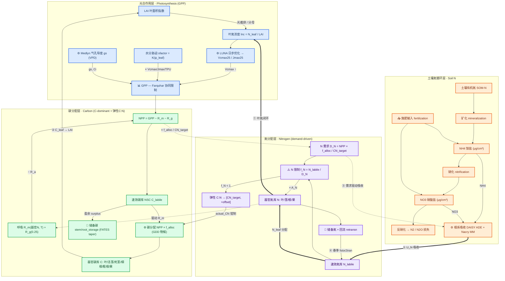

# COMPASS 碳氮–植被–土壤–光合耦合图

> COMPASS v30-2026 当前实现的碳（C）、氮（N）、植被、土壤、光合作用相互影响关系。
> 节点标签后附关键变量名/公式，便于回溯源码。本图据 `src/` 实际代码绘制，非教科书版。

---

## 🔗 总耦合图 / Full coupling diagram

四层（光合 → 碳分配 → 氮分配 → 土壤氮）自上而下为主物质流；粗箭头 `==>` 标出**①叶氮闭环**，虚线 `-.->` 为驱动/需求信号。

---

## 🔄 四大反馈环 / Four feedback loops

| # | 反馈环 | 路径 | 物理含义 |
| --- | --- | --- | --- |
| **①** | 叶氮–光合闭环 | `lnc → LUNA → Vcmax → GPP → NPP → D_N → 吸收 U_N → N_labile → organs_n → lnc` | 缺氮 → Vcmax↓ → GPP↓ → 需求↓ → 吸收↓ → 叶氮持续低，系统锁定在**氮限制态**，直到矿化/回流补给[^1][^2] |
| **②** | 碳–LAI 正反馈 | `GPP → NPP → 分配 → C_leaf → LAI → 光截获 → GPP` | 叶碳长出更多 LAI，截获更多光增 GPP；受 `peaklai`（LAI≥laimx）和休眠物候门控封顶[^2] |
| **③** | 弹性 C:N 缓冲 | `f_N < 1 → actual_CN↑ → 器官碳被钳制 → 剩余留 C_labile → 储备碳` | 氮缺时器官 C:N 上浮到 `[target, target+offset]`，多余碳不强塞器官而入储备，C 不浪费[^3] |
| **④** | 储备越冬多年信号 | `秋季落叶回流 retransn → N_storage → 春季 fstor2tran → N_labile → 叶萌发` | 上一年氮状况经储备库跨年传递，决定次年春季萌发强度（苹果大小年）[^4] |

> **水分旁路**：`sfactor = K(ψ_leaf)` 来自植物水力，乘在 Vcmax/Jmax/TPU 上（不乘 Rd），干旱直接压低 GPP→C_labile，与①②环叠加。

---

## 📋 各节点对应源码 / Source map

| 层 | 关键文件 | 关键函数 / 变量 |
| --- | --- | --- |
| 光合 | `src/+plant/biochemical.m`；`src/+plant/+integrated/+LUNA/computeLuna.m` | Farquhar+Medlyn 迭代；`lnc`→`FNCa`→`Vcmax25/Jmax25`；`sfactor` |
| 碳分配 | `src/+plant/+PlantCarbon/computeCarbonAllocation.m`；`computeNPP.m` | `NPP=GPP−R_m−R_g`(Sitch 2003)；`C_labile`；`clampPoolCN`；FATES `refillTo` |
| 氮分配 | `computeOrganDemand.m`；`allocatePlantN.m`；`runPlantNDemand.m` | `D_N=NPP·f_alloc/CN_target`；`f_N_growth`；`actual_CN` |
| 土壤氮 | `src/+soil/+nitrogen/{+organic/mineralization, +chemistry/nitrification, +root_uptake/nitrogenUptake}.m` | `Smin`、`Snit`、`SinkS`(DAISY+Nacry)；`solveNitrogen.m` 调度 |
| 主循环 | `src/COMPASS.m` | `runPlantNDemand → applyRootUptake → runPlantCNStep → solveNitrogen` |

---

[^1]: Sitch, S. et al. (2003). LPJ 动态全球植被模型——NPP 与氮需求/限制公式 (Eq. 12, 24, 41). *Global Change Biology* 9(2): 161–185. https://doi.org/10.1046/j.1365-2486.2003.00569.x
[^2]: Ali, A.A. et al. (2016). LUNA 模型——叶氮投资优化 Vcmax/Jmax (CLM5 LunaMod). *Geoscientific Model Development* 9: 587–606. https://doi.org/10.5194/gmd-9-587-2016
[^3]: Medlyn, B.E. et al. (2011). 最优气孔导度模型 (g1/√VPD). *Global Change Biology* 17(6): 2134–2144. https://doi.org/10.1111/j.1365-2486.2010.02375.x
[^4]: FATES / Massoud, E.C. et al. (2019). 非结构性碳储备目标驱动平滑充注 (smooth taper). https://doi.org/10.5194/bg-16-3499-2019
