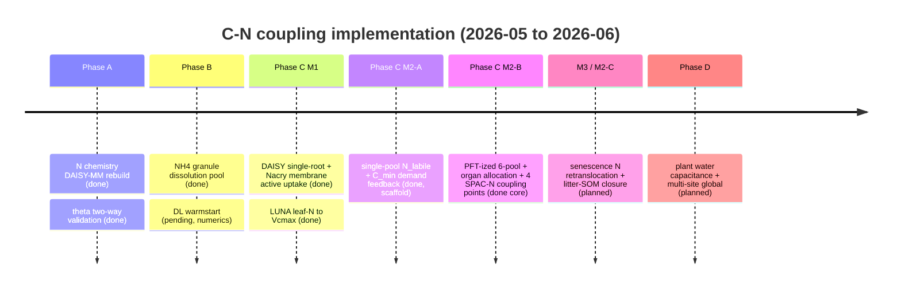
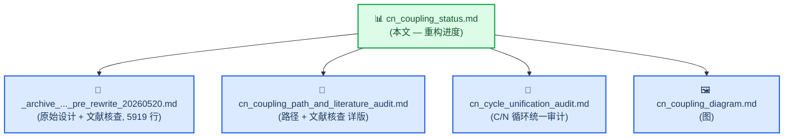

# COMPASS 水–氮–碳闭环耦合 — 架构与实施进度

> 本文是 [_archive_cn_coupling_pre_rewrite_20260520.md](_archive_cn_coupling_pre_rewrite_20260520.md)（2026-05-20 原始设计档，5919 行）的**重构进度版**：把原档的"各部分"按子系统重新组织，并标注当前实现状态（✅ 完成 / 🚧 部分 / ⬜ 计划或推迟）。原档保留作详细设计 + 文献公式核查的索引。
>
> 状态截至 **2026-06-16**。来源：原档 §1–§12 + 当前 `src/` 代码审计 + git 历史。

---

## 📋 进度总览

原档把工作分成 **Phase A → B → C → D** 四阶段；自 2026-05-20 起,**闭环的 11 个核心子系统已基本全部落地并在本周期验证过**(口径修复 / 呼吸节流 / P5 储备 / 2 年复利)。剩余的是衰老–凋落–SOM 闭合、通用化(PFT 化 / 多站点)和几个刻意推迟的过程。

| # | 子系统 | 状态 | 关键文件 |
|---|---|:---:|---|
| 1 | 土壤氮 ADE 运移 | ✅ | `+soil/+nitrogen/+transport/` |
| 2 | 氮化学(硝化/反硝化/矿化/尿素/铵肥溶解) | ✅ | `+soil/+nitrogen/+chemistry/`, `+fertilizer/` |
| 3 | 根系**被动**吸氮(随吸水) | ✅ | `+soil/+nitrogen/+root_uptake/nitrogenUptake.m` |
| 4 | 根系**主动**吸氮(DAISY 单根 + Nacry 根膜) | ✅ | `nacryMembraneFlux.m`, `daisySingleRootFlux.m` |
| 5 | 植物氮库 + 守恒(5 池,C 主导弹性 C:N) | ✅ | `+plant/+PlantNitrogen/allocatePlantN.m` |
| 6 | 植物氮需求(由光合/生长 NPP 推) | ✅ | `+plant/+PlantNitrogen/computeOrganDemand.m` |
| 7 | LUNA 叶氮 → Vcmax/Jmax | ✅ | `+plant/+integrated/+LUNA/computeLuna.m` |
| 8 | 碳氮分配 flexible-CN(6 池,C 主导) | ✅ | `+plant/+PlantCarbon/computeCarbonAllocation.m` |
| 9 | NSC 储备 C(+回流 N) | ✅ | `+plant/+integrated/applyNSCCoupling.m` |
| 10 | 底物限制呼吸节流 + 叶 Rd(Atkin/Kok) | ✅ | `applyNSCCoupling.m`, `biochemical.m` |
| 11 | 果树物候分配(苹果 PFT23,5 相位 GDD) | ✅ | `+plant/+PlantCarbon/fruitTreeAllocation.m` |
| — | 衰老 N 回流 + 凋落–SOM 闭合(M3) | 🚧 | 部分回流已有,全闭合待做 |
| — | PFT 化(一年生+多年生统一) | ⬜ | 设计方案,未实现 |
| — | Phase D:植物水容 + 多站点全球化 | ⬜ | 论文 Tier-1/2 后 |
| — | 木质部氮延迟 / NH4 毒害 / BNF 动态 / P 限制 | ⬜ | §8.13 刻意推迟 |

---

## 🔄 闭环耦合架构

整条链:**土壤无机氮 → 吸水(RWU)携带 + 根膜主动吸收 → 植物 labile N → 叶氮(Na)→ LUNA 优化 Vcmax/Jmax → 光合 GPP → NPP → 碳氮分配 → 器官氮需求 → 反馈回主动吸收**。它把四件物理事实写成守恒可诊断的回路:干旱↓RWU↓被动质流氮;干旱↓水力因子↓光合;低氮↓Vcmax/Jmax↓GPP;高生长需求↑主动吸收↑。

```mermaid
flowchart LR
    accTitle: COMPASS Water-Nitrogen-Carbon Closed Loop
    accDescr: Soil inorganic nitrogen is taken into the plant by passive mass-flow with root water uptake and by active membrane transport; the labile N pool sets leaf N, which drives LUNA enzyme optimization of Vcmax and Jmax, hence photosynthesis and NPP; carbon-nitrogen allocation generates organ N demand that feeds back to active root uptake.

    soil_n["🌱 soil NH4/NO3<br/>ADE + chemistry"]
    rwu["💧 root water uptake<br/>RWU / Srt"]
    uptake["🔀 root N uptake<br/>passive + active"]
    labile["🧪 plant labile N"]
    leaf_n["🍃 leaf N (Na)"]
    luna["⚙️ LUNA<br/>Vcmax25 / Jmax25"]
    photo["☀️ photosynthesis<br/>GPP"]
    npp["🌿 NPP = GPP − Ra"]
    alloc["📦 C/N allocation<br/>6-pool flexible-CN"]
    demand["📈 organ N demand"]

    soil_n --> rwu --> uptake --> labile --> leaf_n --> luna --> photo --> npp --> alloc --> demand
    demand -. demand feedback .-> uptake
    soil_n -. passive mass-flow .-> uptake

    classDef soil fill:#dbeafe,stroke:#2563eb,stroke-width:2px,color:#1e3a5f
    classDef plant fill:#dcfce7,stroke:#16a34a,stroke-width:2px,color:#14532d
    classDef flux fill:#fef9c3,stroke:#ca8a04,stroke-width:2px,color:#713f12

    class soil_n,rwu,uptake soil
    class labile,leaf_n,luna,photo,npp,alloc,demand plant
```

---

## 🧩 子系统进度

### 土壤氮（Soil N）

- **ADE 运移 ✅** — NO3 液相平流-弥散,NH4 加吸附相(线性 Kd,阻滞 R=1+ρ_b·Kd/θ);全 1D ADE 管线 + Thomas TDMA 解 + Peclet/Courant 监控 + 冻融液相钳制。所有项土体基 [μg N/(cm³·s)]。
  - 文献:HYDRUS-1D Šimůnek 2008;CLM5 Tech Note。
- **氮化学 ✅** — 硝化/反硝化均**对称土体基 Michaelis-Menten**(DAISY Hansen 1991 风格),底物 M_NH4=(θ+ρ_b·Kd)·C、M_NO3=θ·C;矿化一阶(SOM 体积基,pH 调制);尿素水解 + 铵颗粒肥溶解解析积分。**A2 修订(2026-05-17)**修了旧反硝化的 C²/(Km+C) 错式。

> ⚠️ **本周期清理(2026-06-16)**:`soilproperty.xlsx` 删了不用的一阶 `Kdenitrification`(MM 不用,代码 8 处删净:`SoilProperties.m` ×7 + `setInitialNitrogen.m` ×1),并给全部参数加了单位;init-only smoke 验证通过。

### 根系氮吸收（Root N uptake）

- **被动吸收 ✅** — RWU 是水-氮耦合桥:仅正向(入根)水流携带溶质 `U_passive = max(RWU_e,0)·C_N,e`。
- **主动吸收 ✅** — **M1 统一机制**(2026-05-18 重写):DAISY 单根柱状 ADE(Klöffel 2026,3 分支按 Péclet)与 Nacry 根膜 MM(Vmax/Km,阈值 C_min)经二分求根**联立**为每层每物种单一通量 `I_x [kg/(m根·s)]`;NH4(带缓冲 ρ_b·Kd)与 NO3(液相)分开。M2-B.2 可选需求驱动模式(读 plant N_labile 反馈)。
  - 文献:DAISY 单根(Klöffel 2026 柱状解);Nacry 2013(HATS/LATS 根膜);被动质流自 HYDRUS。

### 植物氮库与需求（Plant N pools & demand）

- **氮库 + 守恒 ✅** — 5 池(N_labile + 叶/根/活茎/果),**C 主导**(N = C / CN_target,非 N 主导)。弹性 C:N:N 不足时实际 C:N 上浮到 [CN_target, CN_target+offset]。对标 CLM5 FlexibleCN(`NutrientCompetitionFlexibleCNMod.F90:1660`)。
- **氮需求 ✅** — 每器官 `D_N = f_alloc·NPP·1000/CN_target [g N/(m²·s)]`(Sitch 2003 LPJ Eq.12);果实门控用 GDD `fruitTreeAllocation` 或静态 DOY 窗。
  - `f_N_growth = N_labile/(D_N·dt)` 钳到 [0,1] 限制实际生长。

### 叶氮 → 光合（LUNA）

- **LUNA 叶氮→Vcmax/Jmax ✅** — CLM5 `LunaMod.F90` **1:1 移植**:5 池氮(光捕获/电子传递/羧化/呼吸/储备)爬山优化日净碳收益,日更 Vcmax25/Jmax25(10%/d 速率限);`Vcmax25=N_cb·Fc25`、`Jmax25=N_et·Fj25`(Vcmax/Jmax 解耦,无固定 RJV)。由 lnc(=N_leaf/LAI)+ 240d PAR + 热驯化驱动。下游 biochem.m 接 Kattge-Knorr 2007 峰值 Arrhenius fT × 水力因子。
  - 文献:Ali 2016 GMD 9:587;Xu 2012 New Phytol 193:30;Lawrence 2019 CLM5 Tech Note Ch.9。
  - 三层链:**N → 25°C 容量(日)→ T 响应(每步)→ 水力胁迫(每步)**。

### 碳氮分配（C/N allocation）

- **flexible-CN 6 池 ✅** — C_labile + 叶 + 细根 + 活茎 + 死茎 + 果,**C 主导**(2026-06-11 删除 N 主导 `c_follows_n` 模式)。`A_C = NPP·f_alloc`,N 跟随弹性 C:N 带。
  - 文献:Dombrowski 2022 GMD 15:5167;CLM5。

### 呼吸与 NSC 储备

- **NSC 储备 C ✅** — `applyNSCCoupling.m`:R_m 受 NSC 上限约束;C_labile→C_storage 按 target(`computeLabileSugarTarget.m` 糖底线)补库;C_labile≥0(赤字时从 C_storage 透支)。储备为纯 C 池;回流 N 经独立 retransN(质量平衡)。
- **底物限制呼吸 ✅** — **tc_mm_nodebt(本周期定型为苹果默认,commit 6dad23e)**:Thornley & Cannell 2000 Ann Bot 85:55 Eq.17 的 M-M 节流 θ=NSC/(Km+NSC) 作用于**总 NSC**(糖+淀粉),无 xsmrpool 欠债。叶 Rd = Atkin 2015(`lmr25=1.756+0.2061·lnc−0.0402·Tgrowth`)× Bernacchi 2001 T 响应 × **Kok 白天光抑制 0.67**(CLM5 `PhotosynthesisMod.F90:1562-1563`)。
  - **本周期口径修复**:NEE/Reco/autotrophic_respiration 改用 actual(节流后)Ra,扣除重复计的 270 gC。

### 果树物候分配（Apple PFT23）

- **5 相位 GDD 分配 ✅** — CLM5-FruitTree 忠实移植(Dombrowski 2022 GMD 15:5167 `NutrientCompetitionFlexibleCNMod.F90:1645-1754`):P1 营养 [0,400) → P2 果实充实 [400,1100) → P3 成熟 [1100,1350) → P4 叶成熟 [1350,2880) → P5 采后 ≥2880。根/叶 J-Norman taper 确定性锚点。
  - **本周期 P5 修复(commit 92593de)**:采后零 display 分配,碳留 labile surplus → Step 3c 补储备(原 split 让采后长 display、饿死储备)。1 年 + **2 年复利已验证**(次年 LAI 峰 2.80 = 年 1,储备健康循环)。

---

## 🗓️ 里程碑时间线

_自原档 §3 的 Phase A–D 与 §12 的 M1/M2 里程碑。_

---

## ⬜ 未完成与刻意推迟

| 项 | 状态 | 说明 |
|---|:---:|---|
| **M3 / M2-C** 衰老 N 回流 + 凋落–SOM 闭合 | 🚧 计划 | 部分 retranslocation 已有;NPP→器官 C→C 驱动 N 需求→叶衰老氮回流→凋落-SOM 全闭合待补 |
| **PFT 化** 一年生 + 多年生统一架构 | ⬜ 设计 | 原档 §12.14 的参数 PFT 化整理方案,尚未实现为统一参数控制 |
| **Phase D** 植物水容(V_plant)+ 多站点全球化 | ⬜ 计划 | 第一批 Tier-1/2 论文后 |
| 木质部氮延迟(夜间浓缩/黎明脉冲) | ⬜ 推迟 | §8.13:需木质部水+氮储备态,识别难,先跑通基础闭环 |
| NH4 毒害 / 高氮高斯毒害 | ⬜ 推迟 | §8.13:经验罚函数,缺施肥/铵毒实测标定 |
| BNF 动态反馈 / P 限制 / N-P 共限 | ⬜ 推迟 | §8.13:额外不可识别参数,推后 |
| DL warmstart(ONNX + hook) | ⬜ 数值 | Phase B 选项,提速用,非 C-N 核心 |

---

## 📚 文献锚点（按子系统）

| 子系统 | 主要文献 / 源码 |
|---|---|
| 土壤 N ADE | HYDRUS-1D Šimůnek 2008;CLM5 Tech Note |
| N 化学(MM) | DAISY Hansen 1991 |
| 主动吸收 | DAISY 单根 Klöffel 2026;Nacry 2013 根膜 |
| 植物 N 库(flexible-CN) | CLM5 `NutrientCompetitionFlexibleCNMod.F90:1660` |
| N 需求 | Sitch 2003 GCB 9:161 LPJ Eq.12 |
| LUNA | Ali 2016 GMD 9:587;Xu 2012 New Phytol 193:30;Lawrence 2019 CLM5 Tech Note Ch.9 |
| C/N 分配 + 果树物候 | Dombrowski 2022 GMD 15:5167;CLM5 |
| 呼吸节流 | Thornley & Cannell 2000 Ann Bot 85:55 Eq.17 |
| 叶 Rd + Kok | Atkin 2015 New Phytol 206:614;CLM5 `PhotosynthesisMod.F90:1562-1563`(Kok 0.67) |

> 文献引用遵循 `compass-coding-standard` §5.5:可验证 + 具体到表/页/公式/行号。`Kdenitrification`(一阶反硝化)与 NH4 毒害的高斯式属经验/未核实项,已在代码中相应标注或移除。

---

## 🗂️ 文档关系

**一句话**:水–氮–碳闭环的 11 个核心子系统已**全部落地**(土壤 N→根吸→植物 N 库→LUNA 叶氮控光合→碳氮分配→需求反馈),本周期完成口径/呼吸/P5 修复并经 1 年 + 2 年验证。剩余是**衰老–凋落–SOM 闭合 + 通用化(PFT 化/多站点)+ 几个刻意推迟的过程**。
