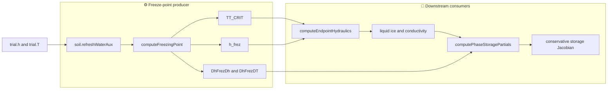
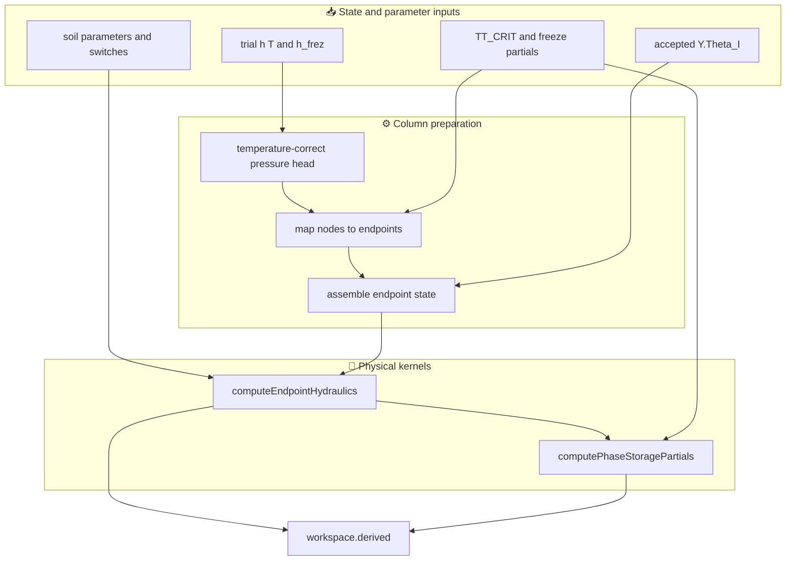
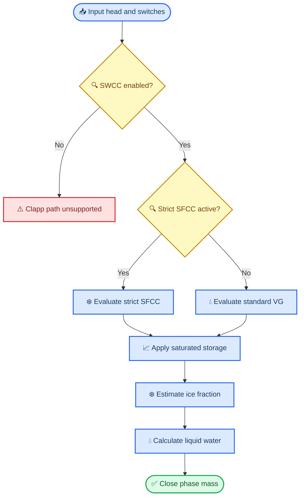

# 水–热–水汽–冻融守恒储量与 Jacobian 完整推导

日期：2026-07-11  
更新：2026-07-12（重写文首水分方程推导，删除重复的旧第 7、8 节）  
状态：新版守恒装配器的数学合同；旧 `calculateMatricCoefficients` 保留

## 🌊 水分方程从连续守恒到 mixed-form 的完整推导

本节先把整条数学主线推导完，后文再分别展开温度修正、VG 容量、冻融闭合和代码分支。这里的核心是：先确定唯一的总水质量账本，再对它做局部线性化，最后将连续方程离散为三对角线性系统。

主要依据为 Zeng (2013) Eqs. 4.10、4.47–4.60[^zeng2013]，Wang et al. (2021) Appendix A2.1 Eq. A13[^wang2021]，Yu et al. (2018) Appendix A1–A5[^yu2018-sfcc]，以及 Celia et al. (1990) modified Picard mixed form[^celia1990]。


### 第一步：从水质量守恒出发

先不考虑冰，单位土体中的水质量密度为：

\[
m_w=\rho_l\theta_l+\rho_v\theta_g .
\]

其中 \(\theta_l\) 是液水体积分数，\(\theta_g\) 是气相孔隙体积分数。一维垂向质量守恒为：

\[
\boxed{
\frac{\partial}{\partial t}
(\rho_l\theta_l+\rho_v\theta_g)
=-\frac{\partial}{\partial z}(q_l+q_v)-S_m
}
\]

这是 Wang Eq. A13 和 Zeng Eq. 4.10 的核心：左边是储量变化，右边是液水与水汽的净通量散度以及根系吸水等汇项。

以液水密度 \(\rho_l\) 归一化，后续方程中的储量统一用“等效液水体积”表示，这样液水、冰和水汽可以在同一把尺上相加。

### 第二步：把总通量拆成六种机制

液水通量由水头、温度、气压和重力驱动：

\[
q_l=q_{Lh}+q_{LT}+q_{La}+q_{Lg} .
\]

水汽通量由水头、温度和孔隙空气运动驱动：

\[
q_v=q_{Vh}+q_{VT}+q_{Va} .
\]

| 通量 | 驱动力 | 当前系数 |
|---|---|---|
| \(q_{Lh}+q_{Vh}\) | \(\partial h/\partial z\) | `Khh` |
| \(q_{LT}+q_{VT}\) | \(\partial T/\partial z\) | `KhT` |
| \(q_{La}+q_{Va}\) | \(\partial P_g/\partial z\) | `Kha` |
| \(q_{Lg}\) | 重力 | `Chg=KfL_h` |
| 空气携带的水汽 | \(V_A\) 与水汽密度梯度 | `Vvh`、`VvT` |

`ChT` 和 `KhT` 不是同一个量。`ChT` 是温度改变引起的水储量变化，进入时间项；`KhT` 是温度梯度驱动的水分通量，进入空间项。

### 第三步：重写为以水头、温度和气压为主变量的方程

将液水含量、水汽密度和导水率都视为 \(h,T,P_g\) 的函数，Zeng Eq. 4.60 可写为：

\[
\boxed{
\begin{aligned}
Chh\frac{\partial h}{\partial t}
+ChT\frac{\partial T}{\partial t}
={}&\frac{\partial}{\partial z}
\left(
Khh\frac{\partial h}{\partial z}
+KhT\frac{\partial T}{\partial z}
+Kha\frac{\partial P_g}{\partial z}
\right)\\
&+\frac{\partial K_L}{\partial z}
+Vvh\frac{\partial h}{\partial z}
+VvT\frac{\partial T}{\partial z}
-S_w .
\end{aligned}
}
\]

这里水方程中已经有气压影响：`Kha`将 \(\partial P_g/\partial z\) 带入通量。当前本构关系把水汽状态主要写成 \(h,T\) 的函数，因此没有独立的 \(ChP_g\,\partial P_g/\partial t\) 储量项。

### 第四步：将未冻水储量扩展为统一的冻融总水储量

为了在同一方程中守恒液水、冰和水汽，定义凝结态水的液水等效储量：

\[
\Theta_u=
\theta_l+
\frac{\rho_i}{\rho_l}\theta_i+
S_s\max(h,0) .
\]

再加上水汽质量：

\[
\boxed{
M_w=\Theta_u+\frac{\rho_v}{\rho_l}\theta_g
}
\]

代码对应为：

| 数学量 | 当前字段 | 含义 |
|---|---|---|
| \(\theta_l\) | `Theta_LL` | 液态孔隙水 |
| \(\theta_i\) | `Theta_II` | 冰体积分数 |
| \(\theta_g\) | `Theta_V` | 气相孔隙体积 |
| \(\Theta_u\) | `Theta_UU` | 凝结态总水的液水等效储量 |
| \(M_w\) | `theta_eq` | 加入水汽后的完整水质量储量 |

冻结只能重新分配液水和冰：

\[
\Delta\theta_l+
\frac{\rho_i}{\rho_l}\Delta\theta_i=0 .
\]

因此不能用 `Theta_LL` 单独作为冻土水方程的时间储量，否则液水转成冰会被误判为土柱丢水。

### 第五步：对总水储量求导得到 `Chh`

对水头求偏导：

\[
\begin{aligned}
Chh
=\frac{\partial M_w}{\partial h}
={}&\frac{\partial\Theta_u}{\partial h}
+\frac{\rho_v}{\rho_l}
\frac{\partial\theta_g}{\partial h}
+\frac{\theta_g}{\rho_l}
\frac{\partial\rho_v}{\partial h} .
\end{aligned}
\]

代码中对应：

```matlab
Chh = DThetaWaterEquivDh ...
    + (RHOV / RHOL) * DThetaGasDh ...
    + Theta_V * DRHOVh / RHOL;
```

未冻结、未饱和时，\(\Theta_u=\theta_l\)、\(\theta_g=\phi-\theta_l\)，所以：

\[
Chh=
\left(1-\frac{\rho_v}{\rho_l}\right)
\frac{\partial\theta_l}{\partial h}
+\frac{\theta_g}{\rho_l}
\frac{\partial\rho_v}{\partial h} .
\]

这正好退化为 Zeng Eq. 4.57 和原版 STEMMUS 的 `Chh`。新版的不同不是改写未冻公式，而是把冰、正水头弹性储水和气相体积的导数显式放进同一条链式法则。

### 第六步：对总水储量求导得到 `ChT`

对温度求偏导：

\[
\boxed{
ChT=
\frac{\partial\Theta_u}{\partial T}
+\frac{\rho_v}{\rho_l}
\frac{\partial\theta_g}{\partial T}
+\frac{\theta_g}{\rho_l}
\frac{\partial\rho_v}{\partial T}
}
\]

代码中对应：

```matlab
ChT = DThetaWaterEquivDT ...
    + (RHOV / RHOL) * DThetaGasDT ...
    + Theta_V * DRHOVT / RHOL;
```

三项分别表示：

1. 温度通过保水曲线修正和冻融闭合改变凝结态等效储量；
2. 温度改变液水–冰体积分配，从而改变气相孔隙体积；
3. 在气相孔隙不变时，温度仍可以通过 \(\partial\rho_v/\partial T\) 改变水汽质量。

未冻结时它退化为：

\[
ChT=
\left(1-\frac{\rho_v}{\rho_l}\right)
\frac{\partial\theta_l}{\partial T}
+\frac{\theta_g}{\rho_l}
\frac{\partial\rho_v}{\partial T} ,
\]

与原版 `ChT=(1-RHOV/RHOL)*DTheta_LLT+Theta_V*DRHOVT/RHOL` 一致。当前改动是把含义混杂的 `DTheta_LLT` 替换为明确的当前状态偏导。

### 第七步：由通量本构关系得到空间系数

当前系数与 Zeng Eq. 4.59 的对应关系为：

\[
Khh=
K_{fL,h}+
\frac{D_V+D_{Vg}}{\rho_l}
\frac{\partial\rho_v}{\partial h} ,
\]

\[
KhT=
K_{L,T}+D_{Ta}+
\frac{D_V\eta+D_{Vg}}{\rho_l}
\frac{\partial\rho_v}{\partial T} ,
\]

\[
Kha=
\frac{K_{fL,h}}{\gamma_w}+
\frac{\rho_vK_g}{\rho_l} ,
\]

\[
Vvh=-\frac{V_A}{\rho_l}\frac{\partial\rho_v}{\partial h},
\qquad
VvT=-\frac{V_A}{\rho_l}\frac{\partial\rho_v}{\partial T},
\qquad
Chg=K_{fL,h} .
\]

`calculateWaterEquationCoefficients` 到此为止只建立系数库，不构造矩阵、右端项、边界条件或求解结果。

### 第八步：用 Galerkin 线性有限元组装空间方程

每个土层单元使用两个线性形函数：

\[
h(z,t)\approx h_1(t)\phi_1(z)+h_2(t)\phi_2(z) ,
\]

\[
T(z,t)\approx T_1(t)\phi_1(z)+T_2(t)\phi_2(z) ,
\]

\[
P_g(z,t)\approx P_{g1}(t)\phi_1(z)+P_{g2}(t)\phi_2(z) .
\]

对连续方程乘测试函数并积分，通量散度项分部积分后得到 Zeng Eqs. 4.49–4.52 的单元矩阵。当前代码对储量使用 lumped 积分：

\[
C_{1,i}=
\sum_{e\ni i}
\frac{\Delta z_e}{2}Chh_{e,i},
\qquad
C_{2,i}=
\sum_{e\ni i}
\frac{\Delta z_e}{2}ChT_{e,i} .
\]

| 矩阵量 | 物理作用 |
|---|---|
| `C1` | `Chh` 水头储量 Jacobian |
| `C2` | `ChT` 温度储量 Jacobian |
| `C4` | `Khh` 与 `Vvh` 的水头传输算子 |
| `C5` | `KhT` 与 `VvT` 的温度传输算子 |
| `C6` | `Kha` 气压梯度算子 |
| `C7` | 重力通量项 |
| `C9` | 根系吸水等汇项 |

线性单元只连接相邻节点，因此全局水头系统为三对角结构，可在施加顶底边界条件后用 Thomas 算法求解。

### 第九步：说清 head-form 为什么不严格守恒

时间步起点为 \(n\)，当前非线性迭代为 \(m\)。旧 head-form 用当前容量斜率估计整个时间步的储量变化：

\[
M_w^{n+1}-M_w^n
\approx
Chh^m(h^{n+1}-h^n)
+ChT^m(T^{n+1}-T^n) .
\]

对强非线性保水曲线，“局部斜率 × 整段状态差”不一定等于真实的 \(M_w^{n+1}-M_w^n\)。即使线性水头方程收敛，也可能留下可观的质量残差。

### 第十步：mixed-form 把精确账本和局部 Jacobian 分开

将“时间步起点到下一试算”拆成两段：

\[
\begin{aligned}
M_w^{m+1}-M_w^n
\approx{}&
\underbrace{M_w^m-M_w^n}_{\text{已知的精确有限储量差}}\\
&+\underbrace{Chh^m(h^{m+1}-h^m)
+ChT^m(T^{m+1}-T^m)}_{\text{仅线性化当前试算到下一试算的小修正}} .
\end{aligned}
\]

精确储量残差按与 `C1`、`C2` 相同的端点权重积分：

\[
R_{\theta,i}^m=
\sum_{e\ni i}
\frac{\Delta z_e}{2}
\left(M_{w,e,i}^m-M_{w,e,i}^n\right) .
\]

若这一次线性水方程只求 \(h^{m+1}\)，而温度保持为当前耦合试算 \(T^m\)，则：

\[
T^{m+1}-T^m=0 .
\]

此时水头时间项是：

\[
\boxed{
\frac{C_1^m}{\Delta t}h^{m+1}
=
\frac{C_1^m}{\Delta t}h^m
-\frac{R_\theta^m}{\Delta t}
+\text{空间通量与源汇项}
}
\]

当迭代收敛时，\(h^{m+1}-h^m\to0\)，最终留下的是真实的 \(M_w^{n+1}-M_w^n\)，而不是一条切线估计的储量变化。

### `ChT` 在 coupled mixed-form 中究竟放在哪里

数学上的完整 coupled mixed-form 必须包含：

\[
ChT^m(T^{m+1}-T^m) .
\]

但必须区分“完整耦合线性化”和“顺序耦合中的单次水头子求解”：

| 求解方式 | 本次未知量 | `ChT` 处理 |
|---|---|---|
| 同时求 \(h^{m+1},T^{m+1}\) | 水头和温度 | 显式保留 \(ChT^m(T^{m+1}-T^m)\) |
| 先给定 \(T^m\)，再求 \(h^{m+1}\) | 只有水头 | \(T^{m+1}-T^m=0\)，不再形成 `C2` 修正 |

在第二种情况中，从时间步起点 \(T^n\) 到当前温度试算 \(T^m\) 造成的全部有限储量变化，已经在以完整状态 \((h^m,T^m)\) 计算的 `Rtheta` 中：

\[
R_\theta^m
\sim
M_w(h^m,T^m)-M_w(h^n,T^n) .
\]

因此在同一个 mixed 水头子求解中，再加旧 head-form 的 \(C_2(T^m-T^n)\) 会对温度储量重复计账。`C2` 仍然是完整 Jacobian 的必要系数，但只在同一线性系统中还要求新温度时乘以非零 \(\Delta T\)。

### 第十一步：从公式对应到当前代码

```text
updateWaterContentAuxiliary
  -> computeEndpointHydraulics
  -> computePhaseStoragePartials
  -> calculateWaterEquationCoefficients
  -> assembleCoefficientMatrices
  -> calculateTimeDerivatives
  -> calculateBoundaryConditions
  -> solveTridiagonalMatrixEquations
  -> exact column-water mass gate
  -> accept and commit
```

| 推导对象 | 当前代码 | 责任 |
|---|---|---|
| 端点液水、冰、气相和导水率 | `computeEndpointHydraulics.m` | 计算当前本构状态 |
| 相态对 \(h,T\) 的偏导 | `computePhaseStoragePartials.m` | 建立物理链式导数 |
| `Chh`、`ChT`、`Khh`、`KhT`等 | `calculateWaterEquationCoefficients.m` | 只生成水方程系数 |
| `C1`–`C9` | `assembleWaterEquationMatrices.m` | 组装水分有限元空间算子 |
| `Rtheta` 和时间项 | `calculateTimeDerivatives.m` | 构造 head 或 mixed 右端项 |
| 顶底通量或定值条件 | `calculateBoundaryConditions.m` | 修改边界行 |
| 新水头 | `solveTridiagonalMatrixEquations.m` | Thomas 前消元和回代 |

### 第十二步：当前守恒路线与原版 STEMMUS 的差异

| 内容 | 原版 STEMMUS | 当前守恒路线 |
|---|---|---|
| 连续通量方程 | Zeng 4.10/4.60 | 基本保留 |
| 未冻 `Chh/ChT` | 液水–水汽形式 | 在未冻区严格退化为原式 |
| 冻融储量 | 主要依赖 `DTheta_LLh/DTheta_UUh` 历史语义 | 显式守恒液水、冰等效质量和水汽 |
| 时间项 | head-form 局部斜率跨整步近似 | exact finite storage residual + local Jacobian |
| 温度储量 | `DTheta_LLT` 可来自割线或经验分支 | 显式 `DThetaWaterEquivDT/DThetaGasDT/DRHOVT` |
| 空间离散 | 线性 Galerkin 有限元 | 保留 |
| 线性求解 | Thomas 三对角求解 | 保留并拟抽成共同求解器 |

> 📌 **当前唯一实现：** `calculateTimeDerivatives` 在热/干空气四种开关组合下都只装配 conservative mixed-form，并继续采用后向欧拉时间离散。调用者必须显式提供已接受子步起点的 `thetaEqN`；事务式 water-only 路线和完整耦合路线都在进入 Picard 循环前计算一次并复用。配置中不再存在 `water_time_form`，代码也不会静默回退到 head-form。

## 1. 目标与边界

本文推导三类连续状态下同一个水质量储量函数及其偏导：

1. 等温、未冻结 Richards；
2. 非等温液水–水汽；
3. 液水–冰–水汽冻融。

数值目标不是匹配旧轨迹，而是满足：

```text
exact finite storage residual + current-state local Jacobian
```

旧函数中的跨时间层割线、`abs(DTheta_LLh)` 和冻融专用手写容量不进入新版数学定义。旧函数作为公开 STEMMUS 兼容路径保留。

主要来源：

- Zeng, Y. (2013), *Coupled Dynamics in Soil*, Eqs. 4.4, 4.10, 4.15,
  4.17, 4.47–4.60；本地 PDF：
  `D:/OneDrive/文档/最近读文献/STEMMUS/试验观测与案例/Coupled Dynamics in Soil.pdf`。
- Yu, L. et al. (2018), *JGR: Atmospheres* 123:7391–7414,
  DOI `10.1029/2018JD028502`, Appendix Eqs. A1–A5；本地 PDF：
  `D:/OneDrive/文档/最近读文献/STEMMUS/模型与方法/冻土中的STEMMUS.pdf`。
- Celia, M. A. et al. (1990), *Water Resources Research* 26:1483–1496，
  modified Picard mixed form。

## 2. 状态、单位和符号

主变量：

```text
h   signed matric head [cm], unsaturated h < 0
T   soil temperature [degC or K difference]
Pg  mixed pore-gas pressure [Pa]
```

相态体积分数：

```text
theta_l  liquid volume / bulk volume
theta_i  ice volume / bulk volume
theta_g  gas-filled pore volume / bulk volume
theta_p  pore condensed water expressed as liquid-water-equivalent volume
Theta_u  augmented total condensed-water storage used by Richards
```

定义：

\[
\theta_p=\theta_l+\frac{\rho_i}{\rho_l}\theta_i,
\qquad
\theta_g=\phi-\theta_l-\theta_i,
\qquad
\Theta_u=\theta_p+S_s\max(h,0) .
\]

因此 `theta_p` 是孔隙凝结态水质量除以液水密度，不是液态水体积；
`Theta_u` 还包含正水头下的弹性储水。弹性项参与水质量储量，但不占用
液水、冰或气相孔隙体积，也不直接进入相态热容和潜热。

## 3. 温度修正压力头

Zeng Eq. 4.17 后给出经验温度修正：

\[
u(h,T)=\chi(T)h,
\qquad
\chi(T)=\exp[-C_w(T-T_r)],
\qquad
C_w=0.0068\ \mathrm{K^{-1}} .
\]

链式偏导为：

\[
u_h=\chi,
\qquad
u_T=-C_w\chi h .
\]

由于未饱和状态下 \(h<0\)，所以 \(u_T>0\)。

当前变量对应关系：

```text
COR   = chi
CORh  = Cw
CORhh = -Cw
```

`CORh` 不是 `COR` 对 `h` 的导数，而是常数 \(C_w\)。

## 4. van Genuchten 正切容量

对 \(u<0\)，令 \(x=-u>0\)：

\[
\theta(u)=\theta_r+(\theta_s-\theta_r)
\left[1+(\alpha x)^n\right]^{-m} .
\]

则：

\[
\boxed{
\frac{\partial\theta}{\partial u}
=(\theta_s-\theta_r)mn\alpha^n(-u)^{n-1}
\left[1+(\alpha(-u))^n\right]^{-m-1}>0
}
\]

负值是对正吸力幅值 \(|u|\) 的导数，不是对 signed head \(u\) 的导数。

未冻结时：

\[
\theta_{l,h}=\theta_u'(u)\chi,
\qquad
\theta_{l,T}=\theta_u'(u)(-C_w\chi h) .
\]

## 5. 旧 `DhU` 的来源

精确修正压力头变化是：

\[
\Delta u_{\rm exact}=\chi(T^m)h^m-\chi(T^n)h^n .
\]

在当前迭代 \((h^m,T^m)\) 做一阶 Taylor 展开：

\[
\Delta u_{\rm Taylor}
=\chi_m(h^m-h^n)-C_w\chi_m h^m(T^m-T^n) .
\]

即：

\[
\boxed{
\Delta u_{\rm Taylor}
=\chi_m[(h^m-h^n)-C_wh^m(T^m-T^n)]
}
\]

这与旧代码完全一致：

```matlab
DhU = COR * (hh - h + hh * CORhh * (TT - T));
```

旧割线：

\[
C_{\rm sec}
=\chi_m\frac{\theta^m-\theta^n}{DhU}
\]

近似 \(\partial\theta/\partial h\)，但它是跨接受状态和当前迭代的准 Newton 斜率，不是持水曲线的局部物理导数。

## 6. 冻融相态闭合

### 6.1 先不看推导：为什么需要 `h_frez`

这里的 SFCC 是 *soil freezing characteristic curve*，即“土壤冻结特征曲线”：它描述降温时
还有多少水能保持液态。Clapeyron 关系在这里负责把“低了多少度”换算成“等价多少压力头”。
前者回答液水–冰怎么分，后者提供温度与水头之间的换算规则。

先把土壤持水曲线 \(F(h)\) 想成一张查表：给它一个压力头 \(h\)，它返回在这个水头下能保持
多少液态水。压力头越负，查到的液态水越少。

没有冻结时，只需要回答一个问题：

> 当前压力头 \(h\) 对应多少水？

冻结时要分成两个问题：

1. 当前压力头控制的总凝结水有多少？这个量记为 \(\theta_u\)
2. 在这些水中，当前温度允许多少仍保持液态？这个量记为 \(\theta_l\)

严格 SFCC 的核心做法不是重新发明一条“温度–液水曲线”，而是把低温换算成一个额外负水头
`h_frez`，然后仍用同一条持水曲线：
\[
\theta_u=F(h),
\qquad
\theta_l=F(h+h_{frz}) .
\]

这里 `h_frez <= 0`。土温越低，`h_frez` 越负，\(h+h_{frz}\) 就越负，查到的液态水越少；
\(\theta_u\) 与 \(\theta_l\) 之间不能继续保持液态的那部分水，再通过密度修正转成冰。

所以 `computeFreezingPoint` 实际只做两件事：

1. 先由压力头算出“这个节点从多少度开始冻结”，即 `Tcrit`
2. 如果实际土温低于 `Tcrit`，再把这段温差换算成 `h_frez`

后面的公式只是把这两句话精确写出来。Yu et al. (2018) Appendix A1–A4 给出了这套
Clapeyron + van Genuchten 关系[^yu2018-sfcc]。

### 6.2 `computeFreezingPoint`：从压力头和温度得到冻结头

`soil.water.computeFreezingPoint` 的职责可以先压缩成一句话：它把当前非线性试算的压力头
`hh` 和土壤温度 `TT` 转换为严格 SFCC 所需的临界冻结温度 `TT_CRIT`、冻结附加水头
`h_frez` 及其对 `hh`、`TT` 的分段偏导。它不直接计算冰含量，也不推进时间状态；它是冻融
持水曲线和守恒 Jacobian 的上游辅助量生产器。

#### 6.2.1 先把三个容易卡住的词说清楚

| 文档里的词 | 解释 |
|---|---|
| \(s_{hT}\) | “温度转水头”的单位换算系数；不是待率定参数。当前约为 `12458 cm/K`，即降温 1 K 等价于约 `−12458 cm` 的冻结水头 |
| `Tmin` | `Tcrit` 允许采用的最低温度偏移；不是土壤历史最低温，也不是函数在时间序列上求出来的最小值 |
| 原始值或未夹断值 | 直接按物理公式算出的结果，还没有经过上下限保护 |
| 夹断值 | 原始结果超过允许范围后，被 `min/max` 改写到边界上的结果 |

“未夹断冻结分支”因此只表示：该节点既进入了冻结条件，`Tcrit` 和 `h_frez` 又都没有撞到
代码设置的边界。它不是一种新的冻结物理，只是说明当前使用的是公式内部的光滑区间。

可以把“夹断”想成温度计量程。真实计算得到 `−16 °C`，但代码规定最低只准用 `−10 °C`，
那么最终保存的是 `−10 °C`；这个节点就被下限夹断了。

#### 6.2.2 先用一个节点把 `h_frez` 算完

取一个容易核算的节点：

| 已知量 | 数值 |
|---|---:|
| 土壤压力头 \(h\) | `−1000 cm` |
| 土壤温度 `TT` | `−5 °C` |
| `Tmin` | `−10 °C` |
| 温度–水头换算系数 \(s_{hT}\) | `12458.2209 cm/K` |

第一步，由压力头算原始冻结温度。相对于 \(0\ ^\circ\mathrm{C}\) 的温度偏移为：

\[
TT_{crit}^{raw}=\frac{h}{s_{hT}}
=\frac{-1000}{12458.2209}
=-0.08027\ ^\circ\mathrm{C} .
\]

意思是：这个节点不是刚到 \(0\ ^\circ\mathrm{C}\) 就冻结，而是降到大约
\(-0.08027\ ^\circ\mathrm{C}\) 才进入平衡冻结条件。

第二步，检查 `Tmin` 下限。原始值 `−0.08027 °C` 高于允许下限 `−10 °C`，所以不用修改：

\[
TT_{crit}=-0.08027\ ^\circ\mathrm{C} .
\]

这就是“`Tcrit` 未夹断”。如果原始值算成 `−16 °C`，同一个 `Tmin=−10 °C` 会把它改成
`−10 °C`，那才叫“`Tcrit` 被夹断”。

第三步，比较实际土温与冻结温度：

\[
-5<-0.08027 .
\]

实际土温更低，因此冻结分支激活。低了多少：

\[
\Delta T=TT-TT_{crit}
=-5-(-0.08027)
=-4.91973\ \mathrm{K} .
\]

第四步，把这段温差换成冻结水头：

\[
h_{frz}=s_{hT}\Delta T
=12458.2209\times(-4.91973)
=-61291.1044\ \mathrm{cm} .
\]

最后，严格 SFCC 实际拿去查液态持水曲线的水头是：

\[
h+h_{frz}
=-1000-61291.1044
=-62291.1044\ \mathrm{cm} .
\]

这就是整个 `h_frez` 计算。后文只是把这个单节点算例推广成向量、补上极干/极冷边界，并对
结果求偏导。

#### 6.2.3 它在水分求解链中的位置



三个输出进入不同但相互闭合的下游路径：

| 输出 | 写入位置 | 直接用途 | 进一步影响 |
|---|---|---|---|
| `TT_CRIT` | `workspace.derived.TT_CRIT` | 判断土壤是否低于局部冻结温度 | `KfL_T` 的冻融温度传导分支 |
| `h_frez` | `workspace.step.trial.h_frez` | 严格 SFCC 使用 \(h+h_{frz}\) 计算液态水 | `theta_l`、`theta_i`、`Se`、`K_L` 和冰阻抗 |
| `dh_frez_dh` | `workspace.derived.DhFrezDh` | 液水对压力头的链式偏导 | 水质量储量 Jacobian |
| `dh_frez_dT` | `workspace.derived.DhFrezDT` | 液水对温度的链式偏导 | 当前进入相态储量偏导，并为完整水–热/潜热 Jacobian 提供所需导数 |

因此，这个函数不是一个可有可无的“冻结诊断”。如果只传 `h_frez` 而不传两个偏导，液水值
可能看起来正确，但 Newton/Picard 矩阵描述的就会是另一个函数，冻结区的水–热耦合不再一致。

#### 6.2.4 输入、输出和温度约定

函数签名为：

```matlab
[TT_CRIT, h_frez, partials] = computeFreezingPoint( ...
    hh, TT, T0, g, L_f, hd, Tmin)
```

| 量 | 单位 | 含义 |
|---|---:|---|
| `hh` | cmH2O | 当前试算压力头；非饱和时为负 |
| `TT` | °C | 相对 \(0\ ^\circ\mathrm{C}\) 的土壤温度 |
| `T0` | K | 纯水冻结温度，当前为 273.15 K |
| `g` | cm s\(^{-2}\) | 模型 CGS 约定下的重力加速度 |
| `L_f` | J kg\(^{-1}\) | 冰融化潜热；启用冻结时必须大于零 |
| `hd` | cmH2O | 烘干压力头阈值 |
| `Tmin` | °C | `Tcrit` 的数值下限偏移；不同调用链的实际来源见第 6.2.6 节 |
| `TT_CRIT` | K | 每个节点的临界冻结温度 |
| `h_frez` | cmH2O | 加到基础压力头上的冻结附加水头，非正 |

代码首先执行 `hh(:)` 和 `TT(:)`，把行向量或列向量统一成 `NN x 1`。这只是形状规范化，
不会改变物理量，也保证后续所有掩码和向量赋值使用同一布局。

这里最容易混淆的是 `TT` 与 `TT_CRIT` 的单位。`TT` 是摄氏温度，而 `TT_CRIT` 是绝对温度；
因此比较前先构造：

\[
T_s = T_0 + TT .
\]

温差的数值用 °C 或 K 表示相同，所以后面的 \(T_s-T_{crit}\) 仍是 K。

#### 6.2.5 第一步：建立温度与水头的 Clapeyron 比例尺

Yu et al. (2018) Appendix A3–A4 给出的冻结势关系可写为[^yu2018-sfcc]：

\[
s_{hT}=\frac{L_f10^4}{gT_0},
\qquad [s_{hT}]=\mathrm{cmH_2O\ K^{-1}} .
\]

代码中的 `freezeHeadPerKelvin` 就是 \(s_{hT}\)：

```matlab
freezeHeadPerKelvin = L_f * 1e4 / (g * T0);
kelvinPerHead = 1 / freezeHeadPerKelvin;
```

其中 `1e4` 不是经验系数。论文公式使用 SI 的米水头和 m s\(^{-2}\)，而 COMPASS 在该函数中
使用厘米水头和 cm s\(^{-2}\)；`L_f` 的数值仍以 m\(^2\) s\(^{-2}\) 表示，因此需要把
m\(^2\) 转成 cm\(^2\)。

这个比例尺有两个互逆读法：

- \(s_{hT}\)：温度每降低 1 K，相当于增加多少厘米负压力头
- \(s_{Th}=1/s_{hT}\)：压力头每变化 1 cm，局部冻结温度变化多少 K

#### 6.2.6 第二步：由压力头计算局部临界冻结温度

未夹断的论文关系为：

\[
T_{crit}^{raw}(h)
=T_0+\frac{h}{s_{hT}}
=T_0+\frac{gT_0h}{L_f10^4} .
\]

由于非饱和压力头 \(h<0\)，所以 \(T_{crit}<T_0\)。也就是说，土壤越干、负压力头绝对值
越大，液水需要降到越低的温度才达到同一热力学冻结条件。这正是冻结点降低。

代码随后保留三个数值约定：

1. 当 `hh >= -1e-6 cm` 时，把 `rawTcrit` 精确设为 `T0`
2. 下界设为 \(T_0+\min(T_{min},0)\)
3. 最终把 `TT_CRIT` 限制在 \([T_0+\min(T_{min},0),T_0]\)

写成一个式子就是：

\[
T_{crit}
=\min\!\left[
T_0,
\max\!\left(T_{crit}^{raw},T_0+\min(T_{min},0)\right)
\right] .
\]

必须区分论文物理和数值保护：无 `/2` 的 \(T_{crit}^{raw}\) 是 Clapeyron 关系；`Tmin` 下界
是从旧 STEMMUS 保留的数值限制，不属于 Yu A4。当这个下界激活时，模型有意停止继续增加
\(T_{crit}\) 对干燥压力头的敏感性。

`Tmin` 这个名字容易让人以为它是某段时间内的最低土温，实际并不是。函数只把调用者传入的
一个标量用于：

\[
TT_{crit}^{floor}=\min(Tmin,0) .
\]

当前各路径的真实情况是：

| 路径 | 实际 `Tmin` | 当前是否真的调用冻结点函数 |
|---|---|---|
| 旧 `COMPASS.m` 活动链 | `MeteoData.Ta(KT)`，即当前小时空气温度 | 是 |
| `test_computeFreezingPoint_oracle` | 固定 `−10 °C` | 是，仅用于解析测试 |
| 新 `runOneStep` water-only 路径 | 未显式传入，因此默认 `0 °C` | 否；water-only 门槛要求 `lFreezing=0`，冻结点函数被跳过 |
| Changwu 新事务主循环 | `lFreezing=1`，但冻结/热耦合求解目前仍是 shell | 尚未进入生产冻结求解 |

Changwu 当前配置的第一个小时空气温度是 `−10.1095 °C`；2021-01-01 至 2021-05-01 的
重建小时空气温度范围约为 `−18.5251～26.6692 °C`。旧链会逐小时把这些 `Ta(KT)` 值传给
`HT_frez`。

> ⚠️ **未来接线要求：** 当新事务主循环真正接通 `lFreezing=1` 的土壤求解时，必须像旧链一样
> 显式决定并传入该步的冻结温度下限。若误用默认 `Tmin=0 °C`，则
> \([T_0+\min(Tmin,0),T_0]=[T_0,T_0]\)，所有 `Tcrit` 都会被夹到 \(0\ ^\circ\mathrm{C}\)，
> 压力头造成的冻结点降低将不起作用。

#### 6.2.7 第三步：判断冻结是否激活并计算 `h_frez`

函数使用两个条件共同定义冻结有效掩码：

\[
\text{freezeActive}
= (h>h_d)\ \land\ (T_s<T_{crit}) .
\]

第一个条件排除超过烘干阈值的节点，第二个条件要求实际土温低于该压力头对应的临界冻结温度。
在有效节点上：

\[
h_{frz}
=s_{hT}(T_s-T_{crit}) .
\]

因为激活时 \(T_s-T_{crit}<0\)，所以 \(h_{frz}<0\)。严格 SFCC 随后使用：

\[
\theta_l=F(h+h_{frz}) .
\]

因此，`h_frez` 的直观含义不是“已有冰产生的压力”，而是把低温等价成一个额外负水头。
温度越低，\(h+h_{frz}\) 越负，VG 曲线给出的平衡液态水越少，多出的凝结水再通过质量闭合
转入冰相。

#### 6.2.8 为什么修正后能严格闭合

在未触发任何数值夹断的冻结节点上，将
\(T_{crit}=T_0+h/s_{hT}\) 代入冻结头公式：

\[
\begin{aligned}
h_{frz}
&=s_{hT}\left[(T_0+TT)-\left(T_0+\frac{h}{s_{hT}}\right)\right]\\
&=s_{hT}TT-h .
\end{aligned}
\]

定义温度对应的 Clapeyron 平衡头：

\[
h_{eq}(TT)=s_{hT}TT ,
\]

于是：

\[
\boxed{h+h_{frz}=h_{eq}(TT)} .
\]

这条闭合说明，一旦进入平衡冻结分支，液态水曲线的有效水头应由温度决定，原始压力头 \(h\)
在 \(h+h_{frz}\) 中恰好抵消。总凝结水仍由 \(h\) 控制，而温度控制液水与冰的分配；这正是
后面 `theta_u` 与 `theta_l` 必须分开计算的原因。

第 6.2.2 节已经用 \(h=-1000\ \mathrm{cm}\)、\(TT=-5\ ^\circ\mathrm{C}\) 完整代数值
演示了这条闭合；这里的符号推导解释的是为什么该数值闭合不是巧合。

#### 6.2.9 第四步：数值夹断及其优先级

计算原始 `h_frez` 后，函数还处理下列分支：

| 条件 | 返回值 | 偏导约定 | 原因 |
|---|---:|---|---|
| `hh <= hd` | `h_frez = 0` | 两个偏导均为 0 | 烘干节点不保留冻结头 |
| `T_s >= Tcrit` | `h_frez = 0` | 两个偏导均为 0 | 未进入冻结分支 |
| `-1e-6 <= h_frez < 0` | `h_frez = 0` | 两个偏导均为 0 | 消除数值噪声级负水头 |
| `h_frez <= -1e6` | `h_frez = -1e6` | 两个偏导均为 0 | 防止极端负水头继续增大 |
| `Tcrit` 命中 `Tmin` 下界 | 继续按温差计算 | \(\partial h_{frz}/\partial h=0\)，\(\partial h_{frz}/\partial T=s_{hT}\) | 只夹断压力头到临界温度的映射 |

掩码顺序很重要。当前实现先把 `hh > hd` 写进 `freezeActive`，因此烘干节点从一开始就不会计算
负冻结头；后面的 `-1e6` 下限不能再把它从 0 覆盖成 `-1e6`。这保证“烘干优先于极冷下限”。

在严格的切换点 \(T_s=T_{crit}\) 上，代码采用右侧未冻结约定：`h_frez=0`，两个返回偏导也
设为 0。这里本来不可微，0 是明确的数值约定，不代表切换点存在唯一物理导数。

#### 6.2.10 第五步：分段偏导如何得到

在 `Tcrit` 未夹断的压力头区间：

\[
\frac{\partial T_{crit}}{\partial h}
=\frac{1}{s_{hT}} .
\]

冻结头为 \(h_{frz}=s_{hT}(T_s-T_{crit})\)，因此光滑冻结分支上：

\[
\frac{\partial h_{frz}}{\partial h}
=-s_{hT}\frac{\partial T_{crit}}{\partial h}
=-1,
\]

\[
\frac{\partial h_{frz}}{\partial TT}
=s_{hT} .
\]

于是有效水头满足：

\[
\frac{\partial(h+h_{frz})}{\partial h}=1-1=0,
\qquad
\frac{\partial(h+h_{frz})}{\partial TT}=s_{hT} .
\]

这两个偏导随后进入 `computePhaseStoragePartials` 的链式法则：

\[
\frac{\partial\theta_l}{\partial h}
=F_{l,u}\frac{\partial u}{\partial h}
+F_{l,h_{frz}}\frac{\partial h_{frz}}{\partial h},
\]

\[
\frac{\partial\theta_l}{\partial T}
=F_{l,u}\frac{\partial u}{\partial T}
+F_{l,h_{frz}}\frac{\partial h_{frz}}{\partial T} .
\]

如果 `Tcrit` 被下界夹断，\(\partial T_{crit}/\partial h=0\)，所以
\(\partial h_{frz}/\partial h=0\)；但只要输出冻结头本身没有命中 0 或 \(-10^6\) cm 下限，
它仍随土温变化，因此 \(\partial h_{frz}/\partial T=s_{hT}\)。

#### 6.2.11 旧 `/2` 为什么错误

旧 `HT_frez` 使用：

\[
T_{crit}^{legacy}
=T_0+\frac{gT_0h}{2L_f10^4} .
\]

代回同一个冻结头公式后：

\[
h_{frz}^{legacy}=h_{eq}(T)-\frac{h}{2},
\]

所以：

\[
h+h_{frz}^{legacy}=h_{eq}(T)+\frac{h}{2},
\qquad
\frac{\partial h_{frz}^{legacy}}{\partial h}=-\frac12 .
\]

这意味着液水有效头仍残留一半原始压力头，不能退化为 Clapeyron 平衡头。当前
`computeFreezingPoint` 已删除该 `/2`；旧 `HT_frez` 只保留为历史 STEMMUS 对照，不再作为
新函数的物理 oracle。

#### 6.2.12 从代码顶部到底部的对应关系

| 当前代码段 | 数学或逻辑作用 |
|---|---|
| `hh(:)`、`TT(:)` | 统一节点向量形状 |
| `freezeHeadPerKelvin` | 建立 \(s_{hT}=L_f10^4/(gT_0)\) |
| `rawTcrit` | 计算无夹断 Clapeyron 临界温度 |
| `nearSaturated`、`TcritFloor` | 应用近饱和和 `Tmin` 温度界限 |
| `temperatureDeficit` | 计算 \(T_s-T_{crit}\) |
| `freezeActive` | 同时检查烘干阈值和冻结温度条件 |
| `h_frez(freezeActive)` | 把温度亏缺转换成附加负水头 |
| `floored`、`tiny` | 应用 \([-10^6,-10^{-6})\) cm 输出范围 |
| `differentiable` | 只对光滑、未输出夹断分支返回解析偏导 |
| `partials` | 打包 `dh_frez_dh` 和 `dh_frez_dT` 供下游 Jacobian 使用 |

整个实现保持全向量化：没有逐节点 `for` 循环，也不再调用 `helpers.heaviside1` 生成额外中间数组。
针对性测试 `tests/test_computeFreezingPoint_oracle.m` 不再比较旧 `/2` 结果，而是直接检查解析
Clapeyron 闭合、有限差分偏导、`Tmin`、切换点、烘干与极冷下限的重叠优先级。

[^yu2018-sfcc]: Yu, L., Zeng, Y., Wen, J., and Su, Z. (2018). “Liquid–Vapor–Air Flow in the Frozen Soil.” *Journal of Geophysical Research: Atmospheres*, 123, 7391–7414, Appendix Eqs. A1–A5. https://doi.org/10.1029/2018JD028502

### 6.3 `updateWaterContentAuxiliary`：把试算节点状态整理成水分辅助量

`soil.water.updateWaterContentAuxiliary` 的一句话作用是：读取当前 Picard 试算的节点状态，调用
端点水力学内核，然后把液水、冰、气相孔隙、导水率和守恒偏导写入可重算的辅助缓存。

它的名字里虽然有 `update`，但它不推进时间，也不修改已经接受的物理状态 `built.Y`。这里的
“update”是“重新计算 auxiliary cache”，不是“把模型从时刻 \(n\) 推进到 \(n+1\)”。

#### 6.3.1 先分清 `Y`、`trial` 和 `derived`

| 容器 | 含义 | 本函数如何使用 |
|---|---|---|
| `built.Y` | 已接受、可以代表模型历史的状态 | 只读取上一接受时刻的冰 `Theta_I`，不写入 |
| `workspace.step.trial` | 当前 Picard/Newton 正在尝试的候选状态 | 读取 `h`、`T`、`h_frez`，不在这里接受或提交 |
| `workspace.derived` | 可由状态和参数重新计算的辅助量 | 读取冻结/热学缓存，并覆盖写入本次最新结果 |

这一点非常重要。非线性求解会在一个时间步内多次调用该函数；如果每次刷新都把结果写进
`built.Y`，一次物理时间步的冻融变化就可能被重复累计。当前设计把“候选值”和“已接受状态”
分开，因此失败迭代可以丢弃，成功后再由外层事务统一提交。

#### 6.3.2 函数入口先做什么

函数签名为：

```matlab
built = soil.water.updateWaterContentAuxiliary(built, dt_s, L_f)
```

入口依次执行四件事：

1. `dt_s` 缺省时设为 0；这表示初始化或只刷新本构关系，不做有限时间的相变松弛
2. `requireWorkspace` 检查 `workspace.step` 和 `workspace.derived` 是否已分配
3. 读取统一物理常数 `physicalConstants()`
4. `L_f` 未传入时，根据 `lFreezing` 决定使用融化潜热还是 0

`L_f=0` 的含义不是把整套水力学内核换成另一个函数，而是在同一个端点内核中关闭冰、冰阻抗
和潜热相关项。这样未冻结和冻结路线共享同一套数据结构。

#### 6.3.3 为什么外层只循环 `nCell`

```matlab
nCell = readDomainField(built.domain, 'nCell', 1);
for c = 1:nCell
    built = refreshColumn(built, c, L_f, dt_s, phys);
end
```

这里的循环是区域列循环，不是逐土层做物理计算：

- 点尺度站点通常 `nCell=1`
- 区域模式下，每个 `c` 表示一根独立垂直土柱
- 进入 `refreshColumn` 后，该柱的全部垂向层和两个端点仍按数组一次计算

因此，这个循环解决的是区域数据布局问题；主要水力学公式依然是按整根土柱向量化的。

#### 6.3.4 单根土柱的数据流



#### 6.3.5 第一步：读取节点量并做温度表面张力修正

每根柱先读取五组节点量：

| 来源 | 读取量 |
|---|---|
| `trial` | `h`、`T`、`h_frez` |
| `derived` | `TT_CRIT`、`DhFrezDh`、`DhFrezDT` |

随后 `surfaceTensionCorrectedHead` 计算基础压力头：

\[
u=COR(T)h .
\]

当 `lhThmrl=0` 时：

\[
COR=1,
\qquad
u=h .
\]

当 `lhThmrl=1` 时，当前实现使用：

\[
C_w=0.0068\ \mathrm{K^{-1}},
\]

\[
COR=\exp[-C_w(T-20)],
\qquad
u=COR\,h .
\]

这里保存的 `CORh` 实际是常数 \(C_w\)，不是 \(\partial COR/\partial T\) 本身；真正的导数是：

\[
\frac{\partial COR}{\partial T}=-C_wCOR .
\]

在低于 20 °C 时 `COR>1`，负压力头的绝对值变大；高于 20 °C 时 `COR<1`，负压力头绝对值
变小。第 3 节已经单独推导了这一温度修正。

#### 6.3.6 第二步：为什么要把节点变成每层两个端点

状态 `h/T/h_frez` 存在 `NN=NL+1` 个节点上，而有限元层量、导水率和储量系数使用
`NL x nD` 的端点布局。当前 `nD=2`，所以 `endpointFromNodes` 做的是：

\[
[x_1,x_2,x_3,x_4]^T
\longrightarrow
\begin{bmatrix}
x_1 & x_2\\
x_2 & x_3\\
x_3 & x_4
\end{bmatrix} .
\]

左列是每层的第一个节点，右列是同一层的第二个节点。相邻两层共享中间节点，所以 `x2`、
`x3` 会各出现两次。这不是重复状态，而是为了让每一层都有自己的两个端点值。

下列量都被转换到相同端点布局：

- 温度修正后的基础水头 `state.h`
- 土壤温度 `state.T_C`
- 冻结头 `state.h_frez`
- 临界冻结温度 `state.TT_CRIT`
- 冻结头对 `h/T` 的偏导

#### 6.3.7 第三步：为什么读取接受态冰，而不是试算冰

`state.theta_i_prev` 优先读取：

```matlab
built.Y.Theta_I
```

只有初始化阶段缺少该字段时，才退回当前辅助缓存 `derived.Theta_II`。这个量是 Dall'Amico
有限速率相变的时间起点。

原因是一个时间步内可能刷新很多次。如果第 1 次 Picard 刷新得到的试算冰又被第 2 次刷新当成
“上一步冰”，同一个 `dt_s` 会被反复施加，相变速度就被人为放大。始终锚定接受态 `Y.Theta_I`
可以保证所有 Picard 迭代都从同一个时间层出发。

端点状态还携带：

- `dt_s`：本次候选子步的时间长度
- `EHCAP` 或 `c_unsat`：体积热容量
- `Lambda_eff`：有效热导率
- `dz_cm`：层厚

这些热学量只在 Dall'Amico 有限速率相变开启时参与计算；普通 VG 或平衡 SFCC 本构刷新不靠
它们推进时间。

#### 6.3.8 第四步：真正的水分物理在哪儿计算

完成端点状态和土壤参数装配后，函数调用：

```matlab
endpoint = soil.water.computeEndpointHydraulics( ...
    soilColumn, switches, state, L_f, phys);
```

`updateWaterContentAuxiliary` 本身不展开这些公式。`computeEndpointHydraulics` 才按以下顺序计算：

1. 冻结分区因子 `gamma` 和中间含水量 `thetaM`
2. 总水当量 `thetaU`
3. 冰的预估值 `thetaI`
4. 液态水 `thetaL`
5. 液水–冰质量闭合
6. 可选的 Dall'Amico 有限速率相变
7. 持水曲线局部导数
8. 有效饱和度 `Se`
9. 未考虑冰阻抗的液态导水率 `KL`
10. 冰比例 `Ratio_ice` 和冰阻抗导水率 `KfL`
11. 温度驱动液水项 `KfL_T`
12. 气相孔隙 \(\theta_v=\max(\phi-\theta_l-\theta_i,10^{-14})\)

所以阅读这两个函数时要明确分工：

| 函数 | 主要职责 |
|---|---|
| `updateWaterContentAuxiliary` | 找数据、转换布局、调用内核、写缓存 |
| `computeEndpointHydraulics` | 计算 \(\theta_l,\theta_i,\theta_u,\theta_v,K_L,K_{fL}\) 等物理量 |

#### 6.3.9 第五步：为什么还要再算一次 `storagePartials`

`computeEndpointHydraulics` 返回的是持水曲线自身的局部导数，例如：

- 液水对基础修正水头 \(u=COR\,h\) 的导数
- 液水对冻结头 \(h_{frz}\) 的导数
- 总水当量对基础水头的导数

但求解器真正需要的是对原始未知量 `trial.h` 和 `trial.T` 的导数。因此
`updateWaterContentAuxiliary` 又构造：

```matlab
rawState = struct('h_raw', ..., 'COR', ..., 'CORh', ...);
freezePartials = struct('dh_frez_dh', ..., 'dh_frez_dT', ...);
```

并调用：

```matlab
storagePartials = soil.water.computePhaseStoragePartials(...);
```

这一步应用链式法则，把局部曲线导数转换成：

\[
\frac{\partial\theta_l}{\partial h},\quad
\frac{\partial\theta_l}{\partial T},\quad
\frac{\partial\theta_u}{\partial h},\quad
\frac{\partial\theta_u}{\partial T},
\]

以及冰相、气相孔隙对 `h/T` 的对应偏导。它们随后进入守恒储量系数，而不是继续依赖含义容易
混淆的旧 `DTheta_LLh/DTheta_UUh` 名字。

#### 6.3.10 第六步：最终写回哪些辅助量

函数最后只覆盖 `built.workspace.derived`。主要输出分为六组：

| 类别 | 字段 | 含义 |
|---|---|---|
| 温度修正 | `COR`、`CORh` | 压力头温度修正因子及其系数 |
| 相态体积 | `Theta_LL/UU/II/V` | 液水、总水当量、冰和气相孔隙 |
| 水力性质 | `Se`、`KL_h`、`KfL_h`、`KfL_T`、`Ratio_ice` | 饱和度、导水率及冰阻抗 |
| 兼容偏导 | `DTheta_LLh`、`DTheta_UUh` | 旧接口仍消费的端点导数 |
| 守恒偏导 | `DThetaLiquid*`、`DThetaWaterEquiv*`、`DThetaIce*`、`DThetaGas*` | 对原始 `h/T` 的明确相态偏导 |
| 相变诊断 | `DallAmicoThermalTime/ThetaLStar/PhaseSource/LimiterCode` | 有限速率相变的目标、源项和限制状态 |

其中 `Theta_U=Theta_UU`、`Theta_I=Theta_II`、`Theta_g=Theta_V` 是迁移期兼容别名，不表示
额外计算了三套不同的水量。

`Gamma_hh` 在端点内核计算后又通过 `endpointGammaToNodes` 恢复成 `NN x 1` 节点向量；其他
相态和导水率量保持 `NL x 2` 端点布局，供层方程装配直接使用。

#### 6.3.11 从顶部到底部只记这条主线

如果暂时不看所有字段，这个函数可以压缩成六步：

1. 读取当前候选的 `h/T/h_frez`
2. 把原始压力头修正成 \(u=COR(T)h\)
3. 把节点数组转换成每层两个端点
4. 调用 `computeEndpointHydraulics` 计算水量和导水率
5. 调用 `computePhaseStoragePartials` 把局部导数转换到原始 `h/T`
6. 只写回 `workspace.derived`，不提交 `built.Y`

因此它是新水分链中的“端点辅助量总装配器”。下一层真正需要逐公式展开的函数是
`computeEndpointHydraulics`；在理解它之前，先记住本函数解决的是容器边界、时间层边界和节点–
端点布局，而不是重新定义一套独立的持水曲线。

### 6.4 严格 SFCC 相态偏导

当前新链实际使用基础头 \(u=\chi h\) 和冻结头 \(h_{frz}\)。记：

\[
\Theta_u=F_u(u),
\qquad
\theta_l=F_l(u,h_{frz}) .
\]

则：

\[
\Theta_{u,h}=F_{u,u}\chi,
\qquad
\Theta_{u,T}=F_{u,u}(-C_w\chi h),
\]

\[
\theta_{l,h}=F_{l,u}\chi+F_{l,h_{frz}}h_{frz,h},
\]

\[
\theta_{l,T}=F_{l,u}(-C_w\chi h)
+F_{l,h_{frz}}h_{frz,T} .
\]

定义孔隙水当量偏导：

\[
\theta_{p,x}=
\begin{cases}
\Theta_{u,x}, & h<0,\\
0, & h\ge0,
\end{cases}
\qquad x\in\{h,T\},
\]

其中饱和分支假定本时间步内 `theta_s` 固定；`Theta_{u,h}=S_s` 仍保留在
Richards 总储量中。冰相由孔隙水质量闭合得到：

\[
\boxed{
\theta_{i,x}=\frac{\rho_l}{\rho_i}
(\theta_{p,x}-\theta_{l,x}),\quad x\in\{h,T\}
}
\]

气相孔隙偏导：

\[
\boxed{
\theta_{g,x}=-\theta_{l,x}-\theta_{i,x}
}
\]

### 6.5 简化正弦冻融

旧 `lSFCC=0` 分支在 \(T_2\le T\le T_1\) 内规定：

\[
\theta_i=f_i(T)\theta_{fc},
\]

\[
f_i(T)=\frac12
\left[1-\sin\left(\pi\frac{T-(T_1+T_2)/2}{T_1-T_2}\right)\right] .
\]

所以：

\[
\theta_{i,h}=0,
\]

\[
\theta_{i,T}=-\frac{\pi\theta_{fc}}{2(T_1-T_2)}
\cos\left(\pi\frac{T-(T_1+T_2)/2}{T_1-T_2}\right) .
\]

由总水质量闭合：

\[
\theta_{l,x}=\theta_{p,x}
-\frac{\rho_i}{\rho_l}\theta_{i,x} .
\]

### 6.6 Dall'Amico/ClimaLand 相变松弛

当前相变松弛先计算平衡液态水 \(\theta_l^*\)，再用：

\[
S_{phase}=\frac{\theta_l-\theta_l^*}{\tau_T},
\qquad
\tau_T=\frac{3\rho C\Delta z^2}{\lambda}
\]

做有界有限步相变。该过程保证：

\[
\Delta\theta_l+\frac{\rho_i}{\rho_l}\Delta\theta_i=0 .
\]

当前新版采用 Picard-lagged phase Jacobian：mixed 残差使用相变后的真实相态储量，Jacobian 使用生成平衡目标的相态切线。这样质量残差精确，局部收敛阶数仍是 Picard 而非完整 Newton。若未来需要完整 Newton，必须对限幅状态分别求广义导数，不能用一个跨分支割线代替。

## 7. 总能量及冻融热容量

以 0 °C 为参考，定义相能量密度：

\[
e_l=\rho_l(c_lT-W),
\]

\[
e_i=\rho_i(c_iT-L_f),
\]

\[
e_v=\rho_v(c_vT+L_0),
\qquad
e_a=\rho_ac_aT .
\]

总能量：

\[
E=E_s+e_l\theta_l+e_i\theta_i
+e_v\theta_g+e_a\theta_g .
\]

压力头容量：

\[
\boxed{
E_h=(e_l-e_v-e_a)\theta_{l,h}
+(e_i-e_v-e_a)\theta_{i,h}
+\theta_g[(c_vT+L_0)\rho_{v,h}+c_aT\rho_{a,h}]
}
\]

温度容量：

\[
\boxed{
E_T=C_{bulk}
+(e_l-e_v-e_a)\theta_{l,T}
+(e_i-e_v-e_a)\theta_{i,T}
+\theta_g[(c_vT+L_0)\rho_{v,T}+c_aT\rho_{a,T}]
}
\]

这样潜热通过 \(e_i\theta_i\) 与 \(\theta_{i,T}\) 自动进入，不需要再维护一套与水相偏导名称交叉的手写 `CTT_PH`。

## 8. 新旧接口分界

| 层 | 旧兼容路径 | 新守恒路径 |
|---|---|---|
| 相态导数 | `DTheta_LLh`, `DTheta_UUh`，含历史符号/交叉语义 | `DThetaLiquid*`, `DThetaWaterEquiv*`, `DThetaIce*`, `DThetaGas*` |
| 时间储量 | head form 或条件割线 | exact mixed residual |
| 矩阵容量 | 可能割线覆盖、限幅或 `abs` | conserved-density chain rule |
| 冻融储量 | 分支专用公式 | 同一个 \(M_w\) |
| 旧函数 | 保留 | 不修改其接口 |

新版入口为：

```text
soil.water.calculateWaterEquationCoefficients
```

旧入口继续保留：

```text
soil.water.calculateMatricCoefficients
soil.water.calculateMatricCoefficientsArray
```

## 9. 验收条件

1. VG signed-head 解析导数与中心差分同号、同量级；
2. `DhU` 与当前点一阶 Taylor 式符号恒等；
3. 未冻结新版 `Chh/ChT` 与 Zeng Eq. 4.57 一致；
4. 冻结新版 `Chh/ChT` 等于 \(M_w\) 的独立链式导数；
5. `theta_l+(rho_i/rho_l)theta_i` 的相变前后孔隙水质量不变，且
   `Ss*max(h,0)` 不进入冰相；
6. closed-column mixed residual在零通量、零源项下闭合；
7. 旧 `calculateMatricCoefficients` 的调用者继续可运行；
8. 新 water-only 适配器只调用守恒装配器，不再依赖割线或 `abs`。

## 10. 尚未授权的物理改动

除已纠正的 Clapeyron `/2` 外，本文和新版装配器不直接改变以下现有物理选择：

- `COR` 与严格 SFCC 同时开启时的经验组合方式；
- Dall'Amico 有界相变是否升级为完整 Newton/半光滑 Newton；
- 水汽相对湿度夹断分支的导数重定义。

这些量已被从矩阵装配器中解耦，后续可以逐项做判别试验后替换，不需要再次重写守恒储量公式。

## 🧭 11. `calculateThetaUUArray` 从代码到公式

本节只解释 `computeEndpointHydraulics.m` 中的
`calculateThetaUUArray`。它的输出 `thetaU` 是当前试算端点的凝结态总水
当量预算；它不是液态水，也还不是完整的液水–冰相分配结果。

### 11.1 先看完整执行顺序



这里最重要的是：严格 SFCC 和普通 VG 是互斥分支。一次调用只会选择
其中一个非饱和公式，然后进入相同的饱和正压力公式。代码里出现两次
`thetaU(sat)=theta_s+Ss*h`，只是两条互斥路线各写了一遍，不表示一处
土壤同时计算两次饱和储水。

### 11.2 输入量分别负责什么

| 输入 | 数学含义 | 在函数中的作用 |
|---|---|---|
| `h` | 有符号压力水头 | 判断饱和、非饱和和极干区 |
| `thetaM` | 严格 SFCC 的毛管水上限 | 只进入严格 SFCC 非饱和公式 |
| `gamma` | 极干区平滑权重 | 只进入严格 SFCC 非饱和公式 |
| `p.theta_s` | 饱和孔隙水量 | VG 上限和饱和分支基准 |
| `p.theta_r` | 残余水量 | 极干下限 |
| `p.Ss` | 比储水量 | 正压力弹性储水斜率 |
| `p.hd` | 烘干水头 | 严格 SFCC 的极干边界 |
| `LfActive` | 冻融潜热是否有效 | 与 `lSFCC` 一起选择严格 SFCC |

`thetaU` 的维度与 `h` 相同。代码中的 `sat`、`dry`、`zero` 和 `vg`
都是同尺寸逻辑掩码，用来一次性给不同端点赋值，不是四个新的状态变量。

### 11.3 普通 VG 路线的推导

当严格 SFCC 未激活时，非饱和区使用标准 van Genuchten 关系：

\[
\Theta_u(h)=\theta_r+
\frac{\theta_s-\theta_r}
{[1+|\alpha h|^n]^m},\qquad h<0 .
\]

这对应：

```matlab
thetaU = calculateThetaCase2Array(h, p);
```

标准 VG 只定义非饱和支。由于实现中使用了 `abs(alpha*h)`，如果把正
水头直接代入，公式会在 `h>0` 后重新下降。因此代码随后必须覆盖正水头：

\[
\Theta_u(h)=\theta_s+S_sh,\qquad h\ge0 .
\]

```matlab
sat = h >= 0;
thetaU(sat) = p.theta_s(sat) + p.Ss(sat) .* h(sat);
```

极端负水头再被精确固定到残余水量：

```matlab
thetaU(h <= -1e7) = p.theta_r(h <= -1e7);
```

所以普通路线的完整关系是：

\[
\boxed{
\Theta_u(h)=
\begin{cases}
\theta_r, & h\le-10^7,\\[2pt]
\theta_r+(\theta_s-\theta_r)[1+|\alpha h|^n]^{-m},
& -10^7<h<0,\\[2pt]
\theta_s+S_sh, & h\ge0.
\end{cases}}
\]

### 11.4 严格 SFCC 路线的四个掩码

严格 SFCC 只有在以下条件同时成立时启用：

```matlab
LfActive && isSwitchOn(switches, 'lSFCC')
```

代码将所有端点分组：

```matlab
sat  = h >= 0;
dry  = ~sat & h <= p.hd;
zero = ~sat & ~dry & gamma == 0;
vg   = ~sat & ~dry & gamma ~= 0;
```

| 掩码 | 条件 | 当前赋值 |
|---|---|---|
| `sat` | `h>=0` | `theta_s+Ss*h` |
| `dry` | `h<0` 且 `h<=hd` | `theta_r` |
| `zero` | 非饱和、非极干且 `gamma==0` | `0` |
| `vg` | 其余非饱和端点 | 严格 SFCC 曲线 |

正常严格 SFCC 非饱和公式为：

\[
\Theta_u(h)=\gamma\theta_r+
\frac{\theta_M-\gamma\theta_r}
{[1+|\alpha h|^n]^m} .
\]

对应：

```matlab
thetaVg = calculateThetaCase0Array(thetaM, h, gamma, p);
thetaU(vg) = thetaVg(vg);
```

`gamma` 由同一个 `h` 和负的 `hd` 产生。按当前定义，正常情况下
`gamma==0` 的负水头已经满足 `h<=hd`，会先被归入 `dry`；正水头又已经
归入 `sat`。因此 `zero` 基本是遗留防御分支，不应解释成一个新的正常
土壤水分区间。

严格 SFCC 路线的饱和部分仍然是：

\[
\Theta_u(h)=\theta_s+S_sh,\qquad h\ge0 .
\]

冻融只改变非饱和保持曲线和后续液水–冰分配，不应创造第二套正压力
储水规律。

### 11.5 为什么代码出现两次相同的 `sat` 赋值

当前代码等价于：

```matlab
if strictSfccActive
    thetaU = strictSfccUnsaturatedStorage(...);
    thetaU(h >= 0) = theta_s + Ss .* h(h >= 0);
else
    thetaU = standardVgUnsaturatedStorage(...);
    thetaU(h >= 0) = theta_s + Ss .* h(h >= 0);
end
```

所以两个 `sat` 赋值满足：

1. 物理公式相同；
2. 所在控制分支互斥；
3. 一次调用只执行一个；
4. 重复来自代码组织，不来自两套饱和物理。

更容易阅读但物理等价的组织方式是：

```matlab
if strictSfccActive
    thetaU = strictSfccUnsaturatedStorage(...);
else
    thetaU = standardVgUnsaturatedStorage(...);
end

sat = h >= 0;
thetaU(sat) = theta_s(sat) + Ss(sat) .* h(sat);
```

这只是可读性重排；在没有专项回归前，本文不据此修改生产代码。

### 11.6 `thetaU` 为什么暂时不使用冻结水头

严格 SFCC 下，总凝结水预算由基础水头决定：

\[
\Theta_u=F_u(h).
\]

温度产生的冻结水头用于后续液态水计算：

\[
\theta_l=F_l(h+h_{frz}).
\]

随后由质量闭合得到冰：

\[
\theta_i=\frac{\rho_l}{\rho_i}
(\theta_p-\theta_l),
\qquad
\theta_p=\min(\Theta_u,\theta_s).
\]

最后满足：

\[
\boxed{
\Theta_u=\theta_l+
\frac{\rho_i}{\rho_l}\theta_i+
\max(\Theta_u-\theta_s,0)} .
\]

这就是调用顺序必须是“先算 `thetaU`，再算 `thetaI` 和 `thetaL`，最后
闭合”的原因。温度改变液水与冰的分配；在没有边界通量和源汇时，相变
本身不能改变总水质量。

### 11.7 三个水头的最小例子

假设 `theta_s=0.45`、`theta_r=0.05`、`Ss=1e-3 cm^-1`：

| 压力水头 | 选择的路线 | `thetaU` 的意义 |
|---:|---|---|
| `h=+5 cm` | 饱和覆盖 | `0.45+0.001*5=0.455` |
| `h=-100 cm` | 普通 VG 或严格 SFCC | 由选定非饱和曲线计算 |
| `h<=hd` | 极干覆盖 | 精确固定为 `theta_r` |

当 `h=+5 cm` 时，`0.455` 不能全部解释为液态孔隙水。物理孔隙水最多
为 `0.45`，其余 `0.005` 是正压力弹性储水，只进入 Richards 总水储量
和水量平衡。

### 11.8 当前开关组合的实际结果

| `lSWCC` | `LfActive` | `lSFCC` | 总水非饱和公式 |
|---:|---:|---:|---|
| `0` | 任意 | 任意 | 当前新内核报错，Clapp 接口尚未实现 |
| `1` | `0` | 任意 | 标准 VG |
| `1` | `1` | `0` | 标准 VG，总水之后做简化冻融分配 |
| `1` | `1` | `1` | 严格 SFCC，总水之后做严格液水–冰闭合 |

因此，阅读这段代码时应先问“本次选择哪条非饱和曲线”，再看共同的
`h>=0` 饱和覆盖，最后才进入温度控制的液水–冰分配。

[^zeng2013]: Zeng, Y. (2013). *Coupled Dynamics in Soil*, Eqs. 4.10 and 4.47–4.60. Local PDF: `D:/OneDrive/文档/最近读文献/STEMMUS/试验观测与案例/Coupled Dynamics in Soil.pdf`.

[^wang2021]: Wang, Y. et al. (2021). “Integrated modeling of processes in the soil–plant–atmosphere continuum.” *Geoscientific Model Development*, 14, 1379–1407, Appendix A2.1 Eq. A13. https://doi.org/10.5194/gmd-14-1379-2021

[^celia1990]: Celia, M. A., Bouloutas, E. T., and Zarba, R. L. (1990). “A general mass-conservative numerical solution for the unsaturated flow equation.” *Water Resources Research*, 26, 1483–1496. https://doi.org/10.1029/WR026i007p01483
