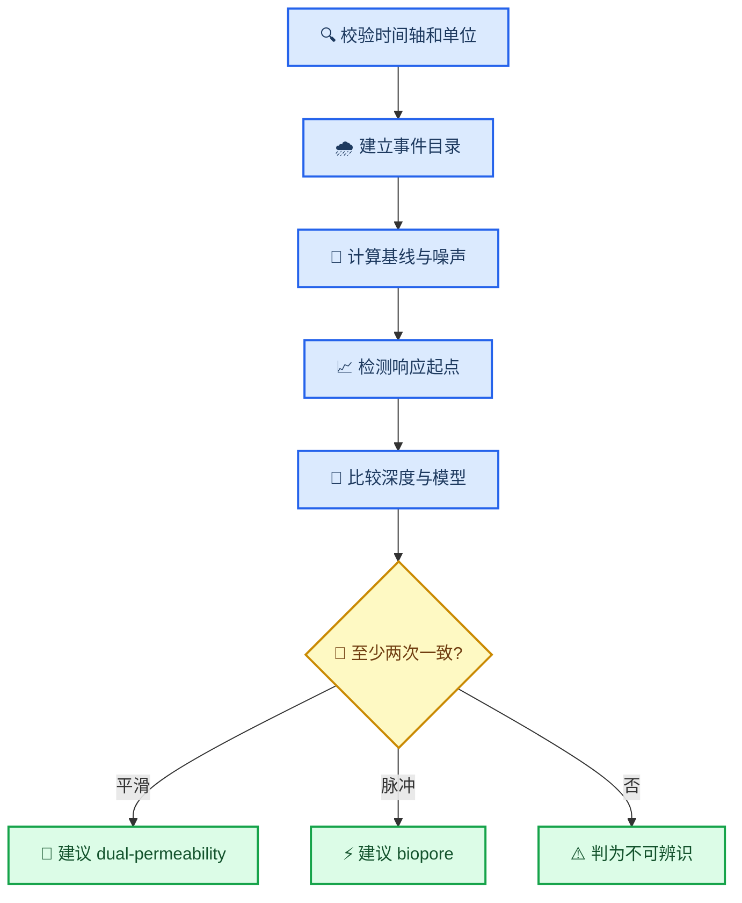

# W0 暴雨事件多深度响应时滞诊断：Grok 任务书

_执行对象：Grok；范围：只读数据诊断与分析产物，不修改 COMPASS 模型代码或生产配置。_

---

## 📋 给 Grok 的直接指令

请在仓库 `F:\COMPASSV1.0` 完成 W0：用质量控制后的长武土壤含水量观测、当前全年模拟和实际地表水通量，判断 50--200 cm 的快速响应更接近：

1. 连续双渗透率的平滑快速传输；
2. biopore/macropore 的脉冲式绕流；
3. 现有数据不足以区分。

本任务只形成证据和模型选择建议。可以新增分析脚本与独立输出目录，但：

- 不改 `src/`
- 不改 `data/sites/changwu/site.toml`
- 不重跑全年模型
- 不打开 `dual_porosity`
- 不实现优先流或迟滞
- 不 commit

完成后把方法、结果、异常、判决和所有产物路径写入同一输出目录的 `W0_decision.md`。

## 🎯 预注册问题

### 主问题

2021 年强降水事件后，观测的 100 cm 和 200 cm 液态体积含水量是否在正常基质湿润锋到达前出现可重复的快速响应？

### 判别假设

| 假设 | 可观测特征 | 模型含义 |
| --- | --- | --- |
| H1：平滑快速双域 | 响应时滞总体随深度增加，深层在数小时至两天内平滑上升 | 优先考虑顺序 dual-permeability |
| H2：脉冲绕流 | 100/200 cm 与浅层近同步，或早于50/70 cm明显湿润；上升陡、持续短 | 优先考虑 biopore/运动波 |
| H0：不可辨识 | 观测缺测、时间分辨率不足、事件重叠或不同事件结论冲突 | 不选方程，先补证据 |

不得把“模型深层响应不足”单独作为 H1/H2 的证明；模型偏差只能与观测的时滞形状共同解释。

## 📚 权威数据

| 数据 | 路径 | 使用字段 |
| --- | --- | --- |
| 质量控制观测 | `tests/integration/changwu_obs_cleaned.xlsx` | 各深度 sheet 的 `time`、`vwc_clean`、`flag_*` |
| 同内容备份 | `data/changwu_obs_cleaned.xlsx` | 仅用于校验两份文件是否一致 |
| 当前全年模拟 | `data/output/yearly_atmospheric_flux_20260720/nc/soil_freezing.nc` | `soil_unfrozen_water`、`depth_node`、`time` |
| 实际地表供水与入渗 | `data/output/yearly_atmospheric_flux_20260720/nc/surface_water.nc` | `surface_liquid_water_supply_amount`、`soil_top_water_amount`、`surface_runoff_amount`、`surface_water_storage_change` |
| 组合水账 | `data/output/yearly_atmospheric_flux_20260720/nc/conservation.nc` | `surface_soil_liquid_input`、水量残差及底排水 |
| 日气象来源 | `data/sites/changwu/forcing.csv` | `precip_mm` 只用于事件日核对 |
| 既有深度映射 | `data/output/yearly_atmospheric_flux_20260720/obs_comparison/depth_mapping.csv` | 观测深度到模型节点 |
| 既有总体比较 | `data/output/yearly_atmospheric_flux_20260720/obs_comparison/README.md` | 背景，不作为时滞结果 |

### 数据语义硬约束

- 观测只保留 `flag==0` 且 `vwc_clean` 有限的数据。
- 模拟必须用 `soil_unfrozen_water`；不能用包含冰等效量的 `soil_moisture`。
- 事件的小时起点必须由 `surface_water.nc` 的实际供水/入渗确定。
- `forcing.csv` 是日尺度，不能把当天 00:00 当作真实小时降雨起点，也不能从日总量虚构小时雨强。
- 模型与观测均保留完整时间轴；缺测不得压缩后计算时滞。

## 🔍 事件选择

### 确认性主事件

| 事件 | 日降水 | 分析窗口 |
| --- | ---: | --- |
| 2021-07-15 | 91.52 mm | 实际小时供水开始前24 h至开始后120 h |

主事件必须单独完整报告，不得因结果不理想而更换。

### 探索性复现事件

从2021年日降水不小于30 mm的日期建立候选集，目前包括：

- 2021-04-24：36.92 mm
- 2021-06-16：35.10 mm
- 2021-08-21：33.80 mm
- 2021-09-18：44.98 mm
- 2021-09-22：44.46 mm
- 2021-09-24：37.18 mm
- 2021-09-25：39.52 mm
- 2021-10-03：79.04 mm
- 2021-10-04：30.42 mm
- 2021-10-05：31.20 mm
- 2021-10-06：46.80 mm

相邻事件按实际小时供水间隔处理：

- 间隔少于72 h时标记为 compound event，不把后一个峰误算成前一个事件的深层响应。
- 确认性统计只纳入事件前至少24 h基线可用、事件后至少72 h观测可用且没有严重重叠的事件。
- 其余事件保留在探索表中，不静默删除。

## 🧪 固定算法

### 深度

确认深度：10、30、50、70、100、200 cm。

补充深度：300、500、700 cm。补充深度只解释深层背景，不参与 W1 方程二选一的主判决。

### 事件起点

按以下顺序确定：

1. 找到候选日期附近第一个正的 `surface_liquid_water_supply_amount` 小时；
2. 若供水被积水暂存，以 `soil_top_water_amount` 首次持续为正作为入土起点，同时保留供水起点；
3. 报告两者差值，不混成一个时间戳。

### 基线与响应阈值

对每个事件、每个深度、观测和模拟分别计算：

- 基线：入土起点前24 h有效值的中位数；
- 基线噪声：该窗口一阶差分的 `1.4826 × MAD`；
- 响应阈值：`max(0.005 m3 m-3, 3 × 基线噪声)`；
- 响应起点：首次连续3个有效时刻高于“基线 + 阈值”，且三点总趋势为上升；
- 峰值时刻：事件起点后120 h内最大增量时刻；
- 响应幅度：峰值减基线；
- 上升时间：响应起点到峰值；
- 初始上升斜率：响应起点后前6 h的稳健线性斜率。

若观测不是严格小时频率，连续3点按真实时间计算；跨度超过6 h不得称为“小时级起点”。

### 缺测规则

- 不跨越超过2 h的缺口插值。
- 若阈值穿越发生在超过2 h的缺口内，响应起点记为区间而不是单值。
- 基线有效点少于12个、事件后72 h有效覆盖不足50%，该事件--深度记为 `insufficient_data`。
- 所有无响应、缺测、事件重叠必须使用不同状态码。

### 时滞指标

对每个事件输出：

\[
L_z=t_{onset,z}-t_{infiltration,start}
\]

以及相对层间时滞：

\[
L_{100-50}=t_{onset,100}-t_{onset,50},\qquad
L_{200-70}=t_{onset,200}-t_{onset,70}.
\]

模型和观测使用同一算法，但不强迫两者具有相同阈值数值。

## 📊 分析流程



## 🎯 判决规则

### 建议 dual-permeability

至少两个质量合格事件同时满足：

- 观测响应时滞总体随深度增加；
- 100/200 cm 在48 h内响应，但不是与表层近同步脉冲；
- 上升持续数小时以上，深度序列相对平滑；
- 当前单基质模型比观测明显更迟或幅度明显更小。

### 建议 biopore/运动波

至少两个质量合格事件同时满足下列核心证据：

- 100或200 cm 在入土后6 h内出现超过阈值的响应；
- 深层起点不晚于50/70 cm超过3 h，或在中层尚未达到阈值时已响应；
- 深层上升时间短、斜率明显陡于单基质模拟；
- 事件总水量允许该响应，不是传感器孤立尖峰。

### 判为不可辨识

出现任一情况不得强选模型：

- 只有2021-07-15一个事件支持结论；
- 深层关键时段缺测或仅有日尺度信息；
- 不同事件在 H1/H2 之间冲突；
- 响应幅度低于阈值；
- 事件复合导致峰值无法归属。

## 📦 交付物

输出目录固定为：

```text
data/output/w0_storm_multidepth_lag_20260720/
```

至少包含：

| 文件 | 内容 |
| --- | --- |
| `event_catalog.csv` | 候选事件、实际供水/入土起止、总量、compound/QC状态 |
| `lag_by_event_depth.csv` | 每事件每深度的基线、阈值、起点、峰值、幅度、斜率、状态码 |
| `model_observation_lag_summary.csv` | 模型与观测时滞/幅度差 |
| `W0_primary_2021-07-15.png` | 主事件供水、入渗及10--200 cm观测/模拟分面图 |
| `W0_event_lag_heatmap.png` | 事件×深度起点时滞热图，缺测显式留空 |
| `W0_depth_lag_profiles.png` | 各事件时滞随深度曲线 |
| `W0_data_qc.md` | 时间轴、单位、重复值、缺测、flag和插值审计 |
| `W0_decision.md` | 最终判决、证据、反证、局限和下一阶段建议 |

允许新增一个可复现分析脚本，例如：

```text
tools/soil/water/analyze_w0_storm_multidepth_lag.py
```

脚本必须只读输入，并在文件头写明上述固定算法和判决阈值。不要覆盖现有 `obs_comparison`。

## ✅ 完成门槛

- 主事件2021-07-15有单独完整结果
- 所有候选事件均有保留/排除原因
- 观测 flag、缺测和真实时间间隔已审计
- 使用实际小时供水/入渗，而不是日降水伪时间
- 使用液态 `soil_unfrozen_water`
- 模型和观测使用同一响应检测框架
- 至少报告一个支持证据和一个反证
- 结论只能是 `dual_permeability`、`biopore` 或 `not_identifiable`
- 没有修改模型代码、生产配置或已有全年输出

完成后停止，不进入 W1 实现；将 `W0_decision.md` 路径和一句话结论交回用户与 Codex 审计。

