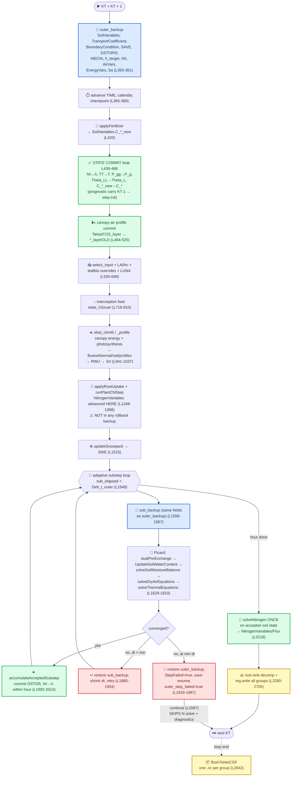

# COMPASS 主循环状态流与 Prognostic State 清单

> 审计文档 §1 + §2 交付物。配套计划见 [main_loop_state_flow_audit.md](main_loop_state_flow_audit.md)。
> 唯一事实来源：[src/COMPASS.m](../src/COMPASS.m)（3046 行，行号锚点对应 commit `bc6b0c2`）。
> 本文档只梳理状态流，不改方程（审计规则 §10）。所有"⚠️ 待审"标记是交给 codex 复核的疑点。

日期：2026-06-20 · 基线：array-kernel 稳定版（`cfg.HydraulicKernel='array'` + `cfg.MatricKernel='array'`）

---

## 1. 主循环状态流

每个外步 `KT`（一个 forcing 小时）把模型从 KT-1 的完整状态推进到 KT。下图是一个 KT 内部的状态转换顺序，标注了**真 prognostic 推进点**、**两级 rollback 边界**和**诊断写出**。

**读图要点**：

- 绿色 = 真 prognostic 推进点；蓝色 = rollback 备份点；红色 = 失败回退；黄色 = 诊断写出。
- **两级 rollback**：`sub_backup` 退当前 trial（缩步重试），`outer_backup` 退整个外步（放弃本小时）。
- **植物 C/N（runPlantCNStep）在子步循环之前推进**，既不在 `outer_backup` 也不在 `sub_backup` 里 → 见 §4 待审疑点。
- **solveNitrogen 在子步循环之后、接受的土壤态上跑一次**；外步失败时 `continue`（L2087）整块跳过。

---

## 2. Prognostic State 清单

下表把每个状态块映射到所属 struct、典型字段、谁更新、是否在 rollback 备份里、输出 group。
"rollback 列"区分两级：**sub**=`sub_backup`（L1556），**outer**=`outer_backup`（L350）。两者字段集合相同（L350-361 vs L1556-1567）。

| 状态块 | struct | 典型字段 | 由谁更新 | 在 backup？ | 输出 group |
|---|---|---|---|---|---|
| 土壤水 | `SoilVariables` | `hh`,`h`,`hOLD`,`Theta_LL`,`Theta_UU`,`Theta_II`,`Theta_L` | `UpdateSoilWaterContent`(L1667), `solveSoilMoistureBalance`(L1714) | ✅ sub+outer | `soil_water`, `conservation` |
| 土壤热 | `SoilVariables`,`EnergyVars` | `TT`,`T`,`TOLD`,`QET`,`QEB`,`Tb`,`Tss` | `solveThermalEquations`(L1806) | ✅ sub+outer（`EnergyVars` 条件存在） | `soil_thermal`, `energy_balance` |
| 土壤气 | `SoilVariables`,`AirVars` | `P_gg`,`P_g`,`P_gOLD`,`Sa` | `solveDryAirEquations`(L1784), `calculateDryAirParameters` | ✅ sub+outer（`AirVars`/`Sa` 条件存在） | `soil_air` |
| 冻融 | `SoilVariables` | `hh_frez`,`h_frez`,`hOLD_frez`,`TT_CRIT`,`T_CRIT` | `HT_frez`(L1661,2071), 状态提交 L444-448 | ✅ 随 `SoilVariables` | `soil_thermal` |
| 地表水 | `BoundaryCondition`,局部标量 | `DSTOR`,`DSTOR0`,`RS`,`NBChh`,`h_target`,`hN` | 子步内 trial(L1996-1998), 边界逻辑 L401-414 | ✅ sub+outer（各自单列字段） | `surface_water`, `conservation` |
| 土壤氮 | `SoilVariables`,`NitrogenVariables`,`NitrogenFlux` | `C_NH4_new`,`C_NO3_new`,`C_Urea`,反应源项,`cum_*` | `solveNitrogen`(L2218)，**外步接受后**一次 | ⚠️ 仅随 `SoilVariables` 部分入 backup；`NitrogenVariables`/`NitrogenFlux` 不在 backup | `soil_nitrogen`, `soil_oxygen` |
| 冠层能量/光合 | `fluxes`,`thermal`,`profiles`,`rad`,`canopy` | `Tch`,`Tcu`,`GPP`,`LE`,`H`,叶温,辐射 | `ebal_clm45`(L946) | ❌ 不在 backup（每 KT 由 ebal 重算，诊断口径） | `energy_balance`, `carbon_fluxes`, `canopy_profiles` |
| 冠层水库 | 局部状态 | `state_h2ocan`,`state_h2ocan_sun/sha`,`fwet` | 截留物理 L716-810, 蒸发 L1415-1513 | ❌ 不在 backup（进 ResumeState 磁盘检查点 L1969） | `surface_water` |
| 植物水力 | `plantHydro`,可选 `W_plant_state` | 根导度,叶水势,水分胁迫 | ebal 内水力求解器；`dynamic` 时 off-loop wrapper(L955-960) | ❌ 不在 backup | `plant_hydraulics` |
| 植物 C/N | `NitrogenVariables` | C/N 池,NSC,分配,actual/potential 呼吸,`C_leaf`,`C_labile` | `runPlantCNStep`(L1368)，**子步循环之前** | ⚠️ **不在 backup**（外步失败不回退）— 见 §4 | `plant_nitrogen`, `carbon_fluxes` |
| 物候/LUNA | `phen_state`,`luna_state`,`luna_clim` | `phen_now`,`Vcmax25_z`,10 天气候缓冲 | phenology(L193), LUNA daily(L665) | ❌ 不在 backup | `plant_nitrogen`, `deep_learning` |
| 纯诊断 | `reg`,局部 history 数组 | 输出用字段（`EVAP`,`QMT`,`Throughfall`...） | `reg.write`(L2458+), `finalizeHourlySubstepOutputs`(L2061) | ❌ 不恢复（重算） | 所有 NetCDF groups |

---

## 3. §1 关键问题的回答

| 问题 | 回答（带行号） |
|---|---|
| 每个 KT 真正的 prognostic state？ | 土壤水/热/气/冻融（`SoilVariables` 的 `hh/TT/P_gg/Theta_*/*_frez`）、地表水（`DSTOR/RS`）、土壤氮（`C_*_new`）、植物 C/N（`NitrogenVariables` 池）、冠层水库（`state_h2ocan*`）、物候/LUNA 累积量。 |
| 哪些只在 trial 里临时有效？ | Picard guess 的 `hh/TT/P_gg`、`TransportCoefficient` 全部系数、`MatricCoeff`、`AirVars`、`Sa`、`RS_trial`/`DSTOR_trial`、`hourAccum`。被 `sub_backup` 覆盖（L1556）。 |
| rollback 必须恢复哪些？ | `outer_backup` 恢复的 11 项：`SoilVariables`,`TransportCoefficient`,`BoundaryCondition`,`SAVE`,`DSTOR`,`DSTOR0`,`NBChh`,`h_target`,`hN`,`AirVars`,`EnergyVars`,`Sa`（L350-361 / 恢复 L1919-1928）。 |
| 哪些只是诊断量、不该手动恢复？ | `fluxes/thermal/rad/profiles`（ebal 每 KT 重算）、所有 `reg` history 数组、`finalizeHourlySubstepOutputs` 的小时累加输出。 |
| 哪些是设计的一步滞后？ | (a) **LAI**：`computeLAIfromPhen` 用 `phen_now` + `C_leaf(KT-1)`，CLM5 推荐的 leafC↔LAI 解耦滞后（L568-577）。(b) **植物 C/N 输入**：ebal 用上一 KT 的池子状态，runPlantCNStep 在 ebal 之后才更新池子。 |

---

## 4. ⚠️ 待审疑点（交 codex 复核）

1. **植物 C/N 不随外步 rollback 恢复**。`runPlantCNStep`（L1368）在子步循环**之前**推进 `NitrogenVariables`；外步失败走 `continue`（L2087）只恢复 `SoilVariables` 等 11 项（`outer_backup` 不含 `NitrogenVariables`）。结果：一个土壤侧"失败"的小时，植物 C/N 已经advance且保留。审计文档 §2 写"植物 C/N 外步失败时需要[恢复]"，与现状不符。
   - *判据*：外步失败是否罕见到可忽略？若构造一个会触发 min-dt 失败的窗口，植物 C 守恒残差是否被污染？
2. **土壤氮 backup 不一致**。`C_NH4_new/C_NO3_new` 随 `SoilVariables` 进 `outer_backup`，但 `NitrogenVariables`/`NitrogenFlux`（累积通量 `cum_*`）不在 backup。外步失败时 `solveNitrogen` 被 `continue` 跳过（未推进，自洽），但需确认 `cum_*` ledger 不会因失败步错位。
3. **冠层水库 `state_h2ocan*` 不在 backup**。外步失败时它已被本 KT 的截留/蒸发推进（L716-1513）且不回退；只进 ResumeState 磁盘检查点（L1969）。需确认冠层水守恒残差（`canopy_water_residual`）在失败步的处理。
4. **`sub_backup` 与 `outer_backup` 字段集合相同**（L350-361 vs L1556-1567）——确认无遗漏字段（如新增的状态块加入时两处都要改）。

---

## 5. 验证目标（每个 cleanup 必须挂一个）

- 状态相等：3 天冬季冻融窗 + 困难窗，array vs scalar kernel 逐值 A/B（看被测路径 marker，防配置还原竞态假阳）。
- 守恒闭合：`water_balance_residual`、N 守恒 `nh4/no3_cum_residual`、`canopy_water_residual`。
- 观测不退化：土壤温度/含水量剖面、ET、GPP（硬生理靶 + 软通量靶）。

---

*本文档为状态流审计的 §1+§2 产物。下一步（§3 土壤 inner-solve 流程图标 rollback 边界）依赖本表确认的 backup 字段集合。*
